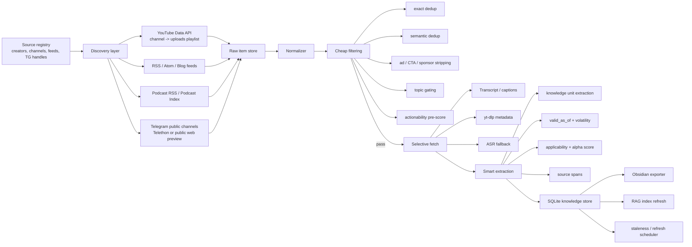
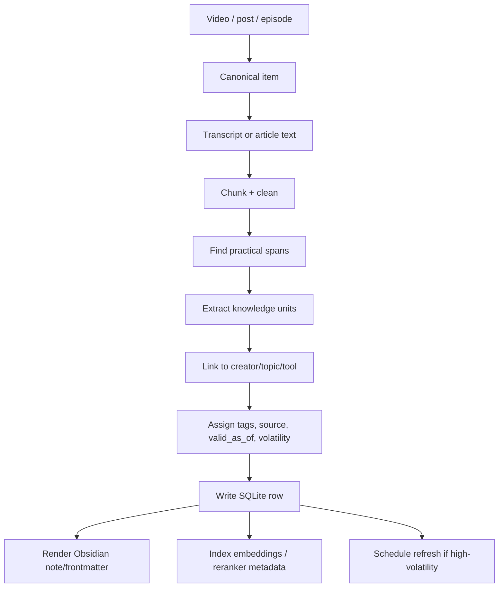
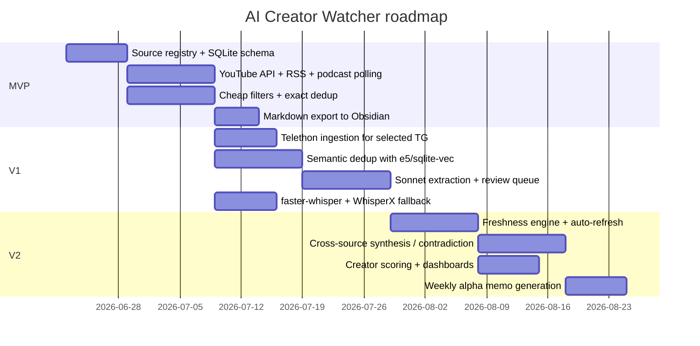

# DR26-06-22-HUB-01 — raw report from practical

> Unedited output of one model. Our reconciled synthesis is the page one level up.

# Designing an AI Creator Watcher for Practical Knowledge Capture

## Executive summary

The highest-lelihood way to make an “AI Creator Watcher” useful inside a large Obsidian vault is **not** to build a universal media ingestion monster first. It is to build a **strictly opinionated watcher** that optimizes for five things in order: **ingestability, dedupability, actionability, time-validity, and export cleanliness**. In practice, that means: discover content cheaply, fetch only when warranted, strip sponsor/news boilerplate before any LLM touch, extract only *atomic practical claims* with source spans, and push those into SQLite + Obsidian with explicit `valid_as_of`, `volatility`, `applicability_score`, and `refresh_after`. The cheapest reliable primitives are already available in the stack you described: YouTube Data API for discovery, RSS/podcast feeds for low-friction polling, Telethon for public Telegram channels where you accept the risk envelope, local Whisper/faster-whisper/WhisperX for ASR fallback, E5 for semantic operations, and SQLite as the state machine. citeturn2search5turn2search6turn3search0turn4search0turn28search0turn31search1turn28search1

The most important architectural choice is a **two-pass pipeline**. Pass one should be cheap and brutal: normalize, dedup, classify, strip ads/self-promo/housekeeping, and reject most items without using frontier models. Pass two should be selective and evidence-oriented: use Sonnet-class extraction only on survivors that already look practical, then use Opus-class synthesis only for cross-source clustering or weekly digests. This materially reduces cost and reduces the failure mode where expensive models invent “insights” from weak material. WhisperX, faster-whisper, sentence-transformer similarity, and vector search in SQLite all support this low-cost-first design. citeturn29academia68turn28search0turn8search0turn28search1

For freshness, the right mental model is not “store notes forever.” It is “store knowledge units with decay.” Advice about **specific model behavior, UI flows, pricing, agent tricks, or editor shortcuts** expires far faster than **PKM principles, evaluation methods, or architectural patterns**. A note without `valid_as_of`, `volatility`, and `refresh triggers` will rot silently. You already called this correctly in your prompt; the system should make staleness first-class. That is especially crucial because creator content often republishes the same idea across YouTube, Telegram, newsletters, and podcasts with slightly different packaging. citeturn14search1turn11search0turn15search0turn22youtube47turn19search0

On sources, the safest discovery paths are **official feeds and APIs**. For YouTube, use the Data API to get the channel uploads playlist instead of leaning on `search.list` for everything, because quota economics strongly favor channel → uploads-playlist discovery over repeated search-heavy polling. For Telegram, MTProto clients such as Telethon are more capable than the Bot API for reading channel history, but they also sit closer to Telegram’s policy boundary and should be treated accordingly. For podcasts, RSS remains operationally easiest, with Podcast Index useful for discovery and feed lookup. citeturn2search5turn2search6turn2search7turn4search0turn3search0turn33search2turn32search0

My bottom-line recommendation is:

- **MVP**: 25–40 sources, YouTube + RSS + podcast RSS first, Telegram second, no full “agent” behavior, simple reviewer queue, SQLite-first, Obsidian markdown export.
- **V1**: semantic dedup, SponsorBlock-assisted cleaning, Sonnet extraction, freshness engine, backfill jobs.
- **V2**: cross-creator synthesis, contradiction detection, automated refresh of stale notes, creator scoring, and weekly “alpha memo” generation.

Confidence on this overall architecture: **established** for the ingestion/cost structure, **emerging** for alpha scoring and automated refresh, **speculative** only where manual editorial judgment is replaced by a strong automatic “practical value” classifier. citeturn27search2turn26search2turn26search1turn26search3turn28search2turn30search0

## Curated creator universe

### Selection logic

This is a **curated watchlist**, not a mathematically ranked “top creators” list. I prioritized creators and creator-entities that are: practical rather than purely newsy, active in 2025–2026, relevant to AI/coding/PKM/agent workflows, and reasonably ingestable through official sites, YouTube, RSS, or public Telegram. Where official surfaces did not expose cadence clearly, I used secondary analytics/mirrors and marked confidence down accordingly. Pure hype/news channels were de-prioritized unless they are useful as raw signals after aggressive filtering. citeturn15search0turn22youtube47turn19search0turn16search3turn17search1

### English creators and creator entities

| Creator | Primary channels | Niche | Approx frequency | RSS/API/public feed status | Confidence |
|---|---|---|---|---|---|
| Simon Willison citeturn14search1turn14search0 | Blog / newsletter / code repos | LLM engineering, coding agents, evals, tool-use, practical experiments | Near-daily | Blog/Atom available; web-native | established |
| Ethan Mollick citeturn11search0turn11search1 | Substack / social | Practical AI use, work/education implications, model/product workflows | Weekly-ish | Newsletter/RSS-style delivery via Substack | established |
| Hamel Husain citeturn12search1 | Blog / courses / talks | Applied AI engineering, evals, RAG, debugging AI products | Monthly-ish longform | Blog feed-friendly | established |
| Nicole van der Hoeven citeturn13search2turn13search4turn13search8 | Blog / YouTube / talks | Obsidian/PKM, AI for notes, observability for PKM | Weekly to monthly | Site publishes posts with video embeds; scraping friendly; RSS common via Hugo-style sites | established |
| Nick Milo / Linking Your Thinking citeturn17search1turn17search0turn17search6 | Website / blog / YouTube / email course | PKM, Obsidian, linked notes, ideaverse workflows | Weekly-ish across properties | Blog + email + YouTube surfaces | established |
| kepano citeturn16search3 | Obsidian blog | Obsidian product strategy, workflows, vault philosophy | Irregular but important | Official Obsidian blog with RSS | established |
| Jeremy Howard / fast.ai citeturn16search4turn16search5 | Personal site / fast.ai course / talks / YouTube | Practical deep learning, AI engineering, open-source implementation | Periodic course/talk drops | Course site + videos + blog-like surfaces | established |
| ArjanCodes citeturn12search0turn12search2turn12search6 | Website / blog / YouTube / weekly newsletter | Software design, Python, increasingly adjacent AI coding workflows | Weekly | Blog + newsletter + YouTube | established |
| Greg Kamradt / DataIndependent citeturn35search1turn35search0turn35search2 | Personal site / YouTube / talks | Building AI apps, evaluation, long-context testing, productized dev tutorials | Periodic, tutorial-driven | Website + YouTube channel; feed status unspecified | established |
| Matt Wolfe citeturn19search0turn19search4 | Website / YouTube / newsletter / podcast | AI tools, product updates, creator workflows, coding-adjacent AI tools | Multiple times weekly | Site has latest videos/podcasts/blog; newsletter available | established |
| Fireship / Jeff Delaney citeturn22youtube47turn20search0 | YouTube / site / newsletter | Fast coding tutorials, tech news, AI/coding tool coverage | Weekly+ | Official YouTube; newsletter/site | established |
| Latent Space citeturn15search0turn15youtube25 | Podcast / YouTube / newsletter | AI engineering, agents, infra, coding, model/tool interviews | Weekly | Podcast feed + YouTube + newsletter | established |
| Andrej Karpathy citeturn34search1turn34search3turn34youtube48 | Personal site / YouTube / talks | Deep technical AI education, Software 3.0, LLM mental models | Irregular but high-signal | YouTube + website; RSS unspecified | established |
| Mckay Wrigley citeturn34search0 | Website / posts / teaching | AI building, agent workflows, Claude-oriented practicals | Irregular but topical | Website posts; feed unspecified | emerging |
| Sam Witteveen citeturn23search1 | YouTube | LLMs, autonomous agents, applied AI engineering | Weekly | Official channel exists; cadence from secondary channel analytics | emerging |
| Cole Medin citeturn36search1 | YouTube | AI agents, AI coding assistants, project-based implementation | Daily to weekly | Official channel exists; cadence from secondary channel analytics | emerging |
| Theo Browne / t3.gg citeturn20search2 | YouTube / T3 ecosystem | AI-native dev workflows, TypeScript, app-building, taste/critique | Several times weekly | Official channel exists; cadence from secondary analytics | emerging |
| David Ondrej citeturn16search1turn16search2 | YouTube | Cursor usage, prompt patterns, vibe-coding/operator tips | Unclear current cadence; was active in 2025 | Public video surface; feed/API unspecified | speculative |
| ThePrimeagen citeturn23search2turn36search54 | YouTube / streams | High-energy software engineering commentary, tools, dev culture, occasional AI/coding reactions | Unscheduled | Official handle public; cadence data weak in source set | speculative |

### Russian creators and creator-adjacent channels

| Creator | Primary channels | Niche | Approx frequency | RSS/API/public TG status | Confidence |
|---|---|---|---|---|---|
| ITBeard citeturn9youtube25turn24search0 | YouTube / Telegram | Broad developer content with strong AI, CV/ML, and future-of-dev interviews | Weekly-ish video + Telegram | Public TG and YouTube | established |
| Миша Ларченко citeturn24search1turn9youtube24turn24search2 | Website / YouTube / Telegram | Programming, AI coding discussion, career/dev commentary | Frequent | Public site + YouTube + Telegram links | established |
| Таня Румянцева / myspacet_ai citeturn9search1turn9search6 | Telegram | Neural tools, automation, n8n, practical bot/build workflows | Frequent | Public Telegram channel | emerging |
| Александр Горный / Стартап дня citeturn25search5turn25search2 | Telegram | Startups, internet business, AI/startup market signal | Daily-ish | Public Telegram channel | established |
| Вастрик citeturn37search3turn37search4 | Blog / Telegram | Tech, indie-hacking, privacy/self-hosting, occasional AI tooling | Periodic longform + Telegram | Public Telegram + blog | established |
| addmeto / Бобук citeturn37search1turn37search8 | Telegram | IT/tech links, source aggregation, strong raw-signal channel but news-heavy | Very frequent | Public Telegram channel | emerging |
| Сергей Жданов citeturn25search0 | Telegram | AI/tech commentary | Unclear / light public evidence | Public Telegram channel | speculative |
| Stepan Gershuni citeturn37search5turn37search12 | Medium / vc.ru | AI futures, coordination, cyber-economy, essay-driven analysis | Irregular | Public writing surfaces; TG signal weak in source set | speculative |
| Hi, AI! ecosystem citeturn37search11 | Telegram media ecosystem | Broad AI media, bots, channels; useful as discovery layer more than trusted teacher | High-volume | Public Telegram-centric ecosystem | speculative |
| CyberTopus citeturn9search4 | Telegram | Programming, AI, neural-network links/posts | Frequent reposting/aggregation | Public Telegram channel | speculative |
| Арсений Кравченко citeturn9youtube25 | Telegram / appearances | ML/CV, future of programming, technical AI discussion | Unclear from source set | TG channel referenced in official interview notes; direct handle not verified here | speculative |

### Practical recommendation on the watchlist

If the goal is **alpha, not entertainment**, I would not start by monitoring all 30 equally.

Use this priority split:

- **Tier A core watchlist**: Simon Willison, Ethan Mollick, Hamel Husain, Nicole van der Hoeven, Nick Milo, kepano, Jeremy Howard, Greg Kamradt, Latent Space, Andrej Karpathy, ArjanCodes, ITBeard, Миша Ларченко. citeturn14search1turn11search0turn12search1turn13search2turn17search1turn16search3turn16search4turn35search1turn15search0turn34search1turn12search0turn9youtube25turn24search1
- **Tier B opportunistic**: Matt Wolfe, Fireship, Mckay Wrigley, Sam Witteveen, Cole Medin, Theo Browne, Таня Румянцева, Александр Горный, Вастрик. These are useful but require stronger filtering because noise/novelty/creator-style variance is higher. citeturn19search0turn22youtube47turn34search0turn23search1turn36search1turn20search2turn9search1turn25search5turn37search4
- **Tier C discovery-only**: addmeto, Hi, AI!, CyberTopus, speculative channels. Watch them for source discovery, not note creation, unless an item survives your alpha filter. citeturn37search8turn37search11turn9search4

## Recommended pipeline architecture

### Architectural principle

Treat the watcher as a **content refinery**, not a summarizer. The system should convert heterogeneous media into a small number of **knowledge units**: each unit is a practical claim, workflow pattern, tool caveat, or reusable instruction with provenance and decay metadata. Everything else is exhaust. citeturn14search0turn12search1turn29academia68

### End-to-end architecture



### Data flow from media to note



### Ingestion choices by source

#### YouTube

**Recommended default**: use the **YouTube Data API for discovery and metadata**, and use `yt-dlp` or transcript extraction only on items that survive cheap filtering. The reason is quota economics and control. `channels.list` exposes the channel’s uploads playlist, which you can poll cheaply; by contrast, `search.list` is expensive and should be reserved for discovery or backfills. Google’s quota documentation is explicit that method costs differ substantially and that all requests consume quota. citeturn2search5turn2search6turn2search7

Recommended decision rule:

- **Discovery / polling**: YouTube Data API.
- **Transcript available**: prefer creator-provided/user-provided captions if accessible through your tooling.
- **No transcript or poor transcript**: local ASR fallback with faster-whisper; use WhisperX when you need better word timestamps or diarization. citeturn28search0turn31search1turn29academia68

Operational guidance:

- Poll only the **uploads playlist** per creator.
- Store only metadata first: `video_id`, `published_at`, duration, title, description, thumbnails, captions-available flag.
- Fetch transcript/audio only if the item passes topical and alpha pre-filters.
- Cache transcript hash and caption language list separately to avoid repeat fetches. citeturn2search6turn2search7turn28search0

#### Telegram

For public Telegram channels, **Telethon / MTProto** is more capable than the Bot API when you need history access, entity resolution, and updates. Telethon’s docs are explicit about direct message retrieval methods and about the difference between Bot API and MTProto: MTProto gives fuller access and lower overhead, but it also increases your operational and policy burden. Session files are sensitive and must be handled accordingly. citeturn3search0turn3search1turn4search0turn3search5

Practical recommendation:

- **MVP**: use public channel previews or simple fetches where possible; keep Telegram ingestion narrow.
- **V1+**: use Telethon under a dedicated account and isolate the session file.
- Avoid Bot API as the primary ingestion layer for creator monitoring; it is not the right tool for broad public-channel history collection. citeturn4search0turn3search6

#### RSS and blogs

For blogs, newsletters, and many site-backed creator properties, **RSS/Atom is the lowest-friction ingest path**. FreshRSS and Miniflux are mature self-hosted feed readers and good operational anchors for polling, deduping feed entries, and exposing programmatic reads later. citeturn26search2turn26search1

My recommendation:

- Use **Miniflux** if you want a minimal API-backed reader.
- Use **FreshRSS** if you want broader extension/community surface.
- Normalize every feed entry into the same `content_item` schema as YouTube/Telegram items. citeturn26search2turn26search1

#### Podcasts

For podcasts, the primary ingestion path should be **podcast RSS feeds**. Podcast Index is useful for discovery and feed lookup, and Podgrab is a workable self-hosted archiver/downloader if you want episode retention or offline ASR workflows. citeturn33search2turn32search0

Recommended split:

- Use **Podcast Index** to discover canonical feed URLs and metadata.
- Poll **the feed itself** thereafter.
- Keep audio download optional; download only when transcript quality matters or no transcript exists. citeturn33search2turn32search0

### Dedup strategy

Use **three layers of dedup**:

#### Exact dedup

Use normalized identity keys:

- `platform + creator_id + external_item_id`
- normalized URL
- transcript/content SHA-256
- title+published_at coarse key

This removes literal duplicates and re-fetch loops.

#### Near-duplicate dedup

Use text normalization + **MinHash/SimHash** on cleaned transcript/article text after boilerplate stripping. This catches creator reposts, mirrored newsletters, podcast show-note clones, and YouTube description/article duplicates.

#### Semantic cross-platform dedup

Use **E5 embeddings** on:
- title
- short abstract
- extracted “practical passage”
- creator identity features

Then cluster by cosine similarity, with creator-aware and date-aware thresholds. Sentence-transformers documentation provides the semantic similarity primitive; E5 remains a strong general-purpose multilingual retrieval family and fits your existing stack. citeturn8search0turn8academia36turn8academia37

A workable production rule:

- If `same creator` and `similarity >= 0.93` within 21 days → merge aggressively.
- If `different platform, same creator` and `similarity >= 0.89` within 30 days → canonicalize to one source-cluster.
- If `different creators` and `similarity >= 0.91` → cluster for synthesis, do **not** dedup away.

### Pre-LLM ad and noise cleaning

This step matters more than most people think. If you let the LLM see sponsor reads, affiliate CTAs, repeated intro scripts, and “three pieces of news” filler, you will poison both extraction quality and your applicability score.

Use four pre-LLM cleaners:

#### Marker-based trimming

Detect and remove:
- intro/outro blocks
- “like/subscribe/comment” asks
- sponsor disclosure lines
- conference/event housekeeping
- repeated channel boilerplate

For YouTube, a practical optimization is to use **SponsorBlock** data where available as a prior for sponsored and self-promo segments, then fall back to regex/timestamp heuristics. SponsorBlock exists specifically to identify sponsored and other skippable segments in YouTube videos. citeturn26search3turn26reddit55

#### Regex heuristic layer

Examples:

```regex
(?i)\b(this video is sponsored by|thanks to .* for sponsoring|use code [A-Z0-9]+|affiliate link|link in the description|smash that like button|subscribe\b|join my newsletter|follow me on)\b
```

Also strip dense URL blocks, coupon codes, sponsor chapter labels, and repeated disclaimer paragraphs.

#### Structural cues

Down-rank or drop segments that contain:
- no examples
- no commands/code/config
- no tool names beyond headlines
- no first-hand experiment signal
- high proper-noun density but low procedural density

That reliably catches “AI news recaps” masquerading as practical content.

#### Newsiness gate

Compute a simple `newsiness_score` from lexical and structural signals:
- release-report verbs without implementation verbs
- many company/model names, few user actions
- no failure mode, no benchmark, no example, no workflow delta

If `newsiness_score` is high and `actionability_score` is low, store only as **topic telemetry**, not as a note candidate.

### Two-pass processing

#### Pass one cheap filter

Use SQL/regex/embeddings before any expensive model.

Outputs:
- `topic_match`
- `language`
- `dedup_status`
- `transcript_quality`
- `actionability_prescore`
- `newsiness_score`
- `promo_score`
- `candidate_priority`

Only pass items onward when:

```text
topic_match = true
AND actionability_prescore >= 0.35
AND promo_score <= 0.45
AND dedup_status != merged
```

This pass should be deterministic or near-deterministic, debuggable, and fast.

#### Pass two smart extraction

Use Sonnet-class extraction on survivors. Prompt it to extract only:

- reusable workflow
- prompt pattern
- coding/agent tactic
- tool limitation
- benchmark/evaluation lesson
- architecture pattern
- contrarian correction to popular misinformation

For each candidate knowledge unit, require:

- source span quotation or precise transcript offsets
- one-sentence claim
- practical takeaway
- applicability conditions
- likely shelf-life
- confidence
- related tools/models

Then use Opus-class synthesis only on clusters with at least two corroborating items, or for a weekly memo.

### Alpha detection

Use an explicit score. Otherwise the system will drift toward “interesting,” which is exactly how vaults get polluted.

I recommend:

```text
alpha_score =
  0.30 * actionability
+ 0.20 * novelty
+ 0.15 * specificity
+ 0.15 * evidence
+ 0.10 * relevance_to_you
+ 0.10 * durability
- 0.15 * promo_penalty
- 0.10 * newsiness
```

Each component normalized to 0–1.

Suggested definitions:

- **actionability**: can you do something concrete after reading it?
- **novelty**: new relative to your existing vault/RAG cluster?
- **specificity**: commands, configs, prompts, architecture details, code, numerical thresholds.
- **evidence**: demos, measurements, reproduced results, failure cases.
- **relevance_to_you**: matches your active themes.
- **durability**: likely to remain true/useful beyond a short product cycle.
- **promo_penalty**: affiliate/course/self-branding load.
- **newsiness**: commentary on releases without transferable takeaways.

Routing:

- `alpha_score < 0.40` → discard or telemetry only
- `0.40–0.60` → queue for human skim
- `> 0.60` → auto-extract into draft note
- `> 0.75` and corroborated by ≥2 sources → promote to evergreen playbook candidate

Confidence: **emerging**. The formula is sound as an operational heuristic, but you will need calibration data from your own accept/reject history.

### Knowledge unit data model

I would not store “notes” as the primary object. Store **knowledge units**, then render notes from them.

#### SQLite schema sketch

```sql
create table content_item (
  id text primary key,
  platform text not null,              -- youtube, telegram, rss, podcast, blog
  creator_id text not null,
  external_id text,
  canonical_url text,
  title text,
  published_at text,
  fetched_at text not null,
  language text,
  raw_text text,
  cleaned_text text,
  transcript_quality real,
  promo_score real,
  newsiness_score real,
  topic_flags text,                    -- JSON
  content_hash text,
  semantic_fingerprint text
);

create table knowledge_unit (
  id text primary key,
  content_item_id text not null references content_item(id),
  cluster_id text,                     -- cross-source synthesis cluster
  claim text not null,                 -- atomic claim
  practical_takeaway text,
  evidence_span text,                  -- quote / timestamps / paragraph refs
  tags text,                           -- JSON array
  source_type text,                    -- tutorial, rant, benchmark, release reaction
  valid_as_of text not null,
  volatility text not null,            -- low, medium, high, critical
  half_life_days integer not null,
  applicability_score real not null,
  alpha_score real not null,
  confidence_label text not null,      -- established, emerging, speculative
  tool_entities text,                  -- JSON array
  model_entities text,                 -- JSON array
  supersedes_unit_id text,
  refresh_after text,
  stale_after text,
  created_at text not null,
  updated_at text not null
);

create table creator (
  id text primary key,
  display_name text not null,
  language text,
  niche text,
  source_priority integer,
  noise_baseline real,
  alpha_baseline real,
  ingest_method text,                  -- api, rss, telethon, yt-dlp, podcast-rss
  cadence_hint text
);
```

#### Obsidian frontmatter render

```yaml
---
type: knowledge_unit
title: "Claude Code benefits from explicit repo rules plus narrow-task prompting"
source_creator: "David Ondrej"
source_platform: "youtube"
source_url: "..."
published_at: 2025-01-17
valid_as_of: 2025-01-17
volatility: high
half_life_days: 60
applicability_score: 0.82
alpha_score: 0.71
confidence: emerging
tags:
  - ai-coding
  - cursor
  - claude-code
  - prompting
related_tools:
  - Cursor
  - Claude
source_spans:
  - "00:07:31-00:09:02"
supersedes: null
refresh_after: 2025-03-18
stale_after: 2025-05-17
---
```

This is the cleanest shape for later RAG and staleness management.

## Freshness, decay, and auto-refresh rules

### The decay function

Use exponential decay. It is simple, composable, and matches the operational reality that many tool-specific tips lose value quickly.

```text
freshness(age_days, half_life_days) = exp(-ln(2) * age_days / half_life_days)
```

This gives:
- freshness = 1.0 at day 0
- freshness = 0.5 at one half-life
- freshness = 0.25 at two half-lives

Then define:

```text
effective_utility = alpha_score * applicability_score * freshness * confidence_factor
```

Where:
- `confidence_factor = 1.0` for established
- `0.85` for emerging
- `0.65` for speculative

### Recommended half-lives

This table is a **design heuristic**, not an industry standard.

| Content type | Typical examples | Half-life | Confidence |
|---|---|---:|---|
| Model UI / pricing / release-specific walkthroughs | “How to use new Codex tab”, “GPT pricing changes” | 30 days | emerging |
| Editor/agent tactics for frontier coding tools | Cursor/Claude Code/Codex prompts, vibe-coding tactics | 45–90 days | emerging |
| API integration patterns | webhook patterns, environment setup, tool interop | 90–180 days | established |
| Evaluation and RAG methods | eval design, retrieval tuning, reranking patterns | 180–365 days | established |
| PKM method / vault structure | linking strategy, evergreen-note method, note review design | 365–730 days | established |
| Strategic essays | “what changes for work”, “software 3.0” | 180–365 days | emerging |

This split is consistent with the observed cadence differences between creator surfaces covering frontier product behaviors versus slower-changing knowledge-management principles and engineering methods. citeturn14search1turn11search0turn13search4turn15search0turn22youtube47turn19search0

### Auto-refresh rules

#### Hard refresh triggers

Refresh immediately if any of the following occurs:

- new source from same creator/topic cluster with semantic similarity `>= 0.88`
- tool/model version mentioned in note is superseded
- note cites UI/price/feature behavior for a fast-changing product
- freshness drops below `0.35` and the note has been retrieved recently from RAG
- contradiction detected from newer high-confidence source

#### Soft refresh triggers

Queue for review when:

- `age_days >= 0.8 * half_life_days`
- note is linked by ≥3 active project notes
- it belongs to an active theme this month
- user manually favorited or recently opened it

#### Retirement rules

Archive or demote when:

- `freshness < 0.20`
- no retrieval hits in 180 days
- superseded by a newer knowledge unit
- low-confidence note contradicted twice by newer established sources

### Example calculations

#### Example A

A Cursor tactic note:
- `alpha_score = 0.74`
- `applicability_score = 0.85`
- `half_life = 60`
- age = 45 days
- confidence = emerging → `0.85`

Then:

```text
freshness = exp(-ln2 * 45/60) = 0.595
effective_utility ≈ 0.74 * 0.85 * 0.595 * 0.85 = 0.318
```

Interpretation: still useful, but already falling into review territory.

#### Example B

A PKM structuring note:
- `alpha_score = 0.62`
- `applicability_score = 0.90`
- `half_life = 540`
- age = 180
- confidence = established → `1.0`

```text
freshness = exp(-ln2 * 180/540) = 0.794
effective_utility ≈ 0.62 * 0.90 * 0.794 * 1.0 = 0.443
```

Interpretation: still robust and probably worth keeping as an evergreen note.

## Open-source tools with the least custom code

### Tool inventory

| Layer | Tool | What it solves | Pros | Cons | Integration notes |
|---|---|---|---|---|---|
| Feed ingestion | Miniflux citeturn26search2 | Minimal self-hosted feed reader with API | Simple, stable, API-friendly | Less extensible than heavier readers | Good as canonical RSS polling service |
| Feed ingestion | FreshRSS citeturn26search1 | Self-hosted RSS reader/aggregator | Mature ecosystem, lots of extensions | Heavier operationally | Good if you want aggregator + user UI |
| Workflow orchestration | n8n citeturn27search2turn27search0 | Visual automation and glue | Fast to stand up, many connectors | Security hygiene matters, fair-code not OSI | Use for polling + routing, not core extraction logic |
| YouTube/media fetch | yt-dlp citeturn1search1 | Media metadata/subtitles/download | Battle-tested, broad extractor coverage | Policy sensitivity on some platforms | Use only after cheap filtering; do not make it your discovery layer |
| Telegram ingestion | Telethon citeturn3search0turn4search0 | MTProto access to channels/history | Powerful, flexible, direct | Session handling risk, policy sensitivity | Best for V1+, not necessarily MVP |
| Speech-to-text | faster-whisper citeturn28search0 | Fast local Whisper inference | Cheap, fast, quantization-friendly | Less alignment detail than WhisperX | Best default ASR fallback |
| Timestamp alignment | WhisperX citeturn31search1turn29academia68 | Word timestamps, VAD, diarization hooks | Better long-form timestamp quality | More moving parts | Use when source spans matter |
| Speaker diarization | pyannote.audio citeturn27search1turn27academia56 | Multi-speaker segmentation | Strong diarization stack | Setup and model access overhead | Use for podcasts/interviews, not all media |
| Ad/noise cleanup | SponsorBlock citeturn26search3turn26reddit55 | Crowdsourced sponsor timestamps | Excellent for YouTube boilerplate removal | Coverage depends on community tags | Use as prior, not sole truth |
| Embeddings/similarity | Sentence Transformers + E5 citeturn8search0turn8academia36turn8academia37 | Semantic dedup/retrieval similarity | Strong multilingual baseline | Needs threshold tuning | Fits your current e5 stack |
| Local vector search | sqlite-vec citeturn28search1 | SQLite-native vector search | Tiny, local, no extra server | Fewer bells/whistles than big vector DBs | Excellent fit for SQLite layer |
| RAG framework | Haystack citeturn28search2 | Production RAG pipelines | Strong modular pipelines | Another framework to own | Good if you need larger orchestrated pipelines |
| RAG framework | LlamaIndex citeturn30search0 | Document/RAG/agent stack | Rich ecosystem | Easy to over-adopt | Use selectively, not as a default dependency |
| Podcast archiving | Podgrab citeturn32search0 | Self-hosted podcast downloader/player | Simple, offline-friendly | Older project cadence, more niche | Good for feed-to-audio archive |
| Obsidian sync/versioning | Obsidian Git plugin citeturn29search1turn29search2 | Git backup/sync inside Obsidian | Convenient, mature plugin | Mobile caution | Good for note artifact history |
| Obsidian programmatic write | Local REST API with MCP plugin citeturn30search1 | API access into vault | Clean automation interface | Depends on plugin availability/ops | Great if you want service-based vault writes |

### Minimal-code recommended stack

If minimizing custom code is the real objective, I would choose:

- **Miniflux or FreshRSS** for feeds
- **YouTube Data API** for discovery
- **yt-dlp only on demand**
- **Telethon** only for selected Telegram channels
- **faster-whisper** as default ASR
- **WhisperX + pyannote** only when source-span quality or speaker segmentation matters
- **sqlite-vec + your existing e5/reranker**
- **n8n** only for scheduling/routing, not semantic logic
- **Obsidian Git + markdown export**, optionally **Local REST API** later

That gives you a lean system with very little framework lock-in.

## Policy and legal boundaries

### YouTube

YouTube’s general Terms of Service prohibit accessing the service by automated means such as scrapers unless explicitly allowed, and they also restrict downloading/reproducing content except as authorized by the service or by permission. Separately, YouTube API Services policies govern how API-derived data can be stored, used, and disclosed. The safest operational posture is therefore:

- use the **official Data API for discovery/metadata**
- avoid bulk mirroring of video/audio
- process only what you need for personal research notes
- store derived notes and limited excerpts, not redistributed media archives
- keep a removal/update path if a source disappears or changes. citeturn6view0turn5search0

### Telegram

Telegram’s current terms explicitly reference separate content licensing and AI scraping terms, and Telegram’s API Terms of Service state that data obtained from Telegram may not be used to train, fine-tune, or otherwise develop AI/ML systems. That does **not** automatically make personal note-taking equivalent to prohibited model training, but it does make the risk boundary much sharper than many people assume. Safest practices:

- restrict to **public channels** you intentionally follow
- do not republish bulk Telegram content
- do not use Telegram-derived corpora to train/fine-tune models
- minimize retention of raw posts when derived notes are enough
- use Telethon carefully and protect session files. citeturn7search1turn7search2turn7search3turn3search5

### RSS, blogs, podcasts

Operationally, RSS is the lowest-friction capture path because publishers expose it intentionally. But that is **not** a blanket republication license. In practical terms: ingest headlines, summaries, and source metadata freely where feeds permit it; keep full-text retention proportionate; prefer storing **derived notes plus canonical source reference** over becoming a shadow archive. This is the safest route for a private research vault. Confidence: **emerging/legal-caution**, not formal legal advice.

## Antipatterns and failure modes

### The big ones

| Antipattern | What goes wrong | Mitigation | Confidence |
|---|---|---|---|
| Monitoring personalities instead of topics | Vault fills with repeated creator takes | Creator tiers + topic quotas + cluster syntheses | established |
| LLM first, filtering later | Cost explodes, noise becomes “insight” | Deterministic cheap pass before any LLM | established |
| Storing full transcripts as notes | Obsidian becomes a dump, retrieval quality degrades | Store transcript separately; notes hold only knowledge units | established |
| No `valid_as_of` / `volatility` | Stale advice is retrieved as if current | Mandatory freshness fields on every extracted unit | established |
| No cross-platform dedup | Same idea from YouTube/TG/blog becomes 3–5 notes | Exact + semantic dedup with source-clusters | established |
| Overweighting news-heavy channels | “Latest” dominates “useful” | Explicit newsiness penalty in alpha score | established |
| No source spans | Hard to verify or refresh | Save timestamps/quotes/paragraph refs | established |
| No human rejection loop | Alpha score drifts and starts rewarding hype | Periodically retrain thresholds from accept/reject history | emerging |
| Aggressive Telegram ingestion | Policy and privacy risk বৃদ্ধি | Keep TG narrow, public, and non-training | established |
| Framework bloat | System becomes harder to debug than the problem | SQLite-first, tool-minimal architecture | established |

### The subtle ones

The most subtle failure mode is **semantic duplication with false novelty**. Creator A posts “Claude Code needs repo rules,” creator B posts “Cursor needs memory files,” creator C posts “agents need explicit project context.” A naïve system stores three notes. A good system stores **one cluster** with creator-specific variants and a synthetic takeaway: *coding agents improve when project invariants are written down in local machine-readable form*. That is the kind of compression that keeps a 150k-note vault usable.

The second subtle failure mode is **extracting “tips” without scope conditions**. A note that says “use model X for coding” is garbage. A note that says “use model X for repository-wide refactors, but model Y for short deterministic edits, valid as of 2026-06, high volatility” is actually retrievable knowledge.

## MVP to V2 roadmap

### Recommended build sequence



### Roadmap table

| Phase | Scope | Effort | Infra | Output |
|---|---|---:|---|---|
| MVP | 15–25 sources, YouTube/RSS/podcasts, cheap filters, SQLite + markdown export | 2–3 weeks | single DB, cron, local GPU optional for ASR | working watcher with human review queue |
| V1 | Telegram subset, semantic dedup, ASR fallback, Sonnet extraction | 3–5 weeks | add worker queue, embedding jobs | high-quality draft knowledge units |
| V2 | freshness/refresh, synthesis clusters, dashboards, creator scoring | 4–6 weeks | scheduled backfills, metrics tables | continuously maintained knowledge refinery |

### Concrete MVP spec

I would ship the MVP with these constraints:

- 12 EN core creators + 5 RU creators
- YouTube Data API + RSS + podcast RSS only
- No Telegram history yet unless absolutely needed
- No Opus synthesis yet
- Only three note outputs:
  - `draft_knowledge_unit`
  - `evergreen_candidate`
  - `telemetry_only`

MVP acceptance criteria:

- dedup rate catches obvious reposts
- fewer than 20% of drafted notes are “non-actionable”
- every note has `source`, `valid_as_of`, `volatility`, and `alpha_score`
- monthly stale scan works

That is enough to prove the concept without overbuilding.

## Open questions and limitations

This report is strongest on the **pipeline design, tooling, and policy surface**. The creator list is intentionally curated rather than globally ranked, and some rows—especially newer vibe-coding YouTubers and several RU Telegram-native sources—use weaker public evidence for cadence because official properties did not expose recent publishing data cleanly in the source set I gathered. Those rows are marked `emerging` or `speculative` accordingly. citeturn20search2turn23search1turn36search1turn16search1turn25search0turn37search5

The one place I would be cautious about over-automation is **alpha scoring**. The formula I recommend is operationally strong, but it still needs calibration against your own acceptance behavior and your vault’s current redundancy profile. Treat it as a controllable heuristic, not as ground truth.

The best single design decision remains the simplest one: **make staleness explicit and force every extracted claim to earn its place**. That is the difference between a watcher and a landfill.