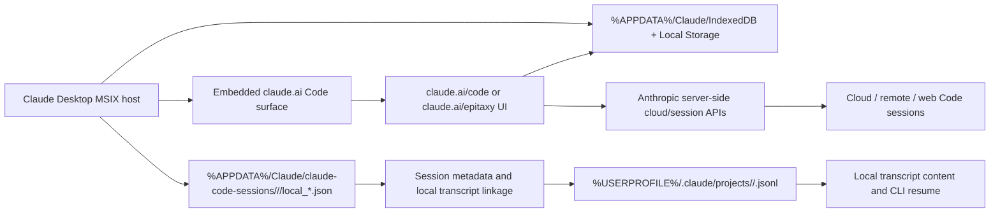

# DR26-06-24-HUB-01 — raw report from chatgpt

> Unedited output of one model. Our reconciled synthesis is the page one level up.

<!--
source: ChatGPT (Pro, Deep Research)
topic: Claude Desktop Code Recents on Windows - storage model and safe cleanup
dr_id: DR26-06-24-HUB-01 (retro-registered 2026-07-06, out-of-registry find)
date: 2026-06-24

author: external LLM (ChatGPT Deep Research), not Anton


-->

# Claude Desktop Code Recents on Windows

## Executive summary

For the current Claude Desktop architecture, the Code tab’s **Recents** list is not driven directly from «внутренний путь лаборатории»*.jsonl` transcripts, and it is not explained by live `claude` processes either. The strongest evidence points to a **hybrid model**: the Windows desktop app loads a `claude.ai` web surface for Code (`https://claude.ai/epitaxy` in newer builds), while the desktop host separately loads **persisted local session metadata** from `%APPDATA%\Claude\claude-code-sessions\<account>\<org>\...`; local transcript content lives under «внутренний путь лаборатории»*.jsonl`; and Chromium storage such as IndexedDB / Local Storage is used as a **UI cache / renderer state layer**, not as the only durable source of truth for local sessions. For **cloud / web Code sessions**, the source of truth is server-side on the Claude account, with official archive/delete actions exposed at `claude.ai/code`. citeturn35view3turn35view2turn7view0turn4view4turn6view1turn28view0

That is why your already-tested changes had no effect: moving local transcripts or editing `local_*.json` does not necessarily update the renderer’s indexed session catalog, and several public bug reports show that the Desktop UI can get out of sync with both the local transcript files and the JSON metadata files. In one Windows reverse-engineering report, the app log explicitly said it had **loaded persisted sessions from `claude-code-sessions`** while rendering Code through `https://claude.ai/epitaxy`; in another, sessions with valid `.jsonl` files still did not appear because the sidebar was reading from an IndexedDB-backed index rather than from the files directly. citeturn35view3turn33view1turn29view1

As of the current public docs, the **supported** ways to clean up are asymmetric: on the **web/cloud side**, Claude Code sessions can be **archived** and then **deleted permanently** from `claude.ai/code`; on the **desktop local side**, the documented controls are **filter**, **group**, **rename**, **archive**, and **auto-archive after PR merge/close**, but not a documented per-session permanent delete in the Desktop sidebar itself. There is also no documented bulk delete, no documented “hide untitled/sub-sessions” toggle, and no documented “internal/headless session” flag that prevents spawned sessions from showing up in Recents. citeturn22view0turn10view2turn4view1turn4view4

The safest cleanup order is therefore: **archive in-app first**, then **delete only server-side cloud sessions from `claude.ai/code`** if they are truly cloud sessions, then use **local CLI cleanup / project purge** for local-only session artifacts, and only then do a **cache reset by renaming Chromium storage directories** while keeping `claude-code-sessions` and «внутренний путь лаборатории» intact. Editing IndexedDB directly or deleting all app data is the risky path. citeturn4view4turn6view1turn36search1turn14view1turn29view0

## Storage model

The current best-fit model for Claude Desktop Code Recents on Windows is shown below. The key point is that **Recents is a rendered catalog**, not a direct directory listing of `.jsonl` transcripts.



The highest-confidence evidence for the host/UI split is a Windows Desktop reverse-engineering report showing that, after an update, the desktop app log recorded **“Loaded 57 persisted sessions from …\claude-code-sessions\<acct>\<org>\”** while the top frame URL for Code was **`https://claude.ai/epitaxy`**; the same report showed older builds using a dedicated `claude.ai/claude-code-desktop/...` route and newer ones mapping Code mode to `epitaxy`. That is strong evidence that the Desktop app is an embedded `claude.ai` code surface sitting on top of locally persisted desktop state. citeturn35view2turn35view3turn35view4

For local session content, Anthropic’s own docs are unambiguous: Claude Code stores transcripts as **JSONL** under «внутренний путь лаборатории»<project>/<session-id>.jsonl`; sessions are “saved continuously to local transcript files”; and the local CLI / SDK session APIs resume from that on-disk state. Anthropic’s Help Center FAQ also states that Claude Code sessions are stored **locally on your machine, per project directory**. citeturn7view0turn6view1turn28view0

But the UI does **not** seem to rebuild Recents directly from those transcript files. Public bug reports repeatedly show `.jsonl` transcripts existing while Desktop Recents is empty or incomplete, and one Windows report specifically states that manually creating or editing `local_*.json` files still did not restore visibility because the app appeared to read the session list from **IndexedDB** instead of those local files directly. Another report says the Desktop UI remained empty even though `.jsonl` files and Local Storage persisted, which again implies a separate render/index path. citeturn33view1turn29view1turn14view4

On the Chromium storage side, another reverse-engineering report found the renderer persisting the conversation graph under an IndexedDB key named **`conversations_v2:<timestamp>`**, using React Query persistence, and observed that deleting the IndexedDB origin caused the renderer to **rehydrate from server**. That is strong evidence that at least some Claude Desktop surfaces cache large server-backed conversation state in IndexedDB, especially for `claude.ai` surfaces. citeturn14view0

The server-side piece is also official for cloud/web Code sessions. Anthropic’s web docs state that sessions appear in the sidebar at **`claude.ai/code`**, can be archived there, and can also be **deleted permanently** there. Anthropic’s desktop docs further state that **Remote** sessions continue on Anthropic’s cloud infrastructure even if you close the app, and you can monitor those cloud sessions from `claude.ai/code` or the iOS app. That means cloud Code sessions are account-backed and server-side, with local browser/Electron cache layered on top. citeturn4view4turn22view0

### Storage location comparison

| Location | What it stores | Evidence | Role in Recents | Confidence |
|---|---|---|---|---|
| `%APPDATA%\Claude\claude-code-sessions\<account>\<org>\local_*.json` | Desktop session registry / metadata, including local session IDs, titles, cwd, timestamps, and in some builds `cliSessionId` linkage | Desktop log: “Loaded 57 persisted sessions from …\claude-code-sessions”; bug report showing `cliSessionId` and `transcriptUnavailable` in `local_*.json` citeturn35view2turn35view3turn35view0turn35view1 | A core **desktop-side index** for local sessions, but not always enough by itself to rewrite the visible list immediately | High |
| `%USERPROFILE%\.claude\projects\<encoded-cwd>\<session>.jsonl` | Local conversation transcripts | Official docs for session storage and transcript export; FAQ says sessions are local per project directory citeturn7view0turn6view1turn28view0 | Source of transcript content and CLI resume; **not** the direct renderer source for Recents | High |
| `%APPDATA%\Claude\IndexedDB\https_claude.ai_0.indexeddb.*` | Cached `claude.ai` renderer data, including React Query persistence such as `conversations_v2:*` | Reverse-engineering of Desktop IndexedDB persistence and rehydration from server citeturn14view0 | Renderer/cache layer; can affect what you see, but is not the only durable store for local sessions | Medium-high |
| `%APPDATA%\Claude\Local Storage\leveldb\` | Auxiliary UI state | Reports show it persists while Recents can still be wrong or empty citeturn29view1turn32search4 | Supplemental state, not reliable sole source of truth | Medium |
| `claude.ai/code` server-side session store | Cloud / remote / web Code sessions | Official docs: sessions at `claude.ai/code` can be archived and deleted; desktop docs: Remote sessions continue in Anthropic cloud and can be monitored from `claude.ai/code` citeturn4view4turn22view0 | Source of truth for cloud/web sessions | High |
| `app_localhost_0.indexeddb.*` | Version-dependent desktop UI conversation cache in some builds | Public reports show some builds used `app_localhost` for conversation content; other newer builds emphasize `https_claude.ai` / `epitaxy` citeturn29view0turn35view3 | Version-dependent; relevant mainly for older / transitional desktop builds | Medium |

## Supported controls

The **supported** in-app controls are more limited than people expect.

For the **Desktop Code tab**, Anthropic documents the following sidebar controls: **filter sessions by status, project, or environment**, **group sessions by project**, **rename a session**, **archive a session via the sidebar archive icon**, and optionally **auto-archive after PR merge or close** for local sessions. Anthropic also documents a Tasks pane for background work **inside the current session**—subagents, background shell commands, and dynamic workflows—which is distinct from top-level sessions in the sidebar. citeturn22view0turn10view2

For **Claude Code on the web**, Anthropic documents that sessions at `claude.ai/code` can be **archived** and **deleted permanently**. Archive hides them from the default list and exposes them through an archived filter; delete is available from the archived-session sidebar view or from the session title dropdown, and is permanent. citeturn4view1turn4view4

What is **not** documented as supported today is equally important: there is no public documentation for a **bulk select / bulk delete**, no documented **hide untitled sessions** toggle, no documented **hide sub-sessions / internal sessions** switch, and no documented **filter for only human-named sessions**. I also did not find a public Anthropic doc for a Desktop-side permanent delete action equivalent to the web’s documented delete flow. The absence of those controls in the docs is consistent with user bug reports complaining that stale or disconnected sessions accumulate with little cleanup control. citeturn22view0turn4view4turn14view2turn14view3

### About undocumented endpoints

Anthropic’s public user-facing docs do **not** publish a supported account API for deleting Claude Code sessions from `claude.ai/code` in bulk. However, reverse-engineering of the Remote Control pathway shows calls shaped like `GET /v1/sessions/{session_id}`, `POST /v1/sessions/{session_id}/archive`, and `POST /v1/sessions/{session_id}/events`, and Anthropic’s managed-agents reference also documents `DELETE /v1/sessions/{session_id}` and `POST /v1/sessions/{session_id}/archive` in a separate API context. The critical caveat is that these are **not documented as a supported consumer/account cleanup API for Claude Desktop Recents**, so I would not recommend using them for account cleanup unless Anthropic explicitly documents them for that purpose. citeturn18view3turn16view1

## Why unwanted sessions appear

The junk accumulation is best explained by a mismatch between **what counts as a “session” in Claude Code internals** and what users think should stay off the main Recents list.

Anthropic’s docs make clear that several features create **new sessions**, not just inner tool calls. `claude agents`, `--bg`, and `/background` all create background sessions; each dispatch in agent view starts its own new session; background sessions are listed across projects; and `claude rm <id>` removes a background session from that list while leaving its transcript on disk. That means “agent-fleet” or “background” workflows can absolutely generate many top-level session objects if they are using background-session machinery rather than staying inside one parent transcript. citeturn21view0turn36search1

By contrast, Anthropic documents that **subagents and dynamic workflows inside the current session** show up in the **Tasks pane** for that session. That implies a useful distinction: if you are seeing dozens of extra **top-level Recents** entries, they are more likely to be things that were created as independent sessions—background agent sessions, remote/cloud sessions, Dispatch-spawned Code sessions, scheduled-task runs, or Remote Control registrations—than plain in-session subagent tasks. citeturn22view0turn21view0

Anthropic also documents several features that can create or encourage that session sprawl: background sessions and agent view, workflows, Remote Control, scheduled tasks, Dispatch-spawned Code sessions, and cloud sessions. Scheduled tasks explicitly create **fresh sessions** on every run, and Dispatch can spawn Code sessions that then appear in the Code tab sidebar with a badge. citeturn9view3turn22view0

There is **no public doc** for a “headless/internal session” flag that tells Desktop to suppress a session from Recents. What Anthropic **does** document are prevention toggles that disable the features creating extra sessions: `disableAgentView` / `CLAUDE_CODE_DISABLE_AGENT_VIEW`, `CLAUDE_CODE_DISABLE_BACKGROUND_TASKS`, `disableWorkflows` / `CLAUDE_CODE_DISABLE_WORKFLOWS`, `disableRemoteControl`, `CLAUDE_CODE_FORK_SUBAGENT=0`, `CLAUDE_CODE_DISABLE_CRON`, and `workflowKeywordTriggerEnabled=false` if keyword-triggered dynamic workflows are the issue. These prevent future accumulation; they do not retroactively hide already-created entries. citeturn37view0turn20view0

## Safe cleanup procedure

This is the safest sequence that matches the current evidence.

### Backup first

Before changing anything, make a **copy**, not a move, of the state directories that matter. The goal is reversibility.

Use PowerShell with Claude fully closed:

```powershell
$ts = Get-Date -Format "yyyyMMdd-HHmmss"
$dst = "$env:USERPROFILE\Desktop\claude-backup-$ts"
New-Item -ItemType Directory -Path $dst | Out-Null

$paths = @(
  "$env:APPDATA\Claude\claude-code-sessions",
  "$env:APPDATA\Claude\IndexedDB",
  "$env:APPDATA\Claude\Local Storage",
  "$env:APPDATA\Claude\logs",
  "$env:USERPROFILE\.claude\projects",
  "$env:USERPROFILE\.claude\history.jsonl",
  "$env:USERPROFILE\.claude\file-history",
  "$env:USERPROFILE\.claude\backups"
)

foreach ($p in $paths) {
  if (Test-Path $p) {
    $name = Split-Path $p -Leaf
    Copy-Item $p -Destination (Join-Path $dst $name) -Recurse -Force -ErrorAction SilentlyContinue
  }
}
Write-Host "Backup created at $dst"
```

This is the low-risk baseline because Anthropic’s docs place transcripts under «внутренний путь лаборатории», while multiple bug reports show Desktop-side session linkage and UI state elsewhere under `%APPDATA%\Claude`. citeturn6view1turn35view3turn35view0

### In-app cleanup first

If the unwanted entries are visible in the Desktop sidebar, start with **non-destructive organization**:

1. Open the Code tab.
2. Use the documented top-of-sidebar controls to **filter by status, project, or environment** and **group by project**.
3. Hover unwanted sessions and use the **archive icon** where available.
4. If you use local PR workflows, enable **Auto-archive after PR merge or close** so finished local sessions do not keep piling up. citeturn22view0turn10view2

If the unwanted entries are **cloud/web sessions**, do the supported destructive cleanup from **`claude.ai/code`**:

1. Open `claude.ai/code`.
2. Archive unwanted sessions first.
3. Filter to archived sessions.
4. Delete from the sidebar delete icon, or open the session and use the title dropdown → **Delete**. Anthropic documents this as permanent and irreversible. citeturn4view1turn4view4

If the unwanted entries are specifically **background sessions** created by agent view / `--bg` / `/background`, use the supported CLI removal:

```powershell
claude agents
# identify the short id, then:
claude rm <id>
```

Anthropic documents `claude rm <id>` as removing a background session from the list **while keeping the conversation transcript on the local machine**. That is the safest supported “hide/remove from list without destroying transcript” control I found. citeturn36search1

### Local cleanup for truly local sessions

If you want to remove old local session artifacts by project, use **`claude project purge`** rather than hand-editing files. Anthropic documents it as removing local state under `projects/`, per-session task/debug/file-history data, matching prompt-history lines, and the project entry in «внутренний путь лаборатории». Your bundled CLI version `2.1.181` is newer than the documented minimum `2.1.124`, so the command should exist. citeturn6view1

Start with dry-run:

```powershell
claude project purge "C:\path\to\repo" --dry-run
```

Then, if the plan matches what you want:

```powershell
claude project purge "C:\path\to\repo"
```

Or for everything local:

```powershell
claude project purge --all --dry-run
claude project purge --all
```

Important caveat: this is **local-state deletion**, not guaranteed immediate Desktop Recents cleanup, because the Desktop sidebar does not reliably rebuild itself from transcript files alone. It is useful to remove resume-able local history, but it is not a proven silver bullet for your current Recents problem. citeturn6view1turn33view1turn29view1

### Cache rebuild only as last resort

If the visible Recents list is clearly stale after supported cleanup, the safest cache reset is to **rename**, not delete, the Chromium storage folders with Claude fully closed.

```powershell
taskkill /IM Claude.exe /F

$ts = Get-Date -Format "yyyyMMdd-HHmmss"
$base = "$env:APPDATA\Claude"

if (Test-Path "$base\IndexedDB") {
  Rename-Item "$base\IndexedDB" "IndexedDB.bak.$ts"
}
if (Test-Path "$base\Local Storage") {
  Rename-Item "$base\Local Storage" "Local Storage.bak.$ts"
}
if (Test-Path "$base\Session Storage") {
  Rename-Item "$base\Session Storage" "Session Storage.bak.$ts"
}

Write-Host "Renamed cache directories. Relaunch Claude Desktop."
```

Do **not** touch these unless you have backups and you accept UI-state loss:

- `%APPDATA%\Claude\IndexedDB`
- `%APPDATA%\Claude\Local Storage`
- `%APPDATA%\Claude\Session Storage`

And do **not** delete these unless you intentionally want local session history gone:

- `%APPDATA%\Claude\claude-code-sessions`
- `%USERPROFILE%\.claude\projects`

Public bug reports show that IndexedDB resets can trigger rebuilds, but they also show that rebuilding can leave data missing or desynchronized, and some updates have wiped desktop-side conversation cache unexpectedly. Renaming preserves rollback. citeturn14view1turn29view0turn14view0

### What not to do

Do not use **logout/login** as a cleanup tactic unless you have already backed everything up. Multiple bug reports show logout or app updates resetting Chromium storage and making the UI state worse, and Anthropic’s help/docs do not present logout as a supported way to rebuild Code Recents safely. citeturn32search4turn29view0

Do not rely on editing `local_*.json` to hide entries. In some builds, those files are only one part of a larger index path; in others, the app may overwrite fields such as `cliSessionId` or mark sessions `transcriptUnavailable`. Public reports show both “manual edits have no effect” and “scanner rewrites metadata on launch.” citeturn33view1turn35view0

Do not directly mutate LevelDB / IndexedDB files unless you are prepared for Chromium DB corruption. Nothing in Anthropic’s public docs supports that workflow, and multiple bug reports revolve around those stores being fragile across updates. citeturn14view0turn29view0

## Preventing recurrence

If your goal is “stop junk sessions from appearing again,” the documented answer is not a hidden-session flag. It is to **turn off the features that create independent sessions**.

For the CLI / Desktop environment, the most relevant controls are:

```json
{
  "disableAgentView": true,
  "disableWorkflows": true,
  "disableRemoteControl": true,
  "workflowKeywordTriggerEnabled": false
}
```

Anthropic documents these settings in `settings.json`, with `disableAgentView` disabling `claude agents`, `--bg`, `/background`, and the on-demand supervisor; `disableWorkflows` disabling dynamic workflows; and `disableRemoteControl` disabling Remote Control. citeturn37view0turn37view1

At the environment-variable level, the most relevant controls are:

```powershell
setx CLAUDE_CODE_DISABLE_BACKGROUND_TASKS 1
setx CLAUDE_CODE_DISABLE_WORKFLOWS 1
setx CLAUDE_CODE_DISABLE_CRON 1
setx CLAUDE_CODE_FORK_SUBAGENT 0
```

Anthropic documents these as disabling background task functionality, dynamic workflows, scheduled tasks, and forked subagents respectively. citeturn20view0

If you still want workflows but do not want accidental keyword-triggered ones, set:

```json
{
  "workflowKeywordTriggerEnabled": false
}
```

Anthropic documents that this prevents the keyword-triggered dynamic workflow path while leaving explicit workflow controls available. citeturn37view0

Finally, if you want finished local sessions to disappear from daily view more aggressively without manual cleanup, enable **Auto-archive after PR merge or close** in Desktop settings. That is official, safe, and reversible. citeturn10view2

### Cleanup checklist

| Step | Action | Risk level |
|---|---|---|
| Backup | Copy `%APPDATA%\Claude\...` and `%USERPROFILE%\.claude\...` first | Low |
| Organize | Filter/group/archive in Desktop sidebar | Low |
| Cloud cleanup | Archive/delete from `claude.ai/code` if those are cloud sessions | Medium, because delete is permanent citeturn4view4 |
| Local background cleanup | `claude rm <id>` for background sessions | Low citeturn36search1 |
| Local project cleanup | `claude project purge --dry-run` then purge | Medium, because it deletes local history citeturn6view1 |
| Cache rebuild | Rename IndexedDB / Local Storage and relaunch | Medium |
| Destructive surgery | Logout, direct LevelDB edits, full app-data wipe | High |

## Open questions and limitations

The biggest unresolved point is **which of your unwanted entries are local desktop sessions versus server-backed cloud sessions**. The public evidence says the Desktop Code surface is hybrid and version-sensitive, and public reports show both `https_claude.ai_*` and `app_localhost_*` IndexedDB patterns depending on build generation. I can say with high confidence that the visible list is **not** rebuilt straight from `.jsonl`, and that the Desktop host + `claude.ai` renderer + local registry/cache layers all matter; I cannot say from public sources alone that **every one** of your current junk entries is server-side. citeturn35view3turn14view0turn29view0

I also did **not** find a publicly documented, supported **bulk-delete API** or GraphQL mutation for consumer/account Claude Code sessions. The only safe, officially documented destructive path I found for account-backed Code sessions is the **web UI delete flow at `claude.ai/code`**. Reverse-engineered `/v1/sessions/...` routes exist in adjacent contexts, but Anthropic has not documented them as a stable consumer cleanup API for Desktop Recents. citeturn4view4turn18view3turn16view1

The most practical conclusion is blunt: **Recents in Claude Desktop Code is a hybrid, index-driven view; local transcripts are necessary but not sufficient; server-side delete exists only for cloud/web sessions via `claude.ai/code`; and there is currently no documented supported way to bulk-hide unnamed spawned sessions or mark them internal so they stop appearing at top level.** citeturn35view3turn33view1turn4view4turn37view0