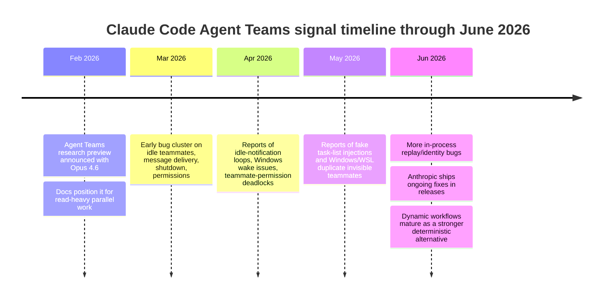
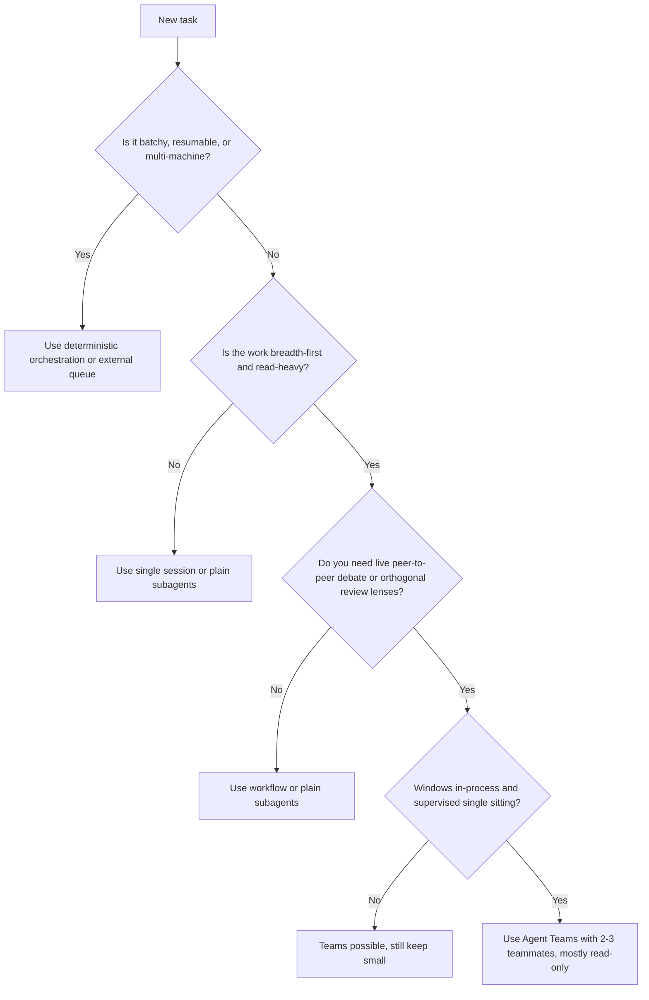

# DR26-06-25-HUB-04 — raw report from pow

> Unedited output of one model. Our reconciled synthesis is the page one level up.

# Claude Code Agent Teams for an Individual Power-User

## A. Executive Summary

Your tentative decision is mostly correct, and the strongest evidence sharpens it rather than overturning it. For an individual power-user on Windows, Claude Code Agent Teams is best treated as an **interactive parallel-thinking tool** for bounded, read-heavy, single-sitting work: adversarial research, competing-hypothesis analysis, and multi-lens review. That is where its unique peer-to-peer mailbox and shared task layer can produce something meaningfully different from plain subagents or a deterministic orchestrator. Anthropic’s own guidance points users toward research and review first, says routine tasks are more cost-effective in a single session, and notes that token costs scale linearly with each teammate. Anthropic’s separate multi-agent research writeup makes the same broader point: multi-agent systems can outperform a strong single agent on breadth-first research, but they burn far more tokens and are not a good fit when tasks are tightly coupled or share too much context. citeturn15view1turn14view5turn11view1turn36view0turn36view1turn36view2

On cost, the answer is blunt. The official current Claude Code docs say Agent Teams use **approximately 7× more tokens than standard sessions when teammates run in plan mode**. Independent benchmarking from UpGPT found Agent Teams **73–124% more expensive than sequential execution at equivalent quality** on their coding benchmark, attributing the premium largely to repeated loading of the same codebase context into each worker. Anthropic’s multi-agent research article reports a broader product-level pattern: multi-agent systems used about **15× more tokens than chat** in that research setting, even while materially improving research quality. Those numbers are not contradictory; they describe different workloads. The common thread is that Teams wins only when the extra parallel reasoning is buying something a single session or scripted orchestration does not. citeturn11view1turn12view1turn12view4turn32view0turn36view0turn36view1

The strongest evidence against using Teams for your import pipeline is not just cost; it is **systems fit**. In-process teammates do **not** resume with `/resume` or `/rewind`; task status can lag; one session can host only one team; teams cannot nest; and split panes are not supported in Windows Terminal or VS Code’s integrated terminal, leaving you in in-process mode on Windows. Meanwhile, dynamic workflows, LangGraph, CrewAI Flows, and AutoGen/AG2 all emphasize some combination of rerunnable scripts, persistent state, durable execution, or distributed runtimes across workers or machines. For batch imports, resumability, retry semantics, schema validation, and external state are the primary requirements. Teams does not beat a deterministic orchestration script plus SQLite on those dimensions today. citeturn14view0turn14view2turn14view4turn16view0turn16view1turn10search0turn10search4turn10search1turn10search5turn10search2turn10search10turn10search22

Windows viability is real but limited. Official docs say in-process mode works in any terminal, but multiple 2026 GitHub issues document Windows-specific hangs, invisible duplicate teammates, and identity corruption after long or compacted in-process sessions. That makes Agent Teams usable for supervised, read-only work in short sessions, but a poor fit for unattended or long-running productionish loops on Windows. citeturn14view5turn11view5turn21view0turn21view2turn11view4

Model mixing is one place your current instinct is well aligned with the evidence. Anthropic’s own multi-agent research system used **Opus as the lead and Sonnet as subagents**, and the current docs explicitly support specifying teammate models while noting teammates do not inherit the lead’s `/model` by default. Community and benchmark evidence supports the general economics of “strong planner / cheaper executors,” but it also shows that the savings are often overstated because the expensive lead still runs the whole session. A widely cited harness README corrected its own earlier marketing claim and now says Teams becomes cost-effective only when the total work exceeds roughly **30 minutes of single-session effort**. Separate benchmark work also showed cheaper workers are effective mainly when the stronger model writes the brief first. So: **Sonnet teammates + Opus lead** is the right default for high-value research/review, but it is not a free lunch and should be reserved for tasks where synthesis quality or adversarial framing actually matters. citeturn36view0turn15view2turn12view5turn32view0

Bottom line: **confirm** your decision to keep imports off Teams, **confirm** keeping multi-machine coordination on an external message bus, and **refine** your Teams use to a narrow band: short-lived, read-mostly, high-value research/review, usually **2–3 Sonnet teammates**, optionally with an **Opus lead** when the memo quality is worth the premium. If you are not explicitly exploiting peer-to-peer teammate communication or adversarial parallel lenses, you usually want plain subagents or a deterministic workflow instead. citeturn15view1turn16view0turn16view2turn24view1

## B. Key Findings

### Where Agent Teams genuinely wins

The core advantage of Agent Teams over plain subagents is not generic “parallelism.” It is **persistent peer-to-peer coordination among a handful of live sessions**. Anthropic’s docs explicitly position Teams for parallel code review, multi-hypothesis investigation, and research/review tasks, and distinguish subagents as the better choice when inter-agent coordination is not needed. Anthropic’s broader multi-agent research writeup reaches the same conclusion at system level: multi-agent architectures excel when tasks are **breadth-first**, highly parallelizable, and exceed what one context window or one search path can cover efficiently. citeturn15view1turn14view5turn36view0turn36view1

For an individual power-user, that translates into a narrow but real set of winning cases:

| Workload shape | Why Teams can win | Why alternatives often lose |
|---|---|---|
| Competing-hypothesis research memo | Parallel agents can pursue mutually disconfirming hypotheses and surface disagreement before the lead synthesizes. Anthropic explicitly recommends this pattern. citeturn15view1 | A single session tends to anchor on the first plausible theory; plain subagents can fan out, but they do not support teammate-to-teammate debate. citeturn11view0turn15view1 |
| Parallel PR / doc / architecture review | Distinct reviewers can hold different lenses at once: security, performance, correctness, tests, maintainability. Anthropic documents this as a prime use case. citeturn15view1 | One reviewer, human or model, often serializes attention and misses orthogonal classes of defects. citeturn15view1 |
| Incident investigation with multiple live tools/sources | A documented practitioner report described a real production incident investigation where Agent Teams self-organized a parallel search and found the root cause quickly. citeturn11view11 | Sequential investigation can get stuck on one avenue; scripted workflows are stronger only if the search branches are already known in advance. citeturn11view11turn16view1 |

Outside that band, the case weakens sharply. Anthropic’s research article is unusually candid that many coding tasks do **not** contain enough true parallelism to justify multi-agent coordination, and recent research on multi-agent systems also finds large task-dependence: architecture-task mismatch can produce large losses versus a single agent, especially on sequential planning or tool-heavy tasks. citeturn36view1turn36view3turn33view4

### Token-cost accounting and realistic benchmark envelopes

The most important accounting detail is that **parent-session cost views can materially understate actual spend**. A GitHub feature request documents that parent session statusline JSON only shows parent cost; each subagent and each agent-team member is billed in its own child session JSONL, and those costs do not automatically roll up. If you do not aggregate child sessions, you can think a run was cheap when it was not. citeturn11view3

The high-confidence benchmark anchors are these:

| Evidence | What it says | What you should infer |
|---|---|---|
| Claude Code cost docs | Agent Teams use **approximately 7× more tokens** than standard sessions when teammates run in plan mode. citeturn11view1 | This is the official current upper-bound-style warning for plan-heavy team use. |
| Claude Code team docs | Costs scale linearly with active teammates; Anthropic recommends starting with **3–5** teammates and using Teams mainly for research/review/new feature work, while calling routine tasks more cost-effective in one session. citeturn15view1 | Per-teammate cost is real, and your default should be “few teammates, narrow scope.” |
| Anthropic multi-agent research system | Multi-agent research beat single-agent Opus by **90.2%** on Anthropic’s internal research eval, but multi-agent systems used **about 15× more tokens than chats**. citeturn36view0turn36view1 | Multi-agent spend can be justified on genuinely hard breadth-first research, not as a general default. |
| UpGPT benchmark | Agent Teams were **73–124% more expensive** than sequential execution at equivalent quality in their coding benchmark; repeated context loading dominated. citeturn12view1turn32view0 | Against a good deterministic or sequential baseline, Teams usually pays a large premium unless wall-clock speed itself matters. |
| Real issue report | Idle/duplicate loop noise consumed **13.0%** of team-input spend in one definition, **22.2%** in a broader one, and caused roughly **3–4× lead-turn inflation** versus earlier non-Team dispatch. citeturn19view0 | Real-world coordination bugs can add a second premium on top of the structural premium. |

For scenario math, I used explicit assumptions rather than pretending to know your exact token profile: a shared context block `C`, teammate useful work `U`, lead synthesis/planning overhead `L`, and deterministic orchestration overhead `O`. The math is anchored to Anthropic’s linear-cost statement, the 7× plan-mode warning, the UpGPT delta, and the observed 13–22% coordination-noise reports. Treat the absolute counts below as **illustrative**, but the multipliers are directionally well grounded. citeturn11view1turn15view1turn12view1turn19view0

| Scenario | Assumptions | Single session | Deterministic orchestration | Agent Teams base | Agent Teams with realistic coordination noise |
|---|---|---:|---:|---:|---:|
| Short review | `C=20k`, `U=35k`, `n=2`, `L=30k`, `O=15k` | 140k | 105k | 140k | 161k–181k |
| Deep research / review memo | `C=80k`, `U=40k`, `n=3`, `L=30k`, `O=15k` | 250k | 215k | 390k | 449k–503k |
| Larger high-context research | `C=120k`, `U=50k`, `n=5`, `L=30k`, `O=15k` | 420k | 385k | 880k | 1.01M–1.14M |

Interpretation:

- **Versus a single session**, Teams usually lands around **1.0–2.1×** in these moderate scenarios before extreme plan-mode inflation.  
- **Versus a deterministic orchestrator or sequential cached flow**, it more often lands around **1.3–2.9×**, because the orchestrator can avoid repeated loading of the same shared context and can resume from structured state.  
- The premium rises with **context size** more than with “thinking quality,” because repeated context loading is the structural tax. That is the same mechanism UpGPT called out directly: three workers often means three copies of the same large context. citeturn12view4turn32view0

### Community cost-control patterns that actually matter

The credible cost-control patterns repeat across official docs and practitioner benchmarks:

| Pattern | Evidence | Practical implication |
|---|---|---|
| Keep team size small | Anthropic says start with **3–5** teammates and warns of diminishing returns. Research on self-organizing teams also finds expertise dilution worsens with team size. citeturn15view1turn27view3 | On Windows, for your use case, **2–3** is usually safer than 5. |
| Use better upfront briefs, not more retries | UpGPT found structured briefs reduced cost and improved quality more than extra review or retry passes; retry loops worsened quality and increased cost. citeturn32view0turn12view2 | Before spawning teammates, compress the task into a hard brief. |
| Put cheap models on leaf work, not on planning | Anthropic’s own multi-agent research used **Opus lead + Sonnet subagents**. UpGPT found cheaper workers work only when a better model wrote the contract first. citeturn36view0turn32view0 | Use Sonnet teammates for search/review branches; reserve Opus for synthesis or the hardest branch only. |
| Instrument true cost across child sessions | Parent views do not automatically aggregate child-session spend. citeturn11view3 | Aggregate every child JSONL before deciding anything about ROI. |
| If the orchestration itself should be rerunnable, move it into code | Anthropic’s workflow docs explicitly position dynamic workflows for tasks that need more agents than one conversation can coordinate or where you want orchestration codified and rerunnable. citeturn16view0turn16view1 | If you care about replay, resume, or reproducibility, Teams is the wrong layer. |

## C. Contradictions & Debates

The debate around Agent Teams looks contradictory only if you collapse different task shapes into one bucket.

### Why Anthropic can be right and the skeptics can also be right

Anthropic’s strongest pro–multi-agent claim is from its research system: on an internal research eval, **Opus lead + Sonnet subagents** beat single-agent Opus by **90.2%**, and the company says multi-agent systems shine on breadth-first, parallelizable search problems. The same article immediately warns that such systems burn through tokens, use roughly **15×** the tokens of chats in that setting, and are a poor fit when agents need to share the same full context or when dependencies are heavy—explicitly mentioning coding tasks as often less parallelizable than research. citeturn36view0turn36view1turn36view2turn36view3

Meanwhile, the strongest anti-Teams practitioner benchmark, UpGPT, tested coding-oriented workflows and found **73–124%** higher cost with no quality gain versus sequential execution, while also finding that better briefs and context compression mattered far more than agent parallelism. Those two bodies of evidence fit together cleanly: **research breadth** can justify Team-style fan-out; **structured coding with shared repo context** often cannot. citeturn12view1turn32view0

Recent academic work also supports the “conditional effectiveness” picture rather than a universal win. One large study found relative change versus a single-agent baseline ranged from **+80.8%** on decomposable financial reasoning to **-70.0%** on sequential planning, and reported that tool-heavy tasks can incur multi-agent overhead. Another paper found debate-style multi-agent setups offer only limited advantages over strong self-agent scaling in many reasoning settings, becoming more useful mainly when problems get harder and models get weaker. citeturn33view4turn35view0turn35view1

### Why “solution looking for a problem” is a fair criticism

A common practitioner complaint is that Agent Teams feels like “expensive subagents with better marketing.” That criticism is weak if the work truly depends on live peer-to-peer coordination, but strong if the only thing you need is fan-out and aggregation. Anthropic’s own workflow docs now give users a different option: a rerunnable script that can orchestrate many subagents, keep the intermediate state in variables rather than conversation context, run in the background, and apply repeatable cross-check patterns. For many solo-user tasks, that moves work away from conversational team management and into code, which is exactly what deterministic users often want. citeturn23view2turn16view0turn16view1turn16view2

Research also backs the skepticism. One paper found a single agent beat multi-agent systems in about **43.3%** of cases across varied tasks. Another found self-organizing LLM teams often fail to match their best member and can suffer performance losses of up to **37.6%**, largely because they compromise instead of properly deferring to the strongest expert. A third argues that compiling capabilities into a single skill-routed agent can substantially reduce token usage and latency, though skill libraries also hit their own scale limits. citeturn27view0turn27view3turn34view0

### The feature direction over early 2026

The pattern from February through June 2026 is not “stable finished product.” It is “valuable experimental primitive under active repair.”

Anthropic’s docs still label Agent Teams experimental and list concrete limitations such as failed in-process resumption, lagging task status, one team per session, no nested teams, fixed lead, and Windows lacking split-pane support. At the same time, June release notes still include Agent Teams-related fixes, including teammate effort inheritance in pane backends and teammate-started background task handling. That is consistent with a feature moving forward, but not yet one you should treat as a reliable automation substrate. citeturn14view0turn14view2turn14view5turn22search0

### Open questions and limits of the evidence

There is still no clean public benchmark set specifically for **Claude Code Agent Teams on research/review tasks for solo users on Windows**. The public benchmark with the clearest numbers is coding-oriented and external. The open GitHub issue stream is rich but noisy: some reports were fixed, some were duplicates, and some are clearly environment-specific. So the strongest conclusion is not “Teams is bad” or “Teams is good”; it is that **task-shape fit dominates**, and the current Windows in-process path adds extra operational risk on top of the structural cost premium. citeturn12view1turn14view5turn11view5turn21view0

## D. Best Practices

### Recommended operating posture for your specific workload mix

The evidence supports different tools for each of your three workloads.

| Workload | Recommended default | Why |
|---|---|---|
| Batch imports into a 128k-note Obsidian vault | Deterministic orchestration script + SQLite / queue / resume | This matches Anthropic’s own warning that routine tasks are more cost-effective outside Teams and gives you the durable state, retries, and resumability that Teams lacks. citeturn15view1turn14view0turn16view0 |
| Multi-phase research and decision memos | Agent Teams **only** when the question is breadth-first, multi-angle, and worth paying for parallel search or critique | This is the clearest overlap between Anthropic’s official examples and the broader research evidence. citeturn15view1turn36view0turn36view1 |
| Code / doc review | Agent Teams for orthogonal, read-only reviewers; otherwise plain subagents or workflow | Anthropic explicitly recommends parallel review lenses, but coding in general remains less parallelizable and more coordination-sensitive. citeturn15view1turn36view3 |

### Recommended configurations

| Use case | Team shape | Model mix | Permissions | Why this is the sane default |
|---|---|---|---|---|
| Short PR / doc / architecture review | 2–3 teammates | Sonnet lead or Opus lead if synthesis quality matters; Sonnet teammates | Read-only if possible | Keeps the unique multi-lens benefit while containing linear cost and Windows fragility. citeturn15view1turn14view5turn11view5 |
| Deep research memo | 3 teammates maximum on Windows | **Opus lead + Sonnet teammates** | Mostly read-only, web/tool access scoped to research | This matches Anthropic’s own winning pattern for research-style work. citeturn36view0turn15view2 |
| Mechanical or repo-wide controlled change | Workflow or deterministic script, not Teams | Cheapest model that clears task quality | Structured outputs + retries at workflow level | If you need reruns, persistence, schema validation, or repeatability, move the plan into a script. citeturn16view0turn16view1turn10search0 |

### Guardrails worth adopting immediately

The following practices are high-leverage and well supported by the evidence:

- **Keep teammates narrowly chartered.** Anthropic emphasizes task-specific context and clear boundaries. This reduces duplicate searches and role drift. citeturn15view1turn36view1  
- **Prefer fewer, sharper teammates over many generic ones.** Anthropic recommends 3–5; current research suggests larger teams dilute expertise and increase coordination overhead. On Windows, bias down to 2–3. citeturn15view1turn27view3  
- **Pre-approve common operations or keep work read-only.** Anthropic explicitly warns that teammate permission prompts bubble up and create friction. There are also documented deadlock cases where permission flows broke. citeturn14view5turn11view8turn11view9  
- **Do not trust parent session cost displays for ROI decisions.** Aggregate child-session JSONLs. citeturn11view3  
- **Avoid long in-process sessions on Windows.** Compaction and wake-up bugs become more likely as the session ages. citeturn11view4turn11view5turn21view0  
- **If you hit task-list injection artifacts, stop using the task list for internal coordination.** One documented workaround was to coordinate through `SendMessage` and external docs, not `TaskCreate`, until the bug is fixed in your build. citeturn20view0  

## E. Failure Modes

The documented failure surface from February through June 2026 is not theoretical. It contains cost blowups, correctness hazards, and operator-friction bugs.

| Failure mode | Concrete evidence | Operational consequence | What to do instead |
|---|---|---|---|
| Idle-notification / duplicate-ack loops | Reported **13–22%** token waste and roughly **3–4×** lead-turn inflation versus non-Team dispatch in one real session. citeturn19view0 | You pay for coordination chatter rather than useful work. | Keep teams tiny; break and restart if loops appear; use workflows/scripts for unattended multi-step jobs. |
| Completed task replay storms | June report described completed assignments being re-delivered, causing verify-and-decline rounds and potential duplicate work. citeturn11view6turn18search6 | Token drain, throughput loss, risk of duplicate PRs or duplicate cards. | Require idempotent worker instructions; do not use Teams for destructive unattended ops. |
| Invisible duplicate teammates on Windows / WSL | A May Windows/WSL report described **10–151 duplicate instances** from a single teammate spawn, each consuming full context; the report estimated extreme token and cost blowups. citeturn21view0turn21view2 | Catastrophic uncontrolled spend and conflicting edits. | On Windows, keep Teams read-only and short; do not trust long-running implementation swarms. |
| Parent/lead wake-up failures | Windows issue: parent did not wake on teammate completion without terminal input. A tmux issue reported the same pattern requiring a keypress. citeturn11view5turn11view7 | You must babysit the system; unattended work stalls. | Use Teams only when you are actively present; otherwise move to workflows/agent view/scripts. |
| Lead identity corruption after compaction | In-process bug on June 1: lead started acting as a teammate after compaction and could no longer spawn teammates. citeturn11view4 | Long sessions can silently degrade into broken orchestration. | Keep sessions single-sitting; avoid long-lived Windows in-process teams. |
| Permission deadlocks and invisible approvals | A documented bug showed teammate permission requests hitting the lead inbox without a valid approval response path; another showed VS Code lead not receiving teammate messages or prompt visibility. citeturn11view8turn11view9 | Teammate blocks indefinitely. | Prefer read-only reviews; pre-approve safe operations before spawning. |
| Fake `task-list` injections into specialist contexts | A May issue documented `<teammate-message teammate_id="task-list">` payloads injecting task descriptions into agent contexts and called out a prompt-injection vector. citeturn20view0 | Agents drift off charter, or external text gains undue authority. | If reproduced in your build, stop using team task list for internal coordination. |
| No in-process resume | Official docs: `/resume` and `/rewind` do not restore in-process teammates. citeturn14view0 | Long-running or interruptible pipelines are unsafe. | Use workflows, LangGraph, CrewAI Flows, or your existing orchestrator. |
| One team per session, no nested teams, no cross-session sharing | Official docs. citeturn14view2turn14view3 | Teams is not a distributed job-control plane. | Keep multi-machine coordination on your own bus or a framework built for it. |

One practitioner's positive June report is also instructive because it implicitly names the rough edges. They praised the **visibility**, **persistence**, and **live communication** of multiple agents over roughly **50 merged PRs**, but still called out two pain points: agents often needed a manual “nudge” to start after assignment, and same-worktree collisions created duplicate PRs and branch interference. That is a useful signal: the feature can enable a powerful mode of work, but it still demands operator discipline and isolation hygiene. citeturn24view0

## F. Strategic Recommendations

### Confirm, refute, or refine your tentative decision

**Imports off Teams: confirm strongly.**  
This is the clearest call in the whole report. Your import pipeline is mechanical, batchy, deterministic, resumability-sensitive, and already has a better architecture: cheapest-tool-first, structured outputs, caching, and SQLite-backed orchestration. Agent Teams adds replicated context cost, lacks resumable in-process teammates, offers weak guarantees around task status and coordination, and does not improve the thing that matters most in imports: deterministic progress over large corpora. Anthropic’s own docs push routine work away from Teams, and both the academic and practitioner evidence says multi-agent gains shrink or reverse as dependency chains and shared context rise. citeturn15view1turn14view0turn33view4turn34view0

**Multi-machine on Syncthing / message bus: confirm strongly.**  
There is no evidence that Agent Teams should replace your message bus. Anthropic’s docs explicitly scope a team to one session, with no shared team across sessions and no nested teams. An enterprise practitioner operating a persistent 9-agent platform on Claude Code reported having to build a Redis Streams bridge because Claude Code agents are fundamentally stdin-driven and lack a native event channel for cross-machine coordination. Meanwhile, AutoGen/AG2 officially supports distributed runtimes across host and worker runtimes, and LangGraph/CrewAI are much closer to “workflow system” territory than Claude Code Teams is. citeturn14view2turn24view1turn10search2turn10search10turn10search22turn10search0turn10search1

**Teams only for read-only research/review in a single sitting: confirm, then refine.**  
That is the right default, but I would make it stricter on Windows:

- Prefer **2–3 teammates**, not 3–5, on Windows in-process.
- Prefer **read-only** by default.
- Use an **Opus lead only when the memo or synthesis is worth it**; otherwise use Sonnet throughout.
- If the task can be represented as a rerunnable procedure, do **not** use Teams—use a workflow or your existing orchestrator.
- If you are not exploiting **peer-to-peer cross-talk** or **competing lenses**, use plain subagents instead. citeturn15view1turn14view5turn16view0turn36view0turn12view5

### Recommendation framework

The practical cutoff for “is the per-teammate cost justified?” is not abstract elegance. It is one of these three conditions:

1. The additional teammate **finds materially different evidence** or defects.  
2. The additional teammate cuts wall-clock time enough that you care.  
3. The additional teammate reduces human cognitive load on a high-value decision.  

If none of those is true, the teammate is not justified. Anthropic’s own product-level evidence and the public benchmarks both imply this same rule, even though they frame it differently. citeturn36view1turn12view1turn15view1

## G. Action Plan

Use a short, instrumented pilot rather than opinion.

### Step one

Build a **true cost ledger** that aggregates the parent session and every child session JSONL for each run. Parent-only status views undercount spend when delegation is involved. Track input, output, cache creation, cache read, wall-clock, and number of spawned teammates. citeturn11view3

### Step two

Choose **two pilot task classes only**:

- one research memo task that genuinely fans out into competing hypotheses or source clusters,
- one review task with clearly separable lenses such as security, performance, and test coverage.

Do **not** pilot on imports. That would answer the wrong question because the architecture is already misaligned there. citeturn15view1turn36view3

### Step three

Run each pilot task through **three baselines**:

- your current best single-session approach,
- plain subagents or deterministic workflow,
- Agent Teams.

Keep prompts, acceptance rubric, and available tools as constant as possible. If the task is review-only, keep all variants read-only. citeturn16view1turn15view1

### Step four

Use only **two team configurations** in the Agent Teams arm:

| Pilot config | When to use |
|---|---|
| Sonnet lead + 2 Sonnet teammates | Default for cost-sensitive review |
| Opus lead + 2 Sonnet teammates | Only for synthesis-heavy research memos |

Anthropic’s own winning research recipe used Opus lead + Sonnet subagents, and community evidence suggests expensive leads are only worth it once the task gets long or strategically important enough. citeturn36view0turn12view5

### Step five

Capture the following metrics for every run:

- total tokens across parent and child sessions,
- token multiplier vs your current best baseline,
- wall-clock time to usable answer,
- number of human interventions,
- number of unique relevant findings,
- false-positive count,
- duplicate-turn or idle-loop rate,
- stuck/permission/identity/compaction incidents,
- whether resume/retry was needed and whether it worked.

Those metrics directly reflect the documented costs and failure modes in the public evidence. citeturn19view0turn11view5turn11view4turn14view0

### Step six

Adopt a hard **acceptance gate**:

- median wall-clock improves by **at least 30%**, **or** unique useful findings improve by **at least 20%**,
- token multiplier stays at **2.0× or less** versus your current best non-Team baseline for the selected task class,
- no critical failures in **10 consecutive runs**,
- no hidden or duplicate teammate incidents,
- no need for `/resume` to complete the task class.

If any of those fail, keep Teams in “toy / occasional specialist” status and do not operationalize it. This gate is conservative, but the public evidence justifies conservatism. citeturn12view1turn14view0turn21view0turn11view5

### Step seven

If the pilot passes, codify a **micro-playbook**:

- Windows only,
- in-process only,
- 2–3 teammates max,
- read-only by default,
- explicit teammate charters,
- one short session,
- no batch work,
- no multi-machine coordination,
- no task-list coordination if you reproduce injection artifacts.

That gives you a scoped adoption box rather than a slippery slope. citeturn14view5turn20view0turn24view1

### Step eight

If the pilot fails, do not keep tweaking Teams. Shift the energy into the path that the evidence says scales better for solo operators: **workflows / scripts / queues / index compression / model routing**. The public benchmarks suggest those levers buy more than multi-agent parallelism for cost-sensitive work. citeturn16view0turn32view0turn34view0

## H. Source

### Prioritized sources used in this report

The source priority for this investigation was: **official Anthropic docs and engineering posts first, then original papers, then practitioner benchmarks, then GitHub issues and field reports**.

**Highest-priority official sources**

- Claude Code Agent Teams docs: feature behavior, limitations, team size guidance, Windows split-pane limits, model selection, and “start with research and review.” citeturn11view0turn14view0turn14view5turn15view1turn15view2  
- Claude Code cost docs: official **~7×** token warning for plan-mode teammates. citeturn11view1  
- Claude Code workflows docs: rerunnable script orchestration, background runs, resumability, and position vs Teams/subagents. citeturn11view2turn16view0turn16view1turn16view2  
- Anthropic engineering on the multi-agent research system: **90.2%** research-eval improvement, **15×** token cost, and candid fit limits for coding and dependency-heavy tasks. citeturn36view0turn36view1turn36view2turn36view3  
- Anthropic Opus 4.6 launch note: positioning Agent Teams as research-preview best for independent, read-heavy work like codebase review. citeturn25search2  
- Claude Code release notes through June 2026: ongoing fixes demonstrate the feature is still moving under active repair. citeturn22search0  

**Original research papers**

- *Towards a Science of Scaling Agent Systems*: architecture-task alignment can swing results from **+80.8%** to **-70.0%**; tool-heavy tasks can incur multi-agent overhead. citeturn33view4  
- *When Does Multi-Agent Collaboration Help? An Entropy Perspective*: single agent beats MAS in about **43.3%** of cases. citeturn27view0  
- *Multi-Agent Teams Hold Experts Back*: self-organizing teams can underperform their best member by **8–38%** and degrade with larger teams. citeturn27view3  
- *Why Do Multi-Agent LLM Systems Fail?*: 1,600+ annotated traces across 7 frameworks, 14 failure modes in three categories. citeturn28view0turn28view1  
- *When Single-Agent with Skills Replace Multi-Agent Systems and When They Fail*: compiled skill systems can reduce token usage and latency while preserving competitive accuracy up to a scaling limit. citeturn34view0turn34view1  
- *Revisiting Multi-Agent Debate as Test-Time Scaling*: limited benefit over self-agent scaling in many settings; more useful mainly on harder tasks with weaker models. citeturn35view0turn35view1  

**Practitioner benchmarks and field reports**

- UpGPT’s 52-run benchmark: **73–124%** Agent Teams cost premium, strong gains from brief quality and context compression, and evidence for cheaper implementers only when stronger planning comes first. citeturn12view1turn12view2turn32view0  
- `vv-claude-harness` README: model-mixing savings are real but often exaggerated; break-even only after roughly **30 minutes** of single-session-equivalent work. citeturn12view5  
- Codecentric June 2026 experience report: positive report on building autonomous workflows with Agent Teams, but notably from a more involved setup and not Windows in-process. citeturn23view0  
- Incident-investigation field report: a concrete positive real-world use case for Agent Teams in a high-value diagnostic task. citeturn11view11  

**GitHub issues and community evidence used for failure analysis**

- Parent-child cost aggregation gap. citeturn11view3  
- Windows parent wake stall. citeturn11view5  
- In-process lead identity corruption after compaction. citeturn11view4  
- Replay storm of completed tasks. citeturn11view6  
- Permission deadlocks / invisible approval flows. citeturn11view8turn11view9  
- Idle-notification / duplicate-ack token waste. citeturn19view0  
- Fake task-list injections into specialist contexts. citeturn20view0  
- Windows/WSL invisible duplicate teammates with massive cost blowups. citeturn21view0turn21view2  
- Practitioner request for event-driven input and cross-machine coordination, documenting a Redis-based workaround. citeturn24view1  

### Limitations

The public evidence is strongest on **architecture fit, cost mechanisms, and failure reports**, and weaker on clean apples-to-apples **research/review benchmarks on Windows in-process for solo users**. Some issue reports may already be fixed in your exact patch level, while others remain open; the safest stance is therefore not a categorical yes/no, but a **scoped adoption with instrumentation and an explicit acceptance gate**. citeturn22search0turn14view0turn21view0