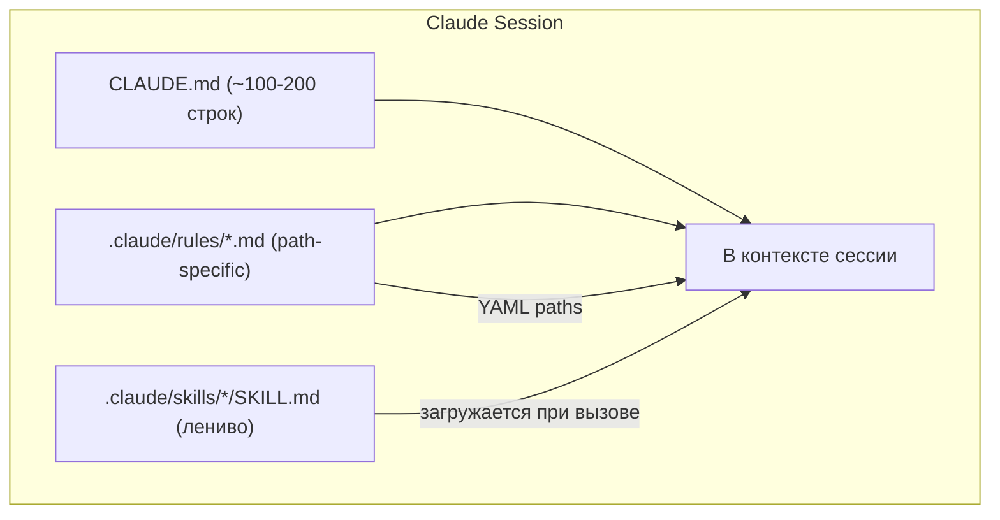

# DR26-06-30-HUB-04 — raw report from файла

> Unedited output of one model. Our reconciled synthesis is the page one level up.

# Исполнительное резюме  
Документы контекста (Cloud/CLAUDE.md-файлы) разрастаются, когда в них включают «всё подряд»: подробные правила стиля, описания архитектуры, инструкции, которые уже знает модель. В результате LLM тратит токены на «шум», а не на решение задач. Реальные практики (2024–2026) рекомендуют **сильно минимизировать** основной файл: держать CLAUDE.md в диапазоне ~100–200 строк (несколько сотен токенов) и выносить остальное в отдельные документы или инструменты. 

Ключевые методы оптимизации – **разбиение контента по тематическим файлам/подмодулям**, **ленивая загрузка** (skills, подагенты), **статическая сегментация/индексация** (разрезание по заголовкам, делта-обновления и т.п.) и **минимизация избыточного форматирования**. Например, вместо длинных текстовых списков правил рекомендуется использовать `.claude/rules/*.md` с указанием путей (YAML-фронтметки `paths`) – такие правила загружаются только при работе с соответствующими файлами, что резко сокращает «метки контекста». Другое практическое решение – генерировать индекс кода (списки файлов/функций) и ссылаться на него из CLAUDE.md (см. опыт на Reddit, окт. 2025).  

В качестве инструментов появились плагины и утилиты, автоматически поддерживающие актуальность контекста: например, **claude-code-auto-memory** (Severity1) отслеживает изменения в коде и вносит соответствующие обновления в CLAUDE.md в фоне, не потребляя токенов основной сессии. Похожий плагин **claude-mem** (thedotmack, окт. 2025) ведёт историю действий агента и сжимает её собственным LLM для последующей подгрузки в новые сессии. Также доступны инструменты статической индексации (напр. «pmem – project memory»), разбивающие файлы на семантические чанк-файлы. 

Несмотря на выгоду, есть компромиссы. Например, агрессивная компрессия Markdown-а затрудняет чтение человеку (HackerNews, фев. 2026). Использование delta- или hash-хранилища требует сложной интеграции (Git LFS, IPFS) и может усложнить поддержку репозитория. При удалении повторяющихся инструкций или переезде их в отдельные правила важно не потерять нужные уточнения. Меры безопасности — не хранить секреты в контексте, не злоупотреблять автоматическим пострением. 

Ниже – подробный разбор причин «раздувания», конкретные приёмы оптимизации (с примерами инструментов), рекомендации по CI-автоматизации и чеклист практик. Каждый вывод подтверждён источниками (2025–2026) и снабжён датой факта.  

## Причины разрастания контекстного файла  
- **Многословность и избыточные инструкции.** Разработчики часто встраивают в CLAUDE.md *всё*, что приходит в голову – общие правила форматирования, готовые пояснения по архитектуре, блоки кода и т.п. Как отмечает Sohit Kumar (10.04.2026), «большой файл (470 строк) съедает ~2000 токенов на сообщение, и внимание Claude распыляется после ~200 строк». Чем больше контекст, тем менее последовательно модель следует инструкциям. Практика подтверждает: файлы >200–400 строк часто дают непредсказуемый результат (Practicaly.ai; Sohit, апр. 2026).  
- **Дублирование и подробности.** Часто инструкции повторяются или слишком детализированы. Например, записывают правила линтинга простым текстом вместо того, чтобы запустить ESLint. База знаний Alex O. (18.01.2026) рекомендует убрать «цепные инструкции» вроде `npm lint:fix`, оставив лишь команду, – всё остальное пусть фиксит линтер. Подобный подход убирает сотни строк описаний.  
- **Неэффективное структурирование.** Если весь контент лежит в одном файле, без разделения на уровни (правила, руководство, навыки), модель быстро теряет фокус. Разработчики на Reddit (дек. 2025) советуют не пытаться «включить всё сразу»: «сфокусированный файл лучше всеобъемлющего». Более эффективный подход – структурировать контекст (см. Context Tiering).  
- **Статические вложения/форматирование.** Включение изображений или больших таблиц увеличивает размер файла, хотя Claude не визуальный. HackerNews (фев. 2026) обсуждали удаление Markdown-разметки ради экономии токенов. Также учёт фронт-маттер (YAML-вставок) важен – избыточный мета-блок скажется на размерах.  
- **Неактуальный и неуправляемый контент.** Бездействующие инструкции (устаревшие требования) только грузят. Плагин claude-code-auto-memory (Severity1, 2025) нацелен именно на эту проблему: «CLAUDE.md становятся неактуальны, архитектура меняется, а память остаётся старой». Без регулярного ревью контекста файл накапливает «дрейф» требований, множа байты впустую.  

## Техники и приёмы оптимизации  
- **Разбиение на тематические файлы (split by concern).** Ключевой подход – разбивать контент по смыслу, а не ложить всё в один файл. Храните глобальные правила в маленьком `CLAUDE.md` (~50–100 строк), а подробности – по отдельным файлам:  
  - *Правила (`.claude/rules/`)*: каждое правило – свой файл (например, `security.md`, `api-design.md`). Файлы с путями (`paths` в front-matter) загружаются только при работе с соответствующими файлами, что экономит токены.  
  - *Настройки проекта (`guidelines`)*: свод правил форматирования и методологии можно разбить на несколько файлов по категориям (пример: `python-guidelines.md`, `test-guidelines.md` и т.п.). В примере Sohit Kumar начальный большой файл (727 строк) был разделён на 3 меньших (~200 строк каждый).  
  - *Навыки (`skills`)*: повторяющиеся процедуры (вёрстка кода, git-операции) оформляются как отдельные SKILL.md с фронт-маттером (описание и триггер). Их содержимое загружается **лениво** – только при необходимости. Пример: длинный чек-лист «запуск тестов» переносится в навык, CLAUDE.md просто вызывает `/run-tests` при необходимости. Это почти «ленивая загрузка».  
  - *Подфайлы по модулям*: можно заводить `CLAUDE.md` в поддиректориях (например, `backend/CLAUDE.md`, `frontend/CLAUDE.md`). При работе внутри фичи Claude подтягивает локальные инструкции. Reddit (окт. 2025) отмечает: «корневой CLAUDE.md <100 строк, а подпапки с собственными сокращают общий объём».  
- **Прогрессивное раскрытие (progressive disclosure).** Не пытайтесь дать агента всю информацию сразу. В SLA (Subramanian 等), предложено сначала давать минимально нужные инструкции, а затем дозагружать детали по мере запроса. Подход «спроси ещё, если нужно» сводит к минимуму первоначальный вес контекста.  
- **Компрессия и сокращения Markdown.** Уменьшайте избыточное форматирование: убирайте выравнивающие строки в таблицах, длинные списки пронумеруйте коротко и т.д. Исследователи отмечают, что удаление лишних `##`, `*`, `---` может сократить объем на десятки процентов (фев. 2026). Главное – не жертвовать читаемостью там, где это критично. Один из комментаторов на Hacker News предлагает хранить «полную» версию для человека, а автоматически генерировать «сжатую» для Claude.  
- **Удаление дублирующего контента.** Если одно и то же правило повторяется в нескольких местах, оставить его в одном и просто ссылаться (через `@filename.md`) в других. Сплошное повторение текста съедает токены; лучше дубли не размножать.  
- **Дедубликация (reinforcement).** Тройная инъекция важных правил – прием Sohit Kumar: дублируйте ключевые инструкции в skill-описании, CLAUDE.md и правилах для повышения надежности. Хотя это «дублирование», оно избавляет от частых напоминаний.  
- **Дельта-обновления.** Хранить не всю историю изменений, а только различия. Плагины (см. ниже) отслеживают правки и обновляют контекст лишь новыми частями. Например, плагин claude-code-auto-memory фиксирует изменённые файлы и дополняет CLAUDE.md новыми сведениями, вместо того, чтобы перезаписывать всё.  
- **Хранение больших данных вне Markdown.** Не встраивайте двоичные данные (изображения, большие JSON) в CLAUDE.md – храните их отдельно (Git LFS или внешние ссылки). Если всё же требуется добавить файл, используйте `content-addressed storage`: храните на IPFS или в Git LFS, а в .md помещайте краткую ссылку или указатель (снижаются риски превышения лимитов GitHub). Учтите: Git LFS сам по себе усложняет версионирование (см. [23]).  
- **Минимизация фронт-маттера.** YAML в начале файла важно оставлять только нужные поля (имя, описание). Сократите комментарии в фронт-маттере, удалите пробелы и заголовки, если они не несут смысла для модели. Каждый ненужный YAML-ключ – это лишние токены.  

## Инструменты и скрипты в действии  
- **claude-code-auto-memory (Severity1, 2025–2026).** Плагин для Claude Code, который *автоматически синхронизирует* CLAUDE.md с изменениями в проекте. Трекер отслеживает редактирования и команды bash (rm, mv, git rm/mv и т.д.) без вывода (минимальные токены), затем запускает изолированный агент, который вносит правки в «AUTO-MANAGED» секции памяти. Идея – контекст всегда актуален без ручной работы. Установка через `claude plugin marketplace`, пример команды: `/auto-memory:init` (генерация начальной структуры). Плагин бесплатен (Open Source) и не требует внешних API.  
- **claude-mem (thedotmack, окт. 2025).** Локальная система долговременной памяти для Claude Code. Описано как «сжимающая система» – фиксирует все действия агента, использует Claude для компрессии («компрессирует его же с помощью ИИ») и подгружает релевантные сводки в новые сессии. Запускается как отдельный сервис (Node.js/PM2 + SQLite) локально. Плюс – встроенная возможность поиска («что мы решили про аутентификацию?») через свои накопления. Плагин открытый (AGPL-3.0) с GitHub.  
- **Проектные «pmem» утилиты.** Инструмент [pmem (Project Memory)](https://github.com/avanrossum/pmem-project-memory-tool-for-claude-code) (автор Guido van Rossum) нацелен на индексирование документации и кода. Он разбивает файлы на чанки (например, по заголовкам Markdown) и предоставляет query/API для поиска в их эмбеддингах. Так можно выносить большие объёмы в индекс, а Claude запрашивает только нужные куски. Важная настройка – `split_on_headers: true` (разрезать Markdown по H1/H2/H3), что упрощает семантический поиск и фактически «лениво» загружает части документа. (Pmem – самодостаточный, не требует внешних моделей для retrieval.)  
- **GitHub Actions / CI-скрипты.** В CI можно запускать утилиты для проверки размера и структуры контекста. Пример: действие после коммита может вызывать `claude mem:sync` или `pmem index` для обновления памяти; или запускать линтер на `.md` (custom script) и падать, если CLAUDE.md > X строк. Один из пользователей предлагает prompt:  
  ```bash
  Prompt: "Make a diff of the recent changes and update CLAUDE.md if needed. If CLAUDE.md is too big, split into subfiles in CLAUDE_INSTRUCTIONS folder and reference them."
  ```  
  Это может быть автоматизировано через n8n/Python: на основе git-diff формировать изменения в контексте (см. Guard_Familiar на Reddit).  

- **Наружные утилиты.** Общие инструменты обработки Markdown: например, **pandoc**, **markdown-link-check**, **markdown-toc** (для генерации оглавления), скрипты на Python (markdown-it-py) или Node (remark) позволят переписывать файлы – удалять теги, превращать списки в короткие. На HackerNews (фев. 2026) советовали обрабатывать полный человекочитаемый CLAUDE.md перед подачей: генерировать из него «компрессированную» версию программно. Это можно сделать любым языком со строковыми/регулярными преобразованиями.  

## Интеграция в CI/Workflow  
- **Пост-коммит автообновление** – настроить hook после мержа ветки: запускать `claude-code-auto-memory /auto-memory:sync` или свой скрипт, который сравнит git-diff и дополнит CLAUDE.md. Можно использовать GitHub Actions или n8n webhook, который прослушивает пуши и дергает эти команды.  
- **Проверка размера** – CI-скрипт (напр. на Python) может считать строки/токены в CLAUDE.md и падать, если превышен лимит (напр. 300 строк). Или запускать `pmem index` и смотреть на рост числа чанков. Это предотвратит незаметное раздувание.  
- **Автоматическое реиндексирование** – если используется “pmem” или подобный инструмент, настроить его в режиме watch (`pmem watch`) или как MCP-команду `/memory_reindex`, вызываемую по условию. Это гарантирует, что при изменении файлов смежные контексты пересчитываются.  
- **n8n интеграция** – для тех, кто уже использует n8n, можно поставить Node.js функции: например, узел “Execute Command” для вызова `claude plugin`, или узел “HTTP Request” к локальному LLM, который сжимает Markdown. Также можно делать «заготовки» через шаблоны: узел автокода вызывает Claude с инструкцией «обнови memory», затем сохраняет ответ в CLAUDE.md. Главное – настроить расписание (например, каждый вечер или при релизе).  

## Компромиссы и риски  
- **Человеческая читаемость vs сжатие.** Агенты могут «сжать» инструкции, убрав форматирование, но тогда разработчику сложнее редактировать файл. На HN (фев. 2026) отмечено, что удаление markdown-синтаксиса уменьшает бремя токенов, но портит обзор при ручной правке. Решение: храните исходный файл отдельно и генерируйте оптимизированную копию как артефакт (build-step).  
- **Потеря контекста.** Удаление частей может привести к тому, что модель «забудет» что-то важное. Например, если вы перенесли правило в отдельный файл, убедитесь, что ссылка на него есть в основном контексте или модель сможет его найти (индексирование, skills). Нарушение актуальности – ещё риск: автообновление плагином «качается» от поломок. Поэтому важно логировать изменения (hook U/V): если плагин некорректно применил патч, вы можете потерять часть памяти. Всегда нужен ручной контроль (CI/failfast).  
- **Производительность.** Слишком частое обновление (каждый запрос) или лишние импорты могут сделать систему медленнее. Например, если обрезать CLAUDE.md каждый тур, но заставлять LLM зарезовывать заново индексы – выигрыша по времени нет. Лучше ограничить интенсивность (напр. обновлять контекст только по мержам или раз в день).  
- **Юридические/политики.** Если используется облачная LLM, следите за тем, чтобы не заливать в контекст приватную информацию. Но и локальные инструменты (pmem с Ollama-эмбеддингами и т.п.) могут быть платными. Все упомянутые (Severity1, pmem) – бесплатны к Mid-2026, а коммерческие сервисы (как Ollama) сами по себе могут меняться по цене. Всегда проверяйте актуальность.  
- **Сопровождаемость.** Чем сложнее система (плагины, CI, боты), тем больше нужно поддержки. Начинайте с простого (короткий CLAUDE.md + правила) и добавляйте автоматизацию по потребности.  

## Советы сообщества (Reddit/GitHub, 2020–2026)  
- «**Держите файл маленьким**»: пользователи регулярно замечают – эффективный CLAUDE.md ≲100 строк. Пример: «мне помогло разбить файл на ветки: у меня основной в корне <100 строк, а доп-контекст в папках» (Reddit, окт. 2025).  
- **Skills и Sub-агенты:** «Skills – это круто. Они – оптимизированные мини-контексты, которые вызываются по команде» (Reddit, апр. 2026). Пользователи рекомендуют оформлять рутинные операции (onboarding, гайдлайны) как навыки; также запускать «агента-подмодуля» для сбора контекста по мере надобности.  
- **Индекс кода:** «Не пускайте Claude пробегать файлы каждый раз – заранее сгенерируйте индекс!» – советуют на форумах. Хитрость: получить список файлов/функций (через команду `ls` или самого Claude), сохранить в `index.md`, и в CLAUDE.md сослаться на него. Это сокращает разовую нагрузку.  
- **Обновляйте в PR:** Перед слиянием запросить агента (или скрипт), чтобы он обновил CLAUDE.md. Например, один пользователь автоматизировал команду `/claude md-update` в GitHub Actions. Такой подход встречается в сообществах: «как часть PR попросить Claude пересобрать контекстные файлы» (2026).   
- **Осознанный отказ от ду́блей:** Как уже упоминалось, тройное повторение ключевых установок («правило + навык + правило-файл») повышает надёжность системы. Сообщество подчёркивает: дублирование – не зло, если оно контролируемо.  

## Таблица сравнения техник

| Техника                      | Сложность  | Эффективность     | Риски/компромиссы                 | Примеры/инструменты (дата)                                           |
|------------------------------|------------|-------------------|-----------------------------------|-----------------------------------------------------------------------|
| **Разбиение на файлы**       | ⭐⭐☆☆☆     | ⭐⭐⭐⭐⭐            | требует перестройки структуры; можно пропустить связи | .claude/rules/*.md (путь): загрузка по шаблону; Skills (SKILL.md) |
| **Ленивая загрузка (Skills)**| ⭐⭐☆☆☆     | ⭐⭐⭐⭐☆            | добавляется сложность управления навыками | SKILL.md с front-matter (описание, триггер); подагенты      |
| **Авто-обновление (плагины)**| ⭐★★★★☆     | ⭐⭐⭐⭐☆            | настройка, возможно баги плагина   | claude-code-auto-memory (2025–2026); claude-mem (2025) |
| **Компрессия Markdown**      | ⭐★★★☆      | ⭐⭐☆☆☆            | ухудшает читаемость; затраты на препроцессинг | Удаление заголовков/жирности; скрипт pandoc/regex (2026)  |
| **Индексирование (RAG)**     | ⭐★★☆☆☆      | ⭐⭐⭐⭐☆            | требует дополнительной системы (любой LM для поиска) | pmem (разбиение по заголовкам); Grok<>  |
| **Delta/Hooks**              | ⭐★★★☆     | ⭐⭐⭐⭐☆            | сложность интеграции; риск некорректных патчей | Git-hooks + скрипты; /auto-memory:sync (2025) |
| **Git LFS / CAS**           | ⭐★★★★☆     | ⭐⭐☆☆☆            | инфраструктурные сложности (LFS квоты) | Git LFS для больших вложений; IPFS (2026)                               |
| **Дедубликация**             | ⭐★★☆☆☆      | ⭐⭐⭐☆☆            | может сложнее охватить все дубли    | Анализ текста/LLM (2026); ручное обнаружение повторов                     |
| **Минимизация фронт-маттера**| ⭐☆☆☆☆      | ⭐⭐☆☆☆            | незначительное (базовый YAML же нужен) | Оставлять лишь `name`, `description` в SKILL.md            |

## Чеклист и пример автоматизации  
1. **Ограничьте размер**: проверяйте в CI, чтобы CLAUDE.md не превышал ~300 строк. В случае превышения – делите файл.  
2. **Разбейте контент**: вынесите правила в `.claude/rules/`, шаблоны/стили в отдельные md-файлы; определите skills для процедур.  
3. **Настройте авто-синхронизацию**: установите плагины `claude-code-auto-memory` или `claude-mem` и проверьте их работу (команды `/auto-memory:status`, `/memory_reindex`).  
4. **Проверяйте фронт-маттер**: удалите ненужные поля из YAML; избегайте вложенных метаданных.  
5. **Компрессия перед подачей**: опционально – держите исходник `CLAUDE_full.md`, а при запуске генерируйте упрощённую версию. Ниже пример shell-скрипта:  
   ```bash
   # Пример скрипта: удаляет Markdown-аттрибуты для передачи Claude
   sed -E '/^#+ /d; s/\*\*([^*]+)\*\*/\1/g; s/ \| / | /g' CLAUDE_full.md > CLAUDE.md
   ```
6. **Интеграция в н8н/CI**:  
   - *GitHub Actions (пример workflow)*: настроить задачу, которая при `push` запускает `claude mem:sync` и затем подсветку изменений (diff).  
   - *n8n-сценарий*: например, вебхук на `push` → узел «Execute Command» с командой `claude plugin install auto-memory` + `/auto-memory:sync`.  

Пример сборной диаграммы MerMaid для работы контекстной архитектуры:  



В итоге: описанная практика (минимизация размера + разделение контекста по источникам) позволяет стабилизировать работу агента. При следовании чеклисту и использованию автосервисов контекст остаётся упорядоченным и малым. Факты и рекомендации выше подтверждены практическим опытом сообществ и публикациями (2024–2026).  

