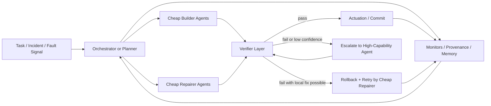
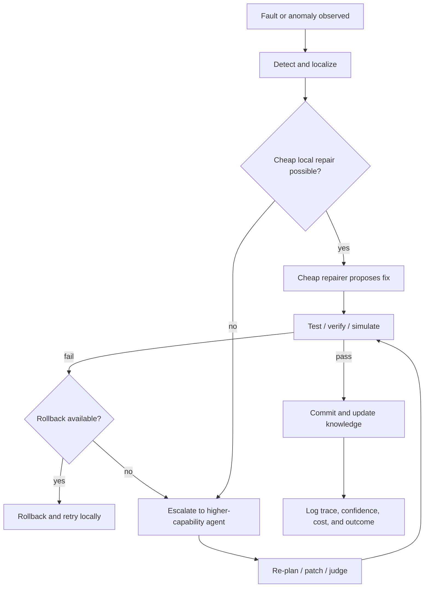
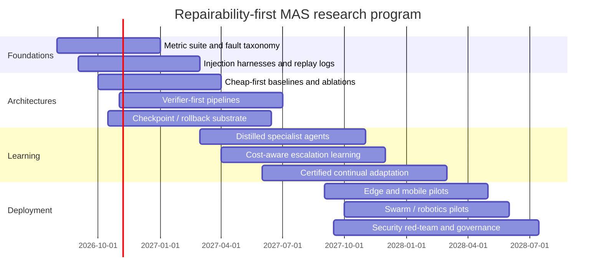

# DR26-07-05-HUB-09 — raw report from systems

> Unedited output of one model. Our reconciled synthesis is the page one level up.

# Repairability-First Multi-Agent Systems

## Executive summary

“Repairability-first” is not yet a standardized term in the multi-agent literature. The most defensible way to define it is by combining classic maintainability and repairability from reliability engineering with autonomic computing’s self-healing loop and multi-agent fault-tolerance research. In that synthesis, a repairability-first multi-agent system is one that is intentionally engineered so failures can be **detected early, localized cheaply, reversed safely, and improved over time**, with these properties treated as first-class design goals rather than afterthoughts. In reliability terms, maintainability is the probability that maintenance can be performed within a stated time under stated procedures and resources; repairability is the “ease of restoring service after a failure.” In autonomic/self-healing terms, the system must discover, diagnose, and react to disruptions. In MAS terms, coordination, communication, negotiation, and verification are part of the recovery mechanism, not just the task mechanism. (White et al., 2006; Cheng et al., 2004; SEBoK, 2025; Arfat and Eassa, 2016). citeturn18view0turn28view5turn32view1turn18view3

The central architectural thesis is strong: in many domains, **cheap models should do most of the building and first-pass repairing**, while expensive models should be reserved for strategic planning, rare escalations, and final adjudication. This is already visible in several adjacent lines of work: model cascades such as FrugalGPT reduce cost sharply by routing only a minority of traffic to stronger models; SATER reports performance comparable to the strong-model baseline at roughly half the cost under the right routing regime; speculative decoding formalizes a “small draft, large verify” pattern; α-UMi decomposes tool use into planner/caller/summarizer specialists; and industrial guidance from NVIDIA explicitly argues that heterogeneous systems should let SLMs play the central operational role while LLMs are invoked only when their generalist capability is actually needed. (Chen et al., 2024; Shen et al., 2025; Leviathan et al., 2023; Chen et al., 2023; Shen et al., 2024; Belcak, 2025). citeturn27view2turn20view3turn24view2turn24view3turn24view0turn29view2

The strongest motivations are domains where systems are **long-lived, resource-constrained, safety-relevant, or operationally expensive to service**: software maintenance, edge/IoT deployments, swarm robotics, network operations, industrial maintenance, and enterprise workflows that must continue running despite local faults. In these settings, the dominant economic objective is often not “best possible single-shot answer quality,” but **availability under budget**—lower MTTR, bounded latency, lower energy, fewer truck rolls or human interventions, and graceful degradation when parts fail. This is exactly the territory of RAM engineering, self-healing control loops, ROS lifecycle management, Kubernetes-style replacement, swarm fault detection, and recent hybrid agentic/edge designs. (SEBoK, 2025; Kubernetes, 2025; ROS 2 design docs, 2021; Winfield and Nembrini, 2005; Carminati et al., 2024; Farahani et al., 2026; TM Forum Catalyst, 2025). citeturn32view1turn28view1turn18view16turn18view5turn18view6turn30view2turn29view0

The literature also makes clear that repairability is not free. More agents can increase **coordination overhead, topology sensitivity, false consensus, privilege propagation, and debugging complexity**. Recent work on multi-agent failure analysis identifies three broad categories—system-design issues, inter-agent misalignment, and verification issues—while a separate 2026 study shows how a single small error can cascade into system-wide failure through message dependencies, yielding “cascade amplification,” “topological sensitivity,” and “consensus inertia.” Security work is equally blunt: prompt injection can replicate across agents like a worm, and privilege escalation can occur when a low-trust agent induces a high-privilege one to act without adequate verification. (Cemri et al., 2025; Xie et al., 2026; Lee et al., 2024; Sharma et al., 2025). citeturn19view2turn19view3turn19view5turn19view0turn18view17turn25view2

The practical conclusion is narrow and useful: **repairability-first MAS should be built around reversible state, typed communication, cheap local repair, strong verification, bounded escalation, and explicit cost/error accounting**. The best near-term research program is not to build ever more elaborate “societies” of agents. It is to engineer systems that answer four operational questions well: *What failed? Can a cheap specialist fix it? How do we verify the fix? When do we escalate?* Current benchmarks only partially cover this. There is still no broadly accepted benchmark suite for “repairability-first MAS” as such; the best available evaluation must be assembled from coordination benchmarks, tool-use benchmarks, software-repair benchmarks, edge/energy benchmarks, and fault-injection experiments. (MultiAgentBench, 2025; BFCL, 2025; StableToolBench, 2024; SWE-bench, 2024; HWE-Bench, 2026; MLPerf Tiny, 2021). citeturn22view0turn18view7turn18view8turn22view4turn22view1turn28view2

## Core concept and taxonomy

A rigorous working definition is:

> **Repairability-first multi-agent systems** are multi-agent systems whose primary architectural objective is to minimize the cost and risk of restoring correct operation after local or global failure, by designing for observability, modularity, reversible state, targeted recovery, and continuous improvement.

That definition is not a quotation from a single paper; it is a synthesis grounded in RAM engineering, autonomic computing, Rainbow-style self-adaptation, and MAS fault-tolerance work. The synthesis matters because the source literatures use overlapping but non-identical terms: *maintainability*, *repairability*, *self-healing*, *fault tolerance*, *self-adaptation*, and *resilience*. Repairability-first is best treated as a system-level property sitting at the intersection of those traditions. (SEBoK, 2025; White et al., 2006; Cheng et al., 2004; Arcaini et al., 2015; Arfat and Eassa, 2016). citeturn32view1turn18view0turn28view5turn28view6turn18view3

From these foundations, six design principles follow.

First, **decompose by repair boundary**, not only by task boundary. Components should be separable enough that a failed planner, executor, retriever, verifier, memory store, tool adapter, or physical node can be restarted, replaced, or rolled back without resetting the whole system. This is the architectural logic behind Rainbow’s externalized adaptation layer, ROS managed nodes, LangGraph checkpointing, and Kubernetes replacement semantics. (Cheng et al., 2004; ROS 2 design docs, 2021; LangGraph docs, 2026; Kubernetes, 2025). citeturn28view5turn18view16turn18view14turn28view1

Second, **cheap models should own local, repeatable, structured subproblems**. The evidence is strongest where the task is predictable, schema-constrained, repetitive, or tool-mediated: routing, parsing, retrieval, formatting, constrained editing, narrow verification, or patch retries. NVIDIA’s position paper and blog make this explicit for agentic workloads; α-UMi and related tool-use work show that capability decomposition lets smaller specialists compete better than a monolithic single model; speculative decoding formalizes the same draft/verify asymmetry at the token layer. (Belcak et al., 2025; Belcak, 2025; Shen et al., 2024; Leviathan et al., 2023; Chen et al., 2023). citeturn13search8turn29view2turn24view0turn24view2turn24view3

Third, **verification must be architecturally independent of repair**. Repairability-first systems assume builders will fail. Therefore, tests, assertions, semantic critics, structured schemas, or human approval must sit outside the builder. This is visible in program repair, where RepairAgent applies a patch, runs the test suite, and explicitly reverts failed edits; in verification-aware planning, where tasks are created together with verification functions; in Hard2Verify and VerifyBench, which emphasize that modern systems increasingly need dedicated verifiers rather than relying on generation alone. (Bouzenia et al., 2025; VeriMAP, 2025; Pandit et al., 2026; VerifyBench, 2025). citeturn27view6turn23view1turn20view4turn23view2

Fourth, **state must be reversible**. Cheap repair is impossible if every failed intervention corrupts the global state irreversibly. Checkpoints, rollback logs, thread-scoped memory, durable traces, and managed lifecycle transitions are therefore not optional plumbing; they are core repair machinery. LangGraph explicitly frames checkpoints as enabling time travel and fault tolerance, while ROS and Kubernetes formalize restart/replacement around stateful components. (LangGraph docs, 2026; ROS 2 design docs, 2021; Kubernetes, 2025). citeturn18view14turn18view16turn28view1

Fifth, **communication must preserve provenance**. Repair becomes much harder once messages lose authorship, role, version, confidence, and dependency information. The classic Contract Net Protocol and FIPA-style performatives matter here conceptually because they separate *what is being requested, offered, accepted, or reported* from raw conversational text. Recent error-cascade and prompt-infection work reinforces this point: without message-level lineage, a single false or malicious belief can propagate system-wide. (Smith, 1980; FIPA/JADE; Xie et al., 2026; Lee et al., 2024). citeturn18view2turn10search0turn19view0turn18view17

Sixth, **repairability must be measured jointly with cost**. RAM engineering already ties maintainability to downtime and lifecycle cost. Modern agentic systems add token cost, API cost, energy, network traffic, and verification overhead. A system that repairs accurately but only with frontier-model escalation on half the requests is not repairability-first in deployment terms. (SEBoK, 2025; FrugalGPT, 2024; SATER, 2025; MLPerf Tiny, 2021; Fernandez et al., 2025). citeturn32view1turn27view2turn20view3turn28view2turn20view8

### Concise taxonomy of architectures and agent roles

| Architecture pattern | Cheap-model roles | High-capability roles | Typical repair target | Verification / rollback mode | Best-fit domains | Main weakness |
|---|---|---|---|---|---|---|
| **SLM-default, LLM-fallback cascade** | Router, parser, retriever, structured responder, first-pass repairer | Rare fallback solver and final adjudicator | Query difficulty mismatch, local generation failure | Confidence gating + escalation; optional replay/checkpointing | Enterprise workflows, edge assistants, tool use | Threshold/calibration errors can misroute hard cases (Chen et al., 2024; Shen et al., 2025). citeturn27view2turn20view3 |
| **Large planner, cheap builders** | Executors, callers, editors, summarizers, local patchers | Global planner/topology designer | Execution faults, bad tool calls, patch attempts | Tests/assertions on executor outputs; planner replans on failure | Tool-use agents, software maintenance | Planner bottleneck; planner mistakes poison all workers (Shen et al., 2024; VeriMAP, 2025). citeturn24view0turn23view1 |
| **Cheap builders, large verifier** | Draft answer/code/plan/token producer | Semantic verifier / final checker | Hallucinations, invalid edits, unsafe actions | Accept/reject, correct, or defer; rollback on failed tests | Safety-sensitive reasoning, code repair, filtering | Verifier cost can dominate; repair loops can stall (Leviathan et al., 2023; Pandit et al., 2026; RAPIDS, 2026). citeturn24view2turn20view4turn25view3 |
| **Layered edge-cloud MAS** | On-device SLMs, rules, anomaly detectors, reflexive repairers | Cloud planner, analytics, strategic optimizer | Sensor noise, transient connectivity, concept drift | Local certifier + delayed cloud validation | IoT, mobile, industrial maintenance | Model drift and hardware heterogeneity complicate tuning (Farahani et al., 2026; Google AI Edge Portal, 2026; MLPerf Tiny, 2021). citeturn30view2turn28view3turn28view2 |
| **Distributed swarm / peer-repair MAS** | Peer monitors, majority voters, local behavior classifiers | Optional supervisor or digital twin | Agent failure, dropouts, inconsistent behaviors | Peer consensus, exogenous/endogenous detection, redundancy | Swarm robotics, distributed sensing | Consensus can mask correlated failure; limited local context (Winfield and Nembrini, 2005; Carminati et al., 2024). citeturn18view5turn32view6 |
| **Checkpointed workflow orchestrators** | Short-horizon workers, schema enforcers, retriers | Orchestrator, human-in-the-loop authority | Workflow interruption, tool exceptions, partial-state corruption | Checkpoints, time travel, managed restart | Production agent pipelines | Durable state reduces downtime but adds state-management complexity (LangGraph docs, 2026; Microsoft Agent Framework, 2026). citeturn18view14turn29view3 |
| **Agentless / pipeline repair baseline** | specialized fetch/edit/validate stages, often with cheap retrievers | Optional stronger editor or judge | Localization and patching rather than open-ended orchestration | Fixed validation harness | Software maintenance | Often cheaper and more interpretable, but less adaptive in open-world tasks (Xia et al., 2025; Xie et al., 2025). citeturn31search5turn24view1 |

### A useful conceptual architecture

This is the repairability-first pattern in one picture: cheap agents do most of the work; a verifier decides whether to commit, retry locally, or escalate; and the entire loop is stateful and reversible. The diagram is a synthesis of autonomic closed loops, repair/validation in program repair, workflow checkpointing, and edge/cloud orchestration patterns. (White et al., 2006; Cheng et al., 2004; Bouzenia et al., 2025; LangGraph docs, 2026; Farahani et al., 2026). citeturn18view0turn28view5turn27view6turn18view14turn30view2

## Motivations and use cases

The most compelling motivation is **long-lived operation under uncertainty**. RAM engineering treats maintainability, availability, and lifecycle cost as tightly linked. Self-healing/autonomic systems exist because manual repair does not scale once systems become large, dynamic, and heterogeneous. Repairability-first MAS extends that logic from “distributed software components” to “distributed cognitive components.” A planner can fail, a verifier can fail, a retriever can drift, a robot can drop out, a code patch can regress, a cloud dependency can vanish, or an attacker can inject one message into an agent channel. In each case, the system should not merely continue; it should continue in a way that is inspectable and economically bounded. (SEBoK, 2025; White et al., 2006; Cheng et al., 2004). citeturn32view1turn18view0turn28view5

In **edge and IoT systems**, the case is straightforward: sending every problem to the cloud is often too slow, too expensive, and too fragile. Google’s AI Edge Portal exists precisely because real on-device performance depends on hardware variation and deployment-scale benchmarking, while MLPerf Tiny exists because latency, accuracy, and energy must be measured jointly on constrained devices. Repairability-first designs for these environments should therefore default to on-device anomaly detection, local fallback policies, and compact language/control models for fast repair, escalating only when local certainty drops or strategic reasoning is needed. (Google AI Edge Portal, 2026; MLPerf Tiny, 2021; Belcak, 2025). citeturn28view3turn28view2turn29view2

In **swarm robotics and distributed autonomy**, the system-level advantage of many small units is only real if the swarm can survive local faults without central human intervention. Classical swarm-robustness work warns that the rhetoric of “inherent robustness” is often overstated; robustness must be verified with fault models and experiments. Recent work on distributed swarm fault detection shows that data-driven local classifiers can detect faults in self and peers with relatively little explicit domain knowledge, which is exactly the kind of cheap local repair signal a repairability-first architecture wants. (Winfield and Nembrini, 2005; Carminati et al., 2024). citeturn18view5turn32view6

In **software maintenance**, the use case is already highly concrete. SWE-bench defines the task as resolving real GitHub issues by generating patches; SWE-Gym provides an environment for training coding agents and verifiers; HWE-Bench extends repository-scale repair to hardware projects; RepairAgent explicitly applies patches, runs tests, and reverts failed attempts; and simpler “agentless” baselines show that repairability should not be conflated with agent count. This domain is probably the best near-term laboratory for repairability-first MAS because failures are easy to inject, rollback is executable, and correctness can often be checked automatically. (SWE-bench, 2024; SWE-Gym, 2025; HWE-Bench, 2026; Bouzenia et al., 2025; Xia et al., 2025). citeturn22view4turn20view2turn22view1turn27view6turn31search5

In **industrial maintenance and network operations**, the pattern is becoming visible in published hybrid systems and official pilots. Farahani et al. describe a prescriptive-maintenance architecture where LLM planner agents coordinate rule-based agents and SLM edge agents. TM Forum’s network-fault-healing Catalyst similarly describes a multi-layer, cross-domain architecture that uses LLMs, agents, digital twins, and “small-model algorithms” to reduce MTTR in transport networks. These are not universal proofs, but they are highly relevant field signals: the real demand is for systems that can repair operational faults faster and cheaper than centralized human workflows. (Farahani et al., 2026; TM Forum Catalyst, 2025). citeturn30view2turn29view0

## Architectures and coordination patterns

The classical coordination baseline remains the **contract/negotiation view**. Smith’s Contract Net Protocol is still the clearest conceptual template for repairable delegation: tasks are announced, bids are made, assignments are explicit, and control is distributed. For repairability-first systems, that matters because repair work itself can be negotiated: *who diagnoses, who repairs, what budget applies, who verifies, who has authority to commit, and when to give up and escalate*. The old protocol does not solve modern LLM-agent problems, but it provides the correct abstraction: recovery should be explicit, bounded, and role-typed. (Smith, 1980). citeturn18view2

Modern MAS implementations add several recurring patterns.

A **hierarchical orchestrator pattern** uses a top-level coordinator to route work to specialized agents. Microsoft’s guidance and framework both explicitly emphasize central orchestration plus domain experts, with support for sequential, concurrent, handoff, and group patterns, as well as durability and restartability. This pattern is attractive when failures are best handled by a central policy that can compare agent confidences, maintain shared context, and enforce escalation policies. Its weakness is the emergence of a planner bottleneck and a single locus for specification failure. (Microsoft, 2025; Microsoft Agent Framework, 2026). citeturn29view1turn29view3

A **builder/verifier pattern** is often stronger when correctness matters more than speed. Here, cheap builder agents construct plans, patches, or tool calls, while an independent verifier evaluates them. VeriMAP crystallizes this design by attaching verification functions to subtasks; Hard2Verify and VerifyBench show why verifier quality deserves separate evaluation; and Mace adds a third agent so that the verifier can demand corrections without contaminating the planner or executor roles. The critical lesson is that the verifier must inspect *structured outputs against explicit criteria*, not merely “feel” that the answer is plausible. (VeriMAP, 2025; Pandit et al., 2026; VerifyBench, 2025; Saha et al., 2026). citeturn23view1turn20view4turn23view2turn23view0

A **checkpointed workflow pattern** treats the run as a resumable state machine rather than a transient conversation. LangGraph’s checkpointers explicitly exist for fault tolerance, conversation continuity, time travel, and HITL workflows; ROS managed nodes let components be restarted or replaced online; Kubernetes keeps the desired state by replacing failed pods. In repairability-first MAS, cheap repairers should update or replay only the failed segment of a workflow whenever possible. That is the closest software analogy to replacing a faulty robot or failed sensor while leaving the rest of the swarm in place. (LangGraph docs, 2026; ROS 2 design docs, 2021; Kubernetes, 2025). citeturn18view14turn18view16turn28view1

An **edge-cloud layered pattern** assigns local reflexes to cheap agents and strategic reasoning to remote agents. Farahani et al.’s manufacturing architecture is representative: an LLM planner coordinates lower-level agents for schema discovery, feature analysis, model selection, and optimization, with SLMs and rule-based agents doing efficient edge work. This layered split is likely to become the default repairability-first architecture outside pure cloud software because it aligns cognitive authority with communication cost. (Farahani et al., 2026). citeturn30view2

### Common protocol elements

Communication protocols in repairability-first MAS should not be treated as free-form chat. The literature points toward a practical stack:

- **Typed messages or performatives** for requests, results, failures, bids, approvals, and rejections, following the spirit of Contract Net and FIPA/ACL. (Smith, 1980; JADE; SPADE). citeturn18view2turn10search0turn28view7  
- **Task allocation rules** that specify whether repair authority is centralized, negotiated, market-based, topology-based, or peer-voted. (Smith, 1980; MultiAgentBench, 2025). citeturn18view2turn22view0  
- **Fault detection channels** that combine monitors, peer reports, execution traces, anomaly detectors, and environment tests. Distributed swarm detection and MAPE-K-style loops are the strongest references here. (Arcaini et al., 2015; Carminati et al., 2024). citeturn28view6turn32view6  
- **Verification functions** that are deterministic whenever possible: tests, assertions, schema checks, AST checks, replay, simulation, or interpreted formal constraints. When semantic judgment is unavoidable, attach it to a separate verifier agent and track uncertainty. (BFCL, 2025; VeriMAP, 2025; Hard2Verify, 2026). citeturn18view7turn23view1turn20view4  
- **Rollback and recovery semantics** determining whether the action is reverted, retried locally, re-planned globally, or escalated to human review. RepairAgent’s failed-test revert is the clearest software example. (Bouzenia et al., 2025). citeturn27view6  
- **Redundancy and diversity** through replicas, peer voting, or heterogeneous specialists. The benefit is fault masking; the risk is correlated error or consensus inertia. (Winfield and Nembrini, 2005; Xie et al., 2026). citeturn18view5turn19view0

### Typical repair workflow

This workflow captures the intended operational discipline: cheap-first repair, strong verification, reversible state, explicit escalation, and learning from traces. It is directly motivated by MAPE-K, LangGraph-style checkpoints, RepairAgent-style revert-on-failure, and modern verifier-aware planning. (Arcaini et al., 2015; LangGraph docs, 2026; Bouzenia et al., 2025; VeriMAP, 2025). citeturn28view6turn18view14turn27view6turn23view1

### Representative papers, projects, and industry examples

| Type | Item | Why it matters | Primary link |
|---|---|---|---|
| Academic foundation | **Contract Net Protocol** (Smith, 1980) | The canonical task-sharing and negotiation model for distributed problem solving; still the cleanest abstraction for bounded delegation and repair contracts. citeturn18view2 | [Paper](https://www.reidgsmith.com/The_Contract_Net_Protocol_Dec-1980.pdf) |
| Academic foundation | **Rainbow** (Cheng et al., 2004) | Classic architecture-based self-adaptation; separates adaptation infrastructure from the target system, which is essential for repairable orchestration. citeturn28view5 | [Paper](https://www.cs.cmu.edu/afs/cs/project/able/ftp/icac/autonomic-web.pdf) |
| Survey | **A Survey on Fault Tolerant Multi Agent System** (Arfat and Eassa, 2016) | Good classical survey on MAS failure types, replication, recovery, and coordination requirements. citeturn18view3 | [Paper](https://www.mecs-press.org/ijitcs/ijitcs-v8-n9/IJITCS-V8-N9-6.pdf) |
| Academic | **Small LLMs Are Weak Tool Learners / α-UMi** (Shen et al., 2024) | Important evidence that decomposing planner/caller/summarizer roles can let smaller specialists outperform monolithic single-model tool use. citeturn27view4turn27view5 | [Paper](https://aclanthology.org/2024.emnlp-main.929.pdf) |
| Academic | **FrugalGPT** (Chen et al., 2024) | Cost-aware model cascade; showed up to **98%** cost reduction while preserving best-model performance on the evaluated tasks. citeturn27view0turn27view2 | [Paper](https://lingjiaochen.com/papers/2024_FrugalGPT_TMLR.pdf) |
| Academic | **SATER** (Shen et al., 2025) | Confidence-aware routing/cascading between an SLM and LLM; reports strong cost/latency trade-offs and explicitly studies routing quality. citeturn20view3 | [Paper](https://aclanthology.org/2025.emnlp-main.531.pdf) |
| Academic | **OPTIMA** (Chen et al., 2025) | Trains multi-agent collaboration for both effectiveness and token efficiency; reports up to **2.8×** gain with less than **10%** of the tokens on heavy information-exchange tasks. citeturn27view3 | [Paper](https://aclanthology.org/2025.findings-acl.601.pdf) |
| Academic | **RepairAgent** (Bouzenia et al., 2025) | Concrete autonomous repair loop for code: patch, test, revert on failure. This is one of the clearest exemplars of practical repair semantics. citeturn27view6 | [Paper](https://software-lab.org/publications/icse2025_RepairAgent.pdf) |
| Benchmark | **MultiAgentBench / MARBLE** (Zhu et al., 2025) | One of the most useful current benchmarks for coordination, topology, milestone progress, and inter-agent collaboration quality. citeturn22view0turn27view7 | [Paper](https://aclanthology.org/2025.acl-long.421.pdf) · [Code](https://github.com/ulab-uiuc/MARBLE) |
| Benchmark | **BFCL** (Patil et al., 2025) | Strong benchmark for function calling and tool-use correctness, including serial/parallel calls and AST-based evaluation. citeturn18view7 | [Paper](https://proceedings.mlr.press/v267/patil25a.html) |
| Benchmark | **StableToolBench** (Guo et al., 2024) | Stabilizes API/tool evaluation with a virtual API server and reproducible evaluation logic. Very useful for repairability experiments involving tool failures. citeturn18view8 | [Paper](https://aclanthology.org/2024.findings-acl.664/) · [Project](https://zhichengg.github.io/stb.github.io/) |
| Benchmark | **SWE-bench / SWE-Gym / HWE-Bench** (Jimenez et al., 2024; OpenAI/Princeton updates; Cui et al., 2026) | Best current family for executable software/hardware maintenance and repair, with containerized validation and repository-scale difficulty. citeturn22view4turn20view2turn22view1 | [SWE-bench](https://github.com/swe-bench/SWE-bench) · [SWE-Gym](https://arxiv.org/abs/2412.21139) · [HWE-Bench](https://github.com/pku-liang/hwe-bench) |
| Open source | **LangGraph** | Production-oriented durability: checkpoints, time travel, HITL, and fault tolerance are built into the workflow substrate. citeturn18view14 | [Docs](https://docs.langchain.com/oss/python/langgraph/persistence) |
| Open source | **Microsoft Agent Framework** | Production-grade orchestration for Python/.NET with checkpointing, restartability, graph workflows, and governance controls. citeturn29view3 | [Repo](https://github.com/microsoft/agent-framework) |
| Open source | **AutoGen / AutoGenBench** | Influential multi-agent framework plus evaluation tooling with logs/telemetry for debugging and profiling. citeturn18view15turn22view2 | [Framework](https://microsoft.github.io/autogen/stable/) · [Bench](https://microsoft.github.io/autogen/0.2/blog/2024/01/25/AutoGenBench/) |
| Open source | **SPADE / SPADE-LLM** | FIPA/XMPP-flavored distributed MAS stack with LLM extensions; useful for explicit messaging and distributed deployment. citeturn28view7turn20view13 | [SPADE](https://spade-mas.readthedocs.io/en/latest/readme.html) · [SPADE-LLM](https://spadeagents.eu/docs/spade_llm/) |
| Industry / field signal | **TM Forum multi-level multi-agent network fault healing** | Official industry pilot focused on transport-network fault management, MTTR reduction, and multi-layer agent orchestration with small-model algorithms and digital twins. citeturn29view0 | [Project](https://www.tmforum.org/catalysts/projects/C25.5.859/multilevel-multiagent-network-fault-healing) |
| Industry / field signal | **RAPIDS** (Indeed, 2026) | Strong security example of an SLM-first, LLM-verifier cascade at production scale: high recall, 21–24× lower latency, ~3.5% of standalone API cost. citeturn25view3 | [Paper](https://aclanthology.org/2026.acl-industry.127.pdf) |
| Industry / platform | **Google AI Edge Portal** | Official tooling for benchmarking/debugging on-device ML/LLMs across large device fleets; directly relevant to edge repairability evaluation. citeturn18view13turn28view3 | [Docs](https://developers.google.com/edge/ai-edge-portal) |
| Industry / position | **NVIDIA SLMs for agentic AI** | Clear industry articulation of the heterogeneous design pattern: SLMs for repetitive structured work, LLMs for rare strategic tasks. citeturn29view2 | [Paper](https://arxiv.org/abs/2506.02153) · [Blog](https://developer.nvidia.com/blog/how-small-language-models-are-key-to-scalable-agentic-ai/) |

## Learning and adaptation

The right learning objective for repairability-first MAS is not “maximize average task score” in isolation. It is “maximize **recoverable** task score under budget.” That shifts the emphasis from raw capability to **fast adaptation, low-cost specialization, and verifier-aware improvement**.

For **meta-learning**, the most concrete high-confidence lesson comes from MARL rather than repair-specific agentic systems. Zhang et al. show that learning meta-representations across varying games/populations improves generalization, and that with limited latent space sizes fast adaptation can be achieved using first-order gradient information. That is relevant because repairability-first systems often confront changing team sizes, available modules, and local failure patterns. Meta-learning is therefore most promising for *repair-policy initialization* and *fast reconfiguration* after topology changes, although the direct evidence for language-agent repair remains early. (Zhang et al., 2023). citeturn34view0

For **continual learning**, federated continual learning for Edge-AI is likely the most directly relevant substrate. The survey by Wang et al. frames FCL as a way to maintain stable and reliable model performance in dynamic distributed environments, exactly the condition faced by edge repairers and long-lived local controllers. In practical terms, this means cheap local agents should update from local traces cautiously, with replay buffers, drift monitors, and rollback checkpoints, while high-capability agents curate periodic consolidated updates. (Wang et al., 2024). citeturn20view10

For **self-supervision and test-time adaptation**, the pattern to import is “repair only when a certifier agrees.” Jawaid et al. propose test-time self-supervision with a certifier module for Sim2Real adaptation in robotics; only certified corrective updates are backpropagated. That is the right discipline for repairability-first MAS more broadly. Cheap repairers should be allowed to adapt online, but only when a verifier/certifier can bound the risk of contaminating the system with self-generated errors. (Jawaid et al., 2024). citeturn35view0

For **distillation**, the evidence is strong that larger teachers can train cheaper specialists with useful behavior, especially when specialist roles are explicit. KARD distills knowledge-augmented rationales into smaller models; D&R Distillation trains separate decomposer and responder students that interact on subquestions; α-UMi uses task-specific specialists trained in stages; speculative decoding research repeatedly improves “draft” models so they align better with larger targets. The common point is that distillation is more effective when the cheap model’s role is narrow and verifiable, not when it is asked to be a full general-purpose peer of the large model. (Kang et al., 2023; Li et al., 2024; Shen et al., 2024; Wang et al., 2025; Zhang et al., 2026). citeturn34view3turn34view4turn24view0turn24view4turn24view5

For **coordination learning**, MAGRPO-style work is important because it shifts fine-tuning from individual outputs to collaborative trajectories. Liu et al. model LLM collaboration as a cooperative MARL problem and show that fine-tuning with multi-agent RL can improve both quality and efficiency in collaborative tasks. For repairability-first systems, the most important future extension is to align rewards not only to final success, but also to *repair effort*, *rollback safety*, *escalation discipline*, and *message economy*. (Liu et al., 2026). citeturn36search3

For **Sim2Real**, the right takeaway is methodological rather than domain-specific. Recent Sim2Real surveys frame adaptation in terms of state, action, transition, and reward mismatches, including the use of foundation models. Repairability-first robotics and embodied MAS should therefore train cheap repairers primarily in simulation, but explicitly evaluate whether recovery policies survive real sensor noise, timing jitter, packet loss, and actuator drift. (Sim2Real Survey, 2025). citeturn20view9

## Evaluation and benchmarks

There is no single benchmark today that directly measures “repairability-first MAS.” The field must therefore evaluate across **four layers**: coordination quality, tool-use correctness, executable repair, and deployment economics.

At the **coordination layer**, MultiAgentBench is the strongest current general benchmark because it measures not only task completion, but milestone-based KPIs, planning, communication, and topology effects across several environments. It is especially useful for comparing star, chain, tree, and graph coordination when studying whether more topology freedom helps or hurts repairability. Microsoft’s AutoGenBench is also useful as harness infrastructure because it supports repeated runs, telemetry, isolation, and debugging traces. (Zhu et al., 2025; Microsoft, 2024; Microsoft Research, 2024). citeturn22view0turn27view7turn22view2turn20view14

At the **tool-use layer**, BFCL and StableToolBench are the most practical choices. BFCL evaluates serial and parallel function calling with AST-based evaluation in real-world settings. StableToolBench addresses evaluation drift by simulating APIs and caching responses. These two together are crucial because many “repairs” in agentic systems are not semantic rewrites; they are repairs of tool invocation, argument structure, and protocol correctness. (Patil et al., 2025; Guo et al., 2024). citeturn18view7turn18view8

At the **executable repair layer**, SWE-bench, SWE-Gym, HWE-Bench, and domain-specific program-repair systems matter most. SWE-bench formalizes issue-to-patch resolution; SWE-Gym adds trajectory training for agents and verifiers; HWE-Bench extends repository-scale repair to RTL/hardware code; RepairAgent gives a concrete “apply-test-revert” agent loop. These are currently the best substrates for measuring not only correctness but also rollback, retry, and escalation behavior. (Jimenez et al., 2024; SWE-Gym, 2025; Cui et al., 2026; Bouzenia et al., 2025). citeturn22view4turn20view2turn22view1turn27view6

At the **deployment-economics layer**, MLPerf Tiny, Google AI Edge Portal, vLLM metrics, and energy-inference studies are the practical tools. MLPerf Tiny measures accuracy, latency, and energy on constrained devices. Google AI Edge Portal benchmarks across large fleets of real devices. vLLM exposes end-to-end latency and time-per-output-token metrics and supports speculative decoding, batching, and structured outputs. Energy studies show that decoding strategy, serving framework, batching, and hardware materially change inference energy, which means repairability claims without deployment measurements are incomplete. (Banbury et al., 2021; Google AI Edge Portal, 2026; vLLM docs, 2026; Fernandez et al., 2025). citeturn28view2turn28view3turn28view4turn20view8

### Recommended metrics

A repairability-first evaluation stack should report the following metrics together:

| Metric | Definition | Why it matters |
|---|---|---|
| **Task Success Rate** | Fraction of tasks completed correctly | Baseline capability |
| **Repair Success Rate** | Fraction of failed attempts recovered without human intervention | Direct repairability |
| **MTTD** | Mean time to detect fault | Observability quality |
| **MTTR / Time to Recovery** | Mean time from fault onset to successful restoration | Classical maintainability outcome (SEBoK, 2025). citeturn32view1 |
| **Availability** | Approx. MTBF / (MTBF + MTTR) for repairable systems | Connects repair speed to service continuity (SEBoK, 2025). citeturn32view1 |
| **Escalation Rate** | Share of tasks requiring stronger model/human escalation | Measures whether cheap-first design is actually doing useful work |
| **Escalation Precision** | Fraction of escalations that were genuinely necessary | Quality of gating/router |
| **Rollback Rate** | Fraction of attempted commits reverted | Measures rework and speculative aggression |
| **Verifier Recall / Precision** | Ability to catch bad fixes vs avoid blocking good ones | Safety-performance trade-off (VerifyBench, 2025; Hard2Verify, 2026). citeturn23view2turn20view4 |
| **Cost per Successful Task** | Total inference/runtime cost divided by successful tasks | Better than raw token cost for deployment |
| **Energy per Successful Task** | Joules or watt-hours divided by successful tasks | Necessary for edge and sustainability claims (MLPerf Tiny, 2021; Fernandez et al., 2025). citeturn28view2turn20view8 |
| **Communication Overhead** | Messages, tokens, bytes, or turns per solved task | Multi-agent complexity tax |
| **Cascade Amplification Index** | Downstream failures triggered per upstream error seed | Makes error propagation measurable (Xie et al., 2026). citeturn19view0 |
| **Security Score** | Weighted compromise, severity, and detection-delay score | Needed under adversarial operation (Sharma et al., 2025). citeturn25view2 |

### Suggested experimental setups

| Setup | System under test | Benchmarks / environment | Faults to inject | Key outputs |
|---|---|---|---|---|
| **Software maintenance lab** | SLM retriever + cheap patcher + verifier + LLM fallback | SWE-bench Verified/Lite, SWE-Gym, HWE-Bench | wrong retrieval, flaky tests, stale context, malformed patch, API/tool failure | resolution rate, rollback rate, MTTR, escalation precision, cost per fix |
| **General agent workflow lab** | orchestrator + cheap builders + verifier + durable state | MultiAgentBench, BFCL, StableToolBench, AutoGenBench | malformed tool schema, low-confidence routing, message reorder, partial memory loss | KPI completion, tool correctness, communication overhead, cascade index |
| **Edge/IoT lab** | on-device cheap model + cloud fallback + local certifier | MLPerf Tiny, Google AI Edge Portal, synthetic sensor pipelines | packet loss, latency spikes, device heterogeneity, concept drift, sensor noise | p50/p95 latency, energy, bytes sent, repair success under disconnection |
| **Swarm robotics lab** | peer monitors + local classifiers + supervisor/digital twin | Robotarium + simulation + physical subset | agent dropout, sensor corruption, motion faults, malicious peer messages | mission success under failures, detection F1, time to isolate, graceful degradation |
| **Security red-team lab** | same as above with provenance and least-privilege controls | prompt-injection suites + custom multi-agent attack harness | prompt infection, ACI injection, privilege escalation, misinformation propagation | compromise rate, detection delay, blocked-vs-executed harmful actions, forensic completeness |

A useful practice is to compare at least **four ablations** in every setup: monolithic large model, naive multi-agent, repairability-first with cheap repairers, and highly simplified pipeline/agentless baseline. The software-engineering literature is now clear that complexity itself can lose to simpler scaffolds, so every repairability claim should earn its keep. (Xia et al., 2025; Bouzenia et al., 2025). citeturn31search5turn27view6

## Trade-offs, security, and deployment economics

The main trade-off is between **local cheap repair** and **global correctness assurance**. Cheap agents improve throughput, latency, and cost, but they also increase the probability of subtle local failures. Strong verification can catch many of those failures—but verification itself costs time and money, and can become the bottleneck. Mace reports runtime overheads from roughly 5.3× to 27.5× depending on configuration, even while obtaining strong accuracy benefits. This is the core systems tension: reliability often comes from redundancy, separation of concerns, and rechecking, but each of those adds overhead. (Saha et al., 2026). citeturn23view0

A second trade-off is **agentic richness versus interpretability and baseline strength**. In software engineering, Agentless showed that a much simpler three-phase process—localization, repair, patch validation—could be both high-performing and low-cost relative to more elaborate autonomous agents on the benchmark it studied. That does not kill the case for repairability-first MAS. It does kill any lazy assumption that “more agents” automatically means better system behavior. The burden of proof remains on architectures that introduce extra planners, critics, reviewers, and tool routers. (Xia et al., 2025). citeturn31search5

A third trade-off is **heterogeneity versus operational complexity**. Heterogeneous systems—SLMs plus LLMs, or rule-based edge modules plus cloud planners—are often the economically correct design. But they add routing, calibration, observability, and update-management problems. SATER shows this clearly: routing quality determines whether the SLM saves cost without breaking quality. FrugalGPT likewise works because only a minority of tasks are escalated to the strongest model. These architectures live or die on threshold selection, uncertainty calibration, and robust fallback semantics. (Chen et al., 2024; Shen et al., 2025). citeturn27view2turn20view3

The most dangerous failure modes are now reasonably well characterized. Cemri et al.’s MAST taxonomy groups them into **system design issues, inter-agent misalignment, and verification issues**. Xie et al. add a more dynamical perspective, showing that modest local errors can become shared global errors through message dependencies, especially in topologies that encourage invalid consensus. Put plainly: if the system is easy to repair locally but easy to synchronize globally around a mistake, its apparent repairability is an illusion. (Cemri et al., 2025; Xie et al., 2026). citeturn19view2turn19view3turn19view0

Security sharpens all of this. Prompt Infection demonstrates LLM-to-LLM prompt injection that self-replicates across interconnected agents. TrustAgent argues that agent/MAS security needs a broader taxonomy than backbone LLM safety alone because memory, tools, other agents, and environment channels all become attack surfaces. Sharma et al. show how security benchmarking for MAS must include agent-to-agent cascading injection, privilege escalations, and misinformation propagation. Repairability-first systems should therefore assume hostile fault signals exist and should treat **provenance, least privilege, sandboxing, typed tool schemas, message lineage, and high-recall first-pass filtering** as mandatory controls. (Lee et al., 2024; Li et al., 2025; Sharma et al., 2025). citeturn18view17turn25view1turn25view2

RAPIDS is especially instructive because it demonstrates a realistic defense pattern: a lightweight SLM acts as a high-recall gatekeeper, with an LLM verifier only for suspected or novel cases. The result—very high end-to-end recall, 21–24× lower expected latency, and ~3.5% of standalone API cost—shows that security filtering is a natural use case for the “cheap repairer / expensive adjudicator” pattern. The same architecture should generalize to tool argument sanitization, memory poisoning detection, policy checks, and output quarantine. (Augey et al., 2026). citeturn25view3

On deployment economics, the evidence is heavily in favor of cheap-first architectures when tasks are narrow enough. NVIDIA explicitly argues that SLMs reduce latency, energy, and infrastructure cost for repetitive agentic work. Google AI Edge Portal provides the missing deployment tooling for large-device-fleet evaluation. vLLM shows that serving-layer optimizations—continuous batching, prefix caching, speculative decoding—change the effective economics of escalation. FrugalGPT, SATER, and RAPIDS each show in different ways that the relevant deployment question is not *how much does a model cost per token*, but *how much does a successful, verified outcome cost under realistic routing?* (Belcak, 2025; Google AI Edge Portal, 2026; vLLM docs, 2026; Chen et al., 2024; Shen et al., 2025; Augey et al., 2026). citeturn29view2turn28view3turn28view4turn27view2turn20view3turn25view3

## Research roadmap

The high-priority gap is not “invent another agent framework.” It is **standardizing repairability as an evaluable systems property**.

### Priority research agenda

| Priority | Research task | Why it is first-order | Success milestone |
|---|---|---|---|
| **Highest** | **Define a repairability metric suite and fault model library** | The field currently measures coordination, tool use, or repair separately, but not repairability-first MAS as a coherent target. | Public benchmark spec with MTTD, MTTR, rollback, escalation, verifier metrics, energy, and cascade index |
| **Highest** | **Build executable fault-injection harnesses** | Without controlled faults, repair claims are anecdotal. | Reproducible injection harnesses for software, tool workflows, edge pipelines, and swarm sims |
| **Highest** | **Create verifier-first architectures and benchmarks** | Verification quality is now the dominant bottleneck in safe cheap-first systems. | Strong baselines on VerifyBench/Hard2Verify + programmatic tests + low false blocks |
| **High** | **Train role-specialized cheap agents via distillation** | Narrow cheap specialists are more plausible than general cheap peers. | Planner/caller/editor/repairer specialists that beat monolithic small models on cost-adjusted success |
| **High** | **Learn escalation policies under cost and risk constraints** | Repairability-first systems succeed or fail on escalation quality. | calibrated router that minimizes cost subject to target error/availability constraint |
| **High** | **Make checkpoints, provenance, and rollback first-class** | Reversible state is foundational and still underemphasized. | observability stack with replay, partial rollback, and message lineage across agents |
| **Medium** | **Develop online adaptation with certified updates** | Continual adaptation is necessary, but unsafe without certifiers. | safe online update policy with rollback on regression |
| **Medium** | **Secure multi-agent repair channels** | Repair pathways themselves are a prime attack surface. | red-team suite showing resilience to prompt infection and privilege escalation |
| **Medium** | **Edge/Sim2Real deployment studies** | Cheap-first systems are most compelling on constrained hardware, but evidence is still fragmented. | published edge/swarm results with latency-energy-reliability curves on real hardware |
| **Longer-horizon** | **Formal policy/contract layers for authority and budget** | Needed to bound autonomous spending, runtime, and tool access. | machine-checkable “repair contracts” with policy enforcement and audits |

### A realistic 12–36 month program

### Milestones by phase

| Phase | Time window | Concrete deliverables |
|---|---|---|
| **Phase one** | **12 months** | repairability metric suite; fault taxonomy; benchmark harnesses for software/tool-use/edge; baseline comparisons between monolithic, naive multi-agent, repairability-first, and agentless pipeline |
| **Phase two** | **18–24 months** | distilled cheap specialists; calibrated escalation policies; independent verifier banks; checkpoint/rollback middleware; open datasets of repair traces and failures |
| **Phase three** | **24–36 months** | real edge pilots, network ops pilot, robot/swarm pilot; security red-team results; policy/contract governance layer; public leaderboard for repairability-first MAS |

The most important strategic choice is to make **evaluation infrastructure precede architectural ambition**. The field already has enough evidence that cheap-first heterogeneous systems can reduce cost and latency, and enough warnings that uncontrolled multi-agent complexity creates brittle failure dynamics. The missing ingredient is systematic, cross-domain evidence of when local cheap repair actually improves availability rather than just shifting where failure happens. (FrugalGPT, 2024; SATER, 2025; Cemri et al., 2025; Xie et al., 2026; MultiAgentBench, 2025; HWE-Bench, 2026). citeturn27view2turn20view3turn19view2turn19view0turn22view0turn22view1

## Open questions and limitations

Several points remain genuinely unresolved.

The first is **terminology**. “Repairability-first” is a useful synthesis, but it is not a standard term with agreed benchmark definitions. The report therefore maps it to better-established ideas—maintainability, self-healing, fault tolerance, verifier-aware orchestration, and reversible execution—rather than pretending a mature canonical literature already exists. citeturn32view1turn18view0turn28view5

The second is **evidence quality heterogeneity**. Some of the strongest sources are classical or peer-reviewed papers; some are modern official docs or industry pilots; and some emerging ideas—especially around meta-learning for self-healing databases or RL over orchestration traces—are much earlier-stage. Where the literature is still immature, the report treats the point as a research direction rather than established practice. citeturn33search5turn36search15

The third is **benchmark incompleteness**. Current benchmarks cover coordination, tool use, software repair, hardware repair, on-device efficiency, or security fragments, but there is still no unified benchmark that jointly measures repairability, cost, rollback safety, and adversarial robustness across multiple domains. That is the clearest gap in the area. citeturn22view0turn18view7turn18view8turn22view4turn22view1turn28view2turn25view2

The fourth is **external validity**. Many results come from text-heavy software or reasoning tasks. Embodied systems, unreliable networks, and real edge hardware introduce constraints—clock drift, packet loss, battery pressure, sensor corruption, actuator wear—that are still underrepresented in agentic benchmark culture. Sim2Real and edge benchmarking tools exist, but the bridge to truly repairable heterogeneous MAS is still thin. citeturn20view9turn35view0turn28view3