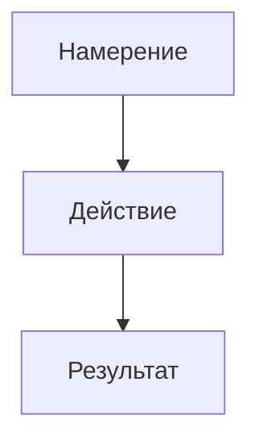
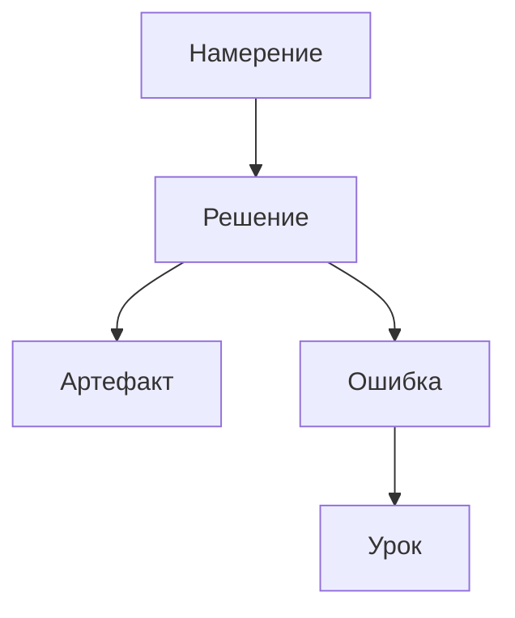

# DR26-07-06-HUB-04 — raw report from vendor

> Unedited output of one model. Our reconciled synthesis is the page one level up.

# Арт-дирекция GitHub-лонгрида для книги-сериала

## Инструментарий GitHub Markdown и честные границы

Для книги, которую читают прямо на `github.com`, у вас есть не “обычный Markdown”, а набор из GitHub Flavored Markdown плюс ограниченный, санитизированный HTML. База — заголовки `#`–`######`, списки, цитаты `>`, ссылки, изображения, таблицы, task-lists, emoji, footnotes, alerts, а также встроенный HTML там, где GitHub его допускает и не вырезает. При наличии двух и более заголовков GitHub автоматически показывает Outline в шапке файла; ссылки на секции генерируются автоматически, а для нестандартных точек можно добавлять `<a name="..."></a>`, но такие кастомные якоря в Outline не попадут. Для `.md`-файлов обычный перенос строки не равен новому абзацу: нужен пустой ряд, два пробела в конце строки, `\` или `<br/>`. GitHub отдельно рекомендует относительные ссылки и относительные пути к изображениям, чтобы они работали и на сайте, и в клоне репозитория. citeturn10view0turn10view1turn11view1turn37view2

Таблицы поддерживаются нативно, но это именно **информационные** таблицы, а не полноценочная layout-сетка. Перед таблицей обязателен пустой ряд; внутри ячеек можно использовать ссылки, inline code, жирный и курсив; выравнивание колонок задаётся двоеточиями. GitHub прямо говорит, что ширины ячеек могут различаться и идеально выравнивать “ASCII-раскладку” по пробелам не требуется. Это хороший инструмент для блока “Артефакты дня”, но плохой — для сложной журнальной композиции. citeturn32view0turn32view2

`<details>` и `<summary>` — разрешённый и официальный способ прятать вторичный слой текста. Внутрь можно класть заголовки, картинки и code blocks; есть `open` для раскрытия по умолчанию. Это один из самых сильных приёмов для сериальной книги, потому что позволяет держать “основной поток” чистым, а технические детали, бэкстейдж и приложения — сворачиваемыми. Но есть важная оговорка: alerts внутри nested/indented-контейнеров и особенно внутри `<details>` имеют известные проблемы рендеринга, а сами alerts по документации “нельзя вкладывать в другие элементы”. Иными словами: `details` — да; `alert inside details` — не как опорный паттерн. citeturn38search0turn11view4turn24view0turn24view3

Диаграммы и формулы GitHub рендерит нативно. Для диаграмм официально поддерживаются `mermaid`, `geojson`, `topojson` и `stl`; для формул — LaTeX через MathJax, как inline, так и блоками `$$...$$` или fenced-блоком ```math```. Для Mermaid GitHub отдельно советует проверять текущую версию рендерера через блок `info`, потому что новый синтаксис Mermaid может не совпасть с тем, что уже раскатан на GitHub. Для книги это означает: простые схемы причинно-следственных связей, roadmap-потоки и sequence diagrams — в Mermaid; формулы, KPI-выкладки и финансовые расчёты — в MathJax, если это не превращает главу в учебник. citeturn39view0turn39view1

Картинки можно вставлять обычным Markdown-синтаксисом ``, HTML-тегом ``, а для light/dark-переключения — через `<picture>` с `prefers-color-scheme`. GitHub официально показывает `<picture>` как рекомендуемый способ адаптации баннеров под тему, а GitHub Blog отдельно подтверждает, что этот подход подходит для README и других Markdown-файлов на GitHub.com. Исторически GitHub также добавил theme-specific image fragments `#gh-dark-mode-only` и `#gh-light-mode-only`, так что это тоже рабочий вариант, если вы хотите остаться в “чистом” Markdown без HTML-контейнера. citeturn11view5turn27search0turn35search0

Полезные мелочи, которые часто недоиспользуют: `<sub>`, `<sup>`, `<ins>` для малых типографических нюансов; `<kbd>` для обозначения клавиш и UI-жестов; HTML-комментарии `<!-- -->` для скрытых редакторских заметок; permanent links к строкам Markdown через `?plain=1#L14`, если вы хотите ссылаться из “артефактов” на конкретный фрагмент другой главы или исходника. Ещё один скрытый, но practically important момент: в Markdown-файлах репозитория автоссылки формата `#123` для issue/PR **не создаются**, так что для книги нельзя рассчитывать на “ленивую” issue-нотацию в тексте главы — только явные ссылки. citeturn7search10turn22search5turn11view3turn22search3

Честная граница GitHub — это санитизация HTML. GitHub aggressively удаляет то, что может нести CSS/JS-логику или риск: `script`-теги, inline styles, `class` и `id`-атрибуты. Отсюда следуют несколько жёстких выводов. Первое: **своих цветов текста и тонкой CSS-типографики на github.com у вас нет**. Второе: `<span style="color:red">`, `<div class="...">`, “подключу CSS-файл рядом” — не стратегия, а самообман. Третье: старый хаκ с `<font color=...>` исторически был выкинут из whitelist, поэтому “цветной текст” как элемент системы лучше сразу считать несуществующим. При этом inert-атрибуты вроде `width` у `` и `align` у контейнеров вроде `<p align="center">` в живых README реально используются, но поведение `align="left/right"` у изображений имело регрессии и не задокументировано как надёжный layout-механизм. Следовательно, держитесь подальше от float-подобной композиции, если документ должен жить годами. citeturn36search2turn12view0turn25view4turn8search3turn36search7

Ниже — компактная карта “что у вас есть”.

```md
# Заголовки
## Подзаголовок
### Микросекция

> [!NOTE]
> Информация для сканирующего читателя.

> [!TIP]
> Небольшой практический хак.

> [!WARNING]
> Риск, цена ошибки, ограничение.

<details>
<summary>Техдеталь / приложение / спойлер</summary>

Любой Markdown внутри.

</details>

| Артефакт | Что это | Ссылка |
| --- | --- | --- |
| Скриншот | Подтверждение | [PNG](./assets/proof.png) |

<picture>
  <source media="(prefers-color-scheme: dark)" srcset="./assets/banner-dark.svg">
  <source media="(prefers-color-scheme: light)" srcset="./assets/banner-light.svg">
  
</picture>



Inline math: $ROI = \frac{gain-cost}{cost}$

```math
\text{Burn rate} = \frac{\text{Cash}}{\text{Months}}
```

Нажмите <kbd>Cmd</kbd>+<kbd>K</kbd>.

Сноска сюда[^1].

<a name="artifact-table"></a>

<!-- Редакторская заметка: проверить alt-текст -->

[^1]: Короткое примечание.
```

## Визуальная система книги вместо зоопарка приёмов

Хорошая GitHub-глава не пытается “выжать максимум из Markdown”. Она строит **ограниченный набор повторяющихся семантических сигналов**, чтобы читатель через 3–5 глав уже читал книгу по инерции. Это особенно важно на GitHub, где интерфейс платформы уже сам по себе шумный: шапка репозитория, breadcrumb, Outline, file chrome. Чем стабильнее ваш внутренний визуальный язык, тем меньше когнитивная цена входа в каждую новую главу. Это согласуется и с UX-исследованиями о сканировании веб-страниц, и с GOV.UK-подходом к консистентности: люди не читают экран линейно, они ищут знакомые паттерны и опорные маркеры. citeturn29view1turn29view4turn29view3

Для вашей книги я бы строил систему вокруг принципа **“один приём = одно значение”**. Не “какой бокс красивее”, а “какой блок что означает”. Тогда даже на голом GitHub это превращается в редакционную сетку, а не в случайный набор украшений.

### Рекомендуемый семафор блоков

| Смысл блока | Приём | Зачем именно он |
| --- | --- | --- |
| Вопрос читателю | `### ❓ Вопрос читателю` + 1 короткий абзац | Вопрос не должен выглядеть как предупреждение |
| Челлендж / действие | `> [!TIP]` | Это мягкий push к действию, а не риск |
| Предупреждение / цена ошибки | `> [!WARNING]` или `> [!CAUTION]` | GitHub уже даёт сильный визуальный сигнал |
| Техдеталь / appendix | `<details><summary>...</summary>` | Не ломает поток основного чтения |
| Цитата дня | обычный `>` blockquote | Цитата не должна конкурировать с alert |
| Финансы / KPI / артефакты | компактная таблица | Данные лучше читать таблично |
| Пост автора / исповедь | `### 📝 Пост автора` + обычный текст | Это narrative block, не callout |

Это не “единственно верная” схема; это редакционная система, где каждый паттерн закреплён за одной функцией. Смысл в том, чтобы никогда не использовать один и тот же визуальный трюк для трёх разных вещей. Если warning-box иногда значит риск, иногда “интересный факт”, иногда “смешная история”, он перестаёт что-либо означать. GitHub Docs сами рекомендуют использовать alerts только когда они критичны для успеха пользователя, ограничивать их примерно одним-двумя на материал и не ставить подряд. Для книги это правило стоит перенести почти буквально. citeturn11view4turn22search7

Практическая норма для главы на 1000–2000 слов: держать **не более 3–5 “акцентных блоков” всего**, из них **alerts — максимум 1–2**, а `details` — столько, сколько нужно для факультативного слоя, но не подряд пачкой. Это уже не факт GitHub, а редакционная эвристика, выведенная из сочетания GitHub-ограничений и исследований сканируемости: если каждые два экрана у вас цветной бокс, глаз перестаёт понимать, что важно, а “layer-cake scanning” сменяется визуальным перегрузом. citeturn11view4turn29view0turn29view1

Полезное правило для сериала: на уровне всей книги заведите **фиксированный словарь секций**. Например: `Холодный опен`, `Польза дня`, `Намерения`, `Epic Fails`, `Артефакты`, `Пост автора`. Эти секции могут появляться не в каждой главе, но если появляются — всегда одним и тем же заголовком и одним и тем же приёмом. Веб-пользователи опираются на повторяемую структуру, а заголовки работают как навигация и для обычного глаза, и для assistive tech. citeturn29view3turn30view0turn10view0

## Ритм и сканируемость на GitHub

Веб-читатель сканирует, а не читает строка за строкой. NN/g десятилетиями показывает одно и то же: scannable-версия выигрывает у сплошного полотна за счёт коротких секций, большего числа заголовков, буллетов, жирных ключевых слов и caption-like маркеров; eyetracking фиксирует и F-pattern, и layer-cake-паттерны, в которых подзаголовки и начала абзацев получают непропорционально много внимания. Поэтому ваша глава должна проектироваться не как “текст на 1500 слов”, а как “25–40 коротких визуальных решений подряд”. citeturn29view0turn29view1turn29view4

Для GitHub-лонгрида в диапазоне 1000–2000 слов я бы ставил такие **редакционные нормы**:

| Параметр | Практический ориентир |
| --- | --- |
| Абзац | 2–4 предложения; обычно 40–90 слов |
| Жёсткий потолок | 120–140 слов, дальше почти всегда дробить |
| Частота подзаголовков | каждые 150–250 слов или при каждом смене драматического/логического хода |
| Количество H2/H3 в главе | обычно 4–8 смысловых узлов |
| Жирное выделение | 1–3 ключевых акцента на абзац, не больше |
| Списки | когда есть серия однотипных объектов; не имитировать списками обычную прозу |
| Горизонтальные разделители | только между макро-сценами, обычно 1–3 на главу |
| Пустые строки | между любыми крупными блоками обязательны |

Числа здесь — не спецификация GitHub, а редакционный таргет, согласованный с веб-читабельностью, ограничениями экрана и структурой GitHub. Формально GitHub поддерживает заголовки, blockquotes, line breaks, горизонтальные правила `---`, таблицы, code fences и lists; practically, именно короткие секции, эхом-повторяющиеся заголовки и умеренный bold делают главу “сканируемой”, а не похожей на README-комбинат. GitHub Quickstart отдельно показывает `---` как способ разделять большие куски, а GitHub Docs для code blocks и tables рекомендуют пустые строки вокруг блоков — это мелочь, но она радикально повышает читаемость сырого Markdown и снижает вероятность поломанного рендера. citeturn38search2turn22search6turn32view0turn11view1

С заголовками нужна дисциплина. W3C рекомендует не пропускать уровни, делать headings краткими и отражающими содержимое следующего куска. На GitHub это особенно полезно, потому что ваши headings ещё и питают Outline-меню в шапке файла. То есть плохой heading здесь не только ухудшает сканирование — он сразу ломает локальную навигацию по главе. citeturn30view0turn10view0

Отдельно про **bold**. NN/g прямо связывает выделение ключевых слов с better web scanning, но это работает только пока жирный остаётся “дорогим ресурсом”. Если вы делаете жирным половину главы, вы обнуляете приём. Практическое правило: bold — для терминов, результатов, сумм, ставок, решений и тезисов длиной 2–6 слов; не для длинных предложений, не для целых абзацев, не для эмоционального крика. citeturn29view0

Про desktop/mobile. На десктопе GitHub даёт комфортнее структуру через Outline и более широкую колонку чтения; на мобильном выигрывают короткие headings, узкие таблицы и вертикальные блоки без “квази-вёрстки” в несколько колонок. Baymard напоминает, что комфортная длина строки — примерно 50–75 знаков; мобильный экран обычно сам приближает вас к этому диапазону, но любое злоупотребление широкими таблицами, длинными summary-строками и картинками-сетками убивает преимущество узкой колонки. Поэтому мобильная версия выигрывает не от “адаптивности руками”, а от отказа от горизонтальных конструкций, которые GitHub всё равно не даёт нормально контролировать. citeturn29view2turn32view0

## Картинки, баннеры, диаграммы и “квитанции”

Для GitHub-книги лучший визуальный стек — это **сочетание SVG/PNG-изображений, Mermaid и строгой файловой дисциплины**. Картинки обязаны работать в светлой и тёмной теме, быстро грузиться, не разваливать мобильный просмотр и не превращаться в недоступный текстовый мусор для screen reader’ов. GitHub официально поддерживает изображения в `.md`-файлах, рекомендует относительные пути, поддерживает `<picture>` и отдельно предоставляет theme-specific image fragments `#gh-dark-mode-only` / `#gh-light-mode-only`. citeturn11view1turn37view2turn27search0turn35search0

### Что использовать и для чего

**Баннер главы.** Если баннер — типографский, геометрический, с крупным номером дня и минимумом деталей, делайте его в SVG и подавайте через `<picture>` с отдельными light/dark-вариантами. Если в баннере есть фотография, сложная иллюстрация или тонкий рендеринг, лучше PNG/WebP, но обязательно проверяйте контраст в обеих темах. GitHub Blog и GitHub Docs в 2025–2026 явно ведут авторов к `<picture>` как к базовому решению для theme-aware изображений. citeturn11view5turn27search0

**Разделители.** Не злоупотребляйте отдельными картинками-разделителями. На GitHub горизонтальное правило `---` уже даёт достаточную паузу. SVG-линия или микро-орнамент оправданы только как фирменный мотив книги и только если они повторяются очень дозированно. В большинстве глав лучше один баннер сверху и ноль декоративных картинок внутри, чем пять псевдо-журнальных “полосок”. citeturn38search2turn29view4

**Mermaid vs статическая картинка.** Mermaid выигрывает там, где важны diffability, текстовая редактируемость и быстрое обновление схем: timeline, flowchart, sequence, система зависимостей, воронка решений. GitHub Docs прямо описывают Mermaid как text-to-diagram инструмент и рекомендуют проверять доступную версию через `info`, чтобы не словить рендер-ошибки на новом синтаксисе. Статическая картинка выигрывает там, где схема требует брендовой типографики, тонкой ручной композиции, богатых аннотаций или должна быть “доказательством” — скриншотом UI, выпиской, графиком из внешней системы. citeturn39view0

**Скриншоты-“квитанции”.** На GitHub они особенно сильны, если играют роль доказательства: “вот метрика”, “вот сумма”, “вот график”, “вот статус деплоя”. Но скрин обязан быть однозадачным. Один скрин = одна мысль. Режьте всё лишнее: браузерные панели, пустые поля, соседние виджеты, мусор вокруг. Перед скрином должна идти строка вида “Что подтверждает этот скрин”, а после — короткий вывод. Если читатель должен долго угадывать, “на что смотреть”, скрин провалился как артефакт. Это уже редакционная рекомендация, но она опирается на базовую идею alt text и informative images: картинка должна передавать смысл, а не просто существовать. citeturn31view0turn31view1turn31view2

### Тёмная тема без боли

Для тёмной темы у вас есть три безопасные стратегии.

Первая — **два файла через `<picture>`**. Это базовый и самый прозрачный путь. Внутри `` даёте нормальный `alt`, а `source` переключает файл по теме. citeturn11view5turn27search0

Вторая — **две Markdown-картинки с фрагментами `#gh-dark-mode-only` / `#gh-light-mode-only`**. Это годится для быстрых вставок без HTML. Официально этот механизм был анонсирован GitHub в changelog. citeturn35search0

Третья — **одна нейтральная картинка**, если графика заведомо переживает обе темы: прозрачный фон, белая/тёмная обводка сбалансированы, мелкий текст не опирается на низкий контраст, а “чёрный текст на прозрачном фоне” не становится невидимым в dark mode. Это лучшая стратегия для артефактов, которые могут жить одной версией. Если картинка рождается только в светлой теме, переработайте её — не заставляйте тему GitHub чинить ваш файл. citeturn27search0turn35search20

### Где хранить

Практически лучший вариант — хранить всё **внутри репозитория** и ссылаться относительными путями. Тогда история версий, pull requests, review и клонирование остаются целостными. Для книги удобна схема вроде:

```text
/assets/
  /chapters/
    /dr26-07-06/
      banner-light.svg
      banner-dark.svg
      receipt-cgm.png
      finance-flow.mmd
      notes-screenshot.png
```

GitHub рекомендует именно относительные ссылки на изображения в репозитории, потому что они корректно переезжают между ветками и не ломаются при клоне. citeturn11view1turn10view1

### Alt-тексты

Для `alt` действуют обычные веб-правила, и они здесь не “для галочки”. W3C и Section 508 сходятся в главном: alt должен передавать **смысл изображения в текущем контексте**, быть кратким, не повторять соседний текст и не превращаться в буквальное описание всех пикселей. Если картинка purely decorative — используйте пустой `alt=""`; если это логотип или изображение с текстом, текст должен быть передан словами; если это сложная диаграмма, важное содержание нужно продублировать и в основном тексте главы. Для русскоязычной книги alt тоже должен быть русским. citeturn31view0turn31view1turn31view2

Примеры:

```md


<picture>
  <source media="(prefers-color-scheme: dark)" srcset="./assets/chapters/day-12/banner-dark.svg">
  <source media="(prefers-color-scheme: light)" srcset="./assets/chapters/day-12/banner-light.svg">
  
</picture>
```

## Образцы мастеров и что у них реально работает

Ниже не “лучшие репозитории вообще”, а полезные **паттерн-референсы** для вашей задачи: длинный текст, читаемый внутри репо, с узнаваемым визуальным устройством.

### GitHub Docs

GitHub Docs важны не как “красивый README”, а как официальный образец дисциплины. В собственной документации GitHub показывает alerts, footnotes, tables, images, details, picture, anchors и при этом прямо ограничивает авторов: alerts — только когда они действительно нужны, лучше один-два на материал и не подряд. Это почти готовый editorial law для вашей книги. citeturn11view4turn22search7turn22search3

**Что взять:** жёсткую семантику alert-ов, короткие headings, примеры сразу после утверждения, отсутствие декоративного мусора.

### sindresorhus/awesome

`awesome` — это мастер-класс по тому, как far can you push GitHub README с помощью простого HTML, не ломая платформу. Там есть центрированный hero-блок, явные `width`/`height` у ``, `<picture>` для тёмной/светлой версии логотипов и огромный ручной `Contents`, который работает как редакционный индекс. citeturn25view4turn21view0turn20view0

**Что взять:** центрированный баннер, ручное мини-оглавление, светлая/тёмная графика, сдержанную HTML-композицию без CSS.

### jwasham/coding-interview-university

Это противоположность “журнальности”, но очень сильный пример narrative README: вверху у автора личный cold open через blockquote, затем большой план, затем task-list-like прогрессия и плотная иерархия разделов. Огромный файл остаётся навигируемым именно потому, что структура сверхпредсказуема. citeturn21view1turn15search5

**Что взять:** личный вход в текст, превращение README в маршрут, а не просто в свалку разделов.

### jlevy/the-art-of-command-line

Это образцовый longread-in-repo: короткое вступление, сразу список крупных секций, затем плотные смысловые блоки без лишней декоративности. У страницы есть характер, но он не достигается “красивостями” — только авторским тоном, жёсткой рубрикацией и высокой информационной плотностью. citeturn21view2turn19view1

**Что взять:** компактную карту главы в начале, сильный lead-абзац, минимализм без унылости.

### rust-lang/book

Файлы `rust-lang/book` полезны как пример книжной предсказуемости: один крупный heading, короткий вводный абзац, затем спокойный ритм `h2`/`h3` и объяснение “о чём этот фрагмент” до деталей. Это очень хороший ориентир для сериальной книги, которая не хочет выглядеть README, но обязана быть стабильно читаемой в plain GitHub view. citeturn19view2turn15search15

**Что взять:** ровный chapter rhythm, без внезапных layout-трюков; проза двигается вперёд секциями, а не коробками.

### codecrafters-io/build-your-own-x

Здесь работает комбинация **баннер + одна сильная цитата + моментальный переход к таксономии**. Визуальный вход есть, но он один; дальше текст моментально становится функциональным. Это отличный пример того, как сделать “обложку” и не утонуть в ней. citeturn21view3turn19view3

**Что взять:** один выразительный hero вверху, затем немедленный переход к структуре.

### sharkdp/bat

README `bat` показывает, как использовать изображения как “доказательства возможностей” рядом с соответствующими подзаголовками. Hero, затем section label, затем screenshot рядом с feature-heading. Это именно та логика, которая хорошо работает для ваших “квитанций”: изображение должно жить возле тезиса, который подтверждает. citeturn21view5

**Что взять:** привязку скриншота к ближайшему заголовку и тезису, а не складирование картинок внизу.

### DavidWells/advanced-markdown

Это уже не masterwork-лонгрид, а скорее “лаборатория приёмов”, но она полезна тем, что на живых примерах собирает набор трюков для GitHub README: image alignment, details, footnotes, Mermaid, callouts. Одновременно это и хороший референс, и напоминание, во что **не надо** превращать главу: в каталог возможностей ради возможностей. citeturn33view0

**Что взять:** техники как библиотеку; **чего не брать** — демонстрационный дух “сейчас покажу все фокусы”.

## Антипаттерны, которые ломают GitHub-лонгрид

Главный антипаттерн — пытаться победить природу платформы. GitHub — не журнал и не no-code CMS. Как только автор начинает симулировать кастомную типографику через хаки, документ превращается в нестабильную конструкцию, которая выглядит “нормально у меня” и разваливается у половины читателей.

**Передоз emoji.** Emoji у GitHub нативны и удобны, но их сила в редкости. Один emoji в заголовке секции — нормально; три emoji в каждой строке — уже визуальная инфляция. На сканировании это работает как шум, а не как навигация. GitHub поддерживает emoji-коды и даже автоподсказку по `:`, но это не приглашение превращать книгу в чат. citeturn28view0

**Box on box.** Если вы ставите alert под alert, а потом ещё `details`, а внутри ещё таблицу, вы создаёте не иерархию, а nesting trap. GitHub прямо предупреждает не ставить alerts подряд и не вкладывать их в другие элементы; community обсуждения подтверждают реальные баги с nested alerts и `details`. Для книги это означает простое правило: главное содержимое — в обычном потоке, максимум один акцентный контейнер на смысловой узел. citeturn11view4turn24view0turn24view3

**Стены таблиц.** Таблица — не абзац и не карточная сетка. Она хороша для инвентаря, артефактов, статусов, KPI, кратких сравнений. Она плоха для длинных описаний, сюжетных кусков и “журнальной верстки в две колонки”. На мобильном такие таблицы особенно быстро становятся тяжёлой горизонтальной прокруткой и убивают ритм. GitHub table syntax удобен, но он про данные, не про композицию. citeturn32view0turn29view2

**Битые или хрупкие якоря.** Автоякоря headings зависят от текста heading-а; GitHub алгоритм делает lowercase, заменяет пробелы на дефисы и добавляет суффикс к дубликатам. Это значит, что ручное мини-оглавление ломается при переименовании заголовка, а одинаковые H2 рождают неожиданные `-1`, `-2`. Если нужна стабильная ссылка на произвольное место, лучше ставить `<a name="..."></a>` и ссылаться на него явно. citeturn10view1turn10view0

**Нечитаемость в тёмной теме.** На GitHub это один из самых частых провалов: светлый скриншот с серым мелким текстом, тёмный логотип без светлой версии, баннер с белым полем вокруг, тонкая диаграмма с low contrast. GitHub уже дал инструменты для theme-specific изображений; если ими не пользоваться, вы сами производите дефект интерфейса. citeturn11view5turn27search0turn35search0

**Надежда на CSS/цветной текст.** На github.com это просто неправильная модель. Inline styles, `class`, `id` и прочая CSS-логика санитизируются; старый `<font color>`-подход исторически вырезан из whitelist. Если стиль документа зависит от текста определённого цвета — стиль уже проиграл платформе. citeturn36search2turn12view0

**Ленивая issue-нотация в главах.** В файлах репозитория не создаются те же автоссылки на issue/PR, что в комментариях. Поэтому `#42` внутри главы книги не надо использовать как “очевидную ссылку”; readers-in-repo получат просто текст, а не навигацию. citeturn11view3

## Style guide, шаблон главы и правила работы

### Style guide на одну страницу

| Блок | Приём | Когда использовать | Когда не использовать |
| --- | --- | --- | --- |
| Холодный опен | 1–3 коротких абзаца сразу под H1, без бокса | Чтобы открыть сцену, задать конфликт | Не превращать в аннотацию “о чём глава” |
| Польза дня | `##` + 3–5 буллетов | Когда нужен быстрый выхлоп для сканирующего читателя | Не прятать в `details` |
| Намерения | `> [!IMPORTANT]` или короткий список чекбоксов | Когда это ключевой фокус дня | Не использовать чаще 1 раза на главу |
| Epic Fails | `> [!CAUTION]` или `> [!WARNING]` | Когда есть цена ошибки, потеря денег, риск, дедлайн | Не использовать для “забавной неудачи” |
| Вопрос читателю | `### ❓ Вопрос читателю` | Для вовлечения и смены темпа | Не оформлять warning-box’ом |
| Техдеталь | `<details><summary>...</summary>` | Для приложений, логов, методики, спойлеров | Не прятать туда смысловой backbone |
| Цитата дня | обычный `>` blockquote | Для короткой цитаты/мантры/наблюдения | Не смешивать с alert |
| Артефакты | компактная таблица | Для ссылок, файлов, скринов, PR, issue, commit | Не писать длинные эссе в ячейках |
| Скрин-квитанция | картинка сразу после тезиса | Когда надо доказать claim | Не складывать пачку скринов в галерею |
| Формула / KPI | inline MathJax или блок `math` | Когда формула реально нужна | Не ради “умного вида” |
| Процесс / поток | Mermaid | Когда схема меняется и должна быть diffable | Не для сложной брендовой инфографики |
| Редакторские заметки | `<!-- ... -->` | Для внутренних TODO | Не оставлять публичные TODO в тексте |

### Готовый шаблон главы-эпизода в сыром Markdown

```md
# День 04. Название эпизода

<picture>
  <source media="(prefers-color-scheme: dark)" srcset="./assets/chapters/day-04/banner-dark.svg">
  <source media="(prefers-color-scheme: light)" srcset="./assets/chapters/day-04/banner-light.svg">
  
</picture>

> Холодный опен в одну-две строки.
>
> Второй ударный абзац, если нужен.

Сегодня всё выглядело **почти управляемо**, пока не стало ясно, что главный риск был не в задаче, а в нашей самоуверенности.

## В этой главе

- [Польза дня](#польза-дня)
- [Намерения](#намерения)
- [История дня](#история-дня)
- [Epic Fails](#epic-fails)
- [Артефакты](#артефакты)
- [Пост автора](#пост-автора)

## Польза дня

- **Один сильный вывод.**
- **Один практический урок.**
- **Одна вещь, которую читатель может повторить сегодня.**

> [!TIP]
> Если читатель пролистывает главу, этот блок должен давать ему минимум один полезный action item.

## Намерения

> [!IMPORTANT]
> Главная ставка дня: закрыть X без расползания в Y и Z.

- [ ] Проверить гипотезу
- [ ] Не сорваться в побочные задачи
- [ ] Зафиксировать артефакты до конца дня

## История дня

Первый обычный абзац. Держите его коротким: **одна мысль — один абзац**.

Второй абзац. Если есть важный термин, результат, сумма или риск, выделяйте **только ключевые слова**, а не весь текст.

### ❓ Вопрос читателю

Что у вас чаще ломает день: плохой план или хороший план, который вы не защитили от шума?

### Цитата дня

> «Короткий блок цитаты, который меняет ритм страницы и даёт паузу глазу.»

### Техдеталь

<details>
<summary>Показать методику, логи или кухню решения</summary>

Здесь можно спрятать вторичный слой.

- параметры
- логика
- мини-список
- код

```json
{
  "decision": "ship_small",
  "risk": "acceptable",
  "next_step": "verify_tomorrow"
}
```

</details>

### Схема решения



### Мини-метрика

Inline formula: $score = \frac{value}{time}$

```math
ROI = \frac{gain - cost}{cost}
```

## Epic Fails

> [!CAUTION]
> Ошибка дня: мы начали расширять объём работы до того, как зафиксировали базовый результат.

Коротко: что сломалось, почему это mattered, какой будет предохранитель в следующей главе.

## Артефакты

| Артефакт | Что это | Зачем открывать |
| --- | --- | --- |
| [Скриншот результата](./assets/chapters/day-04/result.png) | Квитанция | Увидеть итог |
| [Mermaid-исходник](./assets/chapters/day-04/flow.mmd) | Схема | Переиспользовать |
| [Черновая таблица](./assets/chapters/day-04/table.md) | Данные | Проверить цифры |


Этот скрин нужен не “для красоты”, а чтобы подтвердить: **результат реально был зафиксирован**.

## Пост автора

Небольшой кусок от первого лица. Здесь можно позволить себе больше голоса и меньше структуры, но всё ещё не превращать текст в стену.

Сноска к мысли здесь[^1].

## Что дальше

- Следующая ставка
- Следующий риск
- Что нужно не забыть

<!-- TODO редактора: проверить формулировку в Cold Open -->

[^1]: Короткое примечание, которое не стоит выносить в основной поток.
```

### Top-5 делай

1. **Закрепи значение за каждым приёмом.** Alert — это не “красивый блок”, а конкретный сигнал.  
2. **Пиши для сканирования.** Короткие абзацы, частые headings, жирный только по делу. citeturn29view0turn29view1  
3. **Используй `details` как второй слой, а не как мусорный мешок.** Важное — в основном потоке. citeturn38search0  
4. **Делай баннеры и изображения theme-aware.** Через `<picture>` или `#gh-dark-mode-only` / `#gh-light-mode-only`. citeturn11view5turn35search0  
5. **Храни assets в репозитории и линкуй относительными путями.** Так книга остаётся переносимой и проверяемой. citeturn11view1turn10view1  

### Top-5 никогда

1. **Никогда не строй стиль на CSS, inline `style`, `class`, `id` или цветном тексте.** GitHub это не обещает и часто режет. citeturn36search2turn12view0  
2. **Никогда не ставь alert за alert’ом.** Это прямо против рекомендаций GitHub и быстро убивает смысл. citeturn11view4  
3. **Никогда не делай wide-table как основную форму повествования.** Таблица — для данных, не для романа. citeturn32view0  
4. **Никогда не полагайся на nested alerts или alerts внутри `details`.** Это известная проблемная зона. citeturn24view0turn24view3  
5. **Никогда не публикуй изображения без проверки в light и dark.** На GitHub это не edge case, а базовый сценарий чтения. citeturn27search0turn35search1  

## Открытые вопросы и ограничения

У GitHub нет одной идеально полной, публичной и актуальной страницы с exhaustive allowlist всех HTML-тегов и атрибутов для Markdown-рендеринга. Поэтому безопасный практический подход такой: опираться на официально документированные элементы (`details`, `summary`, `picture`, `img`, `a name`, `sub/sup/ins`, tables, alerts, Mermaid, MathJax), а всё остальное считать недостоверным до проверки в реальном README на `github.com`. Отдельно стоит помнить, что поведение предпросмотра в веб-редакторе иногда отличается от финального рендера в committed README, а GitHub Pages не эквивалентен рендеру самого GitHub.com для alerts. citeturn24view1turn24view2turn36search2