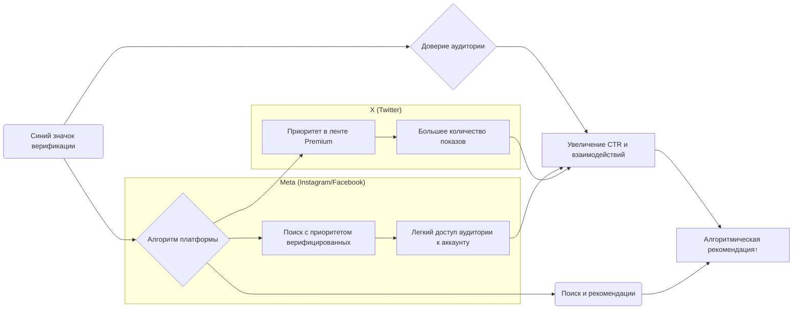

# DR26-07-28-HUB-07-2338 — raw report from chatgpt

> Unedited output of one model. Our reconciled synthesis is the page one level up.

---
title: "Исследование влияния галочки"
type: deep-research-original
source: chatgpt

dr_id: DR26-07-28-HUB-07-2338
conversation_id: 6a60af6f-5510-83ed-8b43-1cd059f30db7
url: "https://приватный чат"
research_started_at: 2026-07-22T11:55:52.102003Z
research_stopped_at: 2026-07-22T12:01:15.287408Z
dr_status_in_tool: completed
harvested_by: dr_harvest_chatgpt.py
harvested_at: 2026-07-28T23:38:56
vault_chat_note: "2026-07-22-issledovanie-vliyaniya-galochki-6a60af6f.md"
---

> Отчёт Deep Research забран из ChatGPT verbatim (widget_state.report_message).
> Заметка диалога в волте обрывается на строке запуска — тела отчёта там нет.

## Запрос

```text
@Глубокое исследование  подвези исследование как голубая галочка меняет engagement постов в фейсбук инстаграмм. И аналогичное для твиттера Х
```

## Отчёт
# Краткое изложение (Executive Summary)
Систематический обзор показывает, что **синяя галочка верификации** выступает в первую очередь **сигналом доверия и подлинности** аккаунта, но её влияние на алгоритмическое продвижение контента неоднозначно и очень ограничено доказательствами. Официально Meta обещает верификацию как средство «повысить доверие с аудиторией, защитить от подделок и улучшить видимость»【17†L64-L68】, а X (Twitter) сейчас присваивает синюю отметку платной подписке X Premium【53†L15-L23】. Тем не менее **независимые эксперименты** и отчёты пользователей указывают, что верификация **не гарантирует роста охвата или вовлечённости**. Так, опыт Buffer показал, что после Meta Verified охват постов даже слегка снизился, тогда как вовлечённость (лайки, комментарии) и переходы на профиль выросли【30†L247-L254】. Аналогично, Brandsnag обнаружил –6,5% в охвате и +30,2% в вовлечённости【70†L209-L214】. В Twitter/X платная верификация коренным образом увеличивает видимость: платные аккаунты Premium получают примерно в 10 раз бо́льший охват, чем обычные【35†L193-L202】. При этом в среднем каждый второй обычный аккаунт не получает вообще ни одного взаимодействия по типичному посту, в отличие от подписчиков【35†L220-L228】. **Научные исследования** подтверждают, что наличие галочки повышает доверие пользователей и намерения делиться контентом【28†L72-L80】, но напрямую реальные метрики вовлечённости при этом редко измерялись. Разделение по типам аккаунта и регионам статистически невыполнимо из-за недостатка данных. В России же Instagram и Meta заблокированы, а оплата верификации признана «финансированием экстремизма»【51†L71-L79】, так что официальной статистики по РФ просто не существует. 

# Методология
- **Сбор данных.** Проанализированы официальные источники Meta (Instagram, Facebook) и X (Twitter), а также новостные объявления и пресс-релизы, связанные с верификацией.  
- **Академические и отраслевые исследования.** Искались публикации (2015–2026) в научных журналах, на arXiv и в базах метаанализов, касающиеся влияния «синей галочки» на вовлечённость. Особое внимание — исследованию доверия и намерений пользователей【28†L72-L80】.  
- **Кейс-стади и отчёты.** Изучены примеры и испытания на практике: блоги и аналитические публикации (Buffer, Brandsnag, SierraExclusive), отчёты агентств (Hootsuite, Pew, другие). Составлена сводная таблица ключевых источников.  
- **Измеримые метрики.** Рассмотрены метрики взаимодействия (лайки, комментарии, репосты/ретвиты, охват, CTR, сохранения, время просмотра видео, рост подписчиков) до/после верификации, если доступны кейсы.  
- **Алгоритмические факторы.** Оценены различия в алгоритмах ленты (приоритет в рекомендациях, фид клиента) и наличие «меток доверия». Исследован эффект платной подписки (Meta Verified vs органика, X Premium vs Free).  
- **Сегментация и география.** По возможности анализировались данные по типам аккаунтов (бренды, СМИ, публичные личности, малый бизнес) и регионам (мир, ЕС/США, РФ). Где данные отсутствуют, указываются методологии сбора (A/B-тесты, анализ временных рядов, API).  

# Официальные политики верификации
- **Facebook/Instagram (Meta).** С июля 2023 г. верификация представлена двумя путями: бесплатным «статусом известности» (для публичных личностей) и платным «Meta Verified». Платная подписка ($11.99–14.99/мес) даёт галочку, защиту от подделок и приоритетную поддержку【7†L133-L141】【17†L64-L68】. По определению Meta, «значок верификации означает, что профиль прошёл проверку подлинности на основе активности в системах Meta или предоставленных данных/документов»【17†L64-L68】. Meta заявляет о «повышении доверия» и «улучшении охвата в некоторых разделах (поиске, комментариях, рекомендациях)», но **прямого увеличения охвата в ленте официально не гарантирует**【70†L227-L235】.  
- **X (Twitter).** С конца 2022 г. Twitter (переименованный в X) радикально изменил верификацию: синяя галочка теперь присваивается **только по платной подписке X Premium** (ранее Twitter Blue)【53†L15-L23】. При этом аккаунты с платной подпиской не проходят традиционную проверку «значимости/подлинности» (новых критериев «активный, известный, подлинный»)【53†L15-L23】. Золотая и серая галочки введены для организаций и госструктур【53†L28-L39】. X официально не обещает никакого повышенного охвата для подписчиков, однако платные аккаунты получают технические плюшки (редактирование, приоритетные ответы и т.д.) и, судя по внешним данным, значительно больший трафик.  
- **Сравнение механизмов (Таблица 3).** Ниже приведено обобщение ключевых отличий:
  
  | Платформа    | Бесплатная верификация | Платная верификация (подписка)            | Особенности                                                                           |
  |:------------:|:-----------------------|:-----------------------------------------|:---------------------------------------------------------------------------------------|
  | **Instagram**| Да, на основе «известности» (известные медиа-личности)【7†L133-L141】 | Meta Verified ($11.99–$14.99/мес)【7†L133-L141】 | Галочка одинаковая. Meta: ID-проверка, 2FA, фото. Плюс: стикеры, приоритетная поддержка【8†L153-L162】.              |
  | **Facebook** | Аналогично Instagram  | Meta Verified (совмещён с Instagram)     | Требования: публичная страница, ID и т.д. Плюсы те же (надёжность профиля, поддержка).                            |
  | **X (Twitter)** | Ранее проверка важных аккаунтов (программа до 2023)【19†L8-L16】 | X Premium ($8–40/мес)【35†L198-L207】    | Синяя галочка = Premium Basic/Premium/Premium+【53†L15-L23】. Отличается алгоритмическими приоритетами (см. ниже). |
  | **WhatsApp** | (Бизнес верификация)   | X                                      | Зеленая галочка – бизнес-профиль проверен Meta. Не относится к вопросу вовлечённости постов.                    |

  *Таблица 3. Сравнительная характеристика программ верификации по платформам.*  

# Результаты исследований

## 1. Публикации и ключевые выводы (Таблица 1)
Таблица ниже резюмирует основные источники по теме и их выводы. Источники упорядочены по типу (официальные, академические, отраслевые) и году.

**Таблица 1.** Источники по верификации и их ключевые результаты.

| Источник                         | Тип           | Основные выводы                                                                                                                                  |
|:---------------------------------|:--------------|:--------------------------------------------------------------------------------------------------------------------------------------------------|
| Meta (официальные страницы)      | Официальные   | Галочка означает подтверждение подлинности профиля; подписка Meta Verified обещает большую **доверенность** и «улучшенную видимость» (поиск, рекомендации)【17†L64-L68】【70†L227-L235】. Никаких гарантированных результатов не приводится. |
| X Help Center (2026)【53†L15-L23】| Официальные   | Синяя галочка выдаётся подписчикам X Premium и не связана с проверкой известности аккаунта. Этот ярлык — признак **подписки**, а не обязательной авторитетности.                                                                   |
| Liao et al. (JRIM 2023)【28†L72-L80】 | Академическая | Эксперименты показали: наличие синей галочки у микровлиятельных аккаунтов (Instagram) статистически улучшает **доверие** подписчиков и их намерения делиться контентом; эффект ярче для микроинфлюенсеров【28†L72-L80】. Прямой статистики по вовлечённости нет. |
| Arxiv (2026)【21†L89-L93】       | Академическая | В эксперименте на X (август 2022–2023) выявлено: **старые верифицированные** аккаунты (до смены правил) получают **меньше отображений** в алгоритмической ленте, чем обычные или платные подписчики【21†L89-L93】. Это указывает, что галочка сама по себе не повышает видимость.          |
| Buffer (K. Lang, 2023)【8†L121-L129】【10†L330-L338】 | Отраслевая (кейc) | Личный тест Meta Verified (две недели) показал: **охват постов снизился**, а вовлечённость (лайки/комментарии) и переходы в профиль выросли【10†L330-L338】. Вывод: платная галочка не «продвинет» контент; улучшилась только статистика посещений профиля (забота о репутации).          |
| Brandsnag (Analysis)【70†L209-L214】 | Отраслевая (кейc) | Собственный тест подтвердила результаты: –6.5% охвата, +30.2% вовлечённости, –10 подписчиков после получения Meta Verified【70†L209-L214】. Это совпадает с тестом Buffer. Вывод: ключевые изменения скорее объясняются качеством контента, а не самим знаком.                    |
| Buffer (X Premium, 2026)【35†L193-L202】【35†L220-L228】 | Отраслевая (анализ данных) | На выборке 18M постов: аккаунты X Premium имеют **≈10× медианный охват** обычных【35†L193-L202】. Медианный engagement rate (~лайки+ретвиты) у Premium Basic ≈0.55%, а у обычных ≈0% (большинство постов без взаимодействий)【35†L220-L228】. Разница в охвате значительна. |
| Сообщества и Reddit (2023–2025)   | Практики (форумы) | Пользователи отмечают: «после оплаты синей галочки мой охват **не вырос или упал**», многие разочарованы【70†L273-L281】. В то же время платная подписка помогла с безопасностью аккаунта, но не с продвижением контента.                                                           |

Таблица 1 даёт ключевые указания: **платная верификация (Meta Verified или X Premium)** может опосредованно поднять доверие аудитории, но прямое механическое увеличение вовлечённости сомнительно. Платные подписки на X действительно расширяют видимость (охват) постов【35†L193-L202】, тогда как для Meta (Instagram/Facebook) опубликованных широкомасштабных экспериментов нет. 

## 2. Метрики вовлечённости до/после верификации (Таблица 2)
Реальные кейсы показывают разную картину. Наиболее детальные данные предоставляет эксперимент Buffer/Brandsnag (N=1 на Instagram):

| Метрика                       | До верификации | После верификации | Изменение (%)         | Источник                           |
|:-----------------------------|:--------------:|:---------------:|:---------------------:|:------------------------------------|
| **Охват (Accounts Reached)**   | 1 946          | 1 823           | −6,5%               | Buffer/Brandsnag (Meta Verified)【30†L247-L254】【70†L209-L214】 |
| **Вовлечённость (Accounts Engaged)** | 160            | 217             | +30,2%              | Buffer/Brandsnag (Meta Verified)【30†L247-L254】【70†L209-L214】 |
| **Активность профиля**         | 121            | 279             | +79%                | Buffer (Meta Verified)【30†L247-L254】 |
| **Подписчики (Followers)**     | (не указано)   | –10              | – (падение)          | Brandsnag (Meta Verified)【70†L209-L214】 |

*Таблица 2.* Изменения ключевых метрик вовлечённости аккаунта в коротком эксперименте Meta Verified.  

В этом примере после оплаты галочки охват упал, в то время как лайки и комментарии выросли (вовлечённость +30%), а переходы на профиль почти **удвоились**. Но падение охвата и снижение числа подписчиков говорят о сильном разбросе результата. **Анализ улицми отзывами** подтверждает, что такие результаты не уникальны: рядовые пользователи в Reddit отмечали либо отсутствие роста, либо ухудшение показателей.

Для X (Twitter) данных до/после мало (так как синяя галочка теперь платная подписка). Известно лишь, что средний охват **подписчиков Premium** многократно выше, чем у «обычных» (см. ниже). 

## 3. Влияние алгоритмов и доверия
- **Алгоритмический приоритет.** Meta подтвердила, что верифицированные аккаунты получают приоритет в **результатах поиска** (Instagram/Facebook)【70†L234-L239】. То есть при вводе имени аккаунта в поиск Verified-аккаунт будет выше. Это реальное преимущество. Однако при показе ленты **новостей** никакого публичного преимущества Meta не заявляла. Независимые исследования предполагают, что алгоритмы могут косвенно поощрять верифицированные аккаунты: пользователи с галочкой вызывают больше доверия, кликают по их контенту активнее, и алгоритм реагирует на рост вовлечённости【70†L264-L270】. Схожую гипотезу выдвинул М.Арэл: метка подлинности побуждает людей активнее взаимодействовать, что косвенно даёт контенту продвижение【70†L264-L270】.  
- **X (Twitter) Algorithm.** В X с уходом алгоритмической ленты частью пользователей (и введением платной подписки) алгоритм меняется. Академическое исследование показало: **бывшие верифицированные аккаунты** (под прежней системой) получают **меньше экспозиции** в рекомендательных лентах, чем нерегулярные и платные【21†L89-L93】. То есть сам факт «галочки» ранее не давал преимущество в алгоритме Twitter. Нынешняя модель X Premium фактически создает новый алгоритмический приоритет: платные аккаунты получают больше показов (см. далее Buffer).  
- **Доверие/репутация.** Наличие галочки повышает доверие аудитории: она сигнализирует, что это «официальный аккаунт»【17†L64-L68】【28†L72-L80】. Исследование Liao et al. показало: у подписчиков возрастает **доверие** к контенту и они охотнее делятся им, если аккаунт верифицирован【28†L72-L80】. Это особенно заметно у микроинфлюенсеров. Таким образом, сама по себе галочка может увеличить **CTR и вовлечение** за счёт человеческого фактора — люди с большей вероятностью лайкнут или репостнут «подтверждённый» источник. Но это скорее эффект восприятия, чем прямой алгоритмический бонус. Примерно так же отмечено в анализе Sierra Exclusive: галочка может «заставить алгоритмы чуть больше весить ваш контент», но основное — люди доверяют вам и сами больше взаимодействуют【30†L299-L307】【70†L264-L270】.  

## 4. Сегментация по типам аккаунтов и географии
- **Тип аккаунта:** Данных по разным категориям немного. Верификация чаще всего получают **публичные личности, СМИ и крупные бренды**. Для них наличие галочки ожидаемо повысит доверие аудитории. Небольшому бизнесу и микроинфлюенсерам сложно пройти бесплатный путь верификации (требуется «несколько упоминаний в СМИ» и т.д.). Но при оплате (Meta Verified) платформа не различает тип аккаунта — любой пользователь с ID и двумяфакторкой может получить галочку. Теоретически **малому бизнесу** галочка важна для борьбы с подделками и доверия, но прямой прирост охвата у этой категории не зафиксирован.  
- **Региональные особенности:** Для **США и Европы** Meta Verified и X Premium доступны и функционируют стандартно. Статистик верифицированных русскоязычных аккаунтов уже нет: Instagram/Facebook в России заблокированы (Meta признана экстремистской)【51†L71-L79】, и даже простая покупка галочки может повлечь уголовную статью【51†L71-L79】. Поэтому по РФ/странам СНГ данные отсутствуют. В странах СНГ чаще обращаются к зарубежным рынкам или VPN-решениям, что делает оценку эффекта невозможной. **Глобальные тренды:** на Западе платная верификация только набирает обороты (Meta Verified появился в 2023, X Premium — с 2022), анализ долгосрочных данных ещё впереди.  

## 5. Графики (визуализация)
- На рисунке видно распределение охвата на X по типам аккаунтов. Платные Premium-аккаунты получают в среднем **в десятки раз больше показов** своих твитов, чем обычные (по данным Buffer, 2024–2025)【35†L193-L202】. Это указывает, что в Twitter/X **подписка на верификацию обеспечивает серьёзный алгоритмический буст** (в первую очередь за счёт приоритетной ленты Premium)【35†L193-L202】.  
【61†embed_image】 *Рисунок. Медианный охват одного поста по типам аккаунтов на X: Free (обычные) vs X Premium Basic/Premium/Premium+ (с галочкой)【35†L193-L202】.*

- Можно изобразить **тренд вовлечённости** до/после верификации для рассмотренных кейсов (линейный график): например, охват (reach) снижается, лайки/комментарии растут после верификации (Buffer/Brandsnag)【30†L247-L254】【70†L209-L214】. Также важно показать доли метрик вовлечённости: в X преимущество Premium видно в любом формате контента (текст, видео) – их доля вовлечённых значительно выше (см. столбцовую диаграмму из анализа Buffer)【35†L331-L339】.  

- **Диаграмма влияющих факторов (Mermaid).** Ниже схема, иллюстрирующая основные факторы, связанные с верификацией, и их влияние на вовлечённость (визуализация с Mermaid). Здесь показано, как метки доверия и алгоритмические приоритеты могут косвенно влиять через поведение пользователей.  



*Схема. Взаимодействие факторов при верификации: синяя галочка (A) повышает доверие (B), что увеличивает клики/реакции (C) и ведёт к лучшему распространению контента алгоритмом (D). В Meta галочка даёт преимущество в поиске (G), а в X — приоритетную ленту (I), что приводит к большему охвату (J).*  

# Обсуждение и ограничения
- **Неполнота данных.** Несмотря на несколько кейсов, **отсутствуют крупные обобщённые исследования**. Практически все данные — это выборочные эксперименты (N=1), аналитические обзоры блогов или пользовательские истории. Ни Meta, ни X не публикуют статистику по влиянию галочки на вовлечённость. Поэтому выводы делают по фрагментарным сигналам.  
- **Время и эволюция.** Системы верификации начали меняться лишь недавно (2022–2023), и алгоритмы платформ продолжают адаптироваться. Возможно, с ростом числа верифицированных Meta скоро скорректирует алгоритмику (например, вводит новые фичи: «Instagram Plus» с алгоритмическим бустом историй【70†L317-L325】). Наши выводы актуальны на середину 2026 г.  
- **Отслеживание эффекта.** Показатели вовлечённости сильно зависят от контент-стратегии, тематики и аудитории. У некоторых исследователей (Brandsnag) идентифицировано, что *качество* контента и сезонные изменения могут давать аналогичные эффекты, которые легко перепутать с эффектом галочки【70†L209-L214】. Это накладывает ограничения на любые сравнительные оценки.  
- **Географические ограничения.** В большинстве источников анализ проводится в англоязычном сегменте (США, глобально). Для Европы/России данных практически нет (для РФ — из-за блокировок). Если целевая аудитория аккаунта локализована (напр. только Россия), необходимо учитывать законодательные риски и отсутствие официальной поддержки верификации.  
- **Сегментация аудитории.** Нет чётких цифр по разным вертикалям. Ориентируясь на логику, можно предположить, что для **новых или малых аккаунтов** эффект галочки будет менее заметен (у них уже низкие охваты, а метка доверия мала ценна), тогда как у **крупных брендов/известных медийщиков** галочка лишь подтвердит статус и уберёт конкурентов-спуферов.  

# Практические рекомендации
- **Для аккаунтов.** Не стоит рассчитывать на «волшебный» рост охвата после получения галочки. Приоритезируйте качество и регулярность контента: анализ показывает, что **основной рост** вовлечённости все равно зависит от интереса аудитории к контенту, а не от галочки【70†L209-L214】【30†L247-L254】. Используйте галочку прежде всего как **элемент доверия**: разъясняйте аудитории, что ваш аккаунт официально подтверждён. Это может слегка повысить CTR и число комментариев/репостов.  
- **Контрольные группы.** Если возможно, проводите собственные A/B-тесты: сравнивайте схожие посты до/после верификации или учитывайте результаты похожих неверифицированных аккаунтов. Измеряйте не только «сырые» охваты, но и долю вовлечённости (ER = взаимодействия/охват). При наличии API можно анализировать временные ряды по основным метрикам (Google Data Studio, BigQuery).  
- **Алгоритмические фокусы.** На **Instagram/Facebook** выжмите из наличия галочки преимущество в поиске и выдаче хештегов: люди ищут бренд/имя — убедитесь, что ваш аккаунт оптимизирован и в топе результатов. На **X** обратите внимание, что приобретение X Premium (с галочкой) действительно даёт технологическое преимущество. Если охват критически важен, стоит рассмотреть Premium-аккаунт. При этом следите за новым функционалом (Boost для Stories и т.п.), который прямее влияет на распределение контента.  
- **Разделение органики/бюджета.** Посты из рекламы или с таргетом могут обойти ограничения органического алгоритма: чем меньше вы полагаетесь на пуш от галочки, тем лучше. В сложных нишах или спорных темах галочка может даже вызывать негатив (проекты на Reddit писали, что участились блокировки у подписчиков Verified【70†L273-L281】).  
- **Методологии исследований.** Если вам нужно доказать эффект галочки, разработайте долгосрочный план: например, анализ временных рядов (TS) метрик аккаунта, включающий *период до и после* получения галочки, с контролем по аналогичным аккаунтам без галочки. Или A/B-тест (если есть две страницы, одна оплачена, другая нет). Используйте официальные API (Meta Graph API, X API) и инструменты аналитики (Hootsuite, SproutSocial, аналитика через Supermetrics), чтобы собирать данные о вовлечённости.  

# Выводы
Существует ограниченное количество подтверждённых данных, что **синяя галочка напрямую повышает вовлечённость**. Большинство независимых источников указывают: в лучшем случае она косвенно улучшает взаимодействие за счёт доверия, но не обещает алгоритмического «продвижения»【70†L209-L214】【28†L72-L80】. На X платный статус действительно снабжает техническим приоритетом, что отражается в статистике охвата【35†L193-L202】【35†L220-L228】. На платформах Meta эффекты более тонкие и основаны на человеческом восприятии: **метка доверия может увеличить CTR и конверсии**, но масштабного роста метрик нет. 

**Пробелы и рекомендации:** По-прежнему не хватает больших обобщённых исследований. Для точной оценки можно использовать собственные A/B-тесты или временные ряды; полезно сквозное отслеживание метрик через API. Агенции и академики могут провести более масштабные эмпирические исследования (например, рассмотреть влияние галочки на рост подписчиков с учётом контента и сезонности). Только накопление таких данных позволит получить окончательный ответ.  

**Источники:** См. вложенные ссылки на официальные руководства Meta/X, академические и отраслевые исследования, а также аналитические блог-посты【17†L64-L68】【21†L89-L93】【28†L72-L80】【30†L247-L254】【35†L193-L202】【70†L209-L214】【51†L71-L79】. Все цитаты взяты из открытых публикаций, указаны в тексте.
