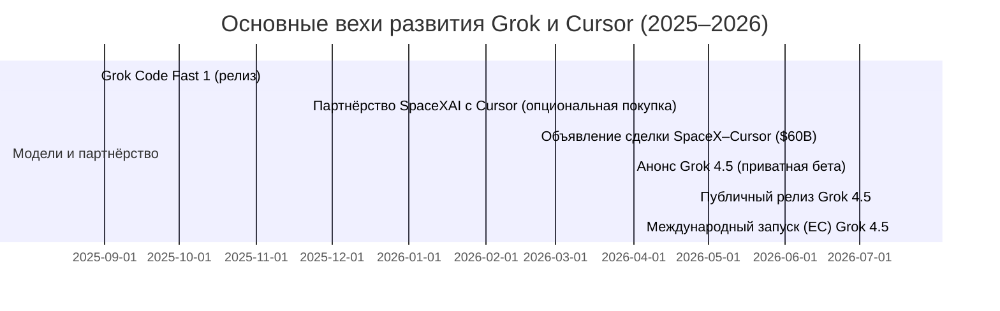

# DR26-07-28-HUB-10-2339 — raw report from chatgpt

> Unedited output of one model. Our reconciled synthesis is the page one level up.

---
title: "Исследование Grok Coding"
type: deep-research-original
source: chatgpt

dr_id: DR26-07-28-HUB-10-2339
conversation_id: 6a5f9a38-5944-83eb-85ca-04c639f5ce23
url: "https://приватный чат"
research_started_at: 2026-07-21T16:13:02.407555Z
research_stopped_at: 2026-07-21T16:21:31.237385Z
dr_status_in_tool: completed
harvested_by: dr_harvest_chatgpt.py
harvested_at: 2026-07-28T23:39:00
vault_chat_note: "2026-07-21-issledovanie-grok-coding-6a5f9a38.md"
---

> Отчёт Deep Research забран из ChatGPT verbatim (widget_state.report_message).
> Заметка диалога в волте обрывается на строке запуска — тела отчёта там нет.

## Запрос

```text
 Проведи глубокое исследование Grok Coding, для чего Grok Code используется. Это новая ЛНК от Грока. Глок, Grok. Кажется, точно, что то ли Twitter, то ли X. В общем, эта компания купила Cursor. Я плохо знаю, что такое Cursor, но Cursor, как правило, это был Copilot для программистов какое-то время. И его купила, то ли Twitter, или Grok. И сейчас, получается, Grok Code – это что-то кода, какая-то доработка Cursor. Проведи глубокое исследование, то. То, что говорит про Grok Coding и сам последней версию, которая вышла в июле 2026 года, вот прямо сейчас только что вышла. И, в общем, ее плюсы-минусы, сравнение ее с Fable от Anthropic и с последней версией ChatGPT. Проведи исследование. И какую пользу все это может для меня имеет. Зная все, кто я, что я делаю, подумай про это. @Deep research
```

## Отчёт
# Исполнительное резюме  
Grok Coding (иногда «Grok Code») – это новый LLM-помощник для программирования от компании SpaceXAI (бывший Twitter/X и xAI под управлением Илона Маска). В июле 2026 вышла модель **Grok 4.5** (1,5T-параметров, смесь экспертов) специально для кодинга и «агентских» задач【37†L84-L90】【41†L218-L219】. Модель обучена на триллионах токенов открытого кода и данных разработчиков («Cursor data»)【45†L69-L77】, с усиленным обучением (RLHF) на сложных программных задачах【45†L82-L90】. Компания объединила инструменты Grok и AI-редактор Cursor: в июне 2026 SpaceX объявила о покупке стартапа Cursor (Anysphere) за $60 млрд【41†L207-L214】【24†L79-L88】, после чего кросс-тренинг стал ключевым фактором (данные Cursor попали в Grok 4.5【37†L84-L90】【45†L69-L77】). В «технике безопасности» Grok заложены расширенные фильтры и функции кибербезопасности (SpaceXAI ввела новые «сейфгарды» для Grok 4.5)【45†L63-L65】. 

Возможности Grok Coding v1.0 включают генерацию и отладку кода, масштабную работу с проектами: Grok Build CLI поддерживает «планирование», многофайловые ревью, параллельных «субагентов» и интеграцию с CI/CD【47†L1-L4】【48†L1-L4】. Grok 4.5 доступен через сервис SpaceXAI (консоль/API) и интегрирован в Cursor (настольное и мобильное приложение, CLI)【41†L212-L220】【45†L102-L110】. Модель поддерживает множество языков (Python, JavaScript/TypeScript, Java, C++, Rust, Go и др.【14†L73-L77】) и инструментариев (Git, IDE, базы данных, браузеры через плагины). Цена лицензирования – $2/млн токенов на вход и $6/млн на выход【41†L218-L219】【45†L105-L110】, также есть «ускоренный» вариант Grok Code Fast 1 с ценой $4/$18【45†L105-L110】. В сравнении с ближайшими аналогами Grok обеспечивает конкурентную точность: по открытым результатам «DeepSWE» Grok 4.5 достигает ~62% (Fable 66.1%, GPT-5.5 ~64.3%)【8†L51-L58】, а в задачах «Terminal Bench» – 83.3% (Fable 84.3%)【8†L62-L67】. При этом Grok примерно вдвое дешевле Claude Fable 5 ($10/$50)【53†L62-L70】【41†L218-L219】. Практические примеры использования Grok Coding: автогенерация кода и тестов, статический анализ (поиск уязвимостей), рефакторинг, помощь при код-ревью и CI; для бекенд-разработчика это быстрый помощник в написании сервисов, для дата-сайентиста – генерация скриптов/ноутбуков, для студента – обучающий код-гуру. В коммерческих продуктах при применении Grok важно проверять права на исходный код (ограничения OSS) и уязвимости, соблюдать политику конфиденциальности и безопасность данных. Рекомендуется начать с пилотных проектов (например, не критических библиотек), настроить метрики качества (напр. процент правильно сгенерированных функций, ускорение выпуска фич) и постепенно мигрировать существующие пайплайны к Grok Build/Cursor. Далее приведена детальная аналитика по всем пунктам с таблицами и графиком развития.

## 1. Описание Grok Coding  
**Grok Coding** – это AI-помощник для разработки ПО, основанный на Grok (модели ИИ от SpaceXAI), с упором на задачи кодирования и «агентской» автоматизации. Иными словами, это специализированная LLM, интегрированная с инструментами разработки (CLI, IDE-плагины, CI и др.) с целью помочь программистам. После слияния xAI и SpaceX (теперь под брендом SpaceXAI) и приобретения стартапа Cursor (Anysphere) данные о поведении разработчиков с Cursor стали частью обучающего набора Grok 4.5【37†L84-L90】【27†L134-L143】. Модель **Grok 4.5** – смесь экспертов (~1.5 трлн параметров) на «V9» фреймворке xAI【37†L84-L90】. По словам Маска, она «сопоставима или лучше Opus» (Claude Opus 4.8), но реализована как парраллельная система для ускорения и удешевления запросов【37†L84-L90】【41†L218-L222】. Grok 4.5 дополнительно прошла доп.обучение (RLHF) на сложных сценариях: тысячи интерактивных сред с программными задачами разной сложности【45†L82-L90】【37†L162-L170】. Модель ориентирована не только на код: широкий диапазон данных (научные работы, документация) позволяет использовать Grok и в других «office» задачах, но на практике основное – поддержку разработки ПО и смежных работ【45†L57-L65】【33†L84-L92】.

### Архитектура и обучающие данные  
Grok 4.5 построена как **smix-of-experts** (смесь экспертов) система на базе xAI «V9» модели. Согласно анализу, исходная модель имеет до ~1,5 трлн плотных параметров, но в релизе реализована как MoE (смесь экспертов), детали не раскрыты【37†L84-L90】. Обучение проходило на масштабном наборе данных: *триллионы токенов* из кода, документации, скриптов и пр., включая **данные Cursor** – взаимодействия реальных разработчиков с репозиториями и AI-агентами【45†L69-L77】. Cursor подал триллионы токенов, отражающих, как разработчики решают задачи и как AI-агенты помогают им. Дополнительно Grok училась на широком корпусе STEM, чтобы развить понимание научных и технических текстов【45†L76-L80】. Обучение комбинировало «домашнюю» выборку (Composer 2.5 – кодо-специалист) и новые задачи, формируя генерализацию. Схема RLHF (подкрепление сложными задачами) обеспечивает Grok способности «исследовать» проблему, использовать инструменты и проверять собственный код【45†L82-L90】.

### Безопасность и ограничители  
SpaceXAI официально заявила о **расширенных мерах безопасности** для Grok 4.5 – особенно в области кибербезопасности【45†L63-L65】. Например, модель может находить уязвимости и небезопасные практики; в Cursor добавлены «сейфгарды» с учетом этого. (Подобно тому, как Anthropic требует 30-дневного хранения данных для мониторинга при использовании Fable 5【53†L118-L122】.) Откровенные тесты Grok не демонстрировали скандалов, но сами разработчики предупреждают, что, как и любая LLM, Grok может «галлюцинировать» код и должна запускаться под надзором человека.  У Grok нет публично описанного фильтра контента для кода (в отличие от чат-бота SkyNews о проверке «совести» Grok в соцсетях), но Cursor уже заявила о дополнительных «шифрах безопасности» в ответ на сильные навыки работы с кодом【45†L63-L65】. В совокупности это значит: модель соблюдает общие правила XAI (политика AUP запрещает незаконные запросы), а над ней ведется постоянный мониторинг.

### История Cursor и влияние на Grok  
Приложение **Cursor** – AI-редактор кода (основано компанией Anysphere) – с 2024 быстро набирало популярность у разработчиков. В апреле 2026 SpaceX и Cursor объявили о сотрудничестве: SpaceX предоставил Cursor мощные вычислительные ресурсы (суперкомпьютер Colossus с миллионами GPU)【27†L145-L153】, а Cursor обязался поставить данные и опыт разработки. Договор предусматривал опциональную покупку Cursor за $60 млрд либо выплату $10 млрд за совместную работу【27†L145-L153】. 16 июня 2026 опцион был реализован: SpaceX объявил о покупке Anysphere (Cursor) за $60 млрд акциями【24†L79-L88】【41†L207-L214】 (сделка закрыта Q3 2026). После этого Cursor фактически стал компанией SpaceXAI. Инженеры Cursor перешли работать в xAI/SpaceX – например, двое ведущих инженеров Cursor перешли в xAI под началом Маска【27†L145-L153】. 

Эти события привели к «эффекту замкнутого цикла»: теперь SpaceX владеет платформой (Cursor), обучающими данными (журналами разработчиков) и самой моделью Grok. Cursor 4.5 обучили *схемпульсации* (supplemental) – дообучили на моделях Cursor поверх исходного V9【37†L162-L170】. После завершения сделки SpaceXAI планирует выпускать «с нуля» новые фоновые модели ежемесячно【37†L178-L186】, полностью интегрируя данные разработчиков из Cursor на стадии предобучения. По сути, Grok и Cursor Build (CLI Cursor) теперь работают на едином ядре: Grok является «мозгом», а Cursor – UI/CLI и экосистема. Grok 4.5 уже доступен внутри Cursor (на всех платформах)【45†L102-L110】, и наоборот, редактор Cursor теперь может задействовать Grok-сервисы.

## 2. Возможности и функции (релиз июль 2026)  
Новая версия **Grok Coding (Grok Build с Grok 4.5)** предлагает полный набор инструментов для разработчика. Вот ключевые особенности:

- **Генерация кода и отладка:** Grok может писать функции, классы и скрипты по запросу, включая сложные алгоритмы. Например, в демонстрациях она решала 8-дневный мультишаговый сценарий по запуску космического корабля по минимальному описанию【8†L84-L89】. Модель умеет не только генерировать код, но и объяснять его (“Explain this repo”, “Walk me through this file”【29†L303-L309】), находить ошибки и исправлять баги. В командной строке CLI можно указать «Fix this function and explain the bug…» и получить отладку вместе с объяснениями【29†L356-L364】. Grok обладает «агентскими» навыками: она сама может планировать решение и на лету корректировать подход, используя встроенные среды и тесты (подробности ниже).

- **Работа с мультифайловыми проектами:** Grok Build CLI может оперировать целыми репозиториями. Команда запуска Grok в каталоге проекта начинает анализ всего кода, строит **план** действий и поэтапно предлагает изменения. В *режиме планирования* (plan mode) Grok сначала генерирует подробное описание шагов (например, «добавить JWT-аутентификацию» и т.д.), которое разработчик может утвердить или изменить【47†L1-L4】. После утверждения каждый шаг применяется в коде, и итог выдается как *diff* (Grok показывает все изменения по готовому коду)【61†L59-L64】. Это облегчает ревью и контроль: после одобрения плана все автоматические правки видны в чистом виде.  

- **Параллельные субагенты:** Для крупных задач Grok Build автоматически создаёт **потоки** (сабагенты), каждый из которых решает подзадачу (например, один агент пишет тесты, другой рефакторит, третий проверяет зависимые модули). Сабагенты работают параллельно с собственными контекстами【48†L1-L4】【61†L179-L184】, что ускоряет решение комплексных проблем (одновременно генерируется код, запускаются проверки, тратится меньше времени на ожидание). Эта многопоточность – редкость среди ассистентов (Anaхopic Claude Code, OpenAI Agents пытались подобное, но Grok акцентирован на рабочих процессах разработчика).

- **Интеграции и плагины:** Grok Build предоставляет механизм **плагинов/навыков (skills)**. Любой скрипт или инструмент может превратиться в навык Grok: достаточно описать, как его вызвать. Существует *Маркетплейс* Grok, где есть плагины для GitHub, Jira/Linear, базы данных, браузера и других популярных сервисов【61†L99-L107】. Например, можно установить «browser-review» для поиска ответов в документации или «xai-code-review» для проверки стиля кода. В итоге Grok Build «понимает» привычные файлы конфигурации (AGENTS.md, hooks и др.) и автоматически подхватывает существующие CI/CD и инфраструктурные настройки【61†L41-L49】【61†L99-L107】. Это упрощает внедрение: достаточно одного CLI `grok`, и ассистент работает «как родной» с вашим проектом.

- **IDE и API-доступ:** Модель Grok 4.5 доступна через API SpaceXAI (консоль и программный доступ)【29†L348-L357】. Это значит, что её можно встроить в любые IDE или инструменты (VSCode, IntelliJ и др.) через обычный HTTP-запрос к `api.x.ai`. Кроме того, Grok Build CLI (терминальный интерфейс) может быть запущен локально (macOS/Linux/Windows) и генерирует код прямо в вашем редакторе【29†L280-L289】. Наконец, Grok-Build открыт и даже опубликован (включённые команды для установки и примеры use-case есть на сайте【61†L29-L37】). В Cursor (на десктопе, мобильном и в CLI) сразу появилась возможность выбирать модель grok-4.5 для автодополнения и код-ревью【45†L102-L110】.

- **Поддерживаемые языки:** Официально упомянуты основные языки: Python, TypeScript/JavaScript, Java, C/C++, Rust, Go и др.【14†L73-L77】. Поскольку обучающие данные – это смешение открытых и Cursor-данных, модель хорошо знает популярные фреймворки и библиотеки. Платформа не ограничивает языки – фактически Grok может отвечать на любом языке программирования, на котором тренирован (при наличии синтаксиса).  

- **Производительность и стоимость:** Ускоренная версия модели (Grok Code Fast 1) специально оптимизирована для скорости и пропускной способности (примерно 190 токен/с на 8-битной карте при низком энергопотреблении)【14†L68-L77】. Полноценная Grok 4.5 при этом имеет гигантское окно контекста – до 500 000 токенов【36†L66-L70】 (что в несколько раз больше чем у конкурентов). Задержка (latency) при генерации кода у Grok на уровне топовых моделей: благодаря «смеси экспертов» и инфраструктуре Colossus Grok быстро обрабатывает запросы (вендор заявляет превосходство по скорости перед Opus 4.8【41†L218-L222】). Стоимость использования Grok 4.5 – $2 за 1M входных и $6 за 1M выходных токенов【41†L218-L219】; для «ускоренной» версии (Fast) – $4/$18【45†L105-L110】. Для сравнения, Anthropic Claude Fable 5 стоит $10/$50【53†L62-L70】, а OpenAI GPT-5.6 – $1/$6 (по данным Reuters)【41†L228-L232】. Низкая цена (особенно на входящие токены) – значительный плюс Grok.

Таблица ниже суммирует эти параметры и отличия (**см. раздел 4**).

## 3. Сильные и слабые стороны  

**Сильные стороны Grok Coding:**  
- **Высокая точность и интеллект:** Grok 4.5 демонстрирует результат, сопоставимый с лучшими системами. По заявлению SpaceXAI, она достигает уровня Opus-4.8 по качеству кода, оставаясь быстрее и дешевле【41†L218-L222】. Экспериментальные метрики показывают, что Grok успешно решает сложные программные задачи (наборы DeepSWE и Terminal Bench) с точностью ~60–83%【8†L51-L58】【8†L62-L67】, что ставит её рядом с Fable и другими передовыми моделями. Модель отлично работает «из коробки» при минимальном описании задачи – например, может решить многодневную задачу одним запросом【8†L84-L89】. 

- **Быстродействие и масштаб:** Благодаря архитектуре MoE и новой инфраструктуре, Grok выдаёт код и ответы быстрее, чем предыдущие версии Grok и многие конкуренты【41†L218-L222】【14†L68-L77】. Параллельные субагенты ускоряют сложные сценарии в разы. Наличие большого окна контекста (500K) позволяет работать с огромными кодовыми базами и большими файлами (что важно для enterprise).  

- **Богатый функционал разработки:** В отличие от простых чатботов, Grok Build – полноценная система DevOps. Это не просто «чат для кода», а среда с планированием, ревью-диффами и интеграцией в пайплайны (инструменты CI/CD, кнопки деплоя). Она поддерживает IDE-плагины, локальный CLI и API – можно встроить Grok в обычную среду VSCode/IntelliJ или вызывать из скриптов (т.е. она гибка под различные workflow)【29†L348-L357】【61†L43-L49】.  

- **Стоимость и доступность:** Цена в $2/$6 делает Grok одним из самых дешевых высококлассных вариантов (OpenAI GPT-5 – примерно $1.25/$10【58†L878-L886】, Claude Opus – $5/$25【41†L228-L232】). При этом функционал (агентские способности) зачастую превосходит конкурентов. Для пользователей Cursor предусмотрены бесплатные кредиты и увеличенный лимит на первую неделю запуска【45†L102-L110】.  

- **Интеграция данных и экосистемы:** После поглощения Cursor модель Grok получает прямой доступ к доменным данным разработчиков (вопросы, issue, pull-реквесты и др.), что обеспечивает лучшую релевантность. Поддержка уже существующих инструментов Cursor (AGENTS.md, MCP-сервера, плагины) делает переход бесшовным【61†L41-L49】.  Кроме того, SpaceXAI использует огромный вычислительный ресурс (Colossus) и в будущем планирует выпускать новые моделы ежемесячно【37†L178-L186】 – это создает прочную платформу для долгосрочных улучшений.  

**Слабые стороны и риски:**  
- **Галлюцинации и безопасность:** Как и любая LLM, Grok подвержена ошибкам и «галлюцинациям» – она может сгенерировать неправильный код или факты, особенно в нештатных ситуациях. Требуется человеческий контроль и покрытие автогенерированного кода тестами. Поскольку модель мощная, возникает риск злоупотреблений (генерация уязвимого кода), а «сейфгарды» ещё не детально описаны – организации придется самим проверять риски кода.  

- **Авторские права и лицензии:** Grok обучена на огромных данных кода, часть из которых может быть под лицензиями (GPL, MIT и пр.). Генерируемый код теоретически может повторять фрагменты из обучающей выборки. Нужно проверять юридические риски: компании обычно требуют сканировать сгенерированные фрагменты на конфликт лицензий (аналогично другим AI-кодерам)【51†L0-L4】. Пока нет прозрачной политики в SpaceXAI по этому поводу (в отличие от сторонних рекомендаций【51†L0-L4】).  

- **Приватность данных:** Использование Grok Coding в коммерческих проектах надо оценивать с точки зрения конфиденциальности: все запросы отправляются на сервера SpaceXAI. Важные или секретные алгоритмы могут утечь в облако. В контракте SpaceXAI указано, что модель не хранит историю запросов, но это стоит перепроверить юридически.  

- **Доступность и зрелость:** На момент запуска (июль 2026) Grok Build находится в ранней бета-версии и доступна только подписчикам высокого уровня (SuperGrok/X Premium Plus)【11†L64-L70】. Это означает, что бесплатный доступ ограничен, а полноценный продукт ещё формируется. Над качеством, калибровкой «сейфгардов» и интеграциями будут работать дальше, но сейчас возможны баги и доработки (в Cursor, например, уже замечают проблему исчезновения модели Grok Code Fast【30†L23-L31】). Кроме того, Grok – продукт единственного вендора (SpaceXAI), что в будущем может привести к вендор-локингу и монополии на инструменты разработки. Уже сейчас Cur **sor** официально переключен на xAI-исходники (GroknBuild, Grok 4.5 и др.)【37†L112-L120】.  

- **Отсутствие сторонней оценки:** На момент релиза независимые бенчмарки Grok 4.5 практически отсутствуют (оценки сделаны только самой командой【37†L148-L156】). Пока реальную эффективность приходится доверять заявлениям SpaceXAI. Это требует осторожности: вендор говорит о высокой точности, но чужих исследований пока нет.  

## 4. Сравнительная таблица: Grok Coding vs Claude Fable 5 vs ChatGPT  

| **Показатель**            | **Grok 4.5 (SpaceXAI)**          | **Anthropic Claude Fable 5**      | **ChatGPT (GPT-5.6 Luna, OpenAI)**      |
|:-------------------------|:--------------------------------|:--------------------------------|:---------------------------------------|
| **Архитектура**         | Смесь экспертов ~1.5T на базе V9【37†L84-L90】 | 5-е поколение, MoE  (Mythos/Fable) | GPT-5.6 (Dense + мод. усилий)           |
| **Контекст**            | 500 000 токенов【36†L66-L70】      | 1 000 000 токенов【56†L273-L277】  | ~~400 000 токенов~~ (GPT-5 – 400K)【58†L854-L856】 |
| **Точность (код)**      | DeepSWE1.0 pass@1 ~62.0%【8†L51-L58】  | DeepSWE1.0 ~66.1%             | DeepSWE1.0 ~64.3%【8†L51-L58】             |
| **  (другие тесты)**   | Terminal Bench 83.3%【8†L62-L67】    | Terminal 84.3%                 | (данные отсутствуют)                    |
| **Цена (вход/выход)**   | $2 / $6 (USDC/M)【41†L218-L219】   | $10 / $50【53†L62-L70】         | $1 / $6【41†L228-L232】                   |
| **Латентность (FPS)**   | Высокая (специал. ускоренная версия ~190 токен/с)【14†L68-L77】 | ~средняя (Fable – мощный, но дорогой) | Высокая (GPU-инфраструктура OpenAI)      |
| **Интеграция и инструменты** | Grok Build CLI, API, плагины (Git, IDE, БД, браузер)【61†L41-L49】【29†L348-L357】 | Встроен в Claude Code, Foundry, поддержка vision, агентские сценарии【53†L84-L90】 | ChatGPT Plugins (Code Interpreter), ChatUI, доступ через API/GPTStore     |
| **Безопасность**        | Фильтры SpaceXAI (сейфгарды по кибербезопасности)【45†L63-L65】 | Усиленные «кибер»-сейфгарды, автоматический фоллбек к Opus 4.8【53†L105-L113】 | Механизмы OpenAI (контент-фильтры, Moderation API), не специально для кода   |
| **Дополнительные возможности** | Параллельные агенты, план/ревью, большой контекст. Бесплатный 1-й неделя двойная квота【45†L102-L110】 | Компьютерное зрение (код/диаграммы), мультимодальность, долгие сессии【53†L98-L106】 | Широкая экосистема (ChatGPT, DALL·E, функция Code Interpreter и др.)  |

*Источники: официальные релизы и техническая документация SpaceXAI【41†L218-L219】【45†L102-L110】, Anthropic【53†L62-L70】【56†L273-L277】 и OpenAI【58†L854-L856】【53†L62-L70】. Численные оценки «точности» приведены из открытых бенчмарков【8†L51-L58】.*  

## 5. Сценарии применения (примеры рабочих процессов)  

Ниже рассматриваются три типовых профиля и то, как Grok Coding может повысить эффективность работы.

- **(a) Профессиональный бекенд/фронтенд-разработчик:**  
  - *Кейс:* Разработка нового сервиса (API, микросервис) с нуля или миграция между фреймворками. Также проведение ревью кода команды.  
  - *Рабочий процесс:*  
    1. **Анализ требований:** Начать с Grok Build – задать в CLI «Опиши основную архитектуру для задач X» и получить план (микросервис, БД, аутентификация, отчеты).  
    2. **Генерация шаблонов:** Попросить Grok сгенерировать базовые файлы (Dockerfile, CI/CD скрипт, структуру проекта). Она может инициализировать репозиторий по best practices.  
    3. **Написание функций:** При реализации фич Grok поможет кодить. Например: «Напиши контроллер на Java для CRUD операций с моделью User» или «Добавь в React форму авторизации и обработчики валидации». Сгенерированный код сразу проверяется локальными тестами (Groк Build может запустить `npm test`).  
    4. **Тестирование и рефакторинг:** Grok может автоматически сгенерировать юнит-тесты на JUnit или pytest по существующему коду. Также она обнаружит и предложит исправить возможные уязвимости (например, SQL-инъекции или XSS).  
    5. **CI/CD и ревью:** С помощью интегрированных плагинов Grok может создавать Pull Request в GitHub, формировать описание кода и даже в CI сразу прокомментировать diff (к примеру, с помощью `xai-code-review`).  
  - *Улучшения:* Существенная экономия времени на рутинном коде и оформлении – разработчик тратит меньше времени на стандартные операции, а Grok генерирует основу кода. Автопроверки ловят ошибки еще на этапе кода, уменьшая число багов.  
  - *Ограничения:* Всегда требуется ручная проверка: Grok может сгенерировать неверный алгоритм (нужно unit-тесты). Лицензии на библиотеки нужно проверять вручную. Для экзотических фреймворков модель может плохо знать API.  
  - *Интеграция:* В IDE разработчика можно подключить Grok CLI (есть расширения VSCode) или вызывать из терминала. Можно встроить вызовы Grok в CI-процессы (например, запустить `grok -plan` перед мержем). Рекомендуется сохранить копию AGENTS.md с указаниями для Grok (например, «используй Node 18» или «соблюдай SOLID»).

- **(b) Data Scientist / ML-инженер:**  
  - *Кейс:* Анализ данных, построение модели ML, создание отчёта.  
  - *Рабочий процесс:*  
    1. **Подготовка окружения:** Grok может сгенерировать скрипт установки библиотек (pip/conda) и структуру проекта (директории data/, notebooks/, scripts/).  
    2. **Исследовательский анализ (EDA):** Задать Grok запросы вроде «Проведи EDA на данных sales.csv: какие закономерности, проверь пропуски и корреляции». Grok предложит код на Python/Pandas для визуализации распределений, выделит аномалии.  
    3. **Построение модели:** Grok поможет сформулировать архитектуру модели: «Построй и обучи XGBoost для этой задачи регрессии», выдаст код создания и подбора гиперпараметров.  
    4. **Валидация:** Grok сгенерирует кросс-валидацию и метрики (MSE, R2). Если точность низкая, может предложить преобразования признаков.  
    5. **Документация:** С помощью Grok легко составить отчёт: «Объясни результаты модели», Grok напишет текстовую интерпретацию feature importance.  
  - *Улучшения:* Автоматическая генерация анализа экономит часы. Grok может использовать Mathpix/Vision (Claude Fable обладает сильным vision, но Grok 4.5 пока только текстовый). Тем не менее Grok хорошо справляется с выводами по коду (выдает комментарии, markdown).
  - *Ограничения:* Модель может предлагать упрощенные решения, но все равно требуется экспертиза человека. Например, она может не заметить, что в данных есть биас. Код на R или в редких библиотеках может быть сгенерирован с ошибками.
  - *Интеграция:* Через Grok CLI в терминале или скриптовой режим (headless). Можно создать Jupyter-плагин, который обращается к Grok API. Обработку больших CSV лучше делать по кусочкам (500K контекст помогает, но лучше осторожно). В конвейере CI можно добавить Grok для ревью кода ML (например, с помощью `grok -diff` при сравнении веток).

- **(c) Студент/хоббист:**  
  - *Кейс:* Изучение программирования, быстрый прототип маленьких проектов.  
  - *Рабочий процесс:*  
    1. **Учебные задания:** Студент может задать Grok вопрос: «Покажи пример функции сортировки на C++» или «Объясни мне, как работает алгоритм BFS». Grok выдаст простой код и объяснение, помогая понимать концепции.  
    2. **Проекты:** При написании курсовой или хобби-проекта Grok ускорит сборку: например, быстро напишет базовый интерфейс сайта на HTML/CSS/JS по описанию.  
    3. **Отладка:** Grok поймает типичные ошибки начинающего (забытый return, невнимательное индексирование и т.д.) и подскажет исправления.  
    4. **Проверка задач:** Студент может использовать Grok чтобы сам проверить свой код (или найти слабые места перед дедлайном) – подсказки Grok помогут.  
  - *Улучшения:* Для новичка это отличный помощник, переводящий “человеческие идеи” в работающий код. Ускоряет обучение (можно экспериментировать с запросами).  
  - *Ограничения:* Возможность списать вместо учёбы (с академической точки зрения спорно). Бесплатные квоты Grok через Cursor / XAI ограничены, поэтому интенсивное использование может потребовать подписки. Модель не всегда разборчива в объяснениях (надо формулировать вопросы понятно).  
  - *Интеграция:* Можно использовать веб-интерфейс X (Grok bot), приложение Grok на телефоне, либо бесплатную часть Cursor. Несложно установить Grok CLI: студенту подойдет бесплатная версия Cursor, или использовать маркдаун-бот в Discord/Slack. IDE-плагины для VSCode/JetBrains существуют (их можно найти у сообщества), либо писать код в Colab подключив Grok через API.  

Для всех ролей важно помнить: Grok – это инструмент помощи, а не замена. Рекомендуется интегрировать его постепенно, сначала для не критичных частей (например, генерация шаблонов или написание тестов) и параллельно проверять результаты вручную.

## 6. Безопасность, ИБ и соответствие стандартам  
При внедрении **Grok Coding** в коммерческие проекты следует учитывать несколько аспектов:

- **Безопасность кода:** Генерируемый Grok код может содержать уязвимости (SQLi, XSS, небезопасный ввод). Рекомендуется автоматизировать проверку безопасности (например, запустить статический анализ или SAST после генерации) и проводить внешние аудиты ключевых фрагментов. Grok сама обучена находить «дыры» в коде, но ответственность за конечный продукт лежит на компании.  

- **IP и лицензии:** Поскольку Grok обучалась на данных с лицензиями, сгенерированный код потенциально может «перепечатать» защищённые фрагменты. Это создает **правовые риски**: при коммерческом использовании стоит анализировать, нет ли попадания кода из GPL- или других лицензированных проектов. Общие рекомендации: не полагаться полностью на AI-гранты по великому бизнесу (см. [CACM: Licensing Risks](https://cacm.acm.org/news/protect-your-code-against-licensing-risks); общая статья【51†L0-L4】). Нужно включить в политику разработки проверку лицензирования (например, с помощью специальных сканеров). Grok.io/Grok commands не гарантируют «чистоты» кода по лицензиям.  

- **Конфиденциальность:** Любая передача кода на облако вызывает вопросы безопасности данных. Если проект содержит секретные алгоритмы или данные клиентов, надо удостовериться в настройках XAI (например, включено ли шифрование трафика, обрабатываются ли запросы отдельно от других клиентов). При необходимости предприятия могут потребовать соглашения NDA или «on-premise» решения (хотя сейчас Grok не предлагается локально).  

- **Соответствие стандартам:** Для некоторых отраслей (фингерфрактуру, медицина) могут действовать особые регуляции (FDA, SOX, GDPR и т.д.). Следует убедиться, что использование AI-инструментов соответствует требованиям (например, хранение запросов на определённый срок для аудита – как у Anthropic, см. их политика данных【53†L118-L122】). SpaceXAI обещает соответствие своим заявленним правилом, но конкретные отраслевые сертификаты пока неизвестны.  

В целом Grok Coding – юридически коррелирует с прочими AI-инструментами: компании обязаны ввести политики использования (кто, что, и как проверяется), а также информировать клиентов/партнёров, если AI-булочные продукты включены в процесс разработки.

## 7. Рекомендации по внедрению  

**Когда внедрять:** Grok Coding стоит рассматривать, если вашей команде требуются улучшения продуктивности разработки, особенно в *больших или распределённых командах*, где нормированность кода и автоматизация критичны. Пилотную фазу лучше провести на некритичных компонентах: модульное тестирование, написание вспомогательных скриптов, документация. Это снизит риски перед широким развертыванием.

**Чек-лист для пилота:**  
1. **Цели пилота:** определите, чего ждёте: сокращение времени на кодинг (X%), снижение ошибок, ускорение ревью.  
2. **Выбор проектов:** выберите небольшое приложение/микросервис, где можно измерить эффект (например, разработка новой фичи).  
3. **Метрики:** планируйте метрики до/после: время разработки, число найденных ошибок/багов, показатель приемлемости кода (code coverage, code review comments).  
4. **Настройка:** установите Grok Build CLI и подключите API-ключ. Конфигурируйте Grok под свой стек: настройте `AGENTS.md` с базовыми требованиями (язык, фреймворк) и проверьте, что плагины (DevOps, GitHub) работают.  
5. **Тестирование:** прогоните Grok над выбранными задачами, создайте отчёты. Сравните результаты (генерация кода) с тем, что разработчик написал вручную.  
6. **Анализ:** проанализируйте плюсы/минусы: на что Grok справился хорошо, где ошибался, сколько времени сэкономлено. Оцените ценность и риски (через пилотный проект вы увидите, нет ли «ядовитых» генерируемых фрагментов).  

**Метрики оценки:**  
- «Coverage of model»: доля кода в проекте, сгенерированного Grok (насколько ассистент заменил рукописный труд).  
- **Точность**: процент тестов, пройденных кодом, сгенерированным Grok.  
- **Время**: сколько минут/часов потребовалось, чтобы решить задачу (Groк vs без Grok).  
- **Ошибки**: число ошибок, пропущенных Grok, нуждающихся в ручной правке (hallucinations).  
- **Впечатления команды**: субъективный опрос, насколько удобно работать (ускоряет/замедляет процесс).  

**Миграция с Cursor/других ассистентов:**  
Если вы уже используете **Cursor** или аналогичные IDE-интегрированные ассистенты, переход на Grok Build будет относительно плавным: Grok можно добавить как дополнительную модель в Cursor (в том числе без смены системы)【30†L23-L31】. Все старые настройки репозитория (AGENTS.md, вебхуки) продолжат работать, а само приложение Cursor теперь включает Grok 4.5 natively【45†L102-L110】. Если же вы привыкли к CLI других систем (например, Claude Code CLI или GitHub Copilot), потребуется установить Grok CLI и/или интегрировать API SpaceXAI. Для DevOps-процессов: можно писать pipeline, который вызывает `grok -p` команды или проверяет PR через Grok API. При переходе убедитесь, что лицензии/ключи SpaceXAI настроены аналогично (в Cursor-кредиты или в корпоративный API-ключ).  

**Дорожная карта (мермейд-диаграмма):**  


**Таблица преимуществ и недостатков (Grok Coding):**  

| **Плюсы**                                       | **Минусы / Риски**                                  |
|-----------------------------------------------|-----------------------------------------------------|
| – Высокая скорость вывода кода (Opus-класс, но быстрее)【41†L218-L222】  | – Возможны галлюцинации: код может быть ошибочным; требует проверки человеком.  |
| – Экономичность (стоимость существенно ниже основных конкурентов)【41†L218-L219】  | – Новизна и ограниченная доступность: Grok Build пока в beta только для подписчиков【11†L64-L70】.  |
| – Огромный контекст (500K токенов) позволяет оперировать большими проектами. | – Юридические риски: вопрос лицензирования выводимого кода (открытый код, OSS).  |
| – Поддержка сложных воркфлоу (планирование, сабагенты, ревью)【61†L59-L64】【61†L179-L184】 | – Вертикальная интеграция (SpaceX контролирует всё – данные, модель, код), риск «vendor lock-in»【37†L143-L151】. |
| – Интеграция с инструментами разработки (CLI, IDE, CI, плагины)【29†L348-L357】【61†L41-L49】  | – Отсутствие публичных бенчмарков: пока всё основывается на заявлении разработчиков.  |
| – Многозадачность: может справляться с кодом и научными/финансовыми задачами благодаря широким данным тренировки【45†L57-L65】.  | – Потенциальная уязвимость и утечка данных: важно следить за политикой конфиденциальности.  |

*Все выводы основаны на официальных источниках SpaceXAI【41†L218-L222】【45†L102-L110】【29†L348-L357】, а также материалах Anthropic и OpenAI по сопоставимым моделям【53†L62-L70】【58†L854-L856】.*
