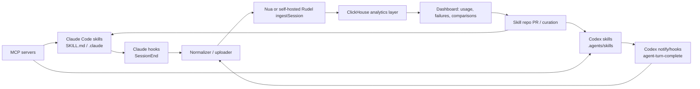
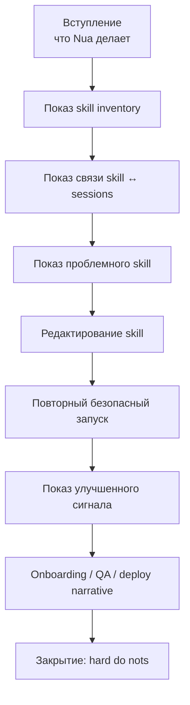

# DR26-07-28-HUB-25-2339 — raw report from chatgpt

> Unedited output of one model. Our reconciled synthesis is the page one level up.

---
title: "Изучение продукта NUA"
type: deep-research-original
source: chatgpt

dr_id: DR26-07-28-HUB-25-2339
conversation_id: 6a3a3cc8-bb20-83eb-8f79-c6f01885b3cd
url: "https://приватный чат"
research_started_at: 2026-06-23T08:00:45.685363Z
research_stopped_at: 2026-06-23T08:12:22.572062Z
dr_status_in_tool: completed
harvested_by: dr_harvest_chatgpt.py
harvested_at: 2026-07-28T23:39:14
vault_chat_note: "2026-06-23-izuchenie-produkta-nua-6a3a3cc8.md"
---

> Отчёт Deep Research забран из ChatGPT verbatim (widget_state.report_message).
> Заметка диалога в волте обрывается на строке запуска — тела отчёта там нет.

## Запрос

```text
Изучи, как будет работать этот продукт, но только шоу. Что вообще не делать с килами, как это может быть полезно для моего claude или кодекса, и для моей команды работы.

https://www.nua.so/
```

## Отчёт
# Nua в демонстрационном сценарии

## Executive summary

По публично доступным материалам Nua выглядит не как «ещё один агент», а как слой наблюдаемости и управления библиотекой agent skills: сайт Nua обещает сканировать skill-файлы «по команде, локальной машине и git», сопоставлять их с сессиями, помечать, какие skills работают, и помогать распространять лучшие skills по команде. Одновременно открытый код и README публичного предшественника Rudel показывают довольно приземлённую, но полезную механику: CLI ставит хуки для Claude Code и Codex, читает локальные журналы/транскрипты, загружает полные сессии и строит по ним аналитику. Поддержка в публичном коде сейчас подтверждается именно для Claude Code и OpenAI Codex. Это делает Nua сильным кандидатом для демо как «skill intelligence / telemetry plane», а не как самостоятельный runtime для прод-автоматизации. citeturn46view0turn47view0turn16view0turn21view0turn21view1turn21view3

Для демонстрации Nua надо показывать не «магическую оптимизацию команды», а очень конкретный цикл: есть библиотека skills, есть реальные или синтетические сессии использования этих skills, есть наблюдаемость по качеству/частоте/ошибкам, и есть управляемая итерация навыков через git. Именно такой сценарий согласуется с тем, что можно проверить публично. При этом я не нашёл публичной технической документации Nua по внешнему API, формуле skill scoring или rate limits; inspectable-часть находится в кодовой базе Rudel и в маркетинговом лендинге Nua. Поэтому всё, что касается «как именно Nua вычисляет, что skill работает», для демо надо подавать как продуктовую гипотезу/функцию интерфейса, а не как доказанную метрическую истину. citeturn46view0turn47view0

Термин «килы» в вашем вопросе двусмысленен. По контексту Nua наиболее вероятно, что речь шла о **skills** или «скиллах», потому что весь лендинг Nua построен вокруг skill files. Но вы справедливо указали и другие чтения — **keys**, **kills**, **internal artifacts**. В демо это критично: для каждого чтения набор запретов разный, а ошибки дорогие. Если коротко: не показывать сырые skills из прод-репозиториев, не светить реальные keys, не использовать «kills» как KPI успеха, и не загружать внутренние артефакты, которые потом окажутся в транскриптах. citeturn46view0turn47view0

С точки зрения интеграции с Claude и Codex, оптимальная архитектура для demo — **out-of-band telemetry**. Claude и Codex продолжают использовать свои родные skills, MCP-серверы и permission/sandbox модели; Nua получает данные из хуков/уведомлений и строит «операционный слой» вокруг skills. Для Claude это особенно естественно, потому что официальные hooks работают на событиях жизненного цикла, включая `SessionEnd`; для Codex аналогичную роль играют `notify` и hooks вокруг `agent-turn-complete`. Иначе говоря: Nua не должен быть в критическом пути исполнения live-demo. Он должен быть в критическом пути объяснения, сравнения и улучшения skills. citeturn38view2turn38view3turn38view4turn38view5

Если бюджет не ограничен, самый надёжный вариант демо — **двойной контур**: изолированный стенд со self-host/open-source Rudel как резервным backend’ом и параллельно готовый hosted/demo account, плюс синтетический репозиторий, синтетические skills, предзагруженные сессии и один безопасный live-run. Так вы не зависите от продовых секретов, от живого network path и от того, что в последний момент неожиданно всплывёт в сессии агента. Эта осторожность хорошо согласуется с рекомендациями NIST по управлению рисками GenAI и с тем, что у агентных систем есть типовые риски prompt injection, insecure output handling и data disclosure. citeturn47view0turn36search6turn37search2turn37search12

## Что Nua собой представляет по публичным источникам

Публичная формулировка ценности Nua очень конкретна: продукт обещает превратить «разрозненные agent skills» в «compounding team skills», сканировать все skill files по команде и git, смотреть на сессии по каждому skill, флагать, работает ли skill, и помогать распространять лучшие навыки. На лендинге также есть явная связь с Rudel: ссылка «the next chapter of» ведёт на Rudel, а сам Rudel публично сообщает, что «shutting down for what comes next». Это позволяет с высокой вероятностью трактовать Nua как эволюцию Rudel из слоя session analytics в слой skill intelligence. Но это всё же вывод по совокупности материалов, а не опубликованная архитектурная спецификация Nua. citeturn46view0turn32search0turn32search1

Открытый Rudel-репозиторий даёт более жёсткую техническую опору: CLI устанавливается через `npm install -g rudel`, поддерживает `rudel login`, `rudel enable` и `rudel upload`; `enable` регистрирует хуки для Claude Code/Codex; транскрипты отправляются в Rudel; дальше они хранятся в ClickHouse и превращаются в аналитику. README прямо говорит, что в uploaded session входят `projectPath`, git-контекст, full transcript, sub-agent usage, а в hosted-варианте продукт предназначен для ingest full coding-agent session data for analytics. Это важный факт: для демо Nua/Rudel — это продукт, который работает с **полными транскриптами**, а не с безобидными summary-only event logs. citeturn47view0

Публичный код также показывает, что поддерживаемые agent adapters в доступной кодовой базе — это именно `claude-code` и `codex`, без дополнительных провайдеров. Для Claude сессии ищутся в «внутренний путь лаборатории», для Codex — в `~/.codex/sessions`. Для Claude включается hook в `settings.json`, для Codex — `notify`-команда в `~/.codex/config.toml`. Это значит, что demo-фокус на Claude/Codex — не произвольный выбор, а то, что реально подтверждается кодом. citeturn16view0turn20view3turn21view1turn21view0turn21view3

Ниже — наиболее честная интерпретация продуктовой поверхности Nua, если ориентироваться только на то, что можно проверить публично. Она важна потому, что именно здесь возникает основной риск «передемо-переобещания». Публичные материалы Nua обещают skill-level эффекты, а inspectable-код Rudel преимущественно показывает session-level ingest и analytics. citeturn46view0turn47view0

| Публичное утверждение | Что подтверждается | Уровень уверенности для демо | Практический вывод |
|---|---|---:|---|
| Nua сканирует skill files по команде, локальной машине и git | Напрямую заявлено на сайте Nua | Средний | Показывать как продуктовую функцию UI; не обещать coverage «всех возможных skill-форматов» без предпрогона |
| Nua связывает skills с сессиями и отмечает, где skill работает | Заявлено на сайте Nua; Rudel подтверждает наличие полного session ingest | Средний | Демонстрировать на заранее подготовленных skills и заранее прогнанных сессиях |
| Основа интеграции — Claude Code и Codex | Подтверждается адаптерами в публичном коде | Высокий | Не расширять live-demo на другие агенты без кастомной адаптации |
| Данные отправляются через hook/notify и содержат полный transcript | Подтверждается README и кодом | Высокий | Демо должно идти только на synthetic/sanitized данных |
| Skill scoring / формула «works or doesn’t» публично задокументирована | Подтверждения не найдено | Низкий | Не продавать это как формальный benchmark или ground truth |

## Что не делать с килами

Главное: слово «килы» здесь нельзя оставлять нераспакованным. В контексте Nua наиболее вероятно, что вы имели в виду именно **skills**, потому что Nua публично описывает себя как систему для skill files, а и Claude Code, и Codex имеют официальные skill-механики. Но для демонстрации надо разобрать и другие чтения — иначе вы легко попадёте в неправильный operational режим. citeturn46view0turn38view0turn43view0

| Возможное значение «килы» | Почему это правдоподобно | Чего **не делать** в демо | Почему это жёсткий запрет |
|---|---|---|---|
| **Skills / скиллы** | Самый вероятный смысл по контексту Nua | Не подмешивать сырые, дублирующиеся, конфликтующие или устаревшие skill-файлы из разных репозиториев; не включать implicit invocation для десятков близких skills; не показывать «много sessions = хороший skill» | И Claude, и Codex выбирают skills по описанию/контексту; плохая библиотека создаёт ложные срабатывания и шум вместо пользы. citeturn38view0turn43view0 |
| **Keys / API keys / secrets** | Вы сами указали это как вероятное чтение | Не использовать реальные API keys, cloud creds, `.env`, deploy-токены, service account secrets, OAuth refresh tokens в skills, prompts, config или транскриптах | Rudel/Nua ingest’ит full session content; README прямо предупреждает, что там могут оказаться secrets. Codex hooks официально подходят даже для блокировки случайной вставки API keys — то есть это признанный класс проблем. citeturn47view0turn38view5 |
| **Kills** | Возможная англицизация KPI/сленга | Не использовать «kills», «победы», «закрытые задачи» как главный KPI шоу | Для агентных coding flows это плохой прокси: он смешивает удачу, лёгкость задач и реальное качество. NIST прямо рекомендует управлять риском через контекстно-адекватные профили, а не через один упрощённый суррогатный показатель. citeturn36search6 |
| **Internal artifacts** | Вы сами указали этот вариант | Не отдавать в ingest внутренние RFC, постмортемы, support dumps, продовые трассы, снапшоты БД, crash logs, приватные MCP tool definitions | Prompt/data surfaces у агентных систем уязвимы к disclosure и prompt injection; плюс сами транскрипты являются ценным носителем внутренних данных. citeturn37search2turn37search12turn36search2 |

Если брать наиболее вероятное чтение — **skills** — то жёсткая рекомендация такая: в demo показывать только **малую, кураторскую, именованную библиотеку** из 3–5 skills, каждый из которых делает одну вещь и имеет очевидные границы применимости. Это согласуется с официальными best practices Codex: держать skill сфокусированным, отдавать предпочтение инструкциям над скриптами, тестировать trigger behavior по описанию skill. Claude тоже рекомендует skills как упаковку повторяемых workflows, а не как свалку всего подряд. citeturn43view0turn38view0

Если брать чтение **keys**, то запрет ещё жёстче: не рассчитывать на «потом заредачим». Публичный Rudel README предупреждает, что uploaded transcripts и связанные метаданные могут содержать prompts, tool output, file contents, command output, URLs и secrets, если они появились в сессии. Это означает, что ошибки обращения с ключами надо предотвращать **до** того, как сессия завершилась и попала в ingest. Для Codex это удобно делать именно hooks/notify-обвязкой, потому что официальные hooks предназначены в том числе для deterministic checks и блокировки опасных ситуаций. citeturn47view0turn38view5

## Как Nua встроить в ваши Claude и Codex workflow

Лучший способ мыслить о Nua в demo — как о **control-plus-observability plane для skills**, а не как о replacement вашего Claude/Codex. Claude Code и Codex уже имеют собственные primitives: skills, hooks, MCP, permissions, sandboxing. Nua должен использовать эти primitives и не ломать их. У Claude skills оформляются через `SKILL.md` и загружаются по мере необходимости; у Codex skills тоже построены на open agent skills standard и используют progressive disclosure, чтобы не забивать контекст. То есть у вас уже есть нативная skill substrate с двух сторон. Nua логично ставить поверх неё как слой оценки, отбора и повторного распространения лучших навыков. citeturn38view0turn43view0

Публичная техническая механика выглядит так: Claude Code даёт lifecycle hooks, включая `SessionEnd`, которые могут быть shell-командами, HTTP hooks, LLM prompt hooks и MCP tool hooks; Codex поддерживает hooks и `notify`, причём `notify` может вызвать внешний скрипт на `agent-turn-complete` и передать туда `thread-id`, `turn-id`, `cwd`, входные сообщения и last assistant message. В открытом коде Rudel эта разница отражена прямо: для Claude ставится SessionEnd hook, а для Codex в `~/.codex/config.toml` прописывается `notify`-команда `rudel hooks codex turn-complete`. Для demo это означает две вещи: во-первых, интеграция технически органична; во-вторых, **гранулярность событий между Claude и Codex асимметрична**, и сравнивать их надо аккуратно. citeturn38view2turn38view3turn38view4turn38view5turn21view0turn21view1



Эта схема хороша для демо потому, что она держит агентов «чистыми». Claude и Codex продолжают жить в своих нативных security-моделях, включая permission rules, sandboxing и trusted-project behavior; Nua не становится inline-прокси на каждый tool call. Это резко снижает вероятность того, что live-demo рухнет из-за одного подвисшего вебхука или одной нестабильной эвристики. citeturn41search1turn41search2turn41search5turn39view3turn39view4

### Конкретные интеграционные паттерны

Ниже — четыре интеграционных паттерна, которые реально имеет смысл демонстрировать. Они построены только на том, что поддерживается официальными docs Claude/Codex и тем, что видно в Rudel/Nua публично. citeturn38view0turn38view2turn38view4turn43view0turn47view0turn26view0

| Паттерн | Как работает | Нужные права/поверхности | Плюсы | Минусы / trade-offs | Рекомендация для demo |
|---|---|---|---|---|---|
| **Hosted passive telemetry** | `rudel enable` / аналогичная Nua-обвязка ставит hooks, после сессии данные уходят в hosted backend | Доступ к user-level Claude/Codex config, интернет-доступ | Самый быстрый запуск | Риск сети, внешнего сервиса, секретов и неожиданного контента | Подходит только при synthetic data и наличии fallback |
| **Self-hosted isolated analytics** | Самостоятельный backend с открытой ingest-моделью и ClickHouse | Инфра + CLI/hook доступ на demo-машинах | Максимальный контроль, можно прогреть данными заранее | Дольше готовить; публично inspectable именно Rudel, а не вся Nua-логика | Лучший вариант при «без ограничений по бюджету» |
| **Git-native skill curation loop** | Canonical skill repo, потом sync в `.claude/skills` и `.agents/skills`; Nua смотрит usage и провалы | Доступ к skill-репозиторию, git PR flow | Сильный onboarding и collaboration story | Требует дисциплины именования и scope | Обязательно показывать |
| **MCP-enriched skills** | Skills зависят от MCP tools/docs; Nua оценивает где skill реально помогает | MCP config, trust model, permissions | Демонстрирует зрелый workflow, а не чат-игрушку | Растёт риск prompt injection и over-permissioning | Показывать только на read-mostly MCP и synthetic systems |

### API и data flow

Публичный typed contract Rudel показывает полезный факт: session ingest строится вокруг объекта `IngestSessionInput`, где есть `source`, `sessionId`, `projectPath`, git-контекст, `tag`, полный `content`, `subagents`, `organizationId` и служебные поля вроде `client_surface` и `platform_os`. Для demo это почти идеальный интерфейс: можно не зависеть от live-run и заранее «посеять» backend синтетическими или предварительно санитизированными сессиями. При этом открытый контракт дополнительно показывает, что в analytics-слое уже существуют overview/developer/session endpoints — значит, для резервного self-host demo surface достаточно богатый. citeturn26view0turn44view0

Пример минимальной demo-полезной нагрузки выглядит так:

```json
{
  "source": "codex",
  "sessionId": "demo-skill-042",
  "projectPath": "/demo/skill-lab",
  "gitBranch": "demo/nua-show",
  "gitSha": "abc123demo",
  "tag": "tests",
  "content": "Sanitized transcript showing use of api-testing skill...",
  "organizationId": "demo-org",
  "platform_os": "macos"
}
```

Это не официальная snippet-документация Nua, а практическое следствие из публичного ingest schema. В демонстрации это даёт два сценария: либо вы показываете реальный hook-driven поток, либо одним движением переключаетесь на уже загруженный корпус synthetic sessions, не теряя нарратива. citeturn26view0

### Как стыковать skill-системы Claude и Codex

Здесь есть важный архитектурный выигрыш: и Claude Code, и Codex работают с open agent skills standard, но их operational envelopes различаются. Claude делает упор на `SKILL.md`, авто-подгрузку нужного навыка, project/user/local scopes и связку с `CLAUDE.md`; Codex хранит skills в `.agents/skills`, тоже делает progressive disclosure, но ещё поддерживает metadata через `agents/openai.yaml`, где можно задавать `allow_implicit_invocation`, UI metadata и MCP dependencies. Это значит, что **правильный cross-agent design** — хранить один canonical skill source, а затем иметь лёгкие platform wrappers. citeturn38view0turn38view1turn43view0

Практически это выглядит так:

- храните canon в отдельном `agent-skills` repo;
- для Claude публикуйте в `.claude/skills/<skill>/SKILL.md` либо совместимые `.claude/commands/*`;
- для Codex публикуйте в `.agents/skills/<skill>/SKILL.md` и, если нужно, добавляйте `agents/openai.yaml` с MCP dependencies и `allow_implicit_invocation: false` для чувствительных навыков;
- в Nua маппите usage не по файловому пути, а по **каноническому skill ID** и версии skill. Это моя инженерная рекомендация, но она напрямую вытекает из того, что у платформ разные пути и слегка разные metadata-слои. citeturn38view0turn43view0

### Prompt design для осмысленной аналитики

Если вы хотите, чтобы Nua давала не просто красивые карточки, а полезный для команды сигнал, промпты должны быть структурированы так, чтобы skill invocation была явной и трассируемой. Для демо я бы зафиксировал три шаблона.

Первый — **explicit skill invocation**. Для Claude — через `/skill-name`; для Codex — через упоминание skill или selector. Это снижает ambiguity и улучшает качество attribution. Официальные docs обеих систем прямо поддерживают explicit invocation. citeturn38view0turn43view0

Второй — **обязательный validation footer**. Например:  
«Используй skill `api-testing`. В конце выдай: touched files, checks run, unresolved assumptions, whether skill instructions were sufficient.»  
Это не официальный vendor prompt, а рекомендованный demo-шаблон. Его смысл — превращать сессию в пригодный для пост-хок анализа артефакт.

Третий — **skill improvement note**. Например:  
«Если skill не хватило, перечисли ровно 3 изменения в `SKILL.md`, которые уменьшили бы число шагов или ошибок.»  
Nua сайт уже строит story вокруг того, что session может “improve skill”, поэтому такой хвост делает live-run совместимым с заявленной продуктовой ценностью. citeturn46view0

### Security и rate limits

В demo нельзя смешивать agent telemetry и credential handling. Для Claude Code permissions управляются через `/permissions`, allow/ask/deny rules и permission modes; по умолчанию Claude работает в более строгом режиме и запрашивает разрешения на опасные действия. У Codex безопасность отделяет sandbox boundaries от approval policy; кроме того, project-local `.codex/config.toml` загружается только для trusted projects, а ряд ключей — включая `notify` и telemetry-related settings — вообще игнорируется в project-local config. Это полезно знать заранее: вы не сможете «пронести» Nua-уведомления скрыто через репозиторий. Для demo это плюс: меньше риск случайного автоподключения. citeturn41search1turn41search7turn41search16turn39view3turn39view4turn41search2turn41search5turn41search17

Для OpenAI-интеграций, которые могут появиться рядом с Codex workflow, разумно использовать short-lived credentials через workload identity federation вместо long-lived API keys. OpenAI официально рекомендует WIF и отдельно напоминает, что API key — секрет, который нельзя вшивать в client-side surfaces. Для Claude в публично доступных docs из этой выборки аналогичной WIF-схемы я не нашёл, поэтому в demo лучше опираться на managed settings, permissions и отдельный demo account/workspace, а не на показ реальных production creds. citeturn41search0turn35search3

По rate limits нельзя забывать две вещи. У Anthropic limits устроены на уровне организации, работают через token bucket, могут бить по коротким burst’ам и возвращать `429 rate_limit_error`; также возможны `529 overloaded_error`, а у больших запросов есть request size limits. У OpenAI rate limits тоже надо учитывать, а Batch API живёт в отдельном лимитном пуле и годится для offline replay/eval workloads. Поскольку публичных rate-limit docs Nua я не нашёл, demo надо строить так, будто у ingest backend limits **непрозрачны**: client-side queue, backoff, idempotency по `sessionId`, и никакой зависимости live-demo от массовой батчевой загрузки прямо на сцене. citeturn39view1turn39view2turn38view6turn35search5

## Как Nua помогает команде

Наиболее убедительная польза Nua для команды — не «автоматически делает всех сильнее», а **делает видимым, какие skills реально экономят время и снижают шум**. Это особенно полезно в onboarding. В Claude project settings могут лежать в `.claude/settings.json` и коммититься в репозиторий; у Codex skills могут лежать в repo-scoped `.agents/skills` и подниматься вверх к корню репозитория. Это позволяет новому инженеру получить не только документацию, но и реально установленный рабочий набор skills. Nua в таком сценарии полезна как слой ответа на вопрос: «какие из этих skills стоит учить в первый день, а какие лежат мёртвым грузом». citeturn38view1turn43view0turn46view0

Для collaboration польза ещё сильнее. Claude и Codex оба рассматривают skills как reusable workflows, а Codex дополнительно умеет упаковывать skills в plugins и привязывать к ним MCP dependencies. Это значит, что команда может делать нормальный supply chain для agent skills: авторинг, review, versioning, distribution. Nua в этом цикле не должна быть tool of record; её роль — показывать usage/failure signal, который инициирует PR в skill repo. Именно такой цикл достоин демонстрации, потому что он превращает skills из личных заметок в управляемый командный актив. citeturn43view0turn40search22turn46view0

Для QA Nua полезна тогда, когда skills и session tags встроены в инженерный процесс. Публичный ingest schema уже содержит `tag`, а доступные значения включают `research`, `new_feature`, `bug_fix`, `refactoring`, `documentation`, `tests`, `other`. Это создаёт хороший demo-story: вы показываете, что skill не просто «существует», а используется в определённом виде работы, и его можно сравнивать по типам задач. Но здесь есть жёсткий предел: аналитика по сессиям не заменяет тесты, линтеры, review и deployment gates. Она лишь подсказывает, где skill снижает трение, а где добавляет его. citeturn26view0

Для deployment Nua стоит позиционировать осторожно. Не как инструмент, который автоматически выкатывает код, а как продукт, который показывает, какие deployment-oriented skills у команды действительно воспроизводимы. Самый безопасный demo-pattern — explicit deploy skill с read-mostly MCP зависимостями, человеческим approval на write-step и финальным validation footer в транскрипте. Это согласуется с тем, что и Claude, и Codex отделяют tool permissions/sandboxing от prompt logic и не требуют, чтобы вашей библиотеке skills слепо доверяли на запись. citeturn41search1turn41search2turn41search5turn43view0

## Риски, failure modes и жёсткие запреты для демонстрации

Главный conceptual failure mode — **подмена понятия «skill works» понятием «agent produced activity»**. Публичный Rudel README говорит про token usage, duration, activity patterns, model usage и full transcripts; Nua сайт говорит про flag’и «works or doesn't». Между этими двумя уровнями огромная методологическая дыра: активность, длина сессии или объём токенов не равны качеству результата. Современные coding-agent benchmarks вообще показывают, что оценка агентных систем очень чувствительна к формату задачи и сильно расходится с реальным interactive use. Поэтому в demo нельзя продавать Nua как строгую метрику engineering productivity. Её надо продавать как **signal amplifier для skill library governance**. citeturn47view0turn46view0turn36search1turn36search4turn36search16

Второй failure mode — **секреты и чувствительные данные в транскриптах**. Здесь запрет абсолютный: никакого live-demo на production repo, никакого `.env`, никаких реальных токенов, никаких закрытых internal URLs, никаких продовых incidents/logs. README Rudel формулирует это прямо: uploaded transcripts могут содержать source code, prompts, tool output, file contents, command output, URLs и secrets. Если вы один раз нарушили этот принцип, никакая последующая «санитизация UI» уже не отменяет факт ingest. citeturn47view0

Третий failure mode — **hook side effects**. У Claude docs есть неприятная, но очень важная деталь: если несколько hooks совпали по событию, все они исполнятся; один `deny` не предотвращает сайд-эффекты в другом hook’е. Значит, в demo нельзя ставить sibling hooks, один из которых «проверяет», а другой уже делает запись/отправку чего-то необратимого. Для шоу это выглядит как мелочь, но в реальности это классический источник неуправляемых побочных эффектов. citeturn38view3

Четвёртый failure mode — **prompt injection и malicious tool/skill definitions**. Для агентных систем это не академическая экзотика: OWASP выделяет prompt injection и insecure output handling как top risks, а недавние статьи показывают, что tool selection и tool docs сами по себе могут быть вектором атаки. Если вы в demo добавляете богатые MCP или даёте агенту видеть чужие skill repos без кураторства, вы сами расширяете attack surface. Поэтому demo должен идти либо на curated read-only MCP, либо вообще без write-capable MCP. citeturn37search2turn37search12turn36search2turn36search8

Ниже — список жёстких «не делать» именно для шоу-режима.

| Жёсткий запрет | Почему | Безопасная замена |
|---|---|---|
| Не показывать live-demo на production repo | Full transcript ingest + риск disclosure | Synthetic repo с реалистичной структурой |
| Не использовать реальные keys, deploy creds, OAuth tokens | Они могут попасть в skill, prompt, output или command transcript | Demo-only credentials с жёстким scope или вообще мок-системы |
| Не полагаться на repo-local Codex config для включения Nua | `notify` и ряд ключей игнорируются в project-local `.codex/config.toml` | Включать через user/admin scope и проверить заранее |
| Не вешать destructive sibling hooks в Claude | `deny` не подавляет side effects других hooks | Один deterministic gate + один uploader без write-side effects |
| Не включать implicit invocation у чувствительных skills | Ошибка выбора skill разрушает narrative и безопасность | Делать explicit invocation для demo-critical skills |
| Не трактовать usage volume как success | Это плохой прокси качества | Показывать usage вместе с tests/checks/human review outcome |

## Чеклист внедрения и пошаговый demo script

Если цель — показать Nua строго в демонстрационном сценарии, ваш implementation checklist должен быть ориентирован не на feature-completeness, а на **предсказуемость**. Публичные механики Claude и Codex это позволяют: у Claude можно контролировать settings, permissions, hooks и MCP scopes; у Codex — config precedence, trusted-project behavior, skills, sandboxing и approvals. Значит, подготовка должна идти по слоям: skill layer, session layer, analytics layer, fallback layer. citeturn38view1turn38view2turn39view3turn39view4turn41search2

### Implementation checklist

| Область | Что должно быть готово | Критерий готовности |
|---|---|---|
| Demo repo | Синтетический, но реалистичный monorepo или сервисный repo | Нет prod-кода и секретов, есть 2–3 понятных workflows |
| Skills | 3–5 skills: `api-testing`, `design-system`, `schema-check`, `deploy-staging`, `research-brief` | У каждого skill есть чёткая граница применимости и owner |
| Claude integration | User-level hook установлен, permissions проверены | После тестовой сессии есть ожидаемый ingest/event |
| Codex integration | User-level `notify`/hook установлен, проект trusted | После тестового turn-complete есть ожидаемый ingest/event |
| Analytics corpus | 6–10 санитизированных сессий загружены заранее | На дашборде есть понятная разница между skills |
| Security | Все creds demo-only, MCP read-mostly, write actions под approval | Нет пути к необратимому внешнему действию |
| Fallback | Скриншоты, экспортированные JSON/payloads, prerecorded run | Можно завершить demo без live network |
| Narrative | Один тезис на раздел: inventory → evidence → improvement → team rollout | Нет «магических» claims без данных |

### Рекомендуемый сценарий демо



### Тайминг и ход показа

| Время | Что показывать | Что говорить | Fallback |
|---|---|---|---|
| 00:00–02:00 | Один слайд или экран с тезисом Nua | «Это не агент-замена, это слой наблюдаемости и улучшения skills» | Статический скрин лендинга + заранее подготовленный architecture slide |
| 02:00–05:00 | Skill inventory | 3–5 skills, каждый на одну работу | Локальная папка skills и git repo вместо UI |
| 05:00–08:00 | Session-to-skill evidence | Какие skills реально использовались и где шум/провалы | Предзагруженные сессии через synthetic ingest |
| 08:00–11:00 | Один проблемный skill | Показать ambiguous trigger / лишние шаги / failure pattern | Скриншоты/экспорт проблемы |
| 11:00–14:00 | Исправление `SKILL.md` | Чётче trigger, явный validation footer, explicit invocation | Готовый PR diff |
| 14:00–16:00 | Один live-run на synthetic repo | Только безопасная read/write внутри песочницы, без внешнего deploy | prerecorded terminal capture |
| 16:00–18:00 | Team story | onboarding, QA, controlled deploy skills | Таблица-процесс вместо живого UI |
| 18:00–20:00 | Закрытие рисками | Что нельзя делать и почему demo-режим должен быть жёстко изолирован | Резервный closing slide |

### Минимальный live script

Ниже — тот скрипт, который я бы реально использовал.

1. Открыть demo repo и показать 3 skill-папки: `api-testing`, `schema-check`, `deploy-staging`.
2. Показать, что у Claude и/или Codex skill вызывается **явно**, а не «может быть модель сама догадается». Это снижает ambiguity и улучшает attribution. citeturn38view0turn43view0
3. Открыть Nua/Rudel dashboard и показать, что один skill используется часто, но даёт больше проблемных сессий, чем соседний skill. Сформулировать это как hypothesis, а не как окончательный verdict. citeturn46view0turn47view0
4. Открыть `SKILL.md`, укоротить scope, добавить «when not to use», добавить validation footer.
5. Прогнать один безопасный сценарий в Claude или Codex на synthetic repo.
6. Вернуться в analytics/UI или показать заранее сохранённый post-run артефакт.
7. Закрыть demo мыслью: «Мы не автоматизировали истину; мы сделали рабочие навыки команды измеримыми и улучшаемыми».

### План аварийного переключения

Если hosted product не отвечает, переключайтесь на self-host/open-source Rudel narrative: hooks, ingest schema, preloaded sessions, ClickHouse-backed analytics. Это не подмена темы, а честный резерв, потому что именно этот слой технически inspectable публично. citeturn47view0turn26view0

Если live Claude/Codex run уходит в сторону, не «боритесь с агентом на сцене». Прерывайте и открывайте заранее подготовленный transcript с тем же skill. Для Nua как demo-продукта важнее сохранить narrative про skill governance, чем доказать, что агент прямо сейчас идеально решает задачу.

Если срабатывает security concern, не пытайтесь «быстро скрыть» экран. Завершайте live-показ и переходите на prerecorded artifacts. Для продуктов, ingest’ящих full session content, это не слабость, а нормальная операционная дисциплина. citeturn47view0

## Источники

- Nua product page и основные продуктовые claims о skill files, session linkage и team skill compounding. citeturn46view0turn32search1
- Rudel README: установка CLI, `enable/upload`, ingest full transcripts, ClickHouse, security/privacy disclaimer. citeturn47view0
- Открытый код адаптеров Rudel для Claude Code и Codex. citeturn16view0turn20view3turn21view0turn21view1turn21view3
- Typed ingest contract и analytics endpoints в `api-routes`. citeturn26view0turn44view0
- Claude Code docs: skills, settings, hooks, Agent SDK, MCP, permissions, security. citeturn38view0turn38view1turn38view2turn38view3turn39view0turn40search1turn41search1turn41search16
- OpenAI Codex docs: config basics/reference, notifications, hooks, skills, MCP, sandboxing and approvals. citeturn38view4turn38view5turn39view3turn39view4turn39view5turn40search2turn43view0turn41search2turn41search5turn41search17
- OpenAI API auth/rate-limit guidance, включая workload identity federation. citeturn41search0turn35search3turn38view6
- Anthropic API rate limits and errors. citeturn39view1turn39view2
- NIST Generative AI Profile для AI RMF. citeturn36search6
- OWASP Top 10 for LLM Applications и Prompt Injection Prevention Cheat Sheet. citeturn37search2turn37search12
- Исследования по prompt injection/tool hijacking и по трудностям реалистичной оценки coding agents. citeturn36search2turn36search8turn36search1turn36search4turn36search16
