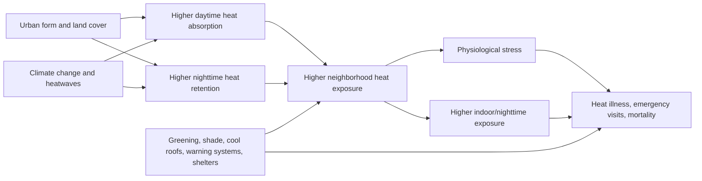

# DR26-08-25-MACANTON-01-0740 — raw report from chatgpt

> Unedited output of one model. Our reconciled synthesis is the page one level up.

---
title: "Deep Research Request"
type: deep-research-original
source: chatgpt

dr_id: DR26-08-25-MACANTON-01-0740
conversation_id: 6a482ca8-7c00-83ed-b424-fec4d07ae1e4
url: "https://приватный чат"
research_started_at: 2026-07-03T21:43:10.976646Z
research_stopped_at: 2026-07-03T21:51:50.873153Z
dr_status_in_tool: completed
harvested_by: dr_harvest_chatgpt.py
harvested_at: 2026-08-25T07:40:13
vault_chat_note: ""
---

> Отчёт Deep Research забран из ChatGPT verbatim (widget_state.report_message).
> Заметка диалога в волте обрывается на строке запуска — тела отчёта там нет.

## Запрос

```text
@Deep research Conduct a deep research investigation on the following topic.
```

## Отчёт
# Deep Research Plan Template and Applied Example

## Scope and working assumption

The original research brief does not specify a topic. I am therefore treating this as a **meta-research request** and delivering two things: a reusable, methodical deep-research template, and an example of how that template would be applied to a representative topic: **impacts of urban heat islands on public health in European cities**. That is a good stand-in topic because the evidence base is mature enough to support a rigorous review, while the policy relevance is immediate: WHO Europe has just updated its heat–health action plan guidance, the EEA has documented gaps in surveillance and preparedness, and Europe has experienced very large recent heat-related mortality burdens. citeturn2view0turn2view1turn10search0turn10search7

For the applied example, the core motivation is straightforward. Europe recorded an estimated **61,672 heat-related deaths in summer 2022**, then **47,690 in 2023**; the 2023 study further estimated that deaths would have been about **80% higher without present-century adaptation**. At city scale, urban heat island effects materially increase risk: in a 500 m-resolution study of 85 European cities, UHI was associated with a **median 45% increase in mortality risk during heat-extreme days**. citeturn10search0turn10search7turn2view3

## Reusable research plan template

A robust deep-research workflow for an unspecified topic should move in a fixed sequence so the final report is reproducible rather than impressionistic.

First, define the research problem in a way that prevents scope creep. The template should force explicit answers to five questions: **what is being measured**, **for whom**, **where**, **over what period**, and **what kinds of evidence count**. For a public-health or climate topic, that usually means pre-registering exposure variables, outcomes, study designs, comparison groups, and inclusion thresholds before reading the literature in depth.

Second, build a source hierarchy before doing open-ended searching. The default order should be: peer-reviewed primary research and systematic reviews; multilateral agencies and national public-health bodies; official datasets; then city or implementation case studies. For the applied example below, the most authoritative recurring sources are WHO, EEA/Climate-ADAPT, the European Commission JRC, Copernicus Climate Change Service, PubMed-indexed studies, and high-impact journals such as *Nature Medicine*, *Nature Communications*, *The Lancet*, and *The Lancet Planetary Health*. citeturn2view0turn2view1turn2view6turn10search0turn12search0turn2view3turn2view4

Third, screen evidence with explicit inclusion and exclusion rules. A good default rule set is: include studies with quantitative exposure or outcome measures, defined geographies, transparent methods, and population relevance; deprioritize unsupported commentary, undated advocacy pieces, poorly documented dashboards, and non-European studies unless they are used strictly for mechanism or contrast. If the topic includes intervention claims, require either natural experiments, modelling with transparent assumptions, or comparative evaluations.

Fourth, extract data into a standardized matrix. The minimum fields should be: citation, geography, time period, unit of analysis, exposure metric, outcome metric, method, covariates, key quantitative finding, stated limitations, and policy relevance. This structure makes it possible to compare heterogeneous designs without collapsing them into vague prose.

Fifth, grade strength of evidence instead of flattening everything into one narrative. A practical grading scheme is: **high** for multicity studies, meta-analyses, and high-quality national surveillance analyses; **moderate** for well-designed single-city studies and credible modelling; **exploratory** for case studies, pilot interventions, and scenario analyses without strong observed-outcome validation.

Sixth, predefine the report outputs. The final product should usually include an executive summary, a methods section, an evidence table, a section synthesizing quantitative findings, a section on heterogeneity and limitations, a policy section, and a references section. If relevant, add one causal diagram, one study-comparison table, and one outcome chart tied to a clean source table.

## Source architecture and search strategy for the example topic

For **urban heat islands and public health in European cities**, the source stack should be built around four evidence layers.

The **policy-and-surveillance layer** should start with WHO Europe’s 2026 *Heat–health action plans* guidance and the EEA’s 2024 briefing on heat-health surveillance and preparedness. WHO frames heat–health action plans around eight core elements: governance, warning systems, populations at increased risk, communication, health system resilience, reducing exposure, surveillance, and monitoring/evaluation. The EEA documents wide variation across countries in surveillance design and notes that the lack of consistent monitoring makes near-real-time European health assessment difficult. citeturn2view0turn2view1

The **exposure-and-urban-climate layer** should rely on Copernicus/UrbClim and Climate-ADAPT. Copernicus provides urban heat island maps for **100 European cities** over **2008–2017**, with day and night views and summer/winter aggregation. Climate-ADAPT has more recent European exposure material showing that many southern cities have very high shares of residents in UHI-affected zones, with nearly all residents affected in places such as **Malaga, Genoa, and Athens**, and the highest absolute exposed populations in **Paris, Athens, and Barcelona**. citeturn2view6turn4view0

The **health-burden layer** should rely on multicity epidemiology and climate-health attribution papers. The key studies here are the 85-city UHI mortality analysis in *Nature Communications*, the 93-city tree-cover health impact assessment in *The Lancet*, the 854-city assessment of non-optimal temperatures in *The Lancet Planetary Health*, and the Europe-wide 2022 and 2023 heat-mortality studies in *Nature Medicine*. Together, these give baseline burden, UHI-specific amplification, and intervention-counterfactual estimates. citeturn2view3turn2view4turn12search0turn10search0turn10search7

The **implementation layer** should rely on official case studies and municipal programs. Good examples include Antwerp’s neighbourhood-level forecasting and building-code changes, Brussels’ urban cooling islands program, Barcelona’s public cooling shelters cited by JRC, and Murcia’s reflective paving and broader overheating adaptation measures. These do not carry the same evidentiary weight as multicity epidemiology, but they are essential for translating risk estimates into operational policy. citeturn7view0turn7view1turn7view2turn8search11

A strong search strategy would use paired search strings across bibliographic and institutional databases. For example:  
`("urban heat island" OR UHI) AND (mortality OR morbidity OR hospitalization) AND (Europe OR European cities)`  
`("heat-health action plan" OR HHAP) AND Europe`  
`("urban trees" OR tree cover OR green infrastructure) AND heat AND mortality AND Europe`  
`site:who.int/europe heat health plan`  
`site:eea.europa.eu urban heat health Europe`  
`site:climate-adapt.eea.europa.eu urban heat island case study`

## Applied example on urban heat islands and public health in European cities

The applied review should be organized around five analytical questions.

The first question is **how large the health burden is**. For broad heat burden, the strongest multicountry figures come from Europe-wide mortality studies: **61,672 heat-related deaths in summer 2022** and **47,690 in 2023**, with the latter estimate suggesting current adaptation already prevented a much larger toll. For urban-only all-temperature burden, the 854-city study estimated an annual excess of **20,173 heat-attributable deaths** and **203,620 cold-attributable deaths** across European urban areas. citeturn10search0turn10search7turn12search0

The second question is **what part of that burden is specifically urban and UHI-driven**. The 85-city *Nature Communications* study found a **median 45% increase in mortality risk associated with UHI during heat-extreme days**, while the 93-city *Lancet* assessment estimated that during June–August 2015, the studied cities were on average **1.5°C warmer** than surrounding rural areas and that **6,700 premature deaths** were attributable to hotter urban temperatures, representing **4.3% of summer mortality** in those cities. citeturn2view3turn3view0

The third question is **where exposure is concentrated and who is most exposed**. Climate-ADAPT indicates especially high exposure in southern European cities, with large absolute exposed populations in Paris, Athens, and Barcelona. It also notes overrepresentation of older adults in UHI-affected areas in some cities such as **Pécs, Venice, and Porto**, and overrepresentation of some disadvantaged groups in selected cities. Separately, the European Climate and Health Observatory notes that **nearly half of hospitals and schools in European cities** are in areas with strong UHI effects above **2°C**, which matters because these are facilities used by vulnerable populations. citeturn4view0turn2view2

The fourth question is **what mechanisms connect the urban physical environment to health outcomes**. The main urban drivers are consistent across official sources: sealed or impervious surfaces, low vegetation, narrow streets with poor air circulation, anthropogenic heat emissions, and nighttime heat retention. JRC summarizes typical UHI intensity in EU cities as **4–6°C on average**, with peaks up to **10°C** above nearby areas, while Brussels’ official materials identify concrete/asphalt dominance, poor airflow, lack of vegetation, and heat generated by transport and buildings as the main contributors. citeturn7view2turn7view1

The fifth question is **which interventions have the strongest plausible or demonstrated effect**. WHO’s current guidance emphasizes heat–health warning systems, identifying at-risk populations, reducing exposure, and strengthening health-system resilience. The strongest city-scale quantitative intervention evidence in the example set is on greening: the 93-city *Lancet* modelling study estimated that raising tree cover to **30%** could have prevented about **2,644** of the **6,700** summer deaths attributed to UHI in those cities. Official implementation examples reinforce the same direction: Antwerp made green roofs mandatory for eligible new or renovated roofs and built a neighbourhood-level forecast system; Brussels is developing cooling islands in public space; JRC highlights Barcelona’s pilot-school cooling shelters and Murcia’s reflective road surfaces. citeturn2view0turn3view0turn7view0turn7view1turn7view2



The causal pathway above reflects the main mechanism emphasized by WHO, JRC, EEA, Brussels, and the multicity epidemiology: background warming plus urban form increases exposure, especially at night, which increases acute physiological stress and mortality risk; intervention can act both on exposure and on response capacity. citeturn2view0turn7view2turn7view1turn2view3

## Example evidence matrix and chart-ready outputs

The table below is the minimum viable comparison matrix I would use for the applied review.

| Study or report | Geography and period | Methods | Key quantitative result | Main limitation | Evidence role |
|---|---|---|---|---|---|
| WHO Europe, *Heat–health action plans*, 2026 | Europe, policy guidance | Synthesis and implementation framework | Defines eight core HHAP elements covering governance, warning systems, risk populations, resilience, exposure reduction, surveillance, and evaluation. citeturn2view0 | Guidance, not a causal effect study | Policy framework |
| Huang et al., *Nature Communications*, 2023 | 85 European cities, 2015–2017 | 500 m-resolution assessment of mortality risks associated with UHI | Median **45% increase** in mortality risk associated with UHI during heat-extreme days; economic impact about **€192 per adult inhabitant per year** on average for heat-related mortality. citeturn2view3 | Modelling assumptions; city-selection limits | UHI-specific risk estimate |
| Iungman et al., *The Lancet*, 2023 | 93 European cities, summer 2015 | High-resolution health impact assessment and counterfactual tree-cover scenario | Cities averaged **1.5°C** hotter than rural surroundings; **6,700** premature summer deaths attributable to UHI; **2,644** potentially avoidable with **30% tree cover**. citeturn3view0 | One main baseline year; intervention counterfactual modelled | Best intervention-counterfactual estimate |
| Masselot et al., *Lancet Planetary Health*, 2023 | 854 European cities, 2000–2019 | Urban mortality burden assessment for non-optimal temperatures | Annual excess of **20,173 heat-attributable** and **203,620 cold-attributable** deaths in European urban areas. citeturn12search0 | Not UHI-specific; broader non-optimal temperature burden | Baseline urban mortality context |
| Ballester et al., *Nature Medicine*, 2023 | 35 European countries, summer 2022 | Continental mortality attribution using Eurostat mortality data | **61,672** estimated heat-related deaths in Europe between 30 May and 4 Sept 2022. citeturn10search0 | Continental rather than city/UHI-specific | Recent burden benchmark |
| Gallo et al., *Nature Medicine*, 2024 | Europe, 2015–2023 focus on 2023 | Heat-mortality estimation with adaptation counterfactual | **47,690** heat-related deaths in 2023; burden estimated **80% higher** without present-century adaptation. citeturn10search7 | Adaptation counterfactual depends on model assumptions | Adaptation relevance |
| Climate-ADAPT population-exposure dashboard, 2026 | European cities | Exposure mapping and demographic overlay | Near-total exposure in some southern cities such as **Malaga, Genoa, Athens**; highest absolute exposed populations in **Paris, Athens, Barcelona**. citeturn4view0 | Dashboard-style synthesis rather than peer-reviewed causal study | Equity and spatial targeting |
| Antwerp Climate-ADAPT case study | Antwerp, 2008–2017 and projections | Detailed thermal mapping and city implementation case | UHI about **2°C yearly average** in city centre, up to **9°C** during summer evenings and nights; city adopted green-roof mandates and neighbourhood heat-forecasting. citeturn7view0 | Single-city case study; implementation evidence not citywide outcome evaluation | Operational case study |

A clean analytical report should then convert the matrix into a small set of charts. The first chart should be a simple burden comparison across scales: Europe-wide deaths in 2022 and 2023, urban all-temperature heat burden, and urban UHI-specific summer deaths. The second should be an intervention plot comparing current UHI-attributable deaths versus the 30% tree-cover counterfactual. The third should be a city case vignette showing Antwerp’s centre-versus-rural differential and Brussels-type or Barcelona-type mitigation categories. Those chart inputs are already available from the sources above. citeturn10search0turn10search7turn12search0turn3view0turn7view0turn7view1turn7view2

A compact chart-ready data snapshot would look like this:

| Metric | Value | Source |
|---|---:|---|
| Europe heat-related deaths, summer 2022 | 61,672 | citeturn10search0 |
| Europe heat-related deaths, 2023 | 47,690 | citeturn10search7 |
| UHI-attributable summer deaths in 93 cities | 6,700 | citeturn3view0 |
| Avoidable deaths with 30% tree cover | 2,644 | citeturn3view0 |
| Median UHI-related mortality risk increase on heat-extreme days | 45% | citeturn2view3 |
| Antwerp UHI, city-centre yearly average | 2°C | citeturn7view0 |
| Antwerp UHI, summer evening/night peak | up to 9°C | citeturn7view0 |

## Deliverable structure, quality controls, and likely conclusions

If this example were turned into a full analytical report, the final structure should be: **executive summary**, **research question and methods**, **epidemiological burden**, **urban-specific amplification**, **vulnerable populations and inequity**, **interventions and case studies**, **gaps and limitations**, **policy recommendations**, and **references**. That structure aligns with the strongest available evidence, rather than mixing broad heat epidemiology with speculative urban-design discussion. citeturn2view0turn2view1turn2view3turn2view4

The likely headline conclusions, based on current evidence, are already visible. First, heat is a major and growing public-health burden in Europe. Second, city form materially amplifies that burden rather than merely reflecting background climate. Third, the best-supported interventions are **not** single silver bullets but portfolios: warning systems and surveillance, targeted outreach to vulnerable groups, reduction of exposure through shade/trees/surface redesign, and health-system readiness. Fourth, exposure and vulnerability are unevenly distributed across cities and within cities, so any serious report should include an environmental-justice lens rather than only reporting citywide averages. citeturn10search0turn10search7turn2view3turn3view0turn4view0turn2view1turn2view2

The main research gaps are also clear. The literature is stronger on **mortality** than on **morbidity**, stronger on **outdoor and neighbourhood exposure** than on **indoor nighttime exposure**, stronger on **modelled intervention scenarios** than on **measured post-implementation health outcomes**, and still uneven in linking high-resolution urban climate maps to high-resolution social vulnerability and real-time health-service utilization. Even the EEA notes that inconsistent surveillance across countries limits near-real-time European assessment. That means a top-tier report should explicitly separate established evidence from plausible but not yet well-validated intervention claims. citeturn2view1turn11view0turn2view4

If the intended topic was something else, the **template above stays the same**; only the applied example, source stack, extraction schema, and chart set need to be swapped.
