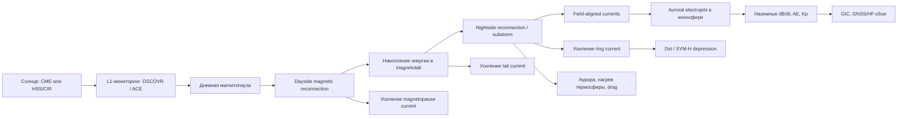

# DR26-08-25-MACANTON-02-0740 — raw report from chatgpt

> Unedited output of one model. Our reconciled synthesis is the page one level up.

---
title: "Резонанс Шумана и магнитосфера"
type: deep-research-original
source: chatgpt

dr_id: DR26-08-25-MACANTON-02-0740
conversation_id: 6a533dab-ae70-83eb-b439-1f1fab8aa064
url: "https://приватный чат"
research_started_at: 2026-07-12T07:10:45.087136Z
research_stopped_at: 2026-07-12T07:18:33.122800Z
dr_status_in_tool: completed
harvested_by: dr_harvest_chatgpt.py
harvested_at: 2026-08-25T07:40:14
vault_chat_note: ""
---

> Отчёт Deep Research забран из ChatGPT verbatim (widget_state.report_message).
> Заметка диалога в волте обрывается на строке запуска — тела отчёта там нет.

## Запрос

```text
@Deep research резонанс шумана и теория магнитосферы земли. Расскажи подробнее. Как измеряется? Как электроника и люди зависят находятся под действием машнитных частот. Магнитных бурь. Доказательства опровержения конспиративные теории
```

## Отчёт
# Резонансы Шумана и магнитосфера Земли

## Executive summary

Резонансы Шумана — это **естественные электромагнитные резонансы** в полости «поверхность Земли — нижняя ионосфера», возбуждаемые в основном глобальной грозовой активностью. Их фундаментальная частота лежит около **7.8 Гц**, а следующие моды — примерно около **14, 20, 26 Гц** и выше. Эти частоты не являются «магическими» или свободно «растущими»: они меняются лишь в узких пределах из-за суточной, сезонной и ионосферной изменчивости, тогда как гораздо сильнее меняется **амплитуда** сигнала. Добротность первых мод на Земле обычно невысока, порядка **Q ≈ 4–6**, потому что полость «подтекает» и сильно теряет энергию в атмосфере и ионосфере. citeturn9search2turn9search6turn9search16turn9search20turn10search1

Магнитосфера Земли — это **динамический плазменный щит**, формируемый взаимодействием геомагнитного поля с солнечным ветром. Ее основные элементы — bow shock, magnetosheath, magnetopause, cusps, plasmasphere, radiation belts, plasma sheet и magnetotail. Ключевые токовые системы включают **магнитопаузный ток**, **хвостовой ток**, **кольцевой ток**, **полевыравненные токи** и **авроральные электроджеты**. Во время магнитных бурь солнечный ветер, особенно при длительном южном IMF Bz, усиливает перенос энергии в магнитосферу через magnetic reconnection, что приводит к усилению кольцевого тока, FAC/электроджетов, нагреву ионосферы/термосферы и росту техногенных рисков. citeturn39view2turn22search1turn21search4turn38search1turn38search10turn5search3turn5search13

Для измерений применяются **наземные индукционные катушки**, **fluxgate-магнитометры**, **search-coil magnetometers**, **вертикальные электрические антенны**, а также сети и спутниковые миссии — от **INTERMAGNET** и **WWLLN** до **Swarm, THEMIS, MMS, DSCOVR, GOES**. Для научно пригодных магнитных рядов важны метрология и стандартизация: например, стандарт INTERMAGNET для definitive 1-second data требует временной точности **0.01 с**, диапазона **DC–0.2 Hz**, разрешения **1 pT** и шума не хуже **10 pT/√Hz at 0.1 Hz**. citeturn36view0turn12view2turn34search1turn34search4turn30search1turn33search14turn33search15turn30search6

Практические риски для техники от природных ELF/VLF и магнитных бурь в основном идут не через «резонанс бытовой электроники», а через **геоиндуцированные токи в длинных проводящих системах**, **сбои GNSS/HF**, **спутниковый drag**, **surface/internal charging** и радиационные эффекты на орбите. NOAA прямо связывает geomagnetic storms с рисками для power grids, pipelines, spacecraft operations, navigation и communications; NERC использует benchmark geoelectric field **8 V/km** для оценки уязвимости энергосистем, а современные оценки для экстремальных сценариев в Скандинавии показывают поля порядка **12 V/km** в уязвимых широтных зонах. citeturn39view0turn23search4turn23search0turn7search2turn7search6turn7search5turn7search17

Для здоровья человека важны два разных вопроса, которые часто смешивают. Первый — **что известно о биофизике ELF-полей вообще**: острые установленные эффекты начинаются на уровнях, достаточных для индуцирования токов и стимуляции нервов/мышц, то есть обычно **намного выше 100 μT**. Второй — **есть ли убедительные доказательства, что естественные вариации геомагнитного поля и резонансы Шумана существенно влияют на поведение, сознание или клинические исходы**. Здесь доказательная база заметно слабее: есть отдельные эпидемиологические ассоциации и небольшие физиологические исследования, но нет общепринятого механизма и нет надежной причинной демонстрации для популярных сильных утверждений типа «магнитные бури управляют людьми» или «Шуман 7.83 Гц синхронизирует сознание». citeturn6search0turn17search1turn17search9turn19view3turn25view1turn25view2turn27view1

## Научное объяснение резонансов Шумана

Резонансы Шумана возникают потому, что система «проводящая поверхность Земли + проводящая нижняя ионосфера» образует **сферическую волноводную полость** для ELF-волн. В идеализированном тонком сферическом резонаторе собственные частоты мод масштабируются как \( f_n \approx \frac{c}{2\pi a}\sqrt{n(n+1)} \), где \(a\) — радиус Земли, а \(n\) — номер моды; в реальной атмосфере частоты ниже идеальных из-за конечной проводимости, диссипации и высотной структуры ионосферы. Поэтому наблюдаемые пики оказываются не идеальными дельта-линиями, а широкими спектральными максимумами. citeturn9search12turn9search11turn9search16turn10search6

На практике у Земли устойчиво регистрируются спектральные пики около **7.8, 14, 20, 26 Гц**; в отдельные периоды оценки в статьях и спектральных методах дают, например, **7.9, 13.5–13.8, 20 и 26 Гц** для первых четырех мод. Добротность первых мод сравнительно низкая, обычно **Q ≈ 4–6**, то есть система колеблется, но быстро теряет энергию. Именно поэтому миф о «резком постоянном росте базовой частоты Земли» противоречит наблюдениям: меняются в основном **амплитуды и форма спектра**, а сами частоты дрейфуют лишь на доли герца. В одном из наблюдательных исследований максимальные вариации составили примерно **0.3, 0.4 и 0.7 Гц** для первых трех мод. citeturn9search2turn9search6turn9search13turn9search20turn10search1

Физически моды Шумана — это **глобальные ELF-моды**: в наземных измерениях обычно анализируют **две горизонтальные магнитные компоненты** и, когда условия позволяют, **вертикальную электрическую компоненту**. Для того чтобы вообще видеть эти сигналы, требуется чувствительность порядка **~0.5–1 pT/√Hz** по горизонтальному магнитному полю и **~100–200 μV·m⁻¹·Hz⁻¹/²** по вертикальному электрическому полю; сами сигналы очень малы по сравнению и с квазистатическим геомагнитным полем, и с инженерными электромагнитными помехами. citeturn20search17turn13view1turn13view3

Главный источник возбуждения — **мировая грозовая активность**. Молния излучает во всем спектре, а ELF-компонента многократно обходит земной шар в волноводе и создает резонансные пики. Помимо квазинепрерывного «фонового» возбуждения, существуют и **Q-bursts** — мощные изолированные импульсы от особенно сильных разрядов, часто положительных cloud-to-ground discharges, которые особенно полезны для локализации источников и изучения transient luminous events. Суточный ход резонансов хорошо отражает три главных «грозовых центра» — **Африка, Азия/Maritime Continent и Америка**, давая характерные максимумы в течение суток. citeturn10search6turn10search8turn10search2turn10search10

Наземные станции действительно регистрируют этот фон как физический атмосферно-ионосферный процесс, а не как эзотерическую «частоту сознания». Например, BGS прямо показывает Schumann peaks на спектрограммах индукционных катушек Эскдалмьюра и описывает их как продукт lightning discharges в полости Earth–ionosphere, с ожидаемыми максимумами около **7.86, 14.3, 20.8 Hz**. Станция Hylaty проектировалась как низкошумовая ELF-обсерватория именно для таких атмосферно-ионосферных и space-weather исследований. citeturn35view0turn12view0turn13view1

## Теория магнитосферы Земли

Магнитосфера — это не просто «магнитный пузырь», а **система плазмы, токов и полей**, связанная с ионосферой и термосферой. На солнечной стороне поток солнечного ветра сначала тормозится на **bow shock**, далее проходит через **magnetosheath** и достигает **magnetopause**, отделяющей межпланетное поле от поле-линий Земли. Внутри находятся **cusps**, **plasmasphere**, **radiation belts** и более удаленная **plasma sheet**; с ночной стороны магнитосфера вытягивается в длинный **magnetotail**. NASA подчеркивает, что plasmasphere, radiation belts и plasma sheet — части одной взаимосвязанной динамической конфигурации near-Earth space. citeturn21search4turn21search0turn39view2

Электрические токи определяют реальную динамику этой системы. Обзор текущих систем в magnetosphere–ionosphere system выделяет как минимум **магнитопаузные токи**, **полевыравненные токи**, **токи в ионосфере**, **кольцевой ток** и токи внутренней магнитосферы; именно эти токи создают наблюдаемые geomagnetic disturbances на земле и в космосе. Кольцевой ток — это тороидальная система энергичных частиц в экваториальной плоскости, чье усиление связано с депрессией Dst/SYM-H во время магнитных бурь. FACs замыкают существенную часть системы токов через полярную ионосферу, а auroral electrojets дают большие локальные возмущения земного магнитного поля. citeturn38search1turn38search0turn38search10turn38search6turn5search3turn5search13

Геомагнитная буря начинается тогда, когда условия солнечного ветра позволяют **эффективный перенос энергии** в магнитосферу. NOAA прямо указывает два критических фактора: **длительный высокоскоростной солнечный ветер** и, особенно, **южно направленный IMF**, противоположный полю Земли на дневной стороне. Тогда возрастает dayside reconnection на магнитопаузе, энергия накапливается и перераспределяется в магнитосфере, усиливаются хвостовые процессы и кольцевой ток, а на поздних стадиях важна reconnection в магнитохвосте, связанная с суббурями. Наиболее сильные бури чаще всего связаны с **CMEs**, более длительные, но обычно менее экстремальные — с **HSS/CIR** от coronal holes. citeturn39view2turn22search1turn22search2turn22search8turn22search13turn22search15

Связь с ионосферой принципиальна. FACs переносят ток и Poynting flux вдоль магнитных линий между магнитосферой и полярной ионосферой; в ионосфере они замыкаются через **auroral electrojets**, вызывают Joule heating, авроральные токи и сильные наземные магнитные вариации. NOAA отмечает, что storms усиливают ring current и field-aligned currents, изменяют radiation belts и ионосферу, повышают drag в LEO и ухудшают прохождение GNSS/HF сигналов. ESA также использует Swarm как рабочую платформу для мониторинга FACs как ключевого канала magnetosphere–ionosphere coupling. citeturn39view2turn38search1turn21search10turn21search3turn21search13



Эта схема соответствует современной operational и review-картине: upstream solar wind измеряется у L1, магнитопауза и хвост перерабатывают энергию через reconnection, а наблюдаемые эффекты проявляются в Dst, AE, Kp, aurora, drag и GIC. citeturn30search6turn39view2turn22search13turn38search1turn5search3turn5search13turn39view1

## Методы измерения и сети наблюдений

Измерение резонансов Шумана и магнитосферной динамики — это многоуровневая задача. Низкочастотный наземный мониторинг использует прежде всего **induction coils** и **fluxgate magnetometers**; VLF-среда и lightning-sferics отслеживаются через специальные широкополосные приемники и глобальные сети; в космосе нужны **fluxgate** и **search-coil magnetometers**, а также пакеты для поля и плазмы. Для operational space weather используются как физические измерения в L1 и GEO, так и сводные индексы — **Kp, Dst, AE**. Dst генерируется по сети экваториальных обсерваторий и служит прокси усиления кольцевого тока; AE измеряет суммарную интенсивность авроральных электроджетов. citeturn5search3turn5search13turn5search7turn39view1

С точки зрения стандартизации самая важная наземная рамка — **INTERMAGNET**. Для definitive one-second data стандарт задает временную точность **0.01 s**, pass band **DC–0.2 Hz**, data resolution **1 pT**, RMS noise ≤ **100 pT** в DC–8 mHz диапазоне и ≤ **10 pT/√Hz at 0.1 Hz** в полосе **8 mHz–0.2 Hz**. Это не «вкусовщина», а практический минимум для сравнимости данных между обсерваториями и корректного расчета производных параметров, включая dB/dt и индексы. citeturn36view0turn12view2

### Сравнение приборов и сетей

| Прибор / сеть | Что измеряет | Диапазон / полоса | Чувствительность / точность | Разрешение по времени | Примеры миссий / лабораторий | Первоисточник |
|---|---|---:|---:|---:|---|---|
| **Hylaty ELF station** | Горизонтальные магнитные компоненты ELF, включая Schumann resonance и атмосферно-ионосферные явления | **0.03–300 Hz**; у ELA11 также **0.03–1000 Hz** | Для антенн AAS1130: **24 μV/pT at 10 Hz**; шум новых антенн порядка **0.01–0.015 pT/√Hz at 10 Hz** | До **900 Hz** (ELA10), **3 kHz** для ELA11 | Jagiellonian University / Hylaty, Польша | citeturn12view0turn13view1 |
| **BGS induction coils, Eskdalemuir** | Быстрые вариации магнитного поля, Schumann peaks, local lightning, IAR/ELF | **0.1–1000 Hz** | **не указано** на открытой странице BGS | Исторически **100 Hz**, после обновления 2024 — **128 Hz** | British Geological Survey, Eskdalemuir Observatory | citeturn35view0 |
| **AWESOME receiver** | ELF/VLF природные и техногенные сигналы, sferics, ионосферный remote sensing | Классический AWESOME: **300 Hz–50 kHz**; LF AWESOME расширен до **0.5–470 kHz** | Для оригинального VLF AWESOME сообщалась чувствительность до **several tens of fT/√Hz**; в новой LF-версии — вплоть до **0.03 fT/√Hz** в зависимости от частоты | GPS-синхронизация; тайминг у LF AWESOME улучшен до **15–20 ns** | Stanford / Georgia Tech / WHU VLF receiver systems | citeturn16search5turn16search7turn15view0 |
| **WWLLN** | Глобальная локализация lightning strokes по VLF-сигналам | Прием VLF; в наблюдениях station spectrograms — до **24/48 kHz**; сильные разряды фиксируются в **6–22 kHz** | Средняя точность позиционирования исторически **<10 km**; регионально в современных сравнениях **2–3 km** | Event-based, микросекундная точность времени | World Wide Lightning Location Network | citeturn34search1turn34search4turn34search12turn34search14 |
| **INTERMAGNET one-second observatory standard** | Стандартизованные ряды наземного geomagnetic field | **DC–0.2 Hz** pass band | **1 pT** data resolution; ≤ **10 pT/√Hz at 0.1 Hz**; absolute accuracy observatory лучше **5 nT** | **1 s**, timestamp accuracy **0.01 s** | Сеть глобальных geomagnetic observatories | citeturn36view0turn12view2 |
| **ESA Swarm VFM / ASM** | Точное векторное и скалярное поле на LEO; core/crustal/ionospheric/magnetospheric signatures; FAC products | VFM high-rate **50 Hz**; ASM nominal **1 Hz**, burst scalar **250 Hz** | ASM absolute accuracy **<0.3 nT**; датировочная ошибка эквивалентна ~**30 pT** max в типичных условиях | **50 Hz**, **1 Hz**, **250 Hz burst** | ESA Swarm, GFZ / ESA Earth Online | citeturn30search1turn11search6turn30search4turn11search18turn21search13 |
| **THEMIS SCM** | Магнитные флуктуации ULF/ELF, substorm/wave physics | **0.1 Hz–4 kHz** | NEMI ≤ **0.76 pT/√Hz at 10 Hz**, **0.08 pT/√Hz at 100 Hz**, **0.022 pT/√Hz at 1 kHz** | Telemetry product-dependent; waveform/FFT/filter-bank | NASA THEMIS | citeturn12view4turn33search14 |
| **MMS SCM** | Волновые магнитные флуктуации в магнитосфере и reconnection regions | Nominal **1 Hz–6 kHz**; calibration from **0.1 Hz** upward | NEMI ≤ **2 pT/√Hz at 10 Hz**, **0.3 pT/√Hz at 100 Hz**, **0.05 pT/√Hz at 1 kHz**; resolution **0.15 pT at 1 kHz** | Product-dependent; waveform/spectral products | NASA MMS | citeturn33search15turn33search3 |
| **DSCOVR MAG** | Upstream IMF at L1 for operational forecasting | Instrument cadence **50 Hz**; публичные продукты **1 s** и **1 min** | Accuracy примерно **±0.5–0.9 nT** | **1 s** и **1 min** products; raw/high-cadence instrument | NOAA DSCOVR | citeturn30search2turn30search6turn30search14 |
| **GOES magnetometers** | Геостационарный мониторинг магнитного поля для storms/substorms | Legacy archives до **2 Hz**; GOES-R officially **10 samples/s** | Legacy sensitivity **0.03 nT**, accuracy **1 nT**; long-term bias stability порядка **1–2 nT** для GOES-14/15 | **0.512 s** legacy; **10 Hz** GOES-R implementation | NOAA GOES | citeturn31search0turn31search16turn31search11turn31search14turn31search1 |

В методическом смысле полезно разделять четыре класса задач. **Schumann monitoring** требует сверхтихих ELF-площадок и чувствительных induction coils. **Operational geomagnetism** требует стандартизованных fluxgate/scalar observatories и индексов Kp/Dst/AE. **Lightning-source monitoring** лучше всего делать VLF/LF сетями типа WWLLN/GLD360. **Magnetospheric process studies** требуют спутников с fluxgate + search-coil + plasma instruments, потому что наземные данные сами по себе не различают однозначно source regions и topology of currents. citeturn35view0turn36view0turn34search1turn34search2turn30search6turn33search15

## Воздействие ELF/VLF полей и магнитных бурь на технику и на здоровье человека

### Электроника и инфраструктура

Для наземной техники главный риск создают не сами «частоты Шумана», а **изменяющееся магнитное поле**, которое по закону Фарадея индуцирует электрические поля в грунте и токи в длинных проводниках. NOAA прямо указывает, что geomagnetic storms способны ухудшать работу power grids, pipelines, HF radio, satellite navigation и spacecraft systems; для G5 возможны widespread voltage control problems, transformer damage, extensive spacecraft charging и pipeline currents **hundreds of amps**. Для оценки устойчивости grid-операторы Северной Америки используют benchmark GMD event с reference peak geoelectric field **8 V/km**, а recent 1-in-100-year modeling for Sweden дало пиковые горизонтальные geoelectric fields порядка **12 V/km** в наиболее уязвимых широтных/геоэлектрических областях. citeturn39view0turn23search4turn7search2turn7search6turn7search5turn7search17

В практической инженерии важен также **dB/dt**, а не только абсолютная амплитуда. Исследования GIC подчеркивают, что уже **~100 nT/min** могут быть значимы для harmful GICs в подходящих сетях. На высоких широтах auroral disturbance fields обычно составляют **100–1000 nT**, а в крупнейших storms могут доходить до **3000 nT**. Поэтому реальный объект риска — это прежде всего **длинные линии электропередачи, трубопроводы, железнодорожные рельсы, кабели, антенны и спутниковые платформы**, а не «голая микросхема смартфона на столе». citeturn24search2turn24search1turn24search24turn23search10turn23search13

Для спутников эффекты иные: plasma/radiation environment вызывает **surface charging, internal charging, orientation/tracking problems**, а нагрев термосферы на фоне storm-time energy input увеличивает плотность верхней атмосферы и тем самым **drag** на низких орбитах. NOAA и NASA приводят реальные operational consequences, включая потерю десятков спутников Starlink в феврале 2022 после storm-enhanced drag. citeturn23search0turn39view2turn23search11turn23search14

### Биофизические механизмы и нормативы безопасности

Для человека установленные и хорошо воспроизводимые механизмы действия ELF-полей — это **индуцированные электрические поля и токи в тканях**, которые при достаточно высоких уровнях могут вызывать **magnetophosphenes**, изменения возбудимости ЦНС и **стимуляцию нервов и мышц**. WHO подчеркивает, что острые подтвержденные эффекты для ELF magnetic fields наблюдаются на уровнях **well above 100 μT**. ICNIRP 2010 задает reference levels для general public: например, в диапазоне **25–400 Hz** это **200 μT**, а в диапазоне **1–8 Hz** уровень задается как \(4\times10^{-2}/f^2\) T, что на **8 Hz** дает **625 μT**. Для occupational exposure на 8 Hz формула \(0.2/f^2\) дает **3.125 mT**. citeturn6search0turn19view0turn19view1turn19view3turn17search10

Теперь важный масштабный факт. Квазистатическое геомагнитное поле Земли равно примерно **25–65 μT**, а естественные вариации во время storms обычно составляют лишь **1–5%** от него; даже долгосрочные флуктуации в течение ~10 лет не превышают **1–2 μT**. Сигналы самих Schumann resonances в атмосфере измеряются в **picoteslas** — обсервационные статьи говорят о необходимости чувствительности порядка **0.5–1 pT/√Hz** для их уверенной регистрации, а другие работы дают типичные магнитные амплитуды порядка **нескольких десятых pT** или около **~2 pT** для фундаментальной моды. То есть и storm-time вариации, и особенно SR-сигналы находятся **на многие порядки ниже** тех уровней ELF-экспозиции, на которых ICNIRP/WHO обсуждают острые нейростимуляционные эффекты. Это не доказывает абсолютное отсутствие любых тонких биологических корреляций, но делает крайне неправдоподобными популярные сильные заявления о мощном прямом физиологическом действии естественных SR-полей. citeturn25view1turn20search17turn8search17turn20search4turn19view3turn6search0

### Экспериментальные и эпидемиологические данные

Научная литература по здоровью здесь неоднородна. С одной стороны, есть исследования, связывающие geomagnetic activity с HRV, blood pressure, myocardial infarction, total/CVD mortality и некоторыми неврологическими/психиатрическими исходами. Например, large ecological study по **263 U.S. cities** сообщил статистические связи между daily Kp и total/CVD/MI deaths; systematic review/meta-analysis 2025 года по **6 studies** также сообщила mean RR примерно **1.3–1.5** для MI/ACS и **1.25–1.6** для stroke. citeturn27view1turn25view2

С другой стороны, качество этих доказательств ограничено. Сами авторы systematic review пишут о **небольшом числе работ**, **разнородной методологии**, различиях в statistical analysis и в способах оценки geomagnetic activity. Обзор Sarimov et al. прямо отмечает, что по ELF-MFs и magnetic storms **нет общепринятого единого механизма**, несмотря на большое количество работ. WHO в части ELF-полей различает установленные кратковременные эффекты на высоких уровнях и гораздо более спорную литературу о долгосрочных низкоуровневых воздействиях; IARC в 2002 году классифицировало ELF magnetic fields как **Group 2B possibly carcinogenic**, главным образом из-за эпидемиологии childhood leukemia при долговременной техногенной 50/60 Hz экспозиции, а не из-за geomagnetic storms или Schumann resonance. citeturn25view2turn25view1turn17search9turn17search1turn6search11

Здесь надо жестко разводить два контекста. **Техногенные ELF-поля** возле power lines или промышленного оборудования и **естественные геомагнитные вариации** — это разные по спектру, по дозиметрии, по экспозиционному паттерну и по механистической интерпретации вещи. Поэтому переносить из WHO/IARC-литературы про power-frequency exposure выводы на «Шуман 7.83 Гц влияет на сознание» — методологическая ошибка. И наоборот: единичные ассоциации geomagnetic activity с клиническими метриками не дают основания утверждать, что магнитные бури «управляют людьми». citeturn17search9turn17search1turn25view1turn39view2

### Масштаб уровней поля

| Источник / процесс | Частоты | Типичный магнитный уровень | Комментарий |
|---|---:|---:|---|
| **Schumann resonance, background** | ~7.8, 14, 20, 26 Hz | порядок **0.5–1 pT/√Hz**, отдельные оценки — **~2 pT** для fundamental mode | Нужны сверхчувствительные индукционные катушки; это очень слабый сигнал. citeturn20search17turn8search17turn20search4 |
| **Pc5/ULF ground pulsations** | ~1.7–6.7 mHz | амплитуды от **>0.5 nT** до десятков nT; в отдельных event studies больше | Значимо для магнитосферной диагностики, но не для прямой нейростимуляции человека. citeturn8search9turn8search16turn8search13 |
| **Auroral electrojet disturbance fields** | ULF / quasi-DC dynamics | обычно **100–1000 nT**, в крупнейших бурях до **3000 nT** | Главный наземный источник GIC-риска на высоких широтах. citeturn24search1turn24search24 |
| **ICNIRP general public, 8 Hz** | 8 Hz | **625 μT** | Reference level для сравнения по порядку величины. citeturn19view3 |
| **ICNIRP general public, 25–400 Hz** | 25–400 Hz | **200 μT** | Для power-frequency-like ELF exposures. citeturn19view3turn17search10 |

Сухой вывод по масштабу: natural SR signals находятся на **порядки ниже** not only geomagnetic background, but also below public reference levels for acute ELF effects; storm-time geomagnetic disturbances существенны прежде всего как **индукционный и системный engineering hazard**, а не как прямой «магнитный агент управления физиологией». citeturn20search17turn24search1turn19view3turn23search4

## Разбор популярных конспирологических утверждений

| Утверждение | Оценка по фактам | Что говорят данные |
|---|---|---|
| **«Частота Шумана постоянно растет: 7.83 → 12 → 20 Гц»** | **Ложно** | Наблюдаются стабильные моды около **7.8, 14, 20, 26 Гц**; частоты дрейфуют лишь на доли герца из-за day–night/seasonal/ionospheric variability. Меняется главным образом **амплитуда** и spectral power, а не «базовая частота Земли». citeturn9search2turn9search13turn9search20turn10search1turn35view0 |
| **«Резонансы Шумана напрямую синхронизируют мозг и сознание»** | **Не подтверждено** | Частотное соседство с alpha-range само по себе не является доказательством causation. Естественные SR магнитные поля — порядка **pT**, тогда как установленные острые ELF-эффекты для человека обсуждаются WHO/ICNIRP на уровнях **сотен μT и выше**. Статьи о взаимодействии SR и человека в основном теоретические, пилотные или методологически слабые; воспроизводимого клинического доказательства нет. citeturn20search17turn20search4turn6search0turn19view3turn29view0 |
| **«Магнитные бури управляют поведением людей»** | **Сильно преувеличено / не доказано каузально** | Есть отдельные статистические ассоциации с HRV, mortality, MI или stroke, но они в значительной степени observational/ecological, неоднородны и не дают вывода о control/manipulation. Авторы обзоров сами подчеркивают heterogeneity и methodological limitations, а единого механизма нет. citeturn25view2turn27view1turn25view1 |
| **«Schumann resonance — мощное поле, способное заметно перестраивать биологию»** | **Ложно по порядку величины** | Для регистрации SR нужны датчики на уровне **pT**; это чрезвычайно слабый сигнал. Да, слабые поля можно изучать в magnetobiology, но утверждение о «мощном природном биомодуляторе» не согласуется с измеренными уровнями поля. citeturn20search17turn8search17turn13view1 |
| **«Бытовая электроника ломается из-за резонансов Шумана»** | **Ложно** | Реальные operational effects space weather на технику идут через **GIC в длинных проводниках**, **GNSS/HF disturbances**, **satellite charging/drag**, а не через прямой «резонанс телефона на 7.83 Гц». NOAA и NERC описывают именно эти механизмы. citeturn23search4turn39view0turn7search2turn23search0 |
| **«Если есть корреляция с сердечно-сосудистыми событиями, значит доказано прямое управление организмом»** | **Неверный вывод** | Корреляция в population-level time-series не равна доказанной причинности. Нужны индивидуальная дозиметрия, воспроизводимость, контроль confounding, биофизический механизм и независимые replication studies. Пока этого уровня доказательности для сильных claims нет. citeturn25view2turn27view1turn25view1turn17search9 |

## Ключевые первоисточники и приоритетные сайты

Для **оперативных и справочных данных** приоритетны следующие официальные площадки: **NOAA SWPC / NOAA NCEI** для Kp, G-scale, GOES, DSCOVR, geoelectric field и impact guidance; **ESA Earth Online / ESA Space Weather** для Swarm и европейских products; **NASA Heliophysics / JPL / SVS** для magnetosphere structure, reconnection и mission context; **WDC Kyoto** для **Dst** и **AE**; **INTERMAGNET** для standards и long-term observatory data. citeturn39view0turn39view1turn39view2turn30search6turn31search2turn23search2turn21search7turn5search0turn5search1turn12view2

Для **обзорной научной базы по резонансам Шумана** наиболее полезны: обзор Colin Price 2016 по ELF waves from lightning и SR, обзор Liu et al. 2023 по современному состоянию и space-based observations, а также наблюдательные работы по частотным и амплитудным вариациям. Для **магнитосферы** — Gonzalez et al. 1994 по определению geomagnetic storm, Milan et al. 2017 по current systems, Ganushkina et al. 2018 по primary current systems, Borovsky & Valdivia 2018 по magnetosphere as a coupled system, Daglis et al. 1999 по ring current и Pulkkinen et al. 2017 по GIC science/engineering. citeturn9search2turn9search16turn5search10turn38search1turn38search0turn21search2turn38search10turn7search7

Если нужен предельно прагматичный набор для дальнейшей работы по теме, я бы считал базовым такой стек источников: **NOAA SWPC + WDC Kyoto + INTERMAGNET + ESA Swarm + peer-reviewed reviews (AGU / Space Science Reviews / Surveys in Geophysics / JASTP / Atmosphere)**. Это минимизирует шум, маркетинг и конспирологию и дает опору на измеряемые величины, стандарты и воспроизводимые данные. citeturn39view0turn5search0turn12view2turn21search13turn38search1turn9search2
