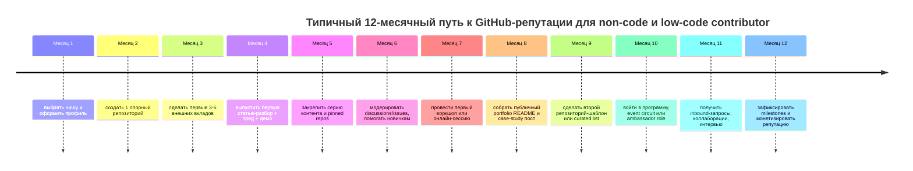

# DR26-08-25-MACANTON-07-0740 — raw report from chatgpt

> Unedited output of one model. Our reconciled synthesis is the page one level up.

---
title: "Успех на GitHub без кода"
type: deep-research-original
source: chatgpt

dr_id: DR26-08-25-MACANTON-07-0740
conversation_id: 6a6aff22-e778-83eb-b3c3-db891cf1c8cd
url: "https://приватный чат"
research_started_at: 2026-07-30T07:40:24.124856Z
research_stopped_at: 2026-07-30T07:50:13.396098Z
dr_status_in_tool: completed
harvested_by: dr_harvest_chatgpt.py
harvested_at: 2026-08-25T07:40:27
vault_chat_note: ""
---

> Отчёт Deep Research забран из ChatGPT verbatim (widget_state.report_message).
> Заметка диалога в волте обрывается на строке запуска — тела отчёта там нет.

## Запрос

```text
 Примеры успешных профилей
Разберём несколько реальных GitHub-профилей, которые демонстрируют различные стратегии продвижения:

Профиль	Описание/статистика
@jwulf (Josh Wulf)	294 followers, 330 звёзд, 443 репозитория. Бывший рекрутер, за 14 мес. открыл десятки PR в Zeebe (Camunda) и др. В итоге получил позицию Developer Advocate по вкладу в OSS. Пример: PR в zeebe-io/zeebe и материалы по BPMN. Показывает, что последовательный вклад приводит к трудоустройству.
@kentcdodds (Kent C. Dodds)	35 000 followers, 1 600 звёзд, 753 репозитория. Автор популярных JavaScript/React библиотек (React Testing Library, cross-env) – пinned проекты: react-testing-library (19.6k ⭐) и cross-env (6.5k ⭐). Профиль демонстрирует: построение репутаций через известные пакеты и обучающие ресурсы (он ведёт курсы), активность в коммьюнити.
@sindresorhus (Sindre Sorhus)	80 500 followers, 3 000 звёзд, 1 100 репозиториев. Легендарный «full-time open sourcerer»: создал сотни npm-пакетов и справочников. Pinned репо: type-fest (17.3k ⭐), ky (17k ⭐), awesome list (~490k ⭐). Это пример «партизана» списка: его Awesome-лист покрыл спрос и привлёк миллионы просмотров, что сделало профиль известным.
@KyMidd (Kyler Middleton)	240 followers, 166 звёзд, 76 репозиториев. HashiCorp Ambassador, AWS Community Builder. Менее массовый случай: профиль с «средними» числами, но равномерная активность в DevOps-сообществе. Демонстрирует постепенный рост: публикации блогов и конференций дополняют GitHub-активность. Пока не набрала масс-фолу, но показывает нишевую экспертизу в DevOps и security.
Я дал тебе примеры успешных профилей чуваков, которые рекламируют, ну, на GitHub'е успешно. Я хочу стать точно таким же успешным чуваком, который на GitHub'е построил себя с нуля. Но поскольку я абсолютно не кодер, тебе нужно найти для меня примеры успехов таких же других некодеров. Как они на GitHub'е себя позиционировали, что они делали, какие социальные сети они вели, где вообще они что писали. То есть мне нужна также информация, где они вели свои блоги, dev.to или Medium, или что-либо еще. То есть нужно понять, как они делали контент свои машины, на что ориентировали максимально детально. И мне нужна история успеха, как не кодер или вайп-кодер стал крутым на GitHub'е. И не просто крутым, и ему дали еще какой-то оффер. То есть очень важно, чтобы ты нашел историю успехов различных вайп-кодеров или некодеров, которые пришли на GitHub и буквально за год стали очень крутыми, успешными и так далее. Спасибо.
```

## Отчёт
# Документированные истории успеха некодеров и low-code contributors на GitHub

## Исполнительное резюме

Если убрать маркетинговый шум, то самые убедительные “быстрые” траектории роста на GitHub у некодеров и very-low-code contributors строятся не вокруг “я резко выучил Computer Science”, а вокруг публично полезной работы: документации, учебных playground-репозиториев, issue triage, шаблонов, curated lists, демо, community-onboarding и контента, который фиксирует эту работу в открытом виде. В самой сильной части выборки люди получали заметный карьерный рывок за месяцы, а не за годы: Josh Wulf описал переход из рекрутинга в инженерную роль через open source; OGBONNA Sunday получил международную роль в OpenSauced вскоре после серии PR; Abdurrahman Rajab сначала получил контракт после GitHub Universe, а затем DevRel-роль в YC-компании после open-source прототипа, подкаста и публичной активности; Victor Eke раскрутил в основном Markdown-репозиторий до 1,000+ stars за 4 месяца. citeturn30search0turn30search9turn41view0turn19view0turn17search0turn17search16

Вторая важная закономерность: почти ни у кого GitHub не работал в вакууме. Сильный профиль почти всегда был связан с внешней “контент-машиной”: DEV, Hashnode, собственный блог, GitHub Blog, YouTube, X, LinkedIn, подкасты, конференции и community programs. То есть GitHub выступал не просто хостингом кода, а доказательной базой для репутации, а внешние каналы — воронкой внимания к этой базе. Это особенно видно у Rizel Scarlett, Kedasha Kerr, Ayu Adiati, Ruth Ikegah и Bekah Hawrot Weigel: у всех GitHub-профиль связан с сериями статей, выступлениями, обучением новичков и публичным позиционированием. citeturn41view1turn27search2turn36search11turn26search0turn35search1turn22search1turn35search0turn13view3turn21search1turn21search5

Самый практичный вывод для тебя: если ты не кодер, тебе не нужен “идеальный” технический стек. Тебе нужен один ясно полезный артефакт на GitHub, который решает реальную боль сообщества, плюс повторяемая привычка превращать каждое маленькое улучшение в публичный след: issue, README, guide, video demo, short post, thread, workshop. Документированные кейсы показывают, что рынок на это реагирует, особенно когда артефакт упрощает вход другим новичкам. citeturn20search1turn22search5turn39search2turn33search7turn33search9

Ниже я даю 8 кейсов. Честное ограничение: полностью “zero-code” историй с детально документированными метриками мало. Поэтому выборка включает не только чистых некодеров, но и людей с very-low-code, docs-first, education-first и community-first стратегиями. Там, где стартовые метрики, даты или точные PR-counts не опубликованы публично, я помечаю это как `unspecified`. citeturn13view3turn22search1turn41view0turn19view0

## Что показывает выборка

Я отобрал кейсы по четырём жестким критериям: есть публичная первичная документация; GitHub — центральная часть истории, а не случайный фон; вклад заметно включает non-code или low-code элементы; в истории есть либо быстрый рост репутации, либо прямой карьерный сигнал — оффер, роль, GitHub Star, maintainer-role, community leadership, заметный звездный рост репозитория. Источники — GitHub-профили и README, GitHub Stars profiles, GitHub Blog, DEV/Hashnode/личные блоги, интервью и анонсы компаний. citeturn35search0turn35search1turn37search2turn40search1turn8search0turn9search0turn26search0turn30search0turn41view0turn19view0

Сильнейшие быстрые истории в этой выборке — это не “я сделал 200 side-projects”, а более узкая стратегия: один центральный репозиторий или экосистема, высокая частота небольших осмысленных вкладов, и поверх этого — повторяемый образовательный контент. У OGBONNA Sunday это были несколько быстрых PR в OpenSauced; у Victor Eke — curated-list repo с открытым contribution flow; у Ayu Adiati — documentation/open-source portfolio и последовательная серия постов; у Kedasha Kerr — GitHub-first educational repos и серийный контент для новичков; у Ruth Ikegah — инфраструктура для онбординга новичков в Git/GitHub и open source. citeturn41view0turn17search1turn35search1turn40search1turn39search2

Ниже — сравнительная таблица по 8 кейсам. Числа followers/repos/stars в колонке “Текущие метрики” — это актуальные значения, которые были видны в публичных GitHub snippets при текущем исследовании; стартовые цифры часто не публиковались, поэтому отмечены как `unspecified`, кроме случаев, где автор сам зафиксировал начальные milestone-метрики. citeturn35search0turn35search1turn37search2turn40search1turn36search0turn38search0turn37search5

| Человек | Исходный фон | Окно быстрого роста | Основной тип GitHub-вклада | Внешние каналы | Итог | Текущие метрики и источники |
|---|---|---|---|---|---|---|
| **Josh Wulf** | 10 лет в рекрутинге, карьерный переход | около 14 месяцев | вклад в OSS-экосистему Zeebe/Camunda, demo/sample apps, статьи, вебинары | DEV, Opensource.com, Camunda blog/podcasts/webinars | сначала инженерная роль через OSS, затем Developer Advocate в Camunda | current followers ~298; точные стартовые метрики unspecified. citeturn30search0turn30search9turn29search1turn29search2turn37search5 |
| **OGBONNA Sunday** | self-taught web learner, мало опыта | дни–недели после августа 2022 | PR в `open-sauced/hot`, small issues, rapid contribution sprint | Twitter/X, DEV, OpenSauced profile | международная Software Engineering role в OpenSauced | старт: first PR 2022-08-03, затем 2 PR 2022-08-04; offer shortly after; current GitHub metrics in story unspecified. citeturn41view0 |
| **Abdurrahman Rajab** | миграционный фон, университет, GitHub Campus Expert, подкастер | примерно 1 год от GitHub Universe 2022 и OSS sprint до ролей | first PR в OpenSauced, OSS prototype под идею YC-founder, UI/UX + issue/PR collaboration | Hadith Tech podcast, YouTube, TV interviews, GitHub Universe | контракт через GitHub Universe связи; затем DevRel engineer в YC-компании Unify | точные GitHub metrics unspecified публично; source of hire explicitly tied to GitHub contributions + podcast + YouTube + TV. citeturn19view0 |
| **Ruth Ikegah** | technical writer / community-first contributor | GitHub Star уже в 2020 после docs-first старта | tutorials, typo fixes, how-to docs, beginner playgrounds, community leadership | личный блог, GitHub Stars, talks, forums, Djangocon Africa, GitHub Universe | GitHub Star, Open Source Program Manager, All In Africa lead, CHAOSS leadership | current: ~872 followers, 106 repos, 113 starred; pinned repos include `BlogExperience`, `Git-and-GitHub-PlayGround`. citeturn13view3turn35search0turn39search2turn39search4turn39search10 |
| **Ayu Adiati** | self-taught, tech blogger, docs-first | 2023–2024 contributor → maintainer | docs, maintainer guides, portfolio repos, contributor onboarding, community docs | own blog, DEV, freeCodeCamp, Hashnode, podcasts, workshops | maintainer roles and course co-authoring; strong niche reputation around docs/open source | current: 237 followers, 83 repos; pinned `oss-portfolio`, `oss-portfolio-template`. citeturn35search1turn22search1turn31search0turn31search4 |
| **Rizel Scarlett** | help desk technician → community college →-devrel track | примерно 1 год от “asking in DMs” до GitHub offer | demos, beginner tutorials, OSS education, public repo experiments | DEV, GitHub Blog, YouTube/Twitch, X, community talks | offer to work as Developer Advocate at GitHub | current: ~957 followers, 288 repos, 175 stars; repos include `copilot-todo-list`, `time-blind`, `my-mcp-app`. citeturn27search3turn41view1turn37search2turn28search10turn28search19 |
| **Kedasha Kerr** | social worker before tech; education/content-first | 2023–2026 public acceleration with GitHub-centered educational content | profile README templates, certification guide, tutorial repos, no-code/AI accessibility framing | GitHub Blog, website, Instagram, TikTok, LinkedIn, X | Developer Advocate at GitHub, strong GitHub-education brand | current: ~1.3k followers, 226 repos, 539 stars; pinned include `github-certification-guide`, `profilereadme`, `simple-next-app`. citeturn36search12turn36search11turn36search1turn40search1 |
| **Victor Eke** | early-career developer, but success repo mostly curation/Markdown-first | 4 месяца до 1,000+ stars | curated list, contributor-friendly README, open PR flow, portfolio inspiration database | Hashnode, DEV, personal site, freeCodeCamp mentions | strong GitHub reputation via one repository | start: 22 stars / 7 forks at article launch; success: 1,000+ stars / 200+ forks in 4 months; later 2,000+ stars / 400+ forks / 100+ contributors; current profile ~1.2k followers and pinned repo 6.2k stars. citeturn17search16turn17search0turn36search0turn17search1 |

## Кейс-банк

**Josh Wulf** — один из самых чистых карьерных кейсов именно “не из кодинга”. В своей истории он прямо пишет, что это “true story: a recruiter quits his job, contributes to open source, gets a job as a software engineer.” В подборке Opensource.com его путь описан как переход после 10 лет в рекрутинге к инженерной работе через open source; уже к июлю 2019 года Camunda официально представляла его как Zeebe Developer Advocate, а в 2020 — как одного из трёх Developer Advocates, делавших контент, sample applications и demos для Camunda BPM и Zeebe. То есть репутация на GitHub и в экосистеме не только дала вход в инженерию, но и быстро конвертировалась в DevRel-роль. Публичный GitHub-след сегодня сравнительно скромен по followers, но это не мешает кейсу: здесь ценность была не в “масс-фолловинге”, а в высокой доверительности вклада в конкретную экосистему. citeturn30search0turn30search9turn29search1turn29search2turn37search5

Что у него важно для воспроизведения: он не пытался “покрыть весь интернет”, а привязался к одной профессиональной теме и сделал себя очевидным человеком для этой темы через вклад, объяснения и demos. Внешняя часть машины — DEV, Opensource.com, Camunda blog, вебинары, подкасты. То есть формула была: **глубокая ниша + последовательный вклад + образовательный слой поверх вклада**. Для некодера это хороший сигнал: тебе не нужен глобальный охват в первый год, тебе нужна ассоциация с одной болью и одной OSS-экосистемой. citeturn13view4turn29search1turn29search2

**OGBONNA Sunday** — самый жёсткий “короткий спринт → оффер” кейс в выборке. В своей истории он пишет, что в августе 2022 поставил себе цель: 30 дней подряд вносить вклад в open source. Первый PR в `open-sauced/hot` он открыл 3 августа 2022, ещё два — 4 августа. В статье он прямо фиксирует поворотный момент: вскоре после этих вкладов ему написал CEO OpenSauced, и этот первый шаг “working in public” привёл к Software Engineering role. У него хорошо видно, что карьерный сдвиг был не следствием многолетнего “накопления статуса”, а следствием очень быстрого и публично видимого сигнала компетентности в нужном сообществе. citeturn41view0

Для тебя из этого кейса важны три детали. Первая: он начал не с “большого продукта”, а с маленьких задач в одном проекте. Вторая: он повторил вклад несколько раз подряд за очень короткое окно, то есть maintainers увидели не случайность, а паттерн. Третья: он сам подчёркивает “positioning” как фактор найма — не только skill, но и публичная видимость этого skill. Для low-code или non-code стратегии это означает, что серия качественных docs/issues/examples за 2–4 недели может быть заметнее, чем один тяжёлый side project за полгода. citeturn41view0

**Abdurrahman Rajab** — особенно полезный кейс для человека, который не хочет строить карьеру только через код. В его истории важнейшую роль играют не только GitHub-вклады, но и **GitHub Campus Expert**, подкаст **Hadith Tech**, GitHub Universe 2022, публичные интервью и способность превращать разговоры с людьми из сообщества в конкретные прототипы. Он пишет, что на GitHub Universe встретил своего четвёртого работодателя Ahmad Awais и сразу получил контракт; затем, уже после серии open-source вкладов и собственного прототипа под идею фаундера Unify, получил предложение DevRel engineer. Причём сам фаундер в разговоре сослался не только на GitHub contributions, но и на YouTube, подкаст и TV interviews. Это почти идеальная иллюстрация того, что GitHub-репутация сегодня работает как часть более широкой публичной доказательной базы. citeturn19view0

Такой путь особенно релевантен для некодера, потому что здесь главная ценность — не “самый сильный инженерный execution”, а комбинация из community trust, taste, product sense, explanatory content и готовности быстро собрать прототип вокруг чужой идеи. Для твоей стратегии это значит: если ты строишь GitHub через docs/prompts/examples/AI demos, обязательно связывай это с каналом, где у тебя есть голос — подкаст, короткие видео, интервью, стримы, X/LinkedIn threads. Одного репозитория часто недостаточно; но репозиторий плюс публичный контекст вокруг него — уже работает. citeturn19view0

**Ruth Ikegah** — один из лучших docs-first кейсов в open source последних лет. В интервью CoderPad она прямо говорит, что начала вклад как technical writer: исправляла typos, делала tutorials и how-to guides для проектов, которые ей были интересны; эта advocacy вокруг beginner-friendly docs привела к тому, что в 2020 году она была номинирована как GitHub Star. GitHub Blog и GitHub Stars profile затем показывают быстрый рост уже на уровне ролей: community pioneer, GitHub Africa Meetup driver, позже All In Africa program lead, Codacy Pioneers Fellowship mentor, CHAOSS board co-chair, спикер GitHub Universe. На GitHub у неё сегодня видны 872 followers и 106 repositories, а в pinned стоят именно правильные для non-coder growth assets репозитории: `BlogExperience` и `Git-and-GitHub-PlayGround`. citeturn13view3turn39search4turn39search1turn9search0turn35search0turn39search8

Что Ruth делала правильно. Во-первых, она не прятала свою “не-кодовую” сильную сторону, а превратила её в продукт: beginner docs, first-contribution stories, Git/GitHub playground. Во-вторых, у неё есть явный community mission statement: помогать новичкам входить в open source, особенно в Африке. В-третьих, она делала контент не абстрактно, а вокруг **онбординга**: это намного лучше продаёт твой профиль работодателю и сообществу, чем просто “я люблю писать про технологии”. Если переводить это на практический язык: твой GitHub должен облегчать первые 30 минут жизни следующего новичка. Если делает — он работает. citeturn13view3turn35search0turn39search2

**Ayu Adiati** — очень сильный шаблон для docs/community-maintainer трека. На своём GitHub-профиле она открыто позиционирует себя как tech blogger, open source contributor & maintainer, community enthusiast и documentation lover; там же у неё не просто bio, а практически mini-landing page: banner, roles, accomplishments, talks, latest blog posts, links, portfolios и pinned repos `oss-portfolio` и `oss-portfolio-template`. В статье про свой GitHub profile README она даже разобрала структуру по секциям: banner, about me, skills, contribution stats, accomplishments, community activities, latest posts, fun fact, quote/GIF, footer. Отдельно она описывает путь “from contributor to maintainer”, где к маю 2024 уже пишет, что шесть месяцев находится в volunteer maintainer role. citeturn35search1turn22search3turn22search1

У Ayu особенно важна **контентная дисциплина**. В 2023–2026 у неё видна связная серия материалов: pledge на Hacktoberfest, reflections, maintainer experience, communication in open source, brand-building through OSS, automated open source portfolio, maintainer playbooks. Иными словами, она не публиковала “всё подряд”; она строила **сериал** вокруг одной темы. Это и есть то, что тебе нужно повторить. Не отдельные статьи, а сюжетная арка. Судя по профилю и статьям, именно это позволило ей стать заметной фигурой на пересечении docs, maintainer work и community education. citeturn31search0turn31search2turn31search4turn31search11turn31search14

**Rizel Scarlett** — очень полезный кейс перехода из нетипичного фона в сильную GitHub-centered публичную роль. Sisters in Tech пишет, что она изучала computer information systems в community college и начинала help desk technician в HubSpot; в своём DEV-посте Rizel пишет, что ещё год назад сама скользила в чужие DM с вопросом “как стать developer advocate”, а затем смогла получить offer в GitHub как Developer Advocate. Самое важное в её разборе — список того, что она системно делала: public speaking, technical blogging, YouTube videos, Twitch streams, open source contributions, community building и brand-building через social media, особенно X/Twitter. У неё на GitHub сейчас около 957 followers и 288 repos; среди репозиториев — `copilot-todo-list`, `time-blind`, `my-mcp-app`, то есть смесь tutorial/demo/AI project assets, а не только “боевых приложений”. citeturn27search3turn41view1turn37search2turn28search10turn28search19

Важный технический урок из Rizel: GitHub здесь выступает хранилищем учебных демонстраций и proof-of-work, а не просто профилем-коммитографом. Важный контентный урок: она оформляла свой путь как серию. DEV зафиксировал 16-part series по её DevRel journey, а GitHub Blog показывает её GitHub-oriented beginner posts и Copilot demos. Для твоего кейса это означает: один формат для long-form объяснений и один формат для коротких демонстраций должны идти параллельно, а не заменять друг друга. citeturn41view1turn27search4turn27search17

**Kedasha Kerr** — один из лучших современных примеров education-first positioning вокруг GitHub. У неё открыто заявлен нетипичный pre-tech background: devopsdays Chicago и Intel публикуют, что до перехода в tech она работала social worker; сегодня она Developer Advocate at GitHub. Её сайт пишет, что она делится контентом в TikTok, Instagram, LinkedIn и иногда Twitter/X, а GitHub Blog показывает почти идеальную серийную cadence: весной 2026 она выпустила GitHub for Beginners posts 2 марта, 16 марта, 30 марта, 13 апреля, 28 апреля, 11 мая, 25 мая и 8 июня — фактически biweekly educational sequence. На GitHub у неё сейчас около 1.3k followers, 226 repos и 539 stars; pinned repos — `github-certification-guide`, `profilereadme`, `simple-next-app`, `mealmetrics-copilot`. Это не случайный набор: каждый pinned repo сам по себе является обучающим или карьерным артефактом. citeturn36search12turn36search11turn40search1turn36search1

Для некодера это чуть ли не референсный путь. Kedasha не позиционирует себя как “самый сильный инженер в комнате”; она позиционирует себя как **переводчик сложности**. У неё сильный bio, серийный beginner-focused контент, profile-README template repo, certification guide repo, AI accessibility framing и даже founder narrative вокруг академии, которая обещает “apps in 48 hours — no coding required”. Это и есть правильное позиционирование low-code reputation builder: не соревноваться с хардкорными maintainers по количеству сложного кода, а стать человеком, который ускоряет вход и обучение другим. citeturn40search1turn36search6turn36search11

**Victor Eke** — важный кейс, потому что его главный репозиторий репутации — это в основном не code-heavy продукт, а curated Markdown/database-style repo `portfolio-ideas`. На 3 июня 2022, по его собственному посту, у репозитория было 22 stars и 7 forks. К 23 октября 2022 проект перевалил за 1,000+ stars и 200+ forks за 4 месяца. А к 21 августа 2023 автор уже пишет про 2,000+ stars, 400+ forks и 100+ contributors. Сегодня его GitHub-профиль показывает около 1.2k followers, 145 repositories, а pinned `portfolio-ideas` — уже около 6.2k stars. Репозиторий притягивал вкладчиков простой и ясной механикой PR: добавь свой portfolio с автором, screenshot, live URL, repo и tech stack. Это почти textbook example того, как low-code repo становится магнитом для внимания и network effects. citeturn17search16turn17search0turn17search1turn36search0turn36search3

У Victor важен не только рост stars, но и контентный контур вокруг repo. Он оформил старт проекта отдельным explanatory post, затем milestone-post “how I got 1000 stars in 4 months”, затем обновление milestone на своём сайте, и дублировал материалы как минимум в Hashnode и DEV. Ровно так должна работать твоя система: **один GitHub asset → серия постов о том, как ты его строишь → contributor loop → следующий milestone-post**. Это работает даже когда сам репозиторий почти полностью состоит из Markdown и ссылок. citeturn17search4turn17search8turn17search16

## Общие паттерны позиционирования и контента

По этим кейсам хорошо видно, что GitHub-репутация для некодера редко строится на “пустом профиле красивого человека”. Она строится на 5 слоях, которые повторяются снова и снова. Первый слой — **один ясный job-to-be-done**: “help beginners use Git/GitHub”, “show first open-source stories”, “curate portfolio inspirations”, “help people pass GitHub certs”, “teach GitHub beginners”, “show maintainers’ invisible work”. Второй — **публичный репозиторий, отражающий этот job-to-be-done**. Третий — **серийный контент**, а не разовые вспышки. Четвёртый — **community labor**, который часто невидим в graph, но видим в памяти людей: triage, onboarding, mentoring, discussions, workshops. Пятый — **правильное profile positioning**: bio, pinned repos, latest posts, roles, proof-of-work. citeturn22search13turn39search12turn35search1turn40search1turn35search0turn17search16

Есть и ещё один неприятный, но полезный вывод: “просто коммитить” — слабая стратегия. Самые сильные кейсы превращали вклад в объяснение. OGBONNA Sunday не просто сделал PR — он потом рассказал, как это привело к работе. Abdurrahman Rajab не просто сделал прототип — он встроил его в подкаст/YouTube/Universe narrative. Ayu и Kedasha не просто ведут профили — они строят библиотеку объяснений вокруг этих профилей. Это значит, что если ты хочешь репутацию за год, каждая единица GitHub-работы должна порождать минимум ещё две единицы контента вокруг неё. citeturn41view0turn19view0turn35search1turn40search1

Типичная 12-месячная траектория, если собрать её из этих кейсов, выглядит так. Это синтез по Josh Wulf, OGBONNA Sunday, Abdurrahman Rajab, Ruth Ikegah, Ayu Adiati, Rizel Scarlett, Kedasha Kerr и Victor Eke, а не биография одного человека. citeturn30search0turn41view0turn19view0turn13view3turn22search1turn41view1turn40search1turn17search0



## Воспроизводимый план на 12 месяцев

Ниже — не мотивационная речь, а воспроизводимый playbook. Он основан на повторяющихся элементах у Ruth, Ayu, Rizel, Kedasha, Victor, Josh, OGBONNA Sunday и Abdurrahman Rajab. citeturn13view3turn35search1turn41view1turn40search1turn17search16turn30search0turn41view0turn19view0

### Двенадцать шагов

1. **Выбери одну “полезную для новичка” нишу.** Не “AI” и не “GitHub” вообще, а что-то вроде: GitHub для биохакеров, prompt-libraries для медицинских исследователей, READMEs для low-code builders, issue triage для AI tooling, examples для bio-data pipelines. Самые сильные кейсы выигрывали за счёт узкого полезного угла, а не за счёт широкой темы. citeturn39search2turn17search16turn40search1

2. **Создай один центральный репозиторий-актив.** Для тебя это почти наверняка должен быть не “приложение мечты”, а один из форматов: curated list, documentation starter, prompt library, examples repo, issue-template library, README kit, beginner playground, bioinformatics demo cookbook. Victor Eke, Ruth Ikegah и Kedasha Kerr доказательно выигрывали именно на таких артефактах. citeturn17search1turn39search2turn40search1

3. **Сразу оформи репозиторий так, чтобы в него могли вносить вклад другие.** Нужны README, contribution rules, issue templates, PR template, release notes categories, topics, pinned repo placement. Это критично: people don’t promote what they cannot easily join. GitHub официально рекомендует templates для более качественных issues/PR, а сильные community-driven repos именно так и выглядят. citeturn33search7turn33search9turn32view0

4. **Сделай первые 5 внешних вкладов в чужие проекты за 30 дней.** Не жди “идеального проекта”. OGBONNA Sunday поставил себе 30-day target и уже через первые PR получил карьерный сдвиг. Для некодера это могут быть README fixes, doc clarifications, issue repro steps, release notes cleanup, prompt examples, screenshots, onboarding guides. citeturn41view0turn20search1

5. **На каждое действие на GitHub делай один внешний контент-след.** Минимум: краткий пост/тред “что я исправил и почему”, скриншот до/после, или 1–3-минутное video demo. У Rizel, Kedasha, Ayu и Victor именно контент закреплял GitHub-вклад в памяти аудитории. citeturn41view1turn40search1turn35search1turn17search0

6. **Работай сериями.** Не “одна статья про GitHub”, а, например, 8-недельная серия: “GitHub для новичка без кода”, “10 prompt files for research repos”, “12 примеров хороших README для AI tools”. Kedasha’s 2026 beginner series и Ayu’s open-source series показывают, насколько мощнее серийный формат, чем случайные публикации. citeturn26search0turn31search0

7. **Сделай профиль не витриной эго, а landing page доверия.** В bio должен быть один sentence про твою пользу. Pinned repos — только три-шесть, и каждый должен отвечать на вопрос “почему мне на это нажать?”. Ayu, Ruth, Kedasha и Rizel все используют profile README именно как структурированный карьерный документ. citeturn35search1turn35search0turn40search1turn37search2

8. **Займи community-role раньше, чем появится “должность”.** Модерируй discussions, отвечай новичкам, собирай FAQ, делай office hours, issue triage, guestbook, first-contribution walkthrough. Многие кейсы ускорились именно после роли “человек, который помогает войти”, а не “человек, который пишет код быстрее всех”. citeturn22search13turn39search12turn13view3

9. **Запусти один repeatable event-format.** Это может быть ежемесячный online review session, short YouTube live, Twitter/X Space, подкаст-интервью, Discord office hour, или GitHub Discussions roundup. Abdurrahman, Rizel, Ruth, Bekah и Ayu все усиливали GitHub через регулярные community-touchpoints. citeturn19view0turn41view1turn9search0turn21search5turn35search1

10. **Фиксируй milestones публично.** 10 merged PRs, 100 stars, 25 contributors, первая conference talk, первый workshop, первый inbound recruiter ping — всё это должно становиться short milestone post. Victor Eke буквально построил рост на milestone-posts. citeturn17search0turn17search16

11. **Собери отдельный “Open Source Portfolio” repo/site.** Ayu буквально сделала curated/automated open source portfolio как отдельный актив. Для некодера это особенно полезно: он связывает разрозненные issue/PR/docs/talks/posts в один narrative. citeturn31search4turn31search11

12. **Проси не работу, а разговор о полезности.** Когда у тебя уже есть 3–5 сильных pinned assets и 2–3 case-study posts, можно аккуратно писать maintainers, DevRel-лидам, PM-ам и community heads не “hire me”, а “я уже улучшаю вход новичков в вашу экосистему; вот 3 конкретных примера, где можно дать больше пользы”. Именно так выглядели реальные траектории, где найм рождался из доказанной полезности. citeturn41view0turn19view0turn30search0

### Еженедельный и ежемесячный ритм

**Еженедельный ритм**

| День | Задача | Выход |
|---|---|---|
| Пн | 1–2 часа issue/discussion triage в своей нише | 1 новый issue, 1 новый контакт |
| Вт | работа над своим repo-активом | 1 meaningful commit или docs update |
| Ср | внешний вклад в чужой repo | 1 PR / doc fix / issue repro |
| Чт | long-form or short-form content | 1 пост на DEV/Hashnode/собственный блог |
| Пт | social packaging | 1 thread/post + 1 screenshot/demo |
| Сб | community touchpoint | live, space, comments, office hour |
| Вс | review | KPI dashboard, pinned repos, backlog |

Эта структура следует логике документированных кейсов: GitHub-вклад, его упаковка, community touchpoint и ретроспектива должны идти каждую неделю, а не по вдохновению. citeturn41view0turn35search1turn40search1turn41view1

**Ежемесячные KPI**

| Месяц | Минимум | Хорошо | Очень хорошо |
|---|---:|---:|---:|
| Репозиторий | 4 meaningful updates | 8 | 12 |
| Внешние вклады | 2 merged PR/docs fixes | 4 | 8 |
| Контент | 2 long-form + 4 short posts | 4 + 8 | 4 + 12 |
| Community | 4 substantive discussion replies | 8 | 15 |
| Network | 2 новых maintainer/creator контакта | 4 | 8 |
| Discovery | 10 stars / 20 profile views / 1 inbound | 25 / 50 / 2 | 50 / 100 / 4 |

Начальные KPI должны измерять не vanity, а ритм. Stars и followers — лаговые метрики; leading indicators — количество осмысленных обновлений, merged contributions, replies, workshops и content pieces. Это согласуется с тем, как развивались Ayu, Ruth, Rizel и Kedasha: сначала — повторяемая активность, потом уже репутационные маркеры. citeturn35search1turn35search0turn41view1turn40search1

### Пример контент-календаря на 4 недели

| Неделя | GitHub-актив | Long-form | Short-form | Community |
|---|---|---|---|---|
| Первая | обновить README / template / guide | “Почему я сделал этот repo и кому он экономит время” | before/after screenshot | ответить в 5 discussions |
| Вторая | внешний PR в чужой repo | “Разбор моего первого/пятого вклада” | 1 thread + 1 короткое demo-video | созвон/space |
| Третья | новый issue template / prompt file / example | “5 ошибок новичка в GitHub/onboarding” | carousel/post with lessons | office hours |
| Четвёртая | release / milestone / changelog | “Что сработало за месяц” | milestone post | ask-me-anything |

Если делать такой цикл 6–12 месяцев без срывов, GitHub перестаёт быть “складом файлов” и превращается в карьерный актив. Именно это отличает профили из выборки от большинства профилей без эффекта. citeturn17search0turn31search4turn26search0turn41view0

## Шаблоны и заготовки

Ниже — не копии чужих шаблонов, а рабочие заготовки, собранные по мотивам того, как GitHub рекомендует оформлять README, issue/PR templates, release notes и Copilot instructions, плюс по паттернам профилей Ayu, Ruth и Kedasha. GitHub docs прямо рекомендуют использовать issue/PR templates для стандартизации входящей информации, `release.yml` — для автоматизируемых release notes, а custom instructions/prompt files — для проектов, где ИИ помогает с контентом и ревью. citeturn32view0turn33search7turn33search9turn33search17turn34search3turn34search5turn34search9

### Шаблон profile README

```md
# Привет, я Anton

Я строю GitHub-портфолио на пересечении AI, biohacking и documentation-first open source.
Помогаю людям быстрее понимать инструменты, README, prompts и workflow-репозитории.

## Что здесь полезного
- `repo-1`: стартовый набор шаблонов README / issues / PR для AI и research repos
- `repo-2`: curated list инструментов и промптов для reproducible research
- `repo-3`: beginner-friendly playground по GitHub для некодеров

## Чем я могу быть полезен
- документация и onboarding
- issue triage и bug reproduction
- prompt libraries и Copilot instructions
- examples, demos, walkthroughs
- связи между техдоками, UX и AI workflow

## Текущая фокус-тема
Сейчас строю: “GitHub for non-coders in AI/research”.

## Последние материалы
- [статья]
- [видео]
- [демо]
- [milestone post]

## Где меня найти
- Blog:
- DEV / Medium / Hashnode:
- YouTube:
- X / LinkedIn:
```

Эта структура повторяет сильные элементы из profile README у Ayu, Ruth и Kedasha: чёткий value proposition, pinned-value mapping, latest posts, social links и явная тема позиционирования. citeturn35search1turn35search0turn40search1

### Шаблон issue form для docs / onboarding bug

```yaml
name: Docs or Onboarding Problem
description: Сообщите, где новичок застревает в документации, README или getting-started flow
title: "[docs]: "
labels: ["documentation", "onboarding"]
body:
  - type: textarea
    id: pain
    attributes:
      label: Где именно вы застряли?
      description: Укажите страницу, раздел README, шаг инструкции или prompt file
      placeholder: "Например: шаг 3 в README, раздел установки"
    validations:
      required: true

  - type: textarea
    id: expected
    attributes:
      label: Что вы ожидали увидеть?
      placeholder: "Пошаговую инструкцию с примером команды"
    validations:
      required: true

  - type: textarea
    id: actual
    attributes:
      label: Что произошло на самом деле?
      placeholder: "Инструкция оказалась неполной / термин был не объяснён / пример не заработал"
    validations:
      required: true

  - type: input
    id: link
    attributes:
      label: Ссылка на страницу или файл
      placeholder: "README.md#installation"

  - type: dropdown
    id: audience
    attributes:
      label: Ваш уровень
      options:
        - Совсем новичок
        - Пользователь без кода
        - Junior contributor
        - Maintainer
```

GitHub рекомендует forms/templates именно для того, чтобы maintainers получали качественные входные данные и не теряли время на доуточнение базового контекста. Для non-code contributor это золотая зона влияния. citeturn33search0turn33search3turn33search5turn33search19

### Шаблон pull request template

```md
## Что изменено
Кратко опишите, что именно меняется и зачем.

## Какую боль это решает
Свяжите PR с конкретной проблемой новичка, пользователя или maintainer workflow.

Closes #

## Тип изменения
- [ ] README / docs update
- [ ] example / demo
- [ ] template
- [ ] prompt file / instructions
- [ ] bug reproduction / fix
- [ ] release notes / housekeeping

## Как проверить
1. Откройте ...
2. Выполните ...
3. Убедитесь, что ...

## Что НЕ входит в этот PR
Чтобы PR оставался маленьким и быстрым для ревью.

## Чеклист автора
- [ ] Я проверил ссылки и команды
- [ ] Я добавил скриншот или пример, если это помогает
- [ ] Я обновил README / changelog при необходимости
- [ ] Я intentionally kept PR small
```

GitHub docs отдельно подчёркивают, что PR template должен просить автора объяснить purpose of change, related issue и testing notes. Маленькие и ясные PR — то, чему прямо учился Abdurrahman Rajab на первом опыте с OpenSauced. citeturn33search2turn33search9turn19view0

### Шаблон release notes config

```yaml
changelog:
  categories:
    - title: "Documentation"
      labels:
        - "documentation"
        - "readme"
    - title: "Examples and Demos"
      labels:
        - "example"
        - "demo"
    - title: "Templates and Prompts"
      labels:
        - "template"
        - "prompt"
        - "copilot"
    - title: "Community and Onboarding"
      labels:
        - "onboarding"
        - "community"
        - "good first issue"
  exclude:
    labels:
      - "skip-changelog"
```

Если ты строишь карьеру на docs/examples/prompts, релиз-ноты должны отражать именно эти категории, иначе вся твоя работа теряется в шуме. GitHub поддерживает автоматическую генерацию release notes через `.github/release.yml`. citeturn33search17

### Шаблон `.github/copilot-instructions.md`

```md
# Repository instructions

## Purpose
Этот репозиторий помогает некодерам и low-code contributors быстрее входить в GitHub и open source.

## What to optimize for
- Ясность объяснений
- Минимум скрытых предпосылок
- Пошаговые инструкции
- Примеры, которые реально можно повторить
- Маленькие PR и low-risk changes

## Writing style
- Объясняй короткими блоками
- Давай сначала контекст, потом шаги
- Не используй жаргон без пояснения
- Если есть команда или prompt, добавь пример ввода и ожидаемый результат

## Repo structure
- `templates/` — шаблоны README, issues, PR, prompts
- `examples/` — минимальные примеры
- `guides/` — how-to и onboarding docs
- `assets/` — скриншоты, diagrams

## Boundaries
- Не усложняй инструкции без необходимости
- Не предлагай breaking changes без явного запроса
- Не добавляй лишние зависимости
```

GitHub рекомендует custom instructions как короткие, структурированные notes про project purpose, tech stack, structure и conventions; в 2025 GitHub отдельно советовал держать instructions не длиннее примерно двух страниц и обязательно включать summary app purpose, stack, coding guidelines и project structure. citeturn34search2turn34search3turn34search4turn34search7turn34search10

### Шаблон prompt file для генерации README или onboarding guide

```md
# Goal
Сгенерируй beginner-friendly README для репозитория с фокусом на быстрый вход.

# Audience
Люди без сильного инженерного бэкграунда, но с интересом к GitHub, AI tools и open source.

# Requirements
- Начни с 2–3 предложений: что это и кому полезно
- Добавь раздел "Getting started in 5 minutes"
- Добавь 1 минимальный пример использования
- Добавь раздел "How to contribute"
- Добавь FAQ для новичков
- Сделай язык простым и без ненужного жаргона

# Output format
README в Markdown, короткие секции, без воды.
```

GitHub Docs прямо предлагают prompt files для задач типа “Create README”, “Onboarding plan”, “Review code”, “Document API”, а `pnp/copilot-prompts` показывает, что community repositories с prompt samples и agent instructions уже стали полноценным reusable asset class. Для low-code reputation building это очень перспективный формат репозитория. citeturn34search5turn34search17turn34search1

### Примеры социальных постов

**Пост для X / LinkedIn**

```text
Я только что улучшил onboarding в [repo-name]:
— убрал 3 неочевидных шага из README
— добавил working example
— оформил issue template для новичков

Почему это важно:
большинство людей не отваливаются из-за “сложного кода”.
Они отваливаются в первые 10 минут, когда не понимают, что делать дальше.

PR / issue / repo — в комментарии.
```

**Пост для DEV / Hashnode**

```text
Заголовок:
Как я превратил одну боль новичка в GitHub-репозиторий, который реально экономит время

Структура:
1. Где именно я сам застрял
2. Почему существующие доки не закрывали проблему
3. Что я сделал в репозитории
4. Как оформил contribution flow
5. Что изменил бы, если бы начинал заново
```

**Сценарий для короткого видео**

```text
Hook: "Если ваш GitHub-репозиторий понятен только вам, он не работает."
Блок 1: покажи старый README
Блок 2: покажи 3 правки
Блок 3: покажи issue template / prompt file
CTA: "Если хотите, выложу этот шаблон в отдельный repo."
```

Эти форматы не скопированы из конкретного автора, но хорошо соответствуют тому, как себя упаковывали Kedasha, Rizel, Ayu и Victor: объяснение проблемы, демонстрация решения, короткий teachable takeaway и явный call-to-action к репозиторию или PR. citeturn40search1turn41view1turn35search1turn17search0

## Итог

Если отбросить романтику, то GitHub-успех для некодера — это не “стать тайно сильным программистом и однажды вас заметят”. Реальные истории показывают другую механику: выбрать одну понятную боль, сделать вокруг неё один полезный GitHub-актив, превратить его в открытый contribution surface, а затем многократно и дисциплинированно объяснять, как и зачем ты его улучшаешь. Именно так Josh Wulf конвертировал open source в карьерный поворот, OGBONNA Sunday — в международную роль, Abdurrahman Rajab — в контракт и DevRel-оффер, Ruth Ikegah — в GitHub Star и program leadership, Ayu Adiati — в maintainer reputation, Rizel Scarlett и Kedasha Kerr — в GitHub-centered public authority, а Victor Eke — в репозиторий с тысячами звезд, выросший в основном на curation и contributor loop. citeturn30search0turn41view0turn19view0turn13view3turn22search1turn41view1turn40search1turn17search0

Для тебя оптимальная стратегия на год выглядит жёстко и прагматично: не притворяться “developer influencer”, а стать **GitHub-оператором ясности** в одной нише. Если ты сделаешь это последовательно — через README, templates, prompts, demos, issues, onboarding, discussions и серийный контент — у тебя будет не “пустой личный бренд”, а публично проверяемый карьерный актив. А это на рынке всегда ценнее. citeturn32view0turn33search7turn34search3turn22search13
