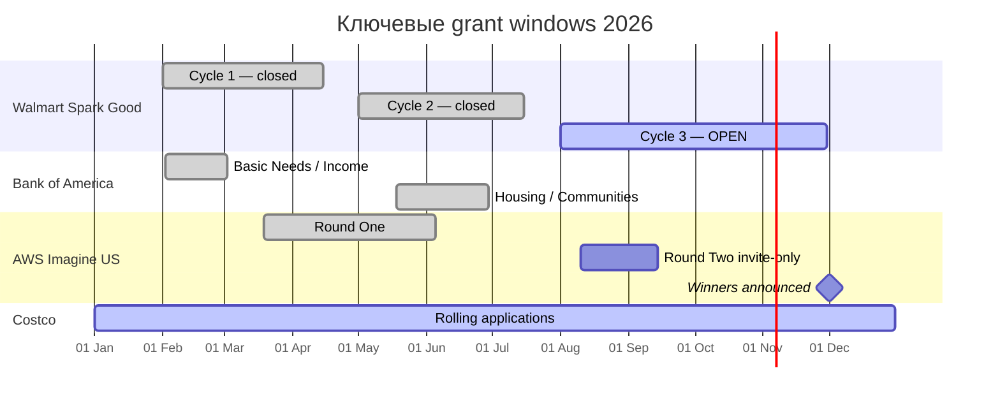

# DR26-08-25-MACANTON-12-0740 — raw report from chatgpt

> Unedited output of one model. Our reconciled synthesis is the page one level up.

---
title: "Гранты НКО США 2026"
type: deep-research-original
source: chatgpt

dr_id: DR26-08-25-MACANTON-12-0740
conversation_id: 6a784f99-a50c-83ed-8b9f-717c94846363
url: "https://приватный чат"
research_started_at: 2026-08-09T10:01:17.634288Z
research_stopped_at: 2026-08-09T10:07:10.261941Z
dr_status_in_tool: completed
harvested_by: dr_harvest_chatgpt.py
harvested_at: 2026-08-25T07:40:37
vault_chat_note: ""
---

> Отчёт Deep Research забран из ChatGPT verbatim (widget_state.report_message).
> Заметка диалога в волте обрывается на строке запуска — тела отчёта там нет.

## Запрос

```text
Продолжи резюме и скажи, какие кредиты или скидки дает Anthropic для своего AI. Именно для обычных подписок, не корпоративных. То есть, если хочу, допустим, non-profit использовать AI от Grok, xAI, OpenAI, Anthropic и какие-то другие еще, крупные LLM-ки, может быть, дают не гранты, может, просто дают скидки. Но мне нужен не корпоративный аккаунт, обычный аккаунт, человеческий.
```

## Отчёт
# Гранты и nonprofit-benefits из файла: что реально доступно в 2026 году и стоит ли создавать 501(c)(3)

## Executive summary

Я разобрал приложенный PDF **USA Grants & Benefits 2026**. В нём смешаны четыре разных класса преимуществ: реальные денежные гранты, облачные/рекламные credits, скидки на ПО и налоговые льготы. Поэтому заявленные в документе «60+ грантов и льгот» не следует трактовать как 60+ грантов. В собственно грантовом разделе PDF перечислены Grants.gov, Walmart Spark Good, Bank of America Charitable Foundation, Community Foundations и Costco; отдельно как «гранты»/credits указаны Google Ad Grants, Google Cloud, Google Maps, Microsoft Azure и AWS. fileciteturn0file0

На **9 августа 2026 года** наиболее practically actionable позиции из файла следующие:

| Программа | Статус на 09.08.2026 | Реальная величина в 2026 | Кому подходит | Нужен US nonprofit? | Официальный источник |
|---|---|---:|---|---|---|
| **Walmart Spark Good Local Grants** | **Открыта** Cycle 3 до 30 ноября | $250–$5,000 cash | US 501(c)(3) public charities, некоторые школы, госорганизации, церкви | **Да / иной специально допустимый тип** | citeturn16search0turn16search4 |
| **Costco Charitable Giving** | **Открыта rolling** | Costco публично не указывает стандартный диапазон | US 501(c)(3), дети, образование, health/human services | **Да** | citeturn17search5turn17search9 |
| **Google Ad Grants** | **Открыта постоянно** | до $10,000/мес. in-kind Search Ads | зарегистрированные charities в поддерживаемых странах | Для US-заявителя — **501(c)(3)** | citeturn13search0turn20search0 |
| **Google Maps Platform nonprofit credit** | **Открыта постоянно** | **$250/мес. = $3,000/год**, не $10k | Google for Nonprofits | Для US-заявителя — **501(c)(3)** | citeturn13search12turn20search0 |
| **Microsoft Azure nonprofit grant** | **Открыта / ежегодно возобновляется** | $2,000 Azure/year | legally recognized nonprofits/charities во многих странах | **Нет**, local equivalent подходит | citeturn14search0turn15search1 |
| **AWS Nonprofit Credit Program** | **Активна** | до $5,000 AWS credits; конкретный route/package может быть ниже | квалифицированные nonprofits, global distribution via TechSoup partners | **Нет**, международные аналоги допускаются | citeturn16search3 |
| **AWS Imagine Grant — US** | Публичная подача **закрыта**; Round 2 с 10 августа только по приглашению | $50k–$200k cash + $20k–$100k AWS credits в зависимости от категории | US-based registered 501(c), кроме educational institutions | **Да**, если целиться в US cycle | citeturn19view0 |
| **Bank of America Charitable Foundation RFP** | **2026 closed** | сумма варьируется; официального $10k–$100k range нет | US 501(c)(3) public charity в BofA markets | **Да, обязательно** | citeturn16search1turn16search2 |
| **Grants.gov / federal grants** | **Платформа активна**, отдельные NOFO постоянно меняются | определяется каждым NOFO; диапазон PDF не универсален | nonprofits, businesses, universities, governments, иногда individuals | **Не всегда** | citeturn7search9turn7search0 |
| **Community Foundations** | Не одна программа; локальные циклы различаются | нет универсального range | обычно local charitable programs | **Часто 501(c)(3), но fiscal sponsor нередко возможен** | citeturn18search0turn18search2 |
| **Google Cloud Credits “до $10k”** | **Не подтверждено как standing 2026 nonprofit grant** | — | отдельные Google.org initiatives могут существовать | Создавать NPO ради этого **нет смысла** | citeturn13search12turn20search1 |

**Главный вывод:** создавать американскую 501(c)(3) **только ради технологических freebies/credits из PDF нерационально**. Google, Microsoft и AWS дают значительную часть benefits международным charitable organizations или их местным аналогам; у Microsoft и AWS US incorporation вообще не является универсальным требованием. citeturn20search0turn15search1turn16search3

С другой стороны, если цель — **систематически собирать американские private/corporate cash grants**, то полноценная **US 501(c)(3) public charity** действительно резко расширяет доступ. В рассматриваемом списке она непосредственно открывает Walmart, Costco, Bank of America и американский Google for Nonprofits, а также является подходящей формой для AWS Imagine US. citeturn16search0turn17search5turn16search1turn20search8turn19view0

Но для **2026 года формировать её сейчас уже поздно как тактический ход ради BofA или AWS Imagine**: оба публичных окна уже закончились. Walmart ещё открыт до 30 ноября, но новый applicant должен успеть получить признание/верификацию и попасть в соответствующие базы. IRS в 2026 году сообщает, что 80% полноформатных Form 1023 determinations выдаются в течение примерно **191 дня**; для 1023-EZ типичные простые determinations существенно быстрее, но IRS одновременно показывает накопившуюся очередь. citeturn8view0

Практически я бы рассматривал создание US 501(c)(3) как **инфраструктуру для 2027+**, а не как способ «успеть собрать все гранты из PDF в 2026».

## Что именно оказалось актуальным в 2026 году

### Google Ad Grants и Google Maps

PDF правильно указывает Google Ad Grants как значимую льготу и приводит **$10,000 в месяц / $120,000 в год** nominal ad inventory. fileciteturn0file0 Это действительно текущий размер программы: квалифицированная организация получает до $10,000 ежемесячного бюджета на текстовую рекламу в Google Search. Это **не деньги на банковский счёт**, остаток не переносится на следующий месяц, и обязательства израсходовать все $10,000 нет. citeturn13search0turn13search2

Программа не имеет annual deadline в обычном понимании: сначала организация проходит Google for Nonprofits / Goodstack verification, после чего отдельно активирует Ad Grants. Google указывает ориентир **2–14 рабочих дней** для большинства проверок. citeturn20search0

Географически это не US-only продукт. Google for Nonprofits работает более чем в 180 географиях, однако организация должна иметь соответствующий charitable status **в своей стране**. Правительства, hospitals/health-care organizations и educational institutions обычно исключены, хотя их отдельные charitable foundations могут быть допустимы. citeturn20search0turn20search1

Для американской организации действуют более конкретные правила: она должна иметь собственный **501(c)(3)** либо подпадать под qualifying group exemption. Fiscally sponsored organization без собственного 501(c)(3) не проходит Google for Nonprofits. citeturn20search7turn20search8

**Рекомендация по NPO: OPTIONAL globally / NECESSARY для US applicant без существующего 501(c)(3).** Создавать именно американскую charity, если уже существует легально признанная nonprofit/charity в другой поддерживаемой Google стране, не нужно. citeturn20search0

#### В PDF есть существенная ошибка по Google Maps

PDF заявляет **$10,000/year Google Maps Platform Credits**. fileciteturn0file0 Текущая официальная страница Google for Nonprofits показывает **$250 в месяц**, то есть nominal максимум **$3,000 в год**. citeturn13search12

Eligibility идёт через тот же Google for Nonprofits account, поэтому юридическая логика та же, что у Ad Grants. citeturn13search15turn20search0

**Статус:** ACTIVE, rolling.  
**NPO:** такая же оценка, как для Google Ad Grants.  
**Поправка к PDF:** $10k/year → **$3k/year текущего credit**.

### Google Cloud Credits “до $10,000”

Это одна из наиболее проблемных строк PDF. Там написано, что Google Cloud Platform credits на Compute, Storage и BigQuery «варьируются по программе Google.org» и могут составлять до $10k. fileciteturn0file0

Однако в текущем официальном каталоге **Google for Nonprofits** четыре основных продукта: Workspace, Ad Grants, YouTube Nonprofit Program и **Google Maps Platform credits**. Открытого standard benefit вида «каждой nonprofit доступно до $10,000 Google Cloud Platform credits» Google там не показывает. citeturn13search12turn20search1

Это не доказывает, что Google.org никогда не выдаёт Cloud credits отдельным grantees, accelerators или targeted initiatives. Но это означает, что строку PDF **нельзя использовать как actionable standing grant opportunity на 2026 год**.

**Статус:** **UNVERIFIED / не считать доступным standing grant**.  
**NPO:** **NOT USEFUL** — создавать 501(c)(3) специально ради этой позиции не следует.

### Microsoft Azure nonprofit grant

Здесь PDF практически точен: Microsoft по-прежнему предоставляет eligible nonprofits **$2,000 Azure services credits в год**. citeturn14search0turn14search1

Это не cash grant. После nonprofit validation предложение появляется в Nonprofit Hub. Microsoft требует активировать его в течение **90 дней с момента issuance**, после активации credit действует один год и ежегодно возобновляется. Неиспользованный остаток не переносится. citeturn14search2turn14search6

Ключевой момент для решения о US NPO: Microsoft требует **recognized legal charitable/nonprofit status в соответствующей стране**, то есть статус, эквивалентный американскому 501(c)(3), а не именно американскую корпорацию. Product availability может различаться по странам. Microsoft использует Goodstack для validation. citeturn15search1turn15search2

Поэтому:

**Статус:** ACTIVE, rolling/annual.  
**Размер:** $2,000/year Azure credit.  
**География:** international, subject to country availability.  
**US NPO:** **NOT NECESSARY**, если существует подходящее local nonprofit entity.

Создавать американскую 501(c)(3) только ради $2k Azure экономически бессмысленно: административная стоимость и governance burden легко превысят ценность самого cloud credit.

### AWS Nonprofit Credit Program

PDF говорит «AWS Nonprofit Credits — до $10,000». fileciteturn0file0 Текущая специализированная страница AWS говорит иначе: **до $5,000 AWS Promotional Credit**, с распространением через TechSoup и partner NGOs. citeturn16search3

AWS указывает:

- программа global;
- US eligibility включает ряд 501(c), в том числе 501(c)(1), (3), (8), (9), (11), (12), (14), (15);
- educational institutions исключены из этой конкретной программы;
- запрос можно делать **один раз за fiscal year July 1–June 30**;
- credit действует не менее года либо до полного расходования. citeturn16search3

На других AWS nonprofit pages встречается базовый **$1,000 TechSoup credit**, а AWS TechAction отдельно позволяет квалифицированным donor/member-engagement projects получить до $5,000. Поэтому конкретный объём фактически доступного credit зависит от route и eligibility; безопасное заключение — заявленные PDF **$10k как общий стандартный benefit не подтверждаются**. citeturn16search5turn16search9

**Статус:** ACTIVE.  
**Размер:** current dedicated program — **up to $5,000**, не общий $10k.  
**US NPO:** **OPTIONAL**. AWS прямо предусматривает international partner route. citeturn16search3

### AWS Imagine Grant

PDF объединяет «AWS Credits» и AWS Imagine Grant, хотя это принципиально разные программы. fileciteturn0file0 Imagine Grant — настоящий competitive cash grant с существенно большей экономической ценностью.

Для американского 2026–2027 цикла AWS предлагает три категории:

| Category | Cash | AWS promotional credit | Основная направленность |
|---|---:|---:|---|
| **Pathfinder** | до **$200,000** unrestricted | до **$100,000** | frontier AI / generative, agentic, autonomous AI |
| **Go Further, Faster** | до **$150,000** unrestricted | до **$100,000** | advanced cloud, AI/ML/HPC/IoT |
| **Momentum to Modernize** | до **$50,000** unrestricted | до **$20,000** | migration, apps, DB/infrastructure modernization |

Эти величины опубликованы непосредственно AWS. citeturn19view0

US eligibility необычно широкая: AWS принимает **registered 501(c)**, а не только 501(c)(3); annual budget не ограничен. Educational institutions на этот цикл исключены. Организация должна быть based in the United States, хотя её beneficiaries могут находиться за пределами США. citeturn19view0

Но для нового заявителя 2026 окно уже потеряно:

- Round One открыт 19 марта;
- Round One закрылся **5 июня 2026**;
- invitations на Round Two отправлены 14 июля;
- invite-only Round Two открывается **10 августа**;
- закрывается **14 сентября**;
- результаты — mid-November;
- winners announced 1 декабря. citeturn19view0

То есть на текущую дату **9 августа** организация, которая не участвовала в Round One, уже не может войти в американский 2026 cycle. AWS прямо маркирует application cycle as closed. citeturn19view0

**Статус:** CLOSED для новых 2026 applicants; active only for invited Round Two applicants.  
**US NPO:** **NECESSARY для US cycle** — хотя это может быть другой qualifying 501(c), не обязательно c3.  
**Практическая рекомендация:** если AWS Imagine — серьёзная цель, 501(c)(3) лучше готовить к **следующему annual cycle**, а не создавать экстренно в августе.

AWS также имеет отдельные Imagine Grant programs для UK, Canada, Australia/New Zealand, поэтому иностранная charity не обязана искусственно становиться US entity только ради самого бренда Imagine Grant. citeturn19view0

### Walmart Spark Good Local Grants

Это сейчас **самый конкретный ещё открытый cash grant из PDF**.

Walmart установил три FY27 application cycles:

- 1 февраля – 15 апреля;
- 1 мая – 15 июля;
- **1 августа – 30 ноября 2026**. citeturn16search0

Следовательно, на 9 августа **Cycle 3 открыт**.

Размер полностью совпадает с PDF: **$250–$5,000 cash** от локальных Walmart stores, Sam's Clubs и distribution facilities. Получатель должен обслуживать тот же service area, который обслуживает facility, куда направляется заявка. Требуется Spark Good account и verification через Deed. citeturn16search0turn16search4

Для nonprofits основная категория — **501(c)(3) public charities**, включая определённые 509(a)(1)/(2)/(3) organizations. Также допускаются отдельные government entities, schools и faith-based organizations для соответствующих community projects. citeturn16search0turn16search8

Это важное исключение из тезиса «без 501c3 никак»: теоретически government/school/church route тоже возможен. Но для частного независимого проекта новая LLC или обычный for-profit не подходит.

**Статус:** **OPEN NOW**, deadline 30 November 2026.  
**US NPO:** **NECESSARY для обычного независимого nonprofit applicant**, либо нужен другой прямо разрешённый organizational type.  
**Fiscal sponsorship:** guidelines не дают общего права sponsored project просто использовать чужой EIN; если sponsor является applicant, именно он становится юридическим grantee и должен соответствовать правилам.

### Bank of America Charitable Foundation

В 2026 году было два RFP:

| RFP | Window | Current status |
|---|---|---|
| Basic Needs and Income Creation | 2 Feb – **2 Mar 2026** | Closed |
| Stable Housing and Empowering Communities | 18 May – **29 Jun 2026** | Closed |

Bank of America не принимает unsolicited applications вне этих дат. citeturn16search2

Поэтому для нового заявителя на 9 августа **2026 opportunities closed**.

Eligibility здесь особенно жёсткая:

- собственный US **501(c)(3)**;
- public charity, **не private foundation**;
- applicant должен находиться и работать в определённых Bank of America markets;
- **fiscally sponsored organizations explicitly ineligible**;
- international philanthropic funding ограничено и invitation-only. citeturn16search1turn16search2

PDF приводит размер **$10,000–$100,000**. fileciteturn0file0 Однако Bank of America сейчас не устанавливает такой универсальный published range: в официальном FAQ говорится, что amount **varies by market and organization size**. Local RFP grants обычно не являются multi-year. citeturn16search2

**Статус:** CLOSED for 2026.  
**US NPO:** **NECESSARY**; fiscal sponsor не решает проблему.  
**Рекомендация:** один из наиболее сильных аргументов за собственную 501(c)(3), но уже для следующего цикла.

### Costco Charitable Giving

Costco — второй реальный cash opportunity из PDF, который сейчас остаётся доступным.

Официальные правила:

- applicant должен быть **IRS-registered 501(c)(3)**;
- приоритет: **children, education, health and human services**;
- только monetary requests;
- заявки принимаются **rolling throughout the year**;
- одна application на организацию за fiscal year **September–August**. citeturn17search5turn17search9

Есть две линии:

**Warehouse Donations** — local organizations/local causes;  
**Grant Applications** — более крупные broad-based organizations/causes. citeturn17search9

Costco концентрирует поддержку на markets, где ведёт бизнес. citeturn17search5

PDF приводит диапазон **$1,000–$10,000**, но действующие официальные страницы Costco **не публикуют универсальный award range**. Поэтому этот диапазон нельзя считать гарантированным или официальным. fileciteturn0file0 citeturn17search5turn17search9

**Статус:** **OPEN / rolling**.  
**Deadline:** фиксированного нет; одна заявка per Sep–Aug fiscal year.  
**US NPO:** **NECESSARY** для direct application.  
**Рекомендация:** целесообразный 2027 target для новой US charity; для newly incorporated August-2026 entity время на получение IRS recognition ограничено.

### Grants.gov

PDF создаёт впечатление, будто «Grants.gov» — один грант на $10k–$500k+. fileciteturn0file0 Это некорректная классификация.

**Grants.gov — федеральный application portal/database**, содержащий множество Notice of Funding Opportunity от разных агентств. Eligibility и award amount определяются **каждым конкретным NOFO**, поэтому универсальный диапазон "$10,000–$500,000+" юридически ничего не означает. citeturn7search2turn7search9

Особенно важно, что **501(c)(3) не является универсальным требованием федеральных грантов**. Grants.gov прямо перечисляет среди потенциальных applicant types:

- nonprofits с 501(c)(3);
- nonprofits без 501(c)(3);
- for-profit organizations;
- small businesses;
- higher education;
- governments;
- иногда individuals. citeturn7search9

Для organizational applicant обычно нужны SAM.gov registration и UEI. SAM registration бесплатна, обновляется ежегодно и обычно занимает ориентировочно **7–10 business days**, хотя verification issues могут растянуть процесс существенно дольше. citeturn7search0turn7search12

Следовательно:

**Статус:** ACTIVE PLATFORM; нужно искать конкретные open 2026 NOFO.  
**Award:** NOFO-specific.  
**US NPO:** **OPTIONAL**, а иногда вообще не даёт преимущества.  
**Решение о структуре нужно принимать после выбора конкретных федеральных opportunities**, а не наоборот.

### Community Foundations

Это также не одна программа. В США существуют сотни community foundations, каждая со своей географией, eligibility, priorities, grant size и deadlines. Council on Foundations определяет community foundation как local grantmaking public charity, действующую в определённой территории, и поддерживает locator таких фондов. citeturn18search0turn18search2

Следовательно, указанные в PDF **$1,000–$50,000** — лишь очень грубое marketing-level обобщение, а не условия одной программы. fileciteturn0file0

Здесь fiscal sponsorship гораздо полезнее, чем в Bank of America или Google. Многие private/community funders могут работать через sponsor, хотя это всегда определяется guidelines конкретного фонда. National Council of Nonprofits отмечает, что fiscal sponsorship используется именно для получения charitable contributions и grants до появления собственного exemption, при этом sponsor сохраняет юридический контроль над средствами. citeturn10search0turn10search1

**Статус:** category is active, но нужен geographic-specific search.  
**US NPO:** **OPTIONAL / often advantageous**.  
**Fiscal sponsor:** реальная альтернатива собственному NPO.

## Что в исходном PDF устарело или нельзя подтвердить

Сам документ полезен как checklist, но не как source of truth. Несколько monetary claims расходятся с действующими primary sources. fileciteturn0file0

| Утверждение PDF | Что показывает проверка на август 2026 | Вердикт |
|---|---|---|
| Google Ad Grants — $120k/year | $10k Search Ads/month действительно существует | **Верно**, но это in-kind ads, не cash |
| Google Cloud Credits — до $10k | Standing Google for Nonprofits benefit с такой суммой не найден; GfNP не перечисляет общий GCP credit | **Не подтверждено** |
| Google Maps — $10k/year | Google сейчас публикует $250/month = $3k/year | **Устарело/неверно** |
| Azure — $2k/year | Microsoft подтверждает $2k/year | **Верно** |
| AWS nonprofit — до $10k | Dedicated current program page говорит up to $5k; некоторые routes отличаются | **Завышено/устарело** |
| Grants.gov — $10k–$500k+ | Grants.gov — portal; нет общего award size | **Нельзя обобщать** |
| Walmart — $250–$5k | Точно подтверждено | **Верно** |
| BofA — $10k–$100k | Funder сейчас говорит «varies by market and organization size» | **Range не подтверждён** |
| Community Foundations — $1k–$50k | Это класс разных funders, не одна программа | **Не универсально** |
| Costco — $1k–$10k | Costco не публикует общий award range | **Range не подтверждён** |

Источники по актуальным значениям: Google citeturn13search0turn13search12, Microsoft citeturn14search1, AWS citeturn16search3, Walmart citeturn16search0, Bank of America citeturn16search2, Costco citeturn17search9 и Grants.gov citeturn7search9.

Я **не нашёл среди названных в PDF реальных программ подтверждённого случая “permanently discontinued in 2026”**. Имеются три другие ситуации:

**Closed for 2026:** Bank of America RFP и public Round One AWS Imagine. citeturn16search2turn19view0

**Still active but PDF amount obsolete:** Google Maps и AWS credits. citeturn13search12turn16search3

**Not verifiable as a standing program:** generic "$10k Google Cloud credits". citeturn13search12turn20search1

## Календарь оставшейся части 2026 года

Даты AWS, Walmart и Bank of America взяты из текущих официальных 2026 schedules. citeturn19view0turn16search0turn16search2 Costco работает rolling, а Google/Microsoft/AWS nonprofit credits не имеют единого календарного annual deadline. citeturn17search9turn14search2turn16search3



На **9 августа** реальный срочный deadline из списка — прежде всего **Walmart, 30 ноября**. AWS Round Two формально стартует завтра, но доступен только applicants, прошедшим Round One. citeturn16search0turn19view0

## Стоит ли создавать собственную US nonprofit

### Что именно означает 501(c)(3)

Важно разделять два уровня:

**Nonprofit corporation** создаётся по законодательству штата.  
**501(c)(3) tax exemption** признаётся IRS на федеральном уровне.

Сам факт регистрации “nonprofit corporation” в штате ещё не равен получению IRS 501(c)(3). Для признания обычно подаётся Form 1023 либо, если организация удовлетворяет eligibility worksheet, упрощённая Form 1023-EZ. citeturn7search11turn9search12

501(c)(3) должна быть организована и фактически работать исключительно в qualifying exempt purposes — charitable, educational, scientific и т. п. Доходы не могут распределяться founder/shareholder/insider, а организация не может использоваться преимущественно для private interests. Political campaign intervention запрещён; существенный lobbying также ограничен. citeturn9search1turn9search4

Это важный момент для «grant hacking»: **501(c)(3) нельзя легитимно создавать как оболочку, основная цель которой — получать бесплатное ПО, credits или grant money в пользу основателя или коммерческой деятельности**. IRS прямо применяет private-benefit/private-inurement restrictions. citeturn9search1

### Где собственная 501(c)(3) действительно даёт доступ к деньгам

Для рассматриваемой подборки она особенно ценна там, где правила прямо требуют собственного charitable status:

| Program | Собственная 501(c)(3) |
|---|---|
| Google Ad Grants / Maps для US entity | **Да** |
| Walmart Spark Good для обычного nonprofit applicant | **Да** |
| Bank of America | **Да, public charity; fiscal sponsor запрещён** |
| Costco | **Да** |
| AWS Imagine US | **501(c) required; c3 подходит и наиболее универсальна** |
| Community Foundations | Обычно полезна, но sponsor часто может заменить |
| Federal Grants | Зависит от NOFO |
| Microsoft Azure | Не нужна именно US; local charitable status достаточно |
| AWS Nonprofit Credit | Не нужна именно US; international program exists |

Это означает, что если строить одну американскую структуру для **максимальной совместимости**, практически разумный вариант — **501(c)(3) public charity**, а не 501(c)(4)/(6) и не private foundation. Bank of America прямо исключает private foundations, а Google/Costco требуют именно 501(c)(3); Walmart ориентирован на public charities. citeturn16search1turn20search8turn17search5turn16search0

### Почему другой 501(c) обычно хуже

AWS Imagine действительно допускает более широкий спектр 501(c), поэтому теоретически 501(c)(6), credit union-type structures и другие формы могут подходить именно AWS. citeturn19view0

Но это слабая стратегия для portfolio access:

- Google US требует 501(c)(3); citeturn20search8
- Bank of America требует 501(c)(3) public charity; citeturn16search1
- Costco требует 501(c)(3); citeturn17search5
- Walmart прямо исключает многие другие 501(c) classes и делает ставку на qualifying public charities. citeturn16search0

Поэтому **если миссия действительно charitable, 501(c)(3) имеет намного более высокий option value**.

### Срок получения статуса

Порядок примерно такой:

**State formation → EIN → IRS application → state charity/tax registrations → grant-platform verifications → SAM/UEI при необходимости.**

EIN выдаётся IRS бесплатно; IRS рекомендует получить его после юридического создания организации и до Form 1023. citeturn9search0turn9search2

IRS processing на текущей странице 2026 показывает:

- Form **1023-EZ**: 80% обычных determinations примерно в течение **22 дней**, а cases requiring further review — примерно до 120 дней;
- full **Form 1023**: 80% determinations примерно в течение **191 дня**;
- при этом IRS в июне 2026 показывал, что новые заявления после определённых дат ещё ожидали assignment, то есть заявленный percentile не следует воспринимать как guaranteed turnaround. citeturn8view0

Из этого следует практический вывод: **полноформатный 1023, поданный в августе, нельзя разумно планировать как гарантированно одобренный к Walmart deadline 30 ноября**. 1023-EZ, если организация вообще имеет право его использовать, математически оставляет значительно больше шансов, но ещё остаются downstream verification у Deed/Goodstack и обновление реестров. citeturn8view0turn16search0turn20search0

IRS обычно позволяет получить exemption effective back to formation date, если требуемая application подана в течение 27 месяцев, но **это не означает**, что corporate grantmaker обязан принять организацию до появления determination letter/verification. citeturn7search13

### Прямые государственные расходы

Основные федеральные расходы на recognition:

- **Form 1023-EZ — $275**;
- **Form 1023 — $600**. citeturn7search5

EIN — **$0**. citeturn9search2

К этому добавляются state incorporation fees, initial reports, charity registration и, в зависимости от штата, state tax-exemption filings. Они сильно различаются, поэтому универсальной «цены регистрации NPO в США» нет.

В качестве конкретного примера масштаба расходов California Attorney General сейчас взимает **$50 за initial charity registration**; последующие annual renewals также обязательны. Secretary of State filings — отдельный слой. citeturn11search0turn11search1

То есть чистый government-fee floor обычно составляет **несколько сотен долларов**, а не тысячи; реальная стоимость становится выше при привлечении lawyer/CPA, registered-agent services, bookkeeping, payroll, multistate fundraising registrations и подготовке более сложной Form 990. Эти профессиональные расходы не являются фиксированными государственными тарифами.

### Постоянная maintenance burden

После одобрения nonprofit не становится «set and forget».

Большинство exempt organizations должны ежегодно подавать Form 990-series. Малые организации с normally ≤$50,000 gross receipts обычно используют Form 990-N; более крупные — Form 990-EZ или Form 990 в зависимости от обстоятельств. Три последовательных года без обязательной annual filing приводят к **automatic revocation** tax-exempt status. citeturn7search15turn7search18

Кроме IRS могут существовать:

- Secretary of State reporting;
- state charity registration/renewal;
- state tax-exemption compliance;
- charitable-solicitation registrations в других штатах;
- donor acknowledgments и bookkeeping;
- grant-specific financial reporting.

California, например, требует charity registration после получения charitable assets и ежегодные renewals. citeturn11search0turn11search1

Для federal grants добавляется SAM.gov: регистрация бесплатна, но должна обновляться ежегодно. citeturn7search0

Таким образом, **экономическая цена NPO — не $275 Form 1023-EZ**, а постоянный governance/compliance overhead.

### Fiscal sponsorship как альтернатива

Для early-stage проекта это часто более рациональный первый шаг.

Fiscal sponsor — уже существующая 501(c)(3), которая принимает charitable funds под своим юридическим и налоговым статусом и осуществляет fiduciary oversight. Средства юридически находятся под контролем sponsor; это не легальный способ просто «одолжить EIN». Sponsor обычно взимает administrative fee, условия определяются договором. citeturn10search0turn10search1

Плюсы:

- можно начать fundraising/grant activity без ожидания собственного IRS determination;
- не требуется немедленно строить собственную compliance infrastructure;
- удобно для проверки гипотезы проекта;
- некоторые проекты годами остаются fiscally sponsored. citeturn10search0

Но для нашего списка sponsor **не универсальная замена**:

| Grant | Fiscal sponsorship |
|---|---|
| Google for Nonprofits US | **Нет** без собственного 501(c)(3) |
| Bank of America | **Явно запрещено** |
| Walmart | Не указан как общий substitute |
| Costco | Applicant должен сам быть 501(c)(3); sponsor route не гарантирован |
| Community Foundations | **Часто workable**, зависит от funder |
| Federal grants | Только если конкретный NOFO/agency structure допускает |
| Microsoft/AWS international credits | Может вообще не понадобиться, если local entity сама eligible |

Google прямо исключает fiscally sponsored organization без собственного c3, а Bank of America прямо называет fiscally sponsored organizations ineligible. citeturn20search7turn16search1

### LLC или for-profit social enterprise

Для коммерчески ориентированного проекта LLC/C-corp/benefit corporation может быть честнее и экономически эффективнее, чем искусственная charity.

Grants.gov прямо показывает, что некоторые federal NOFO открыты для for-profit organizations или small businesses; всё определяется конкретным announcement. citeturn7search9

Но LLC не открывает private charity grants из этого PDF: Google, BofA, Costco и обычный nonprofit route Walmart будут недоступны. citeturn20search8turn16search1turn17search5turn16search0

Идея «сделать обычную founder-owned LLC и оформить ей 501(c)(3)» тоже практически не является shortcut. IRS standards для tax-exempt LLC требуют, в частности, чтобы её members были qualifying 501(c)(3) organizations или governmental units и чтобы operating agreement содержал специальные charitable restrictions. citeturn9search15

То есть для solo-founder social enterprise нормальный выбор обычно такой:

**commercial upside/private ownership нужны → LLC/C-corp;**

**charitable mission, grants/donations, no equity distribution → nonprofit corporation + 501(c)(3).**

Смешивать эти модели лишь ради eligibility — плохая архитектура.

## Итоговая рекомендация по каждой позиции

| Программа | Создавать US NPO? | Оценка |
|---|---|---|
| **Google Ad Grants** | **Optional / necessary only for US route** | Не регистрировать US charity, если уже можно квалифицироваться как charity в другой поддерживаемой стране |
| **Google Maps credits** | **Optional / necessary only for US route** | То же; экономическая ценность всего ~$3k/year |
| **Google Cloud “$10k”** | **Нет** | Standing grant не подтверждён |
| **Microsoft Azure $2k** | **Нет** | Local nonprofit equivalent обычно достаточен; $2k не оправдывает US compliance stack |
| **AWS Nonprofit Credit** | **Нет, как правило** | Global program; US entity не обязательна |
| **AWS Imagine US** | **Да для US cycle** | Сильный long-term reason; 2026 public window уже missed |
| **Walmart Spark Good** | **Да для обычного applicant** | Сейчас единственный очевидно открытый US cash-grant window из списка; но timing нового NPO напряжённый |
| **Bank of America** | **Да, обязательно** | Самый строгий случай: own 501(c)(3) public charity, fiscal sponsor excluded; 2026 closed |
| **Community Foundations** | **Optional** | Сначала fiscal sponsorship/local funder mapping; не стоит создавать entity вслепую |
| **Costco** | **Да** | Direct applicant должен иметь 501(c)(3); rolling program |
| **Federal grants / Grants.gov** | **По NOFO** | Не формировать NPO до поиска конкретных federal opportunities |

Основания для этих выводов: Google citeturn20search0turn20search7, Microsoft citeturn15search1, AWS citeturn16search3turn19view0, Walmart citeturn16search0, Bank of America citeturn16search1, Costco citeturn17search5, Grants.gov citeturn7search9.

### Моя практическая стратегия

**Если проект пока экспериментальный или международный:** я бы **не создавал американскую 501(c)(3) сейчас**. Сначала использовал бы local nonprofit equivalent там, где это работает — прежде всего Microsoft, Google и AWS — и fiscal sponsor для funders, которые его разрешают. Это позволяет проверить fundraising ability и grant-market fit без постоянного американского governance burden. citeturn20search0turn15search1turn16search3turn10search0

**Если в 2027 планируется настоящий US-focused charitable operation** и pipeline включает BofA, Costco, Walmart, AWS Imagine, US foundations и частные donations, тогда создание **501(c)(3) public charity оправдано**. Причём начинать имеет смысл заранее, поскольку full Form 1023 и downstream registrations способны занять месяцы. citeturn8view0turn16search1turn17search5turn19view0

**Если основная деятельность коммерческая и founder должен владеть economics/IP/upside**, nonprofit ради грантов создавать не стоит. Ограничения 501(c)(3) на private benefit и inurement фундаментально противоречат модели, в которой grant-funded assets должны преимущественно увеличивать частную стоимость бизнеса или основателя. citeturn9search1turn9search4

И наконец, **формировать 501(c)(3) в августе 2026 исключительно ради remaining 2026 windows я бы не рекомендовал**. BofA уже закрыт; AWS Imagine Round One закрыт; Google/Microsoft/AWS credits не требуют такой срочности; Costco rolling; остаётся Walmart до 30 ноября, а получить и провалидировать новый статус к этой дате возможно лишь в благоприятном сценарии, особенно если организация проходит 1023-EZ. citeturn16search2turn19view0turn16search0turn8view0

Таким образом, наиболее рациональный decision rule выглядит так: **US 501(c)(3) стоит создавать не ради $2k–$5k technology credits, а когда есть реальный pipeline американских cash grants и donations существенно выше стоимости постоянного compliance — ориентировочно начиная с системной fundraising strategy на 2027+**.
