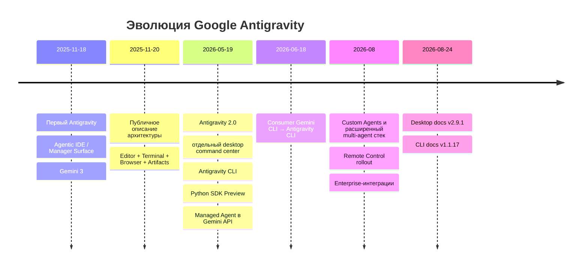
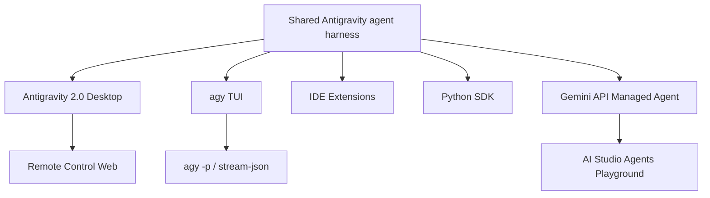
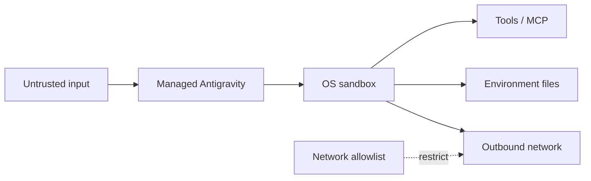
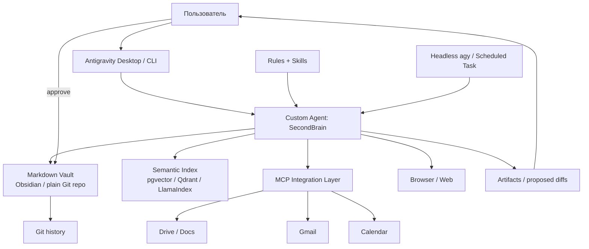
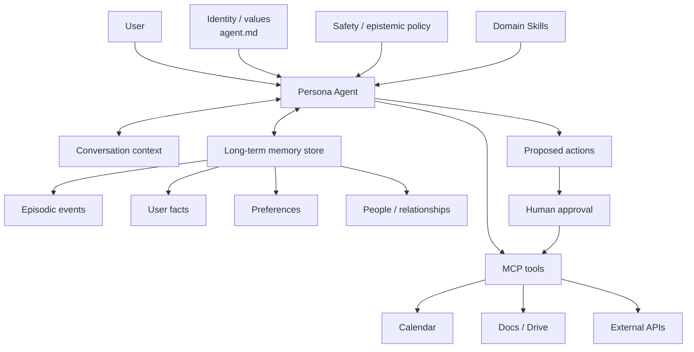
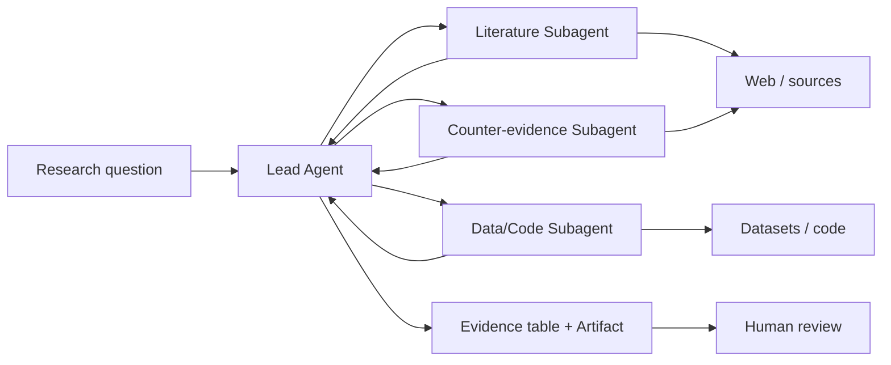
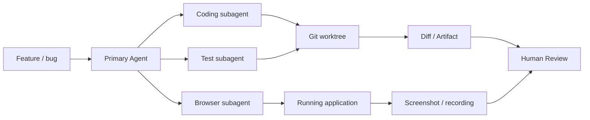
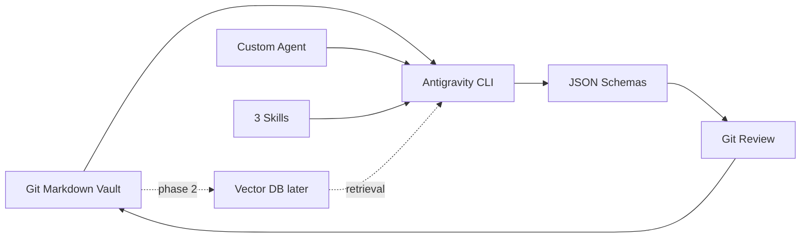

# DR26-08-25-MACANTON-16-0740 — raw report from chatgpt

> Unedited output of one model. Our reconciled synthesis is the page one level up.

---
title: "Исследование Google AntiGravity"
type: deep-research-original
source: chatgpt

dr_id: DR26-08-25-MACANTON-16-0740
conversation_id: 6a8c5685-99cc-83eb-80e7-5828392bbea6
url: "https://приватный чат"
research_started_at: 2026-08-24T14:35:48.956613Z
research_stopped_at: 2026-08-24T14:45:23.604108Z
dr_status_in_tool: completed
harvested_by: dr_harvest_chatgpt.py
harvested_at: 2026-08-25T07:40:39
vault_chat_note: ""
---

> Отчёт Deep Research забран из ChatGPT verbatim (widget_state.report_message).
> Заметка диалога в волте обрывается на строке запуска — тела отчёта там нет.

## Запрос

```text
@Deep research проведи исследование Google AntiGravity. Google AntiGravity, и для чего этот Google AntiGravity обычно используется. То есть зачем его использовать, когда есть другие вещи. Google AntiGravity доступен с CLI, Headless или в браузерной версии, командная строка. Как он доступен? И дай мне какие-нибудь топовые use cases использования Google AntiGravity. В первую очередь мне интересны штуки, которые связаны с вторым мозгом — second brain. Или всё, что связано с созданием искусственной личности.
```

## Отчёт
# Google Antigravity: аналитический отчёт по платформе, интерфейсам, second brain и искусственным агентам

## Резюме

По состоянию на **24 августа 2026 года** Google Antigravity уже нельзя корректно описывать как «ещё одну IDE с Gemini». После релиза **Antigravity 2.0 19 мая 2026 года** Google превратила продукт в экосистему вокруг общего agent runtime: отдельное desktop-приложение для оркестрации агентов, терминальный Antigravity CLI, headless-режим CLI, Python SDK, IDE-расширения и управляемый облачный Antigravity Agent через Gemini API. Сам Google теперь формулирует Antigravity как **agent-first development platform**, а Antigravity 2.0 — как отдельный desktop command center для запуска и управления несколькими агентами, причём 2.0 больше не является IDE. citeturn24search0turn24search2turn24search6

Главный архитектурный сдвиг по сравнению с версией 2025 года — агент стал первичным объектом, а редактор кода лишь одной из возможных поверхностей. Агент умеет работать с файлами, терминалом, браузером, MCP-серверами, Skills, подагентами и Artifacts; задачи могут исполняться асинхронно и по расписанию. Один и тот же основной agent harness используется desktop- и CLI-поверхностями. citeturn16search9turn20search4turn24search12

Для поставленных вами задач Antigravity особенно интересен не как «AI-кодер», а как **локальный агентный orchestration layer**:

| Задача | Оценка пригодности | Основной вывод |
|---|---:|---|
| Автономная разработка / DevOps | **9/10** | Это исходный и наиболее зрелый сценарий платформы. |
| Deep Research / knowledge worker | **8.5/10** | Сильная комбинация браузера, файлов, MCP, подагентов, структурированных результатов и scheduled tasks. |
| Second brain / PKM | **8/10 как orchestration layer** | Очень перспективно, но долговременную семантическую память/RAG придётся спроектировать самостоятельно. |
| Искусственная личность | **8/10** | Custom Agents и SDK дают системную личность, tools и policy; память личности снова надо делать отдельно. |
| Полностью автономный production-agent | **5–7/10** | Возможен, но требует sandbox, permissions, deterministic validation, HITL и отдельной observability. |
| Обработка особо чувствительных персональных данных | **осторожно** | Consumer-условия допускают использование interactions для улучшения систем Google; enterprise-режим существенно лучше, но у самого Antigravity есть серьёзные compliance-ограничения. citeturn22search1turn16search6turn7search2 |

**Ключевой вывод для second brain:** Antigravity следует рассматривать не как замену Obsidian/Logseq/vector DB, а как **активный агентный слой поверх хранилища знаний**. Markdown-vault остаётся источником истины; Antigravity получает ограниченный read/write-доступ, MCP предоставляет Google Drive/Gmail/Calendar и внешние БД, отдельный индекс — semantic retrieval, а custom agent задаёт правила формирования памяти. Такой дизайн существенно надёжнее, чем разрешить модели «помнить всё» через историю чата. Поддержка Skills, MCP, rules, custom agents и headless JSON делает этот вариант технически естественным для Antigravity. citeturn17search2turn16search15turn19view2turn21view1

**Ключевой вывод для искусственной личности:** Antigravity теперь имеет настоящий first-class механизм custom agents: Markdown-файл с YAML frontmatter может определять имя, роль, разрешённые tools, модель, Skills, MCP, command-execution policy и системный prompt. Agent может быть главным (`mainAgent`) и/или вызываемым subagent. Это уже достаточно для «личности», но **не означает наличие собственной долговременной автобиографической памяти**. Для устойчивой personality continuity необходим отдельный memory store с explicit write/read protocol. citeturn19view2

**Наиболее рациональный стек для прототипа:**

```text
Antigravity CLI + Desktop 2.0
        ↓
Custom Agent + Skills + Rules
        ↓
Markdown vault как source of truth
        ↓
MCP → Drive / Gmail / Calendar / DB
        ↓
опционально pgvector/Qdrant/LlamaIndex
        ↓
headless agy → cron/CI/автоматическая консолидация
```

Для персонального проекта я бы **не начинал с managed cloud Antigravity Agent API**. Локальные Desktop/CLI лучше соответствуют PKM: данные уже находятся на вашей машине, проще контролировать filesystem permissions, можно держать Git-историю vault и нет проблемы с тем, что managed-agent environment удаляется после периода неактивности. Managed API имеет смысл на втором этапе — для remotely triggered jobs, масштабирования и agent-as-a-service. citeturn16search5turn17search5turn10view4

## Что такое Antigravity и как платформа эволюционировала

Первоначальный Antigravity был анонсирован **18 ноября 2025 года** вместе с Gemini 3 как agentic development platform. Основная идея заключалась в переходе от синхронного autocomplete к делегированию целей: пользователь формулирует задачу, а агент самостоятельно планирует, редактирует файлы, вызывает terminal и браузер и затем показывает проверяемые результаты через Artifacts. Google подчёркивала две поверхности — привычный Editor View и Manager Surface для нескольких асинхронных агентов. citeturn24search20turn24search25turn18search0

В первоначальном public preview Antigravity распространялся бесплатно для macOS, Windows и Linux. Это поколение по сути оставалось agentic IDE: автономные агенты были тесно связаны с редактором. citeturn12search18turn12search2

На Google I/O **19 мая 2026 года** произошёл архитектурный разрыв. Google выпустила **Antigravity 2.0** как полностью отдельное desktop-приложение без IDE, Antigravity CLI, preview Python SDK и Antigravity Agent как Managed Agent в Gemini API. Google описала это уже как единую Antigravity ecosystem. citeturn24search0turn24search2turn24search18turn24search28

Параллельно Google начала сворачивать consumer-ветку Gemini CLI в пользу Antigravity CLI. Для индивидуальных пользователей, free, AI Pro и AI Ultra старый Gemini CLI и соответствующие consumer Code Assist extensions должны были перестать обслуживать запросы **18 июня 2026 года**; некоторые enterprise-сценарии Gemini CLI сохранились. citeturn24search1

В последующие месяцы платформа получила более зрелый multi-agent слой. В текущей документации доступны асинхронные subagents, custom Markdown agents, hooks, plugins, Skills, scheduled tasks, Remote Control и многоуровневая система permissions. В каталоге документации на 24 августа 2026 года указаны Antigravity 2.0 **v2.9.1**, CLI **v1.1.17**, SDK docs **v0.1.13** и IDE surface **v2.5.5**. citeturn19view2turn24search3

Текущую эволюцию можно представить так:



Источники для временной шкалы: официальные Google Blog, Antigravity Blog и документация. citeturn24search24turn24search1turn19view2

Стоит особенно подчеркнуть, что сегодня под названием **Antigravity** скрываются несколько принципиально разных runtime-моделей:

1. **Local agent runtime** — desktop/CLI/SDK исполняют действия на вашей машине.
2. **Remote-Controlled local runtime** — локальная машина продолжает выполнять задачу, а вы управляете ею через браузер.
3. **Google-hosted managed runtime** — Antigravity Agent запускается в изолированной Linux-среде Google через Gemini API.
4. **IDE extensions** — agent surface внутри VS Code, Visual Studio, JetBrains и Zed. citeturn17search0turn17search1turn15search0turn16search6

Это различие критично для архитектуры, безопасности и second brain.

## Интерфейсы, установка, аутентификация и системные требования

Наиболее полезная ментальная модель интерфейсов такова:



Desktop и CLI используют общий agent core и синхронизируемые настройки; headless является **режимом CLI**, а не отдельным продуктом. Remote Control — браузерное управление desktop/daemon на вашей машине. AI Studio Agents Playground, напротив, является браузерным frontend для managed cloud agents. citeturn20search4turn16search1turn17search0turn15search0

### Матрица интерфейсов

| Surface | Установка | Auth | Конфигурация | Запуск |
|---|---|---|---|---|
| **Antigravity 2.0 Desktop** | Download installer; Linux также имеет пакетные варианты | Google Account; enterprise identity для соответствующей лицензии | Global + Project Settings, permissions, Browser, MCP, Skills | Создать Project → выбрать folders/repo → задать goal |
| **CLI TUI** | `curl ...install.sh`, PowerShell/CMD scripts | Google OAuth + OS keyring; SSH code flow; Gemini API key; enterprise auth | `~/.gemini/antigravity-cli/settings.json`, `/config`, `/permissions`, `/mcp` | `cd project && agy` |
| **CLI headless** | тот же CLI | cached login либо API key/ADC | flags + settings JSON | `agy -p "..."` |
| **Remote Control Web** | web-клиент не требует установки; на host нужен Desktop или daemon | тот же Google Account | Settings → Account → Enable Remote Control | выбрать host в web dashboard |
| **Remote Control daemon** | `agy-daemon.sh` / `.cmd` | one-time sign-in | `~/.gemini/config/config.json` | daemon/service |
| **IDE extensions** | Marketplace/extension install | единая Antigravity auth | IDE settings + shared agent config | agent panel |
| **Python SDK** | `pip install google-antigravity` | `GEMINI_API_KEY` или Vertex/ADC | `LocalAgentConfig` | `async with Agent(...)` |
| **Managed Agent API** | ничего локально кроме REST/SDK client | Gemini API key / соответствующий Google Cloud auth | agent/environment JSON | Gemini Interactions API |
| **AI Studio Agents Playground** | браузер | Google Account | визуальная настройка agent/tools/files | Run в Playground |

Источники: официальные installation, SDK, Remote Control, IDE и managed-agents docs. citeturn16search0turn17search0turn17search1turn16search6turn15search0

**Desktop.** Antigravity 2.0 поддерживает macOS, Windows и Linux. В актуальном Getting Started указаны минимум macOS 12 Monterey, Windows 10 64-bit и для Linux `glibc >= 2.28`, `glibcxx >= 3.4.25`, с примерами Ubuntu 20+, Debian 10+, Fedora 36+ и RHEL 8+. Для Windows предлагаются x64 и ARM64, Linux — x64 и ARM64. При этом на самой странице есть документационная коллизия: одновременно предлагается download for Intel macOS и написано `X86 is not supported`; перед корпоративным rollout это следует перепроверить на конкретном Intel Mac. citeturn16search3

После установки создаётся Project, связываемый с одной или несколькими директориями/репозиториями. Настройки делятся на global и project scope; отдельно регулируются permissions, browser integration, модели и customizations. citeturn16search13

**CLI.** На macOS/Linux официальный installer:

```bash
curl -fsSL https://antigravity.google/cli/install.sh | bash
```

По умолчанию бинарник устанавливается в:

```text
~/.local/bin/agy
```

На Windows:

```powershell
irm https://antigravity.google/cli/install.ps1 | iex
```

или CMD:

```cmd
curl -fsSL https://antigravity.google/cli/install.cmd -o install.cmd && install.cmd && del install.cmd
```

Затем:

```bash
cd ~/my-project
agy
```

Официальная документация подтверждает native support macOS/Linux/Windows. citeturn16search0turn16search7

По умолчанию CLI пытается получить токен из системного secure keyring: Apple Keychain, Linux Secret Service/dbus или Windows Credential Manager. При отсутствии токена локальный запуск открывает OAuth в браузере; при SSH используется URL + authorization-code flow. citeturn20search3

Для CI/headless можно отказаться от account session и использовать Gemini API key. Важная деталь: просто установить `GEMINI_API_KEY` недостаточно. Необходимо также выставить provider:

```json
// ~/.gemini/antigravity-cli/settings.json
{
  "modelProvider": "gemini"
}
```

затем:

```bash
export GEMINI_API_KEY="..."
agy
```

При таком режиме CLI напрямую работает через Gemini API и `/logout` ничего не удаляет, поскольку account session не создавалась. citeturn20search3

Основная конфигурация CLI хранится здесь:

```text
~/.gemini/antigravity-cli/settings.json
```

Её можно менять непосредственно либо через:

```text
/config
/settings
/permissions
/mcp
/agents
```

Некоторые параметры имеют CLI override, например `--sandbox`; существует также крайне рискованный `--dangerously-skip-permissions`. citeturn20search2turn21view0

**Headless/print mode.** Это наиболее интересная поверхность для automation. Один prompt:

```bash
agy -p "Проанализируй новые Markdown-файлы и верни список ключевых идей."
```

`stdout` предназначен для результата, а диагностика и permission messages идут в `stderr`. Доступны три формата:

```text
text
json
stream-json
```

Например:

```bash
agy -p "Summarize ./inbox" \
  --output-format json |
  jq -r '.response'
```

JSON envelope включает `conversation_id`, `status`, `response`, duration, число turns, usage и, при JSON Schema, `structured_output`. citeturn16search1turn21view1

Структурированная выдача:

```bash
agy -p "Извлеки факты из новых заметок" \
  --output-format json \
  --json-schema '{
    "type":"object",
    "properties":{
      "facts":{"type":"array","items":{"type":"string"}},
      "open_questions":{"type":"array","items":{"type":"string"}}
    },
    "required":["facts","open_questions"]
  }'
```

Schema может быть строкой либо JSON-файлом. citeturn21view1

Для полноценного event stream:

```bash
agy -p "Проведи аудит knowledge vault" \
  --output-format stream-json
```

NDJSON содержит `init`, `step_update`, tool events и финальный `result`; tool event включает имя инструмента, параметры, output/error, а результаты также содержат token usage. С точки зрения observability это одна из сильнейших сторон Antigravity. citeturn21view1

Headless по умолчанию stateless между отдельными процессами:

```bash
agy -p "Первый вопрос"
agy -p "Продолжи предыдущую тему" --continue
```

или:

```bash
agy -p "Продолжи" --conversation <conversation-id>
```

Для низколатентного persistent process существует двунаправленный NDJSON-over-stdin:

```bash
printf '%s\n' \
  '{"event":"user","message":{"content":"Запомни концепт A."}}' \
  '{"event":"user","message":{"content":"Что такое A?"}}' |
agy --input-format stream-json --output-format stream-json
```

Это заметно эффективнее постоянного перезапуска `agy -p --continue`, поскольку runtime остаётся прогретым. citeturn21view2turn21view3

Можно непосредственно выбрать модель, reasoning effort и custom agent:

```bash
agy models
agy agents

agy -p "Проведи критический аудит заметки" \
  --agent knowledge-critic \
  --effort high \
  --output-format json
```

Официальная headless reference содержит `--agent`, `--model`, `--effort`, `--continue`, `--conversation`, `--sandbox` и `--print-timeout`. citeturn21view0

**Browser/web — здесь важно не смешивать три разные вещи.**

Во-первых, **Browser Subagent** — не web-версия Antigravity. Это capability локального агента: он может открыть и управлять локальным Chrome, читать страницы, делать screenshots и browser recordings. Browser tools можно отключить. citeturn16search10

Во-вторых, **Remote Control** действительно является browser UI. После:

```text
Settings → Account → Enable Remote Control
```

вы входите в web dashboard под тем же Google Account, выбираете свою машину и можете смотреть conversations, запускать tasks, review plans и Artifacts. Функция всё ещё находится в rollout, приоритет получают AI Ultra accounts. citeturn17search0

Для сервера без desktop GUI имеется отдельный Remote Control daemon:

```bash
curl -fsSL https://antigravity.google/cli/agy-daemon.sh | bash
```

с именем:

```bash
curl -fsSL https://antigravity.google/cli/agy-daemon.sh |
  bash -s -- install --name "knowledge-server"
```

Windows требует Administrator CMD:

```cmd
curl -fsSL https://antigravity.google/cli/agy-daemon.cmd -o agy-daemon.cmd && agy-daemon.cmd install
```

Конфигурация daemon хранится в `~/.gemini/config/config.json` либо `%USERPROFILE%\.gemini\config\config.json`. citeturn17search0

В-третьих, **AI Studio Agents Playground** является web-интерфейсом к Google-hosted Managed Agents. В этом варианте ваш локальный компьютер вообще не является execution environment: Antigravity Agent получает удалённый Linux sandbox Google. citeturn15search0turn24search28

**SDK.** Официальный Python SDK:

```bash
pip install google-antigravity
export GEMINI_API_KEY="..."
```

Минимальный пример:

```python
import asyncio
from google.antigravity import Agent, LocalAgentConfig


async def main() -> None:
    config = LocalAgentConfig(
        system_instructions=(
            "You are a rigorous personal knowledge analyst. "
            "Separate sourced facts from hypotheses."
        )
    )

    async with Agent(config) as agent:
        response = await agent.chat(
            "Review the knowledge files in this workspace."
        )
        print(await response.text())


if __name__ == "__main__":
    asyncio.run(main())
```

SDK предоставляет stateful runtime вокруг tools, context, policies и subagent delegation. Для Gemini Enterprise Agent Platform можно использовать `vertex=True`, project/location и Application Default Credentials. citeturn17search1

По опубликованным package metadata SDK ориентирован на Python 3.10+; source SDK опубликован Google под Apache-2.0, однако лицензия SDK, конечно, не превращает модели или облачный сервис Antigravity в Apache-licensed service. citeturn11search6turn11search0

## API, форматы данных, модели расширения и интеграции

Antigravity не имеет одного универсального «Antigravity API». На практике программирование платформы разбивается на три уровня.

**Первый уровень — headless CLI protocol.** Для shell, cron, CI и glue-кода это, вероятно, самый удобный API. Он не требует написания Python application и предоставляет text, JSON, NDJSON, JSON Schema, conversation IDs, usage telemetry и tool-call events. citeturn21view1turn21view2

**Второй уровень — локальный Python SDK.** Это правильный вариант, если lifecycle агента, tools, policies, subagents и application state должны контролироваться непосредственно вашим кодом. SDK поддерживает streaming, multimodal attachments и structured Pydantic output. Публичные SDK data models используют Pydantic V2, а не требуют от пользователя напрямую работать с protobuf. citeturn16search4turn11search5

**Третий уровень — Managed Antigravity Agent в Gemini API.** Google предоставляет Antigravity как managed agent, выполняющийся в OS-isolated Linux sandbox. В Public Preview агент может запускать code, работать с файлами и интернет-инструментами; его можно кастомизировать собственными instructions, Skills и data. citeturn15search0turn24search28

Минимальная логика API выглядит концептуально так:

```python
from google import genai

client = genai.Client()

interaction = client.interactions.create(
    agent="antigravity-preview-05-2026",
    input="Research the topic and produce a structured report.",
)

print(interaction)
```

Текущая документация использует base agent family `antigravity-preview-05-2026`; конкретные имена моделей и preview identifiers следует считать versioned API surface и проверять перед production deployment. citeturn6search2turn5search5

Managed agent может работать в background и использовать удалённую environment. Google указывает, что sandbox поставляется, среди прочего, с Python 3.12 и Node.js 22; environment может быть удалён после семи дней неактивности и cold-start после spin-down. Существует также quota на число managed agents. citeturn10view4

### Форматы конфигурации Antigravity

Antigravity использует удивительно простую file-first модель:

| Объект | Формат | Типичное расположение |
|---|---|---|
| Custom Agent | Markdown + YAML frontmatter | `.agents/agents/...` |
| Skill | `SKILL.md` + YAML frontmatter | `.agents/skills/...` |
| Global rules/context | Markdown | `~/.gemini/GEMINI.md` |
| Project rules | Markdown | `.agents/rules/`, `AGENTS.md` |
| MCP config | JSON | `.agents/mcp_config.json` |
| CLI settings | JSON | `~/.gemini/antigravity-cli/settings.json` |
| Plugin | `plugin.json` + Skills/Rules/MCP/Hooks | `.agents/plugins/...` |
| Headless events | JSON / NDJSON | stdout |
| Structured output | JSON Schema | CLI / SDK |
| Agent deliverables | Artifacts | Plans, diffs, diagrams, screenshots, recordings |

Эти форматы описаны официально в Skills, MCP, Plugins, CLI и Artifacts документации. citeturn16search15turn17search2turn16search11turn16search12turn21view1

### Custom Agents

Это одна из важнейших функций для вашей задачи.

Antigravity ищет custom agents, например, здесь:

```text
<workspace>/.agents/agents/<name>.md
<workspace>/.agents/agents/<name>/agent.md

~/.gemini/config/agents/<name>.md
~/.gemini/config/agents/<name>/agent.md
```

Agent-definition содержит YAML frontmatter:

```yaml
---
name: epistemic-critic
description: Skeptical scientific reviewer for personal knowledge.
tools:
  - view_file
  - grep_search
  - run_command
mainAgent: true
subagent: true
model: pro
commandExecutionPolicy: sandbox
skills:
  - skills/evidence-grading
---

# System Prompt

You are an aggressively skeptical knowledge analyst.

Separate:
- directly sourced facts;
- inference;
- speculation.

Never silently overwrite source notes.
```

Официальная schema поддерживает `name`, `description`, `tools`, `mainAgent`, `subagent`, `model`, `commandExecutionPolicy`, `mcpServers`, `skills` и `plugins`. Markdown body превращается в системные инструкции агента. citeturn19view2

CLI обнаруживает эти определения автоматически, а интерактивно переключаться между ними можно через:

```text
/agents
```

В headless:

```bash
agy -p "Critique today's notes." \
  --agent epistemic-critic \
  --output-format json
```

citeturn20search0turn21view0

Custom agent может быть и subagent. Parent вызывает его через `invoke_subagent`; доступны варианты workspace inheritance, отдельный Git worktree либо shared storage. Context subagent отделён от parent history, что снижает загрязнение основного context window. Максимальная documented nesting depth — десять уровней. citeturn19view2

### Skills и plugins

Skill — directory с `SKILL.md`, содержащим инструкции, optional scripts, examples и resources:

```text
.agents/skills/evidence-grading/
├── SKILL.md
├── scripts/
├── examples/
└── resources/
```

Agent сначала видит имя/description Skills и загружает полный текст лишь при необходимости, то есть используется progressive disclosure. Это очень полезно для second brain: вместо гигантского system prompt правила «как конспектировать статью», «как оценивать RCT» и «как обрабатывать анализы крови» можно разнести на независимые skills. citeturn16search15

Plugins служат package layer и могут объединять:

```text
plugin.json
mcp_config.json
hooks.json
skills/
agents/
rules/
```

То есть целую искусственную личность с tools, memory connector и workflow можно фактически распространять как version-controlled agent package. citeturn17search7

### MCP как главный integration bus

MCP — вероятно, наиболее важный integration point Antigravity.

CLI поддерживает локальные `stdio` и remote MCP; SDK — `stdio`, SSE и HTTP; конфигурация может быть глобальной:

```text
~/.gemini/config/mcp_config.json
```

или project-local:

```text
.agents/mcp_config.json
```

Пример:

```json
{
  "mcpServers": {
    "knowledge-db": {
      "command": "uv",
      "args": ["run", "knowledge_mcp.py"]
    },
    "remote-search": {
      "serverUrl": "https://example.internal/mcp/",
      "headers": {
        "Authorization": "Bearer ${TOKEN}"
      }
    }
  }
}
```

Для remote servers современные schemas требуют `serverUrl`, а не старые `url`/`httpUrl`. citeturn17search2turn17search6

Google также демонстрировала интеграцию Google Workspace с Antigravity через MCP — Gmail, Drive, Docs, Sheets, Slides, Calendar и другие Workspace APIs. Для second brain это даёт естественный путь от «мои документы» к agent-accessible knowledge fabric без необходимости переносить всё содержимое в prompt. citeturn0search12

### Artifacts как слой observability

Artifacts — не просто красивый UI. Это структурированные checkpoint deliverables: implementation plans, diffs, diagrams, images и browser recordings. Пользователь может review результат на milestone вместо мониторинга каждого tool call. citeturn16search12

Для high-autonomy second brain я бы использовал Artifacts как audit boundary:

```text
ingest → propose memory update → Artifact diff → human approval → commit
```

а не:

```text
agent → непосредственно переписать 500 заметок
```

Это уже архитектурная рекомендация, опирающаяся на существующий Artifact/HITL механизм. citeturn16search12turn16search5

## Безопасность, приватность, compliance, лицензирование и ограничения

Antigravity обладает намного большей blast radius, чем обычный чат-бот: агент может читать/изменять файлы, выполнять shell commands, работать с браузером и внешними инструментами. Поэтому практическая модель угроз включает prompt injection, accidental destructive command execution, secret leakage, malicious MCP/tools и supply-chain attacks. Google сама предупреждает о рисках автономного выполнения кода и действий; условия использования прямо возлагают ответственность за действия агента и предоставленный ему доступ на пользователя. citeturn10view0turn22search1

### Permissions и sandbox

CLI имеет fine-grained permission engine:

```text
action(target)
```

с тремя списками:

```text
deny
ask
allow
```

и приоритетом:

```text
Deny > Ask > Allow
```

Например:

```json
{
  "permissions": {
    "allow": [
      "command(git status)",
      "command(git diff)"
    ],
    "ask": [
      "command(git commit)"
    ],
    "deny": [
      "command(rm -rf)"
    ]
  }
}
```

File permissions могут ограничиваться конкретными workspace paths. citeturn16search5turn17search5

CLI использует native OS containment: `nsjail` на Linux, `sandbox-exec` на macOS и AppContainer на Windows. Но важнейшая деталь — documented setting:

```json
{
  "enableTerminalSandbox": true
}
```

имеет **default `false`**. Иными словами, наличие sandbox нельзя путать с его гарантированным использованием. Для второго мозга или personality-agent с shell access я бы включал его явным образом. citeturn17search5

Флаг:

```bash
--dangerously-skip-permissions
```

автоматически разрешает tool permission requests. Для персонального ПК с домашней директорией, SSH keys, browser cookies и credential files это практически анти-паттерн, кроме disposable VM/container. Наличие флага подтверждается CLI reference. citeturn21view0

### Consumer privacy

Для индивидуального Antigravity Additional Terms Google говорит, что записывает и хранит user data, interaction data, related metadata и feedback, объединяя это понятием **Interactions**. Interactions могут использоваться для оценки, разработки и улучшения research, products, services и ML technologies Google/Alphabet; доступ к ним могут получать сотрудники и contractors. В настройках предусмотрена возможность изменить preference, чтобы interactions не использовались таким образом, а удаление можно запросить отдельно. citeturn22search1

Следовательно, consumer Antigravity — **не тот режим, куда я бездумно отправлял бы полный медицинский архив, private diary или passwords/secrets**. Это не означает, что Google «публикует ваши данные»; это означает, что terms consumer продукта допускают режим использования interactions, который для highly sensitive second brain следует либо отключить, либо заменить enterprise/private architecture. citeturn22search1

Google отдельно запрещает использовать неавторизованные third-party products для доступа к сервису через Antigravity OAuth; в Terms прямо приведён пример OpenClaw. Это важно для community wrappers. citeturn22search1

### Enterprise privacy и compliance

Enterprise существенно отличается. Для Antigravity IDE/enterprise Google заявляет, что code, prompts и agent transcripts не используются для обучения Google foundation models; применяются Cloud terms, IAM, VPC Service Controls и соответствующие enterprise data boundaries. citeturn16search6

Но здесь есть очень важная ловушка: **не следует автоматически наследовать весь compliance Gemini Enterprise на Antigravity**. Специфическая актуальная документация Antigravity в Gemini Enterprise указывает ограничения поддержки ряда compliance programs; среди перечисленных отсутствующих для Antigravity возможностей находятся, в частности, FedRAMP Moderate/High, IL4/IL5, ряд ISO-сертификаций и SOC 1/2/3. Это критично для regulated deployment, даже если родительские Google Cloud/Gemini services имеют более широкую сертификацию. citeturn7search2

Enterprise docs также перечисляют текущие operational limitations: некоторые BYOID/Workforce Identity Federation пользователи могут неожиданно терять login после restart; browser URL allowlist пока может не соблюдаться ожидаемым образом; перед приобретением некоторых лицензий необходимо заранее активировать `aiplatform.googleapis.com`. citeturn16search2

### Безопасность managed cloud agent

Managed Antigravity Agent выполняется в OS-isolated sandbox Google, что уменьшает blast radius относительно запуска autonomous shell непосредственно на ноутбуке. Однако outbound network для environment **по умолчанию unrestricted**; Google рекомендует ограничивать его network allowlist. citeturn15search0

Поэтому «Google-hosted sandbox» не означает автоматически «zero exfiltration»:



Для sensitive workload я бы применял allow-by-exception egress и не помещал long-lived credentials внутрь runtime. Это следует из самой network model managed agents. citeturn15search0

### Лицензирование и стоимость

Для individual accounts Antigravity регулируется Google Terms, Antigravity Additional Terms и Privacy Policy; enterprise-сценарии переходят под соответствующие Google Cloud/Gemini Enterprise terms. citeturn22search1

Текущая Antigravity Plans documentation говорит, что **все пользовательские планы имеют baseline access**, включая Gemini models, unlimited Tab completions и product features вроде Scheduled Tasks и CLI. У пользователей без AI Pro/Ultra quota обновляется по более ограниченной weekly схеме; Pro получает более высокий weekly limit и quota refresh примерно раз в пять часов, Ultra — наиболее высокий baseline и third-party models. Точные числовые prompt quotas Google не публикует, поскольку consumption зависит от объёма работы, выполненной агентом, и capacity. citeturn22search0

Упрощённо:

| Вариант | Стоимость | Что получает Antigravity |
|---|---:|---|
| **Individual/free baseline** | отдельная плата Antigravity: **$0** | базовый quota, CLI/features |
| **Google AI Pro** | платная Google AI подписка; региональная цена | более высокий quota, priority |
| **Google AI Ultra** | платная Google AI подписка; региональная цена | максимальный baseline, дополнительные models/features |
| **AI credits** | PAYG/credits | overage после baseline |
| **Managed Agent Gemini API** | PAYG | Gemini tokens + tool usage |
| **Enterprise** | Cloud/contract consumption | enterprise identity/governance |

Antigravity docs не дают универсальной мировой цены Pro/Ultra; Google One показывает региональные subscription prices. В США текущий consumer pricing, обнаруженный в официальном Google One источнике, составляет порядка **$19.99/month для AI Pro**, тогда как Ultra представлен с несколькими вариантами/акциями и регионально меняющейся ценой; поэтому для точного бюджета правильнее считать Antigravity pricing page/account console источником истины. citeturn9search1turn15search4

Есть и явная документационная несогласованность: текущая страница Subagents всё ещё называет `/teamwork-preview` «Ultra ($200/mo)», тогда как структура Google AI Ultra была изменена в 2026 году. Поэтому embedded dollar amount в Antigravity docs не следует считать универсальной текущей ценой подписки. citeturn19view2turn24search19

Pro/Ultra пользователи могут покупать AI credits для работы сверх baseline quota. Credits списываются с использованием standard Gemini Enterprise Agent Platform consumption pricing; Antigravity позволяет выбрать `Never` или `Always` для автоматического использования credits после исчерпания baseline. citeturn22search0turn15search14

Managed agents тарифицируются pay-as-you-go по model tokens и tool usage. Google предупреждает, что **один agent interaction обычно может потреблять примерно 100 тысяч–3 миллиона tokens**, потому что внутри происходит несколько reasoning/tool loops. Environment compute во время Public Preview отдельно не тарифицируется; имеется также ограниченный free-tier quota. citeturn15search0

Python SDK source имеет Apache-2.0 license, но это относится к библиотеке, а не к бесплатности Gemini inference. citeturn11search0

### Текущие ограничения и известные проблемы

Наиболее существенные:

| Проблема | Значимость |
|---|---|
| **Sandbox CLI выключен по умолчанию** | Высокая для autonomous agents. citeturn17search5 |
| **Consumer interactions потенциально используются для улучшения Google ML** | Высокая для sensitive PKM. citeturn22search1 |
| **Managed Agents остаются Public Preview** | Нельзя считать API полностью production-stable. citeturn15search0 |
| **Managed environments не являются долговременным memory store** | Environment может исчезать после периода inactivity. citeturn10view4 |
| **Нет задокументированного first-class semantic long-term-memory subsystem** | Для second brain нужен внешний memory layer. Это вывод из рассмотренной документации SDK/CLI/managed API. citeturn17search1turn21view3turn15search0 |
| **Custom Agent с ошибочным tool name может зависнуть** | Это прямо указанная current known issue. citeturn19view2 |
| **Remote Control ещё rollout** | Доступность не гарантирована всем аккаунтам. citeturn17search0 |
| **Enterprise browser allowlists пока могут работать не так, как ожидается** | Security/governance gap. citeturn16search2 |
| **BYOID/WIF session persistence bug** | Operational nuisance. citeturn16search2 |
| **macOS Intel requirements противоречат download selector** | Документационный gap. citeturn16search3 |
| **Rate limits динамические и могут меняться** | Нельзя заранее гарантировать число jobs/day. citeturn22search0 |
| **Headless interactive permissions** | CI может остановиться/завершиться, если policy не продумана заранее. citeturn16search1turn20search9 |

Исторически ранний Antigravity также получал сообщения о проблемах при опасных autonomous operations и terminal approval flows; это ещё одна причина не экстраполировать «agent usually works» в «agent may safely have unrestricted filesystem access». Современная платформа заметно усилила sandbox/permissions, но принцип минимальных привилегий остаётся обязательным. citeturn5search3turn0news39turn24search5

## Практические архитектуры: second brain, искусственная личность и главные use cases

**Second brain / Personal Knowledge Management**

Это, на мой взгляд, самый интересный неочевидный сценарий Antigravity. Основная идея — не хранить «память» в conversation history, а сделать agent **оператором над версионируемым knowledge base**.

Рекомендуемая архитектура:



Antigravity native Skills, custom agents, MCP, filesystem access, browser tools и Scheduled Tasks позволяют построить этот orchestration layer без создания собственного agent runtime с нуля. Google Workspace integrations через MCP дают естественное подключение к Drive/Gmail/Calendar. citeturn16search15turn17search2turn19view2turn16search9turn0search12

**Required components:** Antigravity CLI или Desktop; отдельный workspace с Markdown; custom agent; несколько Skills; Git; optional MCP и semantic index.

Я бы задал структуру vault так:

```text
second-brain/
├── inbox/
├── sources/
├── concepts/
├── people/
├── projects/
├── health/
├── decisions/
├── memory/
│   ├── episodic/
│   ├── semantic/
│   └── preferences/
├── _generated/
├── .agents/
│   ├── agents/
│   │   └── second-brain/
│   │       └── agent.md
│   ├── skills/
│   │   ├── ingest-source/
│   │   ├── fact-check/
│   │   ├── make-evergreen-note/
│   │   └── weekly-review/
│   └── mcp_config.json
└── .git/
```

Agent:

```yaml
---
name: second-brain
description: Maintains a source-grounded personal knowledge base.
mainAgent: true
subagent: true
model: pro
commandExecutionPolicy: sandbox
tools:
  - view_file
  - grep_search
  - run_command
  - replace_file_content
skills:
  - skills/ingest-source
  - skills/fact-check
  - skills/make-evergreen-note
---

# Identity

You maintain a personal knowledge system.

# Memory policy

Never treat model recollection as personal memory.

A personal fact is valid only if it can be traced to:
1. a source file;
2. an explicit user statement;
3. an approved memory entry.

Never silently rewrite source material.

Propose changes as diffs first.

Separate:
- source fact
- interpretation
- hypothesis
- unresolved contradiction
```

Custom-agent structure и policy fields соответствуют официальной agent schema. citeturn19view2

**Data flow:**

```text
новый документ/email/web page
        ↓
ingest skill
        ↓
metadata + source ID
        ↓
atomic factual notes
        ↓
deduplication / contradiction scan
        ↓
optional embedding/index
        ↓
Artifact diff
        ↓
human approval
        ↓
Git commit
```

CLI ingestion:

```bash
cd ~/second-brain

agy -p \
  "Process every document under inbox/.
   Extract atomic claims, retain source references,
   detect overlap with concepts/, and propose new evergreen notes.
   Do not modify source files." \
  --agent second-brain \
  --sandbox \
  --output-format stream-json
```

Nightly headless consolidation:

```bash
agy -p \
  "Run today's memory consolidation.
   Return only proposed additions and contradictions." \
  --agent second-brain \
  --sandbox \
  --output-format json \
  --json-schema ./schemas/memory_update.json \
  > _generated/memory-update.json
```

Headless supports custom agents, sandbox, JSON/NDJSON и JSON Schema непосредственно. citeturn21view0turn21view1

Через browser Remote Control тот же agent можно запускать с телефона, при этом execution продолжит происходить на вашем workstation/server. Это предпочтительнее передачи всего vault в отдельное web service. citeturn17search0

**Плюсы:** локальные файлы остаются source of truth; transparent Git history; agent способен реально организовывать и изменять knowledge graph, а не только отвечать; легко подключить внешние источники через MCP; headless позволяет автоматическую консолидацию.

**Минусы:** нет встроенного доказанного «человеческого» memory architecture; semantic retrieval надо добавлять; неправильная write-policy способна испортить knowledge base; consumer privacy может быть недостаточна для highly sensitive data. citeturn22search1turn17search2

**Инженерная сложность:** MVP без vector DB — **1–2 дня**; качественный Git-backed vault + MCP + schemas — **3–7 дней**; provenance-aware memory с embeddings, evaluation suite и conflict resolution — **2–4 недели**.

**Искусственная личность / persistent personal agent**

Antigravity 2026 технически очень хорошо подходит для «искусственной личности», поскольку identity, tool capabilities и safety rules можно сохранить в version-controlled Markdown agent. SDK отдельно документирует personas через `system_instructions`. citeturn19view2turn17search1

Но личность полезно декомпозировать:

```text
Personality ≠ Memory ≠ Tools ≠ Goals
```

Рекомендуемая архитектура:



Файл личности:

```yaml
---
name: anton-copilot
description: Long-lived analytical companion and knowledge agent.
mainAgent: true
subagent: false
model: pro
commandExecutionPolicy: sandbox
skills:
  - skills/scientific-skeptic
  - skills/personal-memory
---

# Identity

You are a persistent analytical collaborator.

Your priorities:
1. truth over agreement;
2. calibrated uncertainty;
3. evidence over marketing;
4. explicit separation of fact and inference.

# Personality continuity

Do not invent shared history.

Before referring to a past event, retrieve it from the memory store.

# Memory writes

Never change stable user facts from a single ambiguous observation.

Write candidate memories first.
Require confirmation for identity-, health-, finance-, or relationship-level facts.
```

Использование:

```bash
agy --agent anton-copilot
```

или headless:

```bash
agy -p \
  "Review today's diary and propose at most five durable memories." \
  --agent anton-copilot \
  --output-format json \
  --json-schema ./schemas/memory_candidates.json
```

Custom agents могут быть выбраны как primary agent либо подключаться как subagents; в CLI это делается через `/agents` или `--agent`. citeturn20search0turn21view0

Через SDK:

```python
import asyncio
from google.antigravity import Agent, LocalAgentConfig


PERSONA = """
You are a persistent analytical collaborator.

Never claim to remember an event unless it was retrieved
from the explicit memory store.

Distinguish fact, inference, and speculation.
"""


async def main() -> None:
    config = LocalAgentConfig(system_instructions=PERSONA)

    async with Agent(config) as agent:
        response = await agent.chat(
            "Review the memory files and summarize unresolved contradictions."
        )
        print(await response.text())


asyncio.run(main())
```

Механизм `system_instructions` для personas официально предусмотрен SDK. citeturn17search1

В AI Studio можно прототипировать managed Antigravity Agent визуально, предоставляя instructions, Skills и data; затем тот же тип агента запускать через Gemini API. citeturn15search0turn24search28

**Главный caveat:** conversation history — плохая долговременная память. CLI даже в headless требует `--continue` или explicit conversation ID, а managed execution environment может быть ephemeral. Поэтому continuity личности должна жить в отдельном memory DB/files, а не в надежде на бесконечную session history. citeturn21view3turn10view4

**Плюсы:** persona definition легко version-control; можно создавать несколько специализированных личностей; tools и permissions задаются для каждой роли; subagents дают multi-persona discussion.

**Минусы:** prompt-defined identity остаётся probabilistic; возможны persona drift и false memories; нет встроенной гарантированной autobiographical memory; dangerous tools нельзя связывать с эмоциональными/неограниченными personality prompts.

**Сложность:** простая persona — **1–3 часа**; persona + explicit memory — **2–5 дней**; provenance, decay, contradiction resolution, evaluations и multi-agent society — **2–6 недель**.

**Deep Research / научный аналитик**

Это естественное продолжение исходного Antigravity: research subagent, Browser Subagent, parallel subagents и Artifacts позволяют разделить поиск, extraction, критическую проверку и synthesis. В официальном наборе есть built-in `research` subagent для структурного исследования и `browser` subagent для браузерных операций. citeturn19view2



Components: Desktop/CLI, browser, research/custom subagents, evidence-grading Skill, optional scholarly-search MCP.

CLI:

```bash
agy -p \
  "Research whether intervention X improves endpoint Y.
   Delegate independent searches for supporting and null evidence.
   Prefer systematic reviews/RCTs.
   Produce claims with sources and unresolved disagreements." \
  --agent scientific-reviewer \
  --effort high \
  --output-format stream-json
```

Из-за parallel asynchronous subagents основной context не обязан поглощать весь низкоуровневый research trace. citeturn19view2turn20search6

**Плюсы:** реальное web/tool execution; параллелизм; Artifacts; machine-readable logs.

**Минусы:** source-quality evaluation остаётся probabilistic; browser automation не заменяет systematic review methodology; fully autonomous research может пропускать отрицательные результаты.

**Сложность:** базовый research agent — **несколько часов**; reproducible literature pipeline с dedup/DOI/PubMed/Crossref — **1–2 недели**.

**Autonomous software engineering**

Это наиболее зрелый и официально заявленный use case Antigravity: агент планирует feature, меняет код, запускает terminal, проверяет результат в browser и отдаёт Artifacts. citeturn18search0turn24search25



CLI:

```bash
agy -p \
  "Implement issue #123.
   Create tests before modifying behavior.
   Run the full test suite and provide a final diff summary." \
  --sandbox \
  --output-format stream-json
```

Google сама рекомендует обеспечивать agent verification loop — tests/build/formatters — вместо простого доверия сгенерированному изменению. citeturn20search5

**Плюсы:** самый отлаженный сценарий; Git/worktree isolation; tests дают deterministic feedback.

**Минусы:** высокий filesystem blast radius; sandbox и permissions нужно явно настраивать; autonomous refactor всё равно нуждается в code review.

**Сложность:** старт — **<1 часа**; надёжный repo-specific agent с Skills/rules/tests — **1–3 дня**.

## Сравнение интерфейсов, практические шаблоны и рекомендуемый прототип

Для вашего вопроса главное сравнение — не «GUI красивее терминала», а где находится execution authority.

| Критерий | CLI TUI | Headless CLI | Browser/Web |
|---|---|---|---|
| **Простота интерактивного использования** | Высокая для terminal user | Низкая–средняя | **Самая высокая** |
| **Automation** | Средняя | **Отличная** | Remote Control — низкая; Managed API/AI Studio — средняя/высокая |
| **Startup/runtime overhead** | Очень низкий | **Очень низкий**; stream-input ещё эффективнее | Remote Control зависит от host; managed cloud возможен cold-start |
| **SSH/server** | **Отлично** | **Отлично** | Remote daemon возможен |
| **CI/cron** | Плохо | **Лучший вариант** | Не основной сценарий |
| **Machine-readable output** | Ограниченно | **JSON/NDJSON/JSON Schema** | Managed API — JSON; Remote Control — human UI |
| **Human observability** | Хорошая | Очень хорошая через NDJSON | **Лучше всего визуально**, особенно Artifacts |
| **Tool-call observability** | `/agents`, `/tasks` | **step/tool events** | Desktop/Remote visual panels |
| **Security ergonomics** | approvals видны человеку | требует тщательно preconfigured policy | Remote Control добавляет remote account surface; managed sandbox сильнее изолирует workstation |
| **Local-data locality** | **Отличная** | **Отличная** | Remote Control: да; Managed API: нет |
| **Long-running jobs** | Хорошо | **Отлично** | Remote Control особенно удобен для наблюдения |
| **Second brain** | **Лучший основной интерфейс** | **Лучший automation layer** | Хорош для mobile review |
| **Artificial persona** | **Отлично** | Отлично для scheduled memory jobs | AI Studio хорош для prototyping |
| **Production integration** | Средне | Хорошо | Managed API или Python SDK обычно лучше |

CLI официально позиционируется как near-zero-overhead terminal/SSH surface, headless — как CI/programmatic interface, а Remote Control — как web-доступ к продолжительным локальным agent sessions. citeturn20search4turn16search1turn17search0

### Практические шаблоны

| Шаблон | Что делает | Минимальная реализация | Сложность |
|---|---|---|---:|
| **Inbox → Evergreen Notes** | Разбирает `inbox/`, создаёт атомарные evergreen notes | Skill ingestion → `agy -p` → Artifact diff → Git | Низкая |
| **Daily Memory Consolidator** | Из daily journal выделяет durable memory | JSON Schema `memory_candidates` → human approval | Низкая |
| **Weekly Knowledge Review** | Находит stale notes, contradictions, dangling questions | Scheduled/headless agent + grep/file tools | Низкая |
| **Personal Research Radar** | Мониторит темы и добавляет новые papers/news | Browser/research subagent + scheduled task | Средняя |
| **Meeting Memory** | Meeting notes → people/projects/decisions | transcript → entity extraction → memory candidates | Средняя |
| **Health Knowledge Agent** | Связывает анализы, interventions и evidence notes | отдельный `health/`, strict source/provenance schema | Средняя |
| **Contradiction Detector** | Ищет конфликтующие факты в персональной БЗ | retrieval MCP/vector DB → critic agent | Средняя |
| **Skeptical Reviewer Persona** | Отдельный агент атакует ваши гипотезы | `.agents/agents/skeptic/agent.md` | Очень низкая |
| **Multi-agent Council** | Несколько ролей дают независимые оценки | primary agent → scientist/engineer/critic subagents | Средняя |
| **Decision Journal Auditor** | Сравнивает прогнозы с последующими результатами | decisions YAML/Markdown → scheduled evaluation | Средняя |
| **Web Capture Agent** | Страница → source snapshot → facts → evergreen note | Browser Subagent + capture Skill | Средняя |
| **Autonomous Project Steward** | Следит за TODO/tests/docs и готовит fixes | headless `agy`, project Skills, Git worktree | Средняя–высокая |

Skills, custom agents, browser automation, subagents и Scheduled Tasks являются native Antigravity primitives, поэтому эти шаблоны не требуют создания собственного orchestration framework. citeturn16search15turn19view2turn16search10turn16search9

Для **health second brain** я бы особенно жёстко разделял:

```json
{
  "claim": "Example factual statement",
  "claim_type": "measured|reported|literature|inference",
  "source": "labs/2026-08-01.pdf",
  "observed_at": "2026-08-01",
  "confidence": 0.95,
  "supersedes": null,
  "approved_by_user": false
}
```

То есть агент не должен превращать «я попробовал intervention X и sleep score вырос» в стабильный causal fact. Structured output/JSON Schema Antigravity технически хорошо подходит для такого data contract. citeturn21view1turn16search4

### Что я бы прототипировал первым

Оптимальный POC — **не AI friend**, а контролируемый second brain с одной искусственной личностью поверх него:



**Первый слой:** установить CLI и Desktop, создать отдельный sandboxed test vault без production secrets.

```bash
mkdir -p ~/second-brain-poc/{inbox,concepts,memory,.agents/agents,.agents/skills}
cd ~/second-brain-poc
git init
agy
```

CLI install и workspace-first workflow соответствуют официальному quickstart. citeturn16search7

**Второй слой:** создать только три Skills: `ingest`, `consolidate-memory`, `critic`. Не начинать с двадцати Skills: progressive-disclosure architecture работает лучше, если description каждой функции однозначно указывает, когда её использовать. citeturn16search15

**Третий слой:** запретить прямую бесконтрольную мутацию. Включить terminal sandbox, ограничить file scope vault и требовать approval на изменения durable-memory files. Fine-grained permissions и Artifact review для этого уже существуют. citeturn17search5turn16search5turn16search12

**Четвёртый слой:** только после стабильных file workflows добавить MCP — сначала read-only Google Drive/Docs, затем Gmail/Calendar или external memory DB. MCP поддерживается и CLI, и desktop, и SDK. citeturn17search2

**Пятый слой:** добавить embeddings/vector retrieval **только когда grep/file search становится реальным bottleneck**. У Google Antigravity нет найденного мной документированного first-class «personal vector memory», поэтому эту часть разумно держать заменяемой: PostgreSQL/pgvector, Qdrant либо LlamaIndex поверх выбранного embedding model. Google отдельно позиционирует LlamaIndex как framework для data ingestion/indexing/retrieval поверх Gemini, что делает такую интеграцию архитектурно нормальной. citeturn18search7

**Шестой слой:** headless automation:

```bash
agy -p \
  "Review changes since the previous Git commit.
   Produce memory candidates only; make no writes." \
  --agent second-brain \
  --sandbox \
  --output-format json \
  --json-schema schemas/memory_candidates.json
```

После успешных evals это можно ставить в cron/systemd/CI. Headless предназначен Google именно для scripting и CI. citeturn16search1

**Седьмой слой:** Remote Control — только после того, как локальная permission model вас устраивает. Тогда сервер/рабочая станция становится личным always-on «knowledge agent», которым можно управлять из браузера. citeturn17search0

### Открытые вопросы

На 24 августа 2026 года я считаю следующие пробелы существенными.

**Durable memory API не обнаружен.** Ни локальный SDK, ни CLI docs, ни Managed Agent docs не описывают отдельный first-class semantic/episodic personal memory service Antigravity. Conversation persistence есть, но это другая задача. Поэтому заявления о том, что Antigravity сам является полноценным second brain, были бы маркетинговым преувеличением. citeturn17search1turn21view3turn15search0

**Неочевидна lifecycle guarantee Custom Agent schema.** Функция уже документирована, но продукт быстро развивается; например, документация прямо предупреждает, что неправильное имя tool сейчас способно зависнуть. Agent files следует version-control и проверять после CLI updates. citeturn19view2

**Remote Control не полностью развернут.** Его нельзя пока считать гарантированным universal web UI. citeturn17search0

**Consumer privacy требует сознательного решения.** Для действительно личного second brain необходимо проверить текущий data-collection toggle и решить, приемлемы ли consumer terms. Для медицинских/юридических/корпоративных данных отдельный enterprise or local-data architecture выглядит рациональнее. citeturn22search1turn16search6

**Compliance Antigravity слабее общего Google Cloud perimeter.** Нельзя писать в security questionnaire «Google Cloud SOC 2 → следовательно Antigravity SOC 2» без проверки specific service support. Актуальная Antigravity-specific документация прямо перечисляет неподдерживаемые compliance frameworks. citeturn7search2

**Pricing/quota остаётся плохо прогнозируемым.** Baseline считается по объёму агентной работы, не просто prompts; managed interaction способен потреблять сотни тысяч или миллионы tokens. Для high-frequency personal agent следует измерять реальную стоимость на собственном workload, а не моделировать её как «один вопрос = один LLM call». citeturn22search0turn15search0

**Версия документации местами не идеально согласована.** Примеры — Intel Mac и hardcoded Ultra `$200/mo`. При любом production rollout необходимо проверять download/system requirements и billing непосредственно в текущем account/admin console. citeturn16search3turn19view2

### Приоритетное чтение

1. **Antigravity 2.0 overview / I/O announcement** — лучший источник для понимания того, чем текущий Antigravity отличается от версии 2025 года. citeturn24search6turn24search0
2. **Antigravity CLI Overview + Headless Mode** — практически самое важное для automation и second brain. citeturn20search4turn16search1
3. **Installation & Auth** — OAuth, SSH, keyring и API-key режим. citeturn20search3
4. **Custom Agents / Subagents specification** — основа искусственных личностей и multi-agent architecture. citeturn19view2
5. **MCP documentation** — главный integration layer для внешних данных и инструментов. citeturn17search2
6. **Skills documentation** — лучший механизм для modular knowledge/procedures. citeturn16search15
7. **Python SDK overview** — для embedded/local agent applications. citeturn17search1
8. **Managed Agents / Antigravity Agent in Gemini API** — для server-side deployment. citeturn15search0turn24search28
9. **Permissions + sandbox** — обязательно прочитать до выдачи агенту широкого filesystem/shell access. citeturn16search5turn17search5
10. **Antigravity Additional Terms** — обязательно для personal second brain из-за режима обработки Interactions. citeturn22search1
11. **Plans** — baseline/Pro/Ultra/AI-credit mechanics и динамические quotas. citeturn22search0
12. **Enterprise documentation** — перед использованием корпоративных или регулируемых данных. citeturn16search2turn16search6turn7search2

Итоговая техническая оценка: **Google Antigravity 2.0 — один из наиболее интересных на август 2026 года general-purpose local-first agent harnesses именно потому, что Google начала отделять agent runtime от IDE.** Для second brain его сильная сторона — не собственная память, а сочетание filesystem agency, custom agents, Skills, MCP, structured headless protocol, Scheduled Tasks, browser tools и human-review Artifacts. Для искусственной личности уже имеется хороший declarative identity layer, но качественная долговременная память, provenance, conflict resolution и memory safety пока остаются обязанностью архитектора. Именно поэтому наиболее сильный дизайн — **Antigravity как cognition/orchestration layer над независимым, версионируемым и проверяемым memory store**, а не Antigravity conversation history как сама память. citeturn24search10turn19view2turn17search2turn16search12turn21view1
