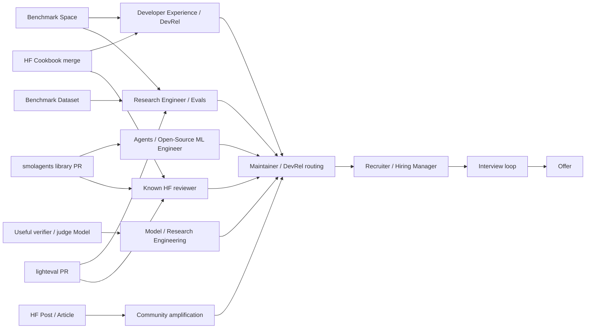
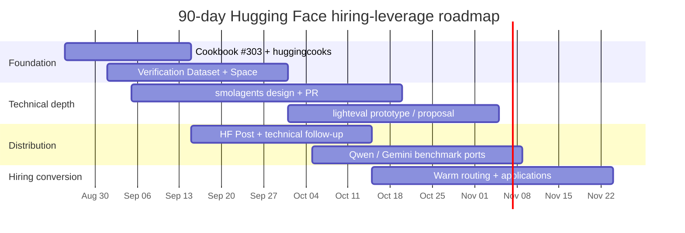

# DR26-08-25-MACANTON-17-0742 — raw report from chatgpt

> Unedited output of one model. Our reconciled synthesis is the page one level up.

---
title: "Research Hiring Leverage"
type: deep-research-original
source: chatgpt

dr_id: DR26-08-25-MACANTON-17-0742
conversation_id: 6a8d33d5-0cbc-83eb-8a26-c76a8261e47f
url: "https://приватный чат"
research_started_at: 2026-08-25T06:20:11.551383Z
research_stopped_at: 2026-08-25T06:34:26.964287Z
dr_status_in_tool: completed
harvested_by: dr_harvest_chatgpt.py
harvested_at: 2026-08-25T07:42:08
vault_chat_note: ""
---

> Отчёт Deep Research забран из ChatGPT verbatim (widget_state.report_message).
> Заметка диалога в волте обрывается на строке запуска — тела отчёта там нет.

## Запрос

```text
Conduct a deep research investigation on the following topic.TOPIC: How to use the HuggingFace ecosystem — and open-source contributions to vendor "cookbook"/examples repositories more broadly — as a concrete lever to (a) get NOTICED by the right people (repo maintainers, DevRel, recruiting/sourcing) at a top-tier LLM company, and (b) CONVERT that contribution into an intro → interview → offer. Target companies: Anthropic, OpenAI, Google/Gemini, xAI, Mistral, Meta, HuggingFace itself, DeepSeek, Qwen/Alibaba, Cohere. Center on HuggingFace specifically: which HF surfaces actually generate hiring-relevant attention and how each converts — the Open-Source AI Cookbook (github.com/huggingface/cookbook), Spaces, Models & Datasets on the Hub, HF blog / community "Posts", the "huggingcooks" cookbook-author badge, and code PRs to HF libraries (smolagents, TRL, transformers, lighteval, datasets, huggingface_hub, accelerate). Then generalize to vendor cookbook repos across the other labs.CONTEXT — we ALREADY have (do NOT re-derive; build BEYOND): (1) a vendor liveness map of which repos merge external PRs + CLA/DCO gates — skip it; (2) an Anthropic-specific OSS contribution map — skip it; (3) a generic "positioning for a frontier-LLM DevRel role" analysis + an anatomy of 8 public-build→lab hires (Steinberger→OpenAI, Charlie Marsh/Astral→OpenAI, Logan Kilpatrick, Trisha Gee) — do NOT re-explain the "Proof-of-Work replaces resume" paradigm, EXTEND it with HuggingFace-orbit and cookbook-contributor-specific precedents. Our position: Palo Alto AI Research Lab, FRESH GitHub org (few prior contributions; fresh accounts get blocked by mega-monorepo interaction limits), already shipped Anthropic claude-cookbooks PRs + Qwen-Agent #927 + Google ADK plugin, currently shipping a PR into huggingface/cookbook under issue #303.OPEN QUESTIONS to answer:1. HF SURFACE-BY-SURFACE CONVERSION: for each surface (merged Cookbook notebook, a Space, a Model, a Dataset, an HF blog/community Post, a library PR) — how does it generate hiring-relevant attention, who sees it, and the realistic path to a recruiter DM or maintainer intro? Rank surfaces by hiring-signal-per-unit-effort.2. CONTRIBUTION-WEIGHT RANKING (the sharp question): which weighs more for getting noticed/hired — a merged cookbook notebook vs a Space with N likes/trending vs a Model with N downloads vs a viral Dataset vs a popular HF blog post vs a merged library PR? Rank WITH reasoning and evidence; note thresholds (e.g. a Space must trend / hit X likes before anyone notices).3. NAMED PRECEDENTS: concrete named people hired or clearly noticed via OSS contributions to HuggingFace repos OR other vendors' cookbook/examples/agent repos — who, what they contributed, timeline (contribution → contact → offer), which company, what weighed most. Especially people hired BY HuggingFace via its own repos, and people hired by other labs whose on-ramp was HF work. If thin, say so and give closest analogues.4. The "huggingcooks" / cookbook-author track: what the badge is, how to earn it, whether it carries hiring/DevRel signal, and how HF DevRel/maintainers discover and amplify external contributors.5. CONVERSION MECHANICS & OUTREACH: once a contribution lands, the concrete play to convert it to an intro/interview — who to tag, follow-up, inbound-vs-outbound reality, role of X/LinkedIn/HF social amplification, warm-intro paths, and actual open roles that value this profile (Developer Advocate, ML Engineer, Community, Research Engineer), with realistic timing.6. FAILURE MODES & ANTI-PATTERNS specific to this play: slop, over-posting, fresh-account credibility gap, CLA/DCO friction, mega-monorepo interaction limits, low-quality Spaces/models that hurt; how a fresh org warms up on HF specifically (Hub is more open than GitHub monorepos — quantify).7. STEP-BY-STEP PLAYBOOK FOR OUR CASE: given our assets (multi-agent consensus/adversarial verification, authority routing/tier-gating to a human, pipeline-vs-barrier concur
```

## Отчёт
# Hugging Face and Vendor Cookbooks as a Hiring Lever Into Frontier LLM Companies

## A. Executive Summary

The highest-leverage way to use Hugging Face for hiring is **not** to accumulate unrelated public artifacts. It is to build a compact, mutually reinforcing chain in which the same technical idea is independently legible across several surfaces:

**maintainer-reviewed code → reproducible benchmark/data → interactive demonstration → technical explanation → repeated interaction with the same maintainers → role-specific application.**

Hugging Face is unusually good for this strategy because those surfaces live in one identity graph. A Cookbook author can link directly to a Hugging Face or GitHub profile; a merged recipe appears in the public Open-Source AI Cookbook; the author can request membership in the public `huggingcooks` organization; the same identity can own Models, Datasets and Spaces; Hub discussions and pull requests can notify mentioned participants; and the contributor can then move from the relatively accessible Cookbook/Hub layer into higher-selectivity library repositories such as `smolagents`, `lighteval`, `TRL`, or `transformers`. The Cookbook README explicitly directs new-recipe contributors to tag HF maintainers Merve Noyan and Steve Liu and says contributors can request the `huggingcooks` badge after contributing. fileciteturn2file0L2-L2

For **Palo Alto AI Research Lab specifically**, the optimal sequence is therefore:

> **finish Cookbook #303 well → claim `huggingcooks` → release one serious agent-verification Dataset + one Space around it → land a substantive `smolagents` contribution → upstream a reusable evaluation component to `lighteval` → then convert the resulting reviewer graph into warm routing and targeted applications.**

This is a better strategy than opening ten shallow cookbook PRs. The strongest documented Hugging Face hiring precedents involve **sustained technically valuable contributions and repeated exposure to maintainers**, not a single viral post or notebook. Niels Rogge describes beginning with Transformers model contributions in 2020 and says that, after working on multiple PRs, Hugging Face eventually asked him to join. Xuan-Son Nguyen describes contributing to `llama.cpp`/`llama-server`, being contacted by Hugging Face CTO Julien Chaumond around mid-2024, and joining in August 2024. citeturn27view0turn27view1

The sharp ranking depends on whether we ask about **raw hiring weight** or **signal per unit effort**:

| Rank | Raw hiring weight, normal case | Hiring-signal-per-effort for your case |
|---|---|---|
| **1** | Substantive merged HF library PR | **Merged HF Cookbook notebook** |
| **2** | Merged HF Cookbook notebook | **Targeted `smolagents` / `lighteval` PR** |
| **3** | Reused benchmark Dataset + associated Space | **Benchmark Dataset + Space bundle** |
| **4** | High-traction/Featured Space | HF Post amplifying a real artifact |
| **5** | Model with genuine adoption and role relevance | Stand-alone Space |
| **6** | High-performing technical Post/article | Model, unless there is a legitimate model to release |
| **7** | `huggingcooks` badge alone | Badge alone |

There is one major exception: **external adoption can overwhelm review selectivity**. A benchmark Dataset that becomes standard infrastructure, a Model with genuine downstream use, or a Featured/viral Space can be a stronger hiring signal than one ordinary library PR. Hugging Face itself now exposes decentralized evaluation results on model pages and benchmark leaderboards, including community-submitted evaluations, which makes adopted evaluation infrastructure especially legible. citeturn1search2turn1search11

For your existing assets, **evaluation + governance of agents** is a considerably stronger positioning vector than “we build multi-agent demos.” The most compelling artifact family would combine citation-faithfulness evaluation, adversarial verifier agents, correct-defer/human-escalation behavior, authority/tool-policy gating, agent memory failure cases, and the quality/latency/cost trade-off between pipeline and barrier concurrency. That maps cleanly to Open Source ML, Agents, Evals/Research Engineering, and Developer Experience roles. Google DeepMind describes Research Engineers as the bridge between theory and implementation who build and scale systems to test and evaluate ideas; OpenAI currently advertises a Developer Experience Engineer role centered on demos, sample applications and technical content, while its Codex Deployment Engineer role explicitly includes contributing examples, guides and patterns to the OpenAI Cookbook. citeturn27view4turn27view5turn27view7

**Bottom line:** a good HF Cookbook merge can get you known to the right two or three people. A good HF library PR can make those people take your engineering ability seriously. An adopted benchmark can give other labs a reason to care. **The hiring conversion comes from connecting all three and then making a low-friction routing ask—not from waiting for a recruiter to discover a star count.**

## B. Key Findings

**Current vendor/example-repository landscape.** The table below uses GitHub API data queried on August 25, 2026. GitHub's returned `watchers_count` mirrors the star count in these records; therefore “watching” below uses the separate `subscribers_count`, which is the more useful measure of explicit repository subscriptions. GitHub traffic such as views, clones and referrers was not publicly available for these third-party repositories and is therefore left out rather than estimated. Publicly comparable PyPI/Conda telemetry was likewise unavailable for enough repositories to make it a sound cross-vendor ranking variable.

| Company / surface | Repository / URL | Stars | Forks | Watching | Last push | Primary language | License | Strategic interpretation |
|---|---|---:|---:|---:|---|---|---|---|
| **Hugging Face** | `github.com/huggingface/cookbook` | 2,710 | 412 | 38 | 2026-08-20 | Jupyter Notebook | Apache-2.0 | Lower raw reach than OpenAI/Gemini/Llama, but unusually strong identity/reviewer conversion because it connects into the Hub and `huggingcooks`. fileciteturn1file0L2-L2 |
| **OpenAI** | `github.com/openai/openai-cookbook` | 75,532 | 12,766 | 1,007 | 2026-08-25 | Jupyter Notebook | MIT | Enormous public audience; directly aligned with current OpenAI developer-facing roles. fileciteturn3file0L2-L2 |
| **Google/Gemini** | `github.com/google-gemini/cookbook` | 17,696 | 2,747 | 211 | 2026-08-19 | Jupyter Notebook | Apache-2.0 | Large branded learning/examples surface for Gemini API work. fileciteturn4file0L2-L2 |
| **Meta** | `github.com/meta-llama/llama-cookbook` | 18,560 | 2,763 | 194 | 2026-05-19 | Jupyter Notebook | MIT | Large audience; inference, fine-tuning, RAG and end-to-end Llama work are central themes. fileciteturn7file0L2-L2 |
| **Qwen / Alibaba** | `github.com/QwenLM/Qwen-Agent` | 17,010 | 1,702 | 104 | 2026-03-04 | Python | Apache-2.0 | More valuable than a pure cookbook because examples coexist with an actual agent framework; directly relevant to your existing #927 work. fileciteturn8file0L2-L2 |
| **Mistral** | `github.com/mistralai/cookbook` | 2,313 | 535 | 43 | 2026-08-24 | Jupyter Notebook | MIT | Similar GitHub scale to HF Cookbook; current and actively maintained. fileciteturn6file0L2-L2 |
| **xAI** | `github.com/xai-org/xai-cookbook` | 553 | 189 | 24 | 2026-04-16 | TypeScript | Other / NOASSERTION | Smaller public audience, potentially greater concentration of attention per meaningful contribution. fileciteturn5file0L2-L2 |
| **DeepSeek** | `github.com/deepseek-ai/deepseek-harness` | 193,069 | 21,692 | 849 | 2026-08-21 | TypeScript | MIT | Extraordinary current reach; Harness is plugin-centric rather than a conventional notebook cookbook. Treat the scale as GitHub API data, not evidence that every star is hiring-relevant. fileciteturn9file0L2-L2 |
| **Cohere** | `github.com/cohere-ai/cohere-developer-experience` | 114 | 74 | 10 | 2026-08-20 | Jupyter Notebook | Unspecified in GitHub API | Current docs/snippets/guides repository; GitHub stars likely understate consumption through Cohere's documentation surface. fileciteturn10file0L2-L2 |

Anthropic is intentionally not re-inventoried here because you already have an Anthropic-specific contribution/liveness map and have shipped `claude-cookbooks` work.

### HF surface-by-surface conversion mechanics

The important distinction is between **attention**, **selectivity**, and **attribution**. A Space can generate a lot of attention but has almost no admission gate. A library PR has limited broad visibility but forces a maintainer to evaluate your code. A Cookbook contribution is unusually attractive because it sits between those extremes: real human review, public attribution, and relatively manageable engineering effort. HF's Cookbook explicitly asks that recipes be practical, end-to-end or technically focused, open-source, clearly written, executable without errors, additive rather than duplicative, and neutral rather than promotional. fileciteturn2file0L2-L2

| HF surface | Who actually sees it | Quality gate | Realistic hiring conversion | Practical traction threshold |
|---|---|---|---|---|
| **Merged Cookbook notebook** | Cookbook maintainers/reviewers first; then users of `hf.co/learn/cookbook`; your author link resolves directly to HF/GitHub identity. | **Medium-high** | Reviewer recognizes you → merge → `huggingcooks` → second technical interaction → routing to DevRel/Open Source/Agents/Evals → targeted application. | **The merge is the threshold.** No arbitrary likes/download number is required. README explicitly names @merveenoyan and @stevhliu for new recipe PRs. fileciteturn2file0L2-L2 |
| **Library PR** | Core maintainers, reviewers, issue participants, repo subscribers; potentially release notes downstream. | **Highest** | Strongest direct technical relationship. Repeated PRs can create inbound recruiting; this is the best-documented HF precedent. citeturn27view0 | No social threshold. One difficult merge is meaningful; **two or three related accepted contributions** create much stronger identity recognition. The latter is a strategy heuristic, not an HF policy. |
| **Dataset** | Dataset search/trending users, researchers, benchmark users and people following linked repos. | Low at publication; high if adopted | Strong for Research Engineer/Evals if other people actually use the benchmark, submit results or build on it. HF tracks dataset downloads, but download counts are not unique-user counts. citeturn1search10turn1search11 | Heuristic: ~1k monthly downloads = enough to mention for a niche benchmark; ~10k = strong; ~100k = major. External references/leaderboard use matter more than raw downloads. |
| **Space** | Hub discovery/search, social sharing, people following the creator; HF can additionally surface high-quality Featured Spaces. citeturn2search27turn1search13 | Low until curated/adopted | Great demonstration layer. It becomes hiring-relevant when it gives a reviewer/recruiter a 30-second way to understand the difficult thing you built. | **Not official HF thresholds:** <10 likes = little validation; 25–50 = credible niche traction; 100+ = meaningful; 500+ = breakout; ~1k+ = flagship territory. Featured status is stronger than raw likes. Public Spaces show a very wide distribution, including >1k-like flagship examples. citeturn10search12turn10search16 |
| **Model** | Model search/trending, downstream integrators, benchmark pages and leaderboard users. | Low at upload; potentially extremely high through adoption | Excellent for model/research/inference roles if it is a *real useful model*. Weak for your profile if uploaded merely to check a box. | Heuristic: 10k monthly downloads starts to be interesting, 100k strong, 1m standout—**but HF downloads are HTTP access counts, not unique people**. Model-card quality and evaluation results materially improve legibility. citeturn1search0turn1search2turn1search4 |
| **HF Post** | HF social feed/followers, people following linked creators/artifacts; replies can generate notifications. citeturn2search2turn11search16 | Very low | **Amplifier, not primary evidence.** Best used to turn a merge/benchmark into distribution. | Derived heuristic from strong technical HF Posts: ~5k views/count plus ~20 meaningful reactions is useful reach; ~10k+ is strong. Transformers.js/Xenova posts have demonstrated five-figure distribution. citeturn16search0turn16search4 |
| **Long-form HF article** | Blog/community readers and social feed; better searchability and explanatory depth than a short Post. | Publishing access + editorial/social filtering rather than engineering review | Excellent interview packet material when paired with code/data; poor substitute for code. | As of current HF documentation, personal long-form article publishing has account/paid-tier requirements that Posts do not share. citeturn1search8turn2search4 |
| **`huggingcooks` badge** | Anyone resolving your public HF profile/org affiliations. | Cookbook contribution | Useful **legibility metadata**: “this person has crossed an HF contribution gate.” It does not establish engineering depth by itself. | Cookbook README says contributors may request organization membership after contributing; the organization describes itself as Cookbook Authors and includes recipe/translation contributors. fileciteturn2file0L2-L2 citeturn0search0 |

The numerical Space/Post/download thresholds above are **decision heuristics, not documented Hugging Face ranking thresholds**. Hugging Face does not publish a hiring-relevant “100 likes = noticed” rule. They are useful for determining when public adoption becomes meaningful enough to mention in outreach. For Models and Datasets in particular, HF's own download documentation makes it important not to equate requests with unique users. citeturn1search0turn1search10

### The contribution-weight ranking

For an ordinary artifact with no exceptional virality, my ranking of **technical hiring signal** is:

**substantive library merge > Cookbook merge > adopted benchmark Dataset + Space > high-quality Space > relevant Model > technical Post/article > badge.**

For **your exact agent/eval profile**, the Model moves down because fabricating a small model simply to possess a model card would add little evidence. Conversely, a verifier/judge/reranker model belongs near the top if it measurably improves the benchmark and is genuinely reused.

For **signal divided by effort**, the order changes:

**Cookbook merge > narrowly scoped `smolagents`/`lighteval` PR > Dataset+Space benchmark bundle > Post used as amplifier > Space alone > Model built only for visibility.**

A useful mental model is:

\[
\text{Hiring signal} \approx
\text{reviewer selectivity}
\times
\text{role relevance}
\times
\text{external adoption}
\times
\text{attribution clarity}
\times
\text{repeated exposure}
\]

This is an analytical framework rather than a measured HR equation. The key implication is important: **100,000 self-generated download events do not automatically beat one hard technical merge**, while a benchmark genuinely adopted by multiple independent groups can absolutely beat it.

### Which HF libraries matter for you

| Repository | Current public scale | Fit to your assets | Signal if merged | Effort | Recommendation |
|---|---|---|---|---|---|
| **`smolagents`** | 28,979 stars, 2,891 forks, 135 subscribers; Python, Apache-2.0; pushed 2026-08-22. fileciteturn11file0L2-L2 | **10/10** | Very high | Medium | **First target.** Agents + tool governance + human authority boundaries are exactly your domain. |
| **`lighteval`** | 2,524 stars, 543 forks, 26 subscribers; Python, MIT; pushed 2026-08-11. fileciteturn12file0L2-L2 | **9/10** | Very high for eval/research roles | Medium | Second target after the benchmark exists in your own repo. Upstream only the reusable metric/task/adapter. |
| **`TRL`** | Active HF post-training library for SFT, DPO, GRPO and related methods. citeturn18search2turn18search34 | 6/10 | Extremely high | High | Do this only if your verifier/evaluator project produces a genuine post-training problem. |
| **`datasets`** | HF's data library supports multimodal datasets and agent traces. citeturn19search0 | 5/10 for library code; 10/10 as Hub Dataset user | High | High | Publish your Dataset first; contribute library code only when the benchmark exposes a real data-system problem. |
| **`huggingface_hub`** | Core Hub Python/CLI client; its public APIs include repository/community operations. citeturn19search1 | 5/10 | High | High | Do not contribution-chase. Fix real infrastructure friction you encounter. |
| **`transformers`** | Flagship model library; current contribution surface has no obvious good-first-issue shortcut. citeturn18search3turn18search35 | 4/10 now | Extremely high | Very high | Not where a fresh org should begin unless you discover a concrete model/agent integration bug. |
| **`accelerate`** | Distributed-training abstraction for PyTorch. citeturn19search2turn19search17 | 3/10 now | Very high | Very high | Useful only if concurrency/distributed execution becomes substantive systems work rather than a demo feature. |

There is a particularly strong current opening in `smolagents`: issue **#2656**, opened August 18, 2026, proposes governance middleware hooks around execution, including policy-like concerns such as authorization/cost controls. That is unusually close to your existing “authority routing/tier-gating to a human” work. The correct move is to enter with a compact API/design proposal and ask whether maintainers want the minimal hook abstraction—not to arrive with a giant unsolicited framework. citeturn18search12

The resulting role graph is roughly:



The role mapping is consistent with current public role descriptions: OpenAI's Developer Experience team explicitly builds demos, developer tools, sample applications and technical content; OpenAI's Codex Deployment role explicitly includes examples/guides/Cookbook work; Google DeepMind's Research Engineer role emphasizes building systems to test and evaluate ideas; and Hugging Face currently lists Open-Source Machine Learning Engineer and open-source/Python engineering roles. citeturn27view4turn27view5turn27view7turn21search0turn21search2

## C. Named Precedents

The public record is much stronger for **HF library/project contributors → Hugging Face** than for **one cookbook contributor → frontier-lab hire**. That distinction matters. I found strong first-party precedents for sustained OSS work producing contact and employment at Hugging Face, but **not a well-documented primary-source case where a single OpenAI/Gemini/Mistral/xAI/Qwen/Cohere cookbook notebook alone directly produced recruiter contact and an offer**. That absence should not be filled with folklore.

| Person | What they built / contributed | Surface | Public timeline | Hiring / joining company | What seems to have mattered most | Evidence strength |
|---|---|---|---|---|---|---|
| **Niels Rogge** | TAPAS, LayoutLM and subsequent model implementations in Transformers; later many vision architectures | HF core library PRs | Began contributing in **2020**; says that while working on various PRs the HF team eventually asked him to join; still completed a formal application | **Hugging Face** | Repeated technically difficult model ports, reproducibility and direct review relationships—not social virality | **Direct first-person causal evidence.** citeturn27view0 |
| **Xuan-Son Nguyen** | Alpaca Web UI; `llama.cpp` / `llama-server` work | External OSS deeply connected to HF inference ecosystem | Discovered `llama.cpp` early **2023**; began contributing later in 2023; HF CTO Julien Chaumond reached out around **mid-2024**; joined **August 2024** | **Hugging Face** | Sustained ownership of useful C++ inference/server infrastructure | **Direct first-person timeline.** citeturn27view1turn27view2 |
| **Aleksander Grygier** | Web UI / `llama.cpp` ecosystem maintenance | External OSS project maintenance | HF's later account says the growing Web UI needed a dedicated maintainer and that the team recruited him; exact first-contact/offer chronology is not publicly specified | **Hugging Face / llama.cpp orbit** | Becoming the obvious maintainer for an increasingly important piece of infrastructure | **Direct statement of recruitment reason; incomplete timeline.** citeturn27view1 |
| **Joshua Lochner / Xenova** | Transformers.js ecosystem, examples and large-scale model conversion for browser/WebGPU inference | Independent OSS → HF project/Hub ecosystem | Joshua was publicly associated with HF by 2024; Transformers.js v3 later moved from the Xenova namespace into official Hugging Face package/repository infrastructure | **Hugging Face** | Ownership of a differentiated, widely useful ecosystem capability; browser ML technical leadership | **Strong project-to-HF analogue; public sources do not establish a precise “PR → recruiter → offer” causal timeline.** citeturn27view3turn16search3 |
| **Georgi Gerganov / GGML team** | GGML and `llama.cpp` | Foundational external OSS | Following a long collaboration, Hugging Face announced that GGML/`llama.cpp` were joining HF in **February 2026**; existing `llama.cpp` contributors were already on the HF team | **Hugging Face** | Foundational infrastructure, ecosystem adoption and long-term collaboration | **Strategic project/team precedent, not an ordinary candidate funnel.** citeturn27view1 |

Niels Rogge is the cleanest answer to the question “does contributing to HF's own repositories ever convert into being recruited by HF?” The answer is **yes**, with unusually direct evidence: he explicitly says multiple PRs preceded HF asking him to join. It is also evidence against the “one clever PR is enough” interpretation. The causal variable visible in his account is accumulated trusted work. citeturn27view0

Xuan-Son Nguyen is equally important because the work did **not** have to begin inside an official HF repository. Becoming a critical external contributor to infrastructure Hugging Face cared about was enough for HF leadership to discover and recruit him. That is highly relevant to your multi-vendor strategy: a benchmark, evaluator or agent-governance component can be the hiring object even when it originates under your own organization. citeturn27view1

The weakest part of the public evidence is specifically **cookbook-only hiring**. Cookbook contributions are clearly useful for establishing an initial maintainer relationship and a highly legible technical artifact, but there is not enough primary-source evidence to assign them an empirical recruiter-DM or offer conversion rate. Therefore the report treats Cookbook as an **on-ramp**, not as a magic hiring channel.

## D. Contradictions & Debates

**Reach versus selectivity.** OpenAI's Cookbook has roughly 75.5k GitHub stars while HF's Cookbook has roughly 2.7k. Pure audience math therefore favors OpenAI by an order of magnitude. Yet that does not imply an individual OpenAI notebook is automatically a stronger hiring signal. HF Cookbook contributors are explicitly routed to named maintainers, become publicly attributed authors, get publication in `learn/cookbook`, and can join the `huggingcooks` organization. HF therefore offers a denser **identity-to-reviewer conversion path**, despite lower repository reach. fileciteturn1file0L2-L2 fileciteturn3file0L2-L2 fileciteturn2file0L2-L2

**Reviewed contribution versus viral self-publication.** A library PR signals that somebody with merge authority accepted your engineering work. A Space or Dataset can be uploaded by its creator without equivalent review. That favors PRs at low-to-moderate traction. But once a Dataset becomes a common benchmark or a Space becomes Featured and widely reused, the market itself is effectively providing a second quality filter. This is why there cannot be a universal statement that “library PR always beats Dataset.” HF's benchmark/evaluation infrastructure explicitly supports community-produced results and aggregated leaderboards, making external adoption visible. citeturn1search11turn2search27

**Downloads are seductive but noisy.** HF model and dataset downloads are operational request metrics, not a count of unique humans or hiring managers. Automated loading, repeated accesses and tooling behavior affect them. A 100k-download benchmark with no meaningful discussion, downstream use or citations can therefore be less interesting than a 5k-download specialist dataset used by three respected evaluation projects. citeturn1search0turn1search10

**The `huggingcooks` badge is real, but its meaning is coarse.** Cookbook documentation says a contribution makes you eligible to request membership, and the public organization is for Cookbook Authors. Because recipes and translations can qualify, membership cannot by itself encode whether a person implemented an advanced evaluation system or translated a notebook. Its hiring value is therefore best understood as **identity verification and profile navigation**, not a high-resolution technical credential. fileciteturn2file0L2-L2 citeturn0search0

**“The Hub is more open than GitHub” is directionally correct, not absolute.** GitHub supports repository interaction restrictions that can temporarily exclude new users or people without an established relationship, which explains some of the friction fresh accounts encounter on high-traffic projects. HF Hub discussions and PRs are built into model, dataset and Space repositories and do not require a traditional GitHub fork. However, HF still has anti-abuse/resource constraints: for example, ZeroGPU usage/hosting has account and quota rules, including a >30-day requirement for some free personal-account creation privileges. citeturn11search0turn11search1turn11search34

This matters for your fresh organization: **Hub artifacts are a sensible credibility warm-up, but “HF lets fresh accounts do anything” would be false.** One can quantify the difference mechanically rather than rhetorically: an ordinary Hub repo offers direct discussion/PR interaction without first constructing a GitHub fork/reputation history, whereas some premium compute surfaces impose explicit maturity quotas. HF also publishes rate limits for authenticated and unauthenticated Hub use; these are capacity controls, not contributor-reputation scores. citeturn11search2turn11search34

**Breadth versus repeated trust.** Ten one-off vendor contributions make a résumé look broad. Two or three useful contributions reviewed by the same core maintainers create a much stronger trust graph. The direct Niels Rogge and Xuan-Son Nguyen precedents favor the latter interpretation: repeated visible ownership preceded recruitment. That is an inference from the public cases rather than a universal hiring rule. citeturn27view0turn27view1

**Public virality versus relevance to the actual role.** A browser demo with 1,000 likes may be spectacular for Developer Experience and nearly irrelevant to a distributed-training role. Conversely, a modest `accelerate` PR may be nearly invisible socially but highly persuasive to an infrastructure hiring manager. Current role descriptions reinforce that role-content match matters: OpenAI Developer Experience emphasizes sample apps/content/ecosystem engagement, whereas DeepMind Research Engineering emphasizes experimental systems, model optimization and infrastructure. citeturn27view4turn27view7

## E. Best Practices

The central best practice is to **build one artifact family rather than six unrelated artifacts**.

For your lab, I would make the canonical project something like:

> **Agent Verification Benchmark: When should an agent answer, verify, escalate, or refuse to act?**

The Dataset is the source of truth. Each case should be inspectable and contain, where appropriate: task/query; source evidence; adversarial distractors; expected supported claims; required citations; permitted tools; authority level; conditions requiring human escalation; memory state; expected safe/defer action; and optionally latency/cost constraints. The Dataset card should clearly separate human-authored, transformed and synthetic cases and document any contamination/limitations.

The evaluation layer should report more than a single “accuracy” number. For your existing strengths, the interesting dimensions are:

| Dimension | Useful metric |
|---|---|
| Citation correctness | Claim-support precision / recall; unsupported-claim rate |
| Retrieval/evidence behavior | Evidence recall; distractor susceptibility |
| Authority routing | Correct-action rate at each authority tier |
| Human escalation | Correct-defer / false-defer rates |
| Tool governance | Unauthorized-tool attempt rate; policy interception rate |
| Agent memory | Stale-memory use, cross-session leakage, contradiction handling |
| Consensus/verifier agents | Incremental quality versus single-agent baseline |
| Concurrency | End-to-end latency and critical-path latency |
| Efficiency | Tokens, model calls and monetary cost per solved case |
| Reliability | Variance over repeated runs / seeds where stochasticity matters |

Then use the **Space as the visualization layer**, not as the experiment itself. A visitor should be able to choose a case class, compare single agent versus consensus versus adversarial verifier versus human-gated mode, and see quality/latency/token/cost trade-offs. A cached set of canonical runs should make the Space informative even when inference capacity is unavailable. Featured Spaces are an explicit HF discovery channel, so production polish is worth doing after the underlying evaluation is credible. citeturn2search27

Use the **Cookbook as the educational derivation** of the system. The notebook should explain a narrow question and reproduce a result from the benchmark instead of becoming the README for your company. This is particularly important because HF's Cookbook guidelines explicitly ask for practical, clearly written, executable and content-neutral recipes rather than branded promotion. fileciteturn2file0L2-L2

For #303, that means resisting scope creep. The current contribution should remain an excellent implementation of the agreed search/DuckDB/agent recipe. Adding a small citation-verification or “defer when evidence is insufficient” example can make it more characteristic of your lab **only if it remains obviously within the accepted recipe**. Turning #303 into your entire multi-agent governance stack would lower merge probability and make you look unable to control scope.

The **library contribution should extract the reusable mechanism** from the application. In `smolagents`, do not upstream “Palo Alto Authority Router.” Upstream the smallest generic hook/API that allows an application to enforce tool authorization, execution policy, cost bounds or human approval. A high-quality contribution should include API semantics, unit tests, negative-path tests, docs, a compact runnable example, backwards-compatibility reasoning, and no unnecessary framework machinery. Current issue #2656 gives you an unusually natural entry point. citeturn18search12

The **evaluation contribution should come second**. Start with the metric/task implementation in your own project. Once you have evidence that it is generic, ask `lighteval` maintainers whether they want the reusable component. `lighteval` exists specifically to evaluate LLMs across multiple backends, so a real citation-faithfulness or agent-trace evaluation has plausible fit; inventing an arbitrary metric solely to obtain a merge does not. fileciteturn12file0L2-L2

For all public artifacts, reproducibility is itself hiring evidence. Pin important dependencies; have a tiny deterministic smoke-test subset; run notebooks end-to-end; mock secrets in tests; enforce cost caps on CI; separate evaluation code from presentation; record model/API versions; expose benchmark data transformations; and have one-command reproduction for at least the reference baseline. HF's Cookbook explicitly requires notebooks to execute without errors, while model-card/evaluation tooling is designed around reproducibility and structured evaluation evidence. fileciteturn2file0L2-L2 citeturn1search2turn1search4

Your own organization should also look like somewhere another engineer could contribute: concise CONTRIBUTING instructions, issue templates, a test command that works, labeled starter issues, changelog/releases, a clear architecture document and responsive reviews. That changes the signal from **“candidate produced artifacts”** to **“candidate can operate an OSS project.”**

Finally, make identity resolution trivial. The Cookbook explicitly allows the author line to link to an HF or GitHub profile. Use a real, consistent identity across the lab org, personal contributor account, HF profile, GitHub and LinkedIn; cross-link the technical artifacts; put a short public contact path in the profile. Do **not** make maintainers reconstruct who the human behind a fresh organization is. fileciteturn2file0L2-L2

## F. Failure Modes & Anti-patterns

**AI-generated contribution slop is now actively toxic to this strategy.** Niels Rogge's March 2026 account of contributing to Transformers discusses the pressure created by low-quality AI-generated contributions on maintainers. The implication is not “do not use coding agents”; his own article is about using Codex productively. The distinction is whether the contributor understands, tests and owns the patch. A suspiciously broad PR with verbose generated prose, weak tests and no evidence that the author reproduced the underlying behavior can actively damage the fresh-account credibility you are trying to build. citeturn27view0

Your mitigation should be visible in the artifact itself: small diffs, specific issue context, concrete reproductions, quantitative before/after results, tests that would fail without the change, explicit limitations, rapid knowledgeable responses to review, and willingness to delete unnecessary code.

**Do not ship “surface-completion artifacts.”** A low-quality Model uploaded because “Models are an HF surface,” a generic chatbot Space, a synthetic 100k-row Dataset with no validation, and a Post announcing each tiny action make the profile worse rather than better. Self-publishing has a low admission gate; hiring managers know this. Public adoption or a rigorous artifact card is what restores signal.

**Do not confuse social metrics with engineering validation.** Model/Dataset download counts are not unique-user measures. GitHub stars are attention, not reviewer approval. Space likes are useful distribution evidence but do not establish architecture quality. A hiring packet should therefore pair each popularity metric with a stronger proof: independent user, downstream repository, evaluator result, maintainer merge, benchmark improvement, technical citation, or repeat reviewer interaction. citeturn1search0turn1search10

**Do not mass-tag HF staff.** The Cookbook already tells contributors whom to tag; use those names there. On library work, tag only maintainers already involved in the issue, owners implied by project guidance, or people who have reviewed you. HF Hub notifications mean a mention/reply is an actual notification mechanism, so indiscriminate mentions are not “visibility optimization”; they are notification spam. fileciteturn2file0L2-L2 citeturn11search16

**Do not ask for a referral in the first review thread.** The PR is where you demonstrate that working with you is easy. Mixing a merge request with a job request changes the maintainer's incentive and makes the contribution look transactional. The first post-merge ask should be technical; the later ask should be for *routing*, not an obligation.

**Do not warm a fresh account by attacking the largest monorepo.** GitHub provides interaction-restriction mechanisms that can discriminate against very new/no-history accounts at a repository level. HF's Hub gives you lower-friction paths—Models, Datasets, Spaces, discussions and Hub PRs—through which the same identity can accumulate real activity before attempting a difficult `transformers` contribution. citeturn11search0turn11search1

At the same time, **do not claim HF has zero fresh-account friction**. ZeroGPU has account-age/quota requirements for some free-account use, including a 30-day-age condition for owning a limited number of ZeroGPU Spaces. The answer is to build a CPU/static/API-backed Space first if needed, not to stall the whole strategy waiting for premium GPU entitlement. citeturn11search34

**Do not infer contributor locations or time zones from commit timestamps.** Commit timezone is contaminated by local Git configuration, automation, rebases, squash merges and travel. For hiring networking, use only self-declared public locations and profile/contact details. What matters more is the reviewer graph: who reviewed you, who replied twice, who requested follow-up work, and who voluntarily amplified the project.

**Do not shotgun vendors with identical “hello world” PRs.** Cross-vendor work is valuable when the *methodology* stays constant and the adapter changes: run the same benchmark across Anthropic, Gemini, Qwen, Mistral, Grok, OpenAI, etc. That shows you understand portability and provider-specific behavior. Ten different trivial notebooks instead signal campaign behavior.

**Do not over-post.** One excellent HF Post after a substantive result is an amplifier. Five announcements around issue creation, PR opening, first review, merge and “badge obtained” turn an engineering project into personal marketing. Strong technical Posts on HF can reach thousands to tens of thousands of readers, so reserve that distribution for material results. citeturn16search0turn16search4

## G. Strategic Recommendations

Your existing contribution history already solves an important problem: **you do not need another generic “we can integrate an LLM API” demonstration.** Anthropic Cookbook work, Qwen-Agent #927, a Google ADK plugin and now HF Cookbook #303 establish basic cross-ecosystem capability. The next 90 days should add **depth, independent evaluation, and named maintainer trust**.

| Priority | Move | Why it is high leverage | Attached outreach action |
|---|---|---|---|
| **P0** | **Get HF Cookbook #303 merged with exceptional execution quality** | Lowest-cost path to a named HF reviewer relationship, Cookbook publication and badge eligibility. | No hiring ask. Be fast on review. At merge, thank reviewers and request `huggingcooks`. |
| **P1** | **Release `agent-verification-bench-v0` as an HF Dataset** | Converts your claims about consensus, citation fidelity, authority routing and memory into measurable infrastructure. | Mention the Dataset only after it has a rigorous card, baseline and reproducible subset. |
| **P1** | **Release a paired Space** | Gives DevRel/recruiting/maintainers a <60-second visual explanation of the benchmark. | Send to #303 reviewer as a *technical follow-up*, not a portfolio dump. |
| **P1** | **Engage `smolagents` #2656** | Near-perfect overlap with your authority/tool-governance capability; a merge would be much stronger engineering evidence than another notebook. citeturn18search12 | Comment first with minimal design, compatibility story and test plan. Ask if that scope is useful. |
| **P2** | **Propose the next HF Cookbook recipe: evaluator-first agentic RAG** | Builds a coherent authored series around an under-served technical axis rather than generic agent orchestration. | Open an issue before implementing; reference the benchmark, not your company pitch. |
| **P2** | **Prototype citation-faithfulness/agent-trace evaluation for `lighteval` in your own repo** | Bridges application engineering to Research/Evals signal. | Once validated, open a narrow upstream design issue asking which reusable layer belongs in `lighteval`. |
| **P3** | **Port the benchmark to one or two existing vendor relationships** | Turns prior Qwen/Google/Anthropic work into a comparative system rather than disconnected PRs. | Notify the vendor maintainer who already interacted with you: “same benchmark, provider-specific result X.” |
| **P4** | **Only later consider TRL/model training** | A verifier/judge model is compelling only if data/result justify it. | Publish a Model only when it has a quantitative reason to exist. |

The next Cookbook proposal should be narrowly differentiated. HF's open contribution call has explicitly welcomed applied use cases, multimodality, production techniques and other recipes that extend existing coverage. An issue along the lines of **“Evaluator-first agentic RAG: citation faithfulness, adversarial verification, and human authority gates with smolagents”** would be more differentiated than “multi-agent consensus tutorial.” citeturn14search0

A second promising version is **“When multi-agent consensus actually helps: quality × latency × cost × defer-rate benchmark.”** The key is that the notebook should be capable of finding a negative result. If a single-agent baseline beats three-agent consensus on cost-adjusted accuracy for half the tasks, publish that. Intellectual honesty is itself Research Engineer signal.

### Conversion mechanics: merge → intro → interview

The conversion funnel should be deliberate but restrained.

**At the PR stage:** make no career request. Respond to comments quickly, run the requested tests, explain trade-offs without defensiveness, and keep scope under control. Your immediate objective is for the maintainer to think, *this contributor understands the system and reduces my workload.*

**At merge:** thank the reviewers. For Cookbook, request the `huggingcooks` membership described in the repository instructions. Publish the paired artifact only when it genuinely adds information. fileciteturn2file0L2-L2

**Roughly two to seven days later**, after you have a concrete follow-up result, send one technical note to the maintainer who engaged most:

> Thanks for the review on the Cookbook contribution. We turned the core pattern into a reproducible HF Dataset + Space and added a citation-faithfulness baseline. The interesting result is that adversarial verification reduced unsupported claims from **X to Y** at **Z%** additional latency. I’m considering upstreaming the reusable governance/eval piece next. Is `smolagents`/`lighteval` the direction you would consider useful?

The interval is a practical heuristic, not an HF protocol. The important thing is that the message contains **new information**, so it is not a disguised referral request.

After **two or three substantive interactions**, or after the reviewer has engaged with two distinct artifacts, switch from technical follow-up to a routing ask:

> We now have two HF contributions around agent verification/governance plus the benchmark and cross-provider integrations. I’m targeting Open Source ML / Agents / Evals / Developer Engineering work. Is there someone on the Agents, Evals or open-source side you think would be useful for me to show this to? Happy to keep the conversation technical.

That is much easier for a maintainer to answer than “can you refer me?”

When an appropriate live role exists, apply through the formal process **and then** send a compact note:

> I applied to **[role]**. The three pieces most relevant to the role are **[merged library PR]**, **[benchmark Dataset/Space]**, and **[cross-vendor integration]**. They map to **[two explicit role requirements]**. **[Maintainer]** reviewed the HF contribution if the hiring team wants a quick technical reference.

Current examples where this public-work packet maps directly to job language include:

| Target | Current/recent role surface | Why your proposed proof maps |
|---|---|---|
| **Hugging Face** | **Open-Source Machine Learning Engineer** roles | The job family is explicitly about work in the open-source ML ecosystem; core-library contribution is therefore first-order evidence. citeturn21search0turn21search1 |
| **Hugging Face** | **Senior Python Software Engineer / Open-Source Contributor** | `smolagents`/`lighteval` Python work, tests, maintainership and public collaboration directly fit the title. citeturn21search2turn21search12 |
| **OpenAI** | **Developer Experience Engineer** | Builds demos, tools, sample apps and developer-facing technical content; Cookbook+Space+benchmark is highly legible evidence. citeturn27view4 |
| **OpenAI** | **Codex Deployment Engineer** | Current description explicitly includes technical examples/guides/patterns and OpenAI Cookbook contributions. citeturn27view5 |
| **Google DeepMind** | **Research Engineer** role family | Benchmark/evaluation systems and rigorous experiments map to GDM's description of building/scaling systems to test and evaluate new ideas. citeturn27view7 |
| **Anthropic** | Technical engineering/research hiring | Anthropic explicitly tells candidates to foreground independent research, thoughtful technical writing and OSS contributions. Your evaluation/governance layer is the relevant extension of work you already have there. citeturn27view6 |
| **Mistral** | Applied AI / developer ecosystem work | Comparative agent/eval implementations are more relevant than generic API demos; Mistral's current Cookbook remains actively maintained. fileciteturn6file0L2-L2 citeturn23search4 |
| **Meta / Qwen / xAI / Cohere / DeepSeek** | Agent, applied-ML, developer-product and research-engineering families | Use the *same benchmark methodology* through provider-specific adapters; do not make each vendor a disconnected campaign. Their public example/framework repos give this work a native home. fileciteturn7file0L2-L2 fileciteturn8file0L2-L2 fileciteturn5file0L2-L2 fileciteturn10file0L2-L2 fileciteturn9file0L2-L2 |

The inbound-versus-outbound reality is blunt: **do not plan around recruiter inbound from one Cookbook merge.** The strongest direct HF precedents that produced outreach involved sustained OSS contributions over months. Your operating assumption should be that public work creates a warm evidence graph; you still activate that graph through targeted outreach and applications. Recruiter inbound is upside. citeturn27view0turn27view1

## H. 30/60/90-day Action Plan

The plan below begins **August 25, 2026** and runs through approximately **November 23, 2026**. The sequence deliberately alternates a relatively low-friction visibility surface with a higher-selectivity engineering surface so that the fresh organization builds credibility without spending the whole quarter waiting on one mega-repo review.

| Window | Surface, in priority order | Deliverable | Definition of done | Outreach attached to the deliverable |
|---|---|---|---|---|
| **Days 0–30** | **HF Cookbook #303** | Get current notebook merged without scope creep | End-to-end clean run; dependency/runtime documented; author identity linked; review comments closed; neutral framing | Thank the actual reviewers; request `huggingcooks`. No employment ask. Cookbook contribution process explicitly supports this author/badge flow. fileciteturn2file0L2-L2 |
|  | **HF Dataset** | `agent-verification-bench-v0` | Start with roughly **200–500 carefully reviewed cases**, not a giant synthetic corpus; card documents provenance, schema, baselines and limitations | Link from your HF profile and #303 follow-up only when usable. |
|  | **Space** | Interactive benchmark explorer | Single-agent / consensus / adversarial verifier / human-gated comparison; quality, defer, citation, latency, tokens/cost | Send one technical result to the most engaged #303 reviewer. |
|  | **HF Post** | One short result-driven announcement | Lead with one empirical finding and a chart/Space; link Dataset, recipe and methodology | Tag only genuinely involved people. Target useful discussion, not likes. HF Posts provide a public social/discovery surface. citeturn2search2 |
|  | **`smolagents` #2656** | Design comment before code | Minimal hook semantics, example policy use cases, backward compatibility, tests proposed | Ask issue participants whether that is the API shape they want. citeturn18search12 |
| **Days 31–60** | **`smolagents`** | Implement maintainer-approved governance contribution | Tests + negative paths + docs + example + no unnecessary abstraction | After merge, send one note tying the API to benchmark evidence; ask what adjacent issue is most useful. |
|  | **Next Cookbook issue** | “Evaluator-first agentic RAG” or “When consensus helps” | Issue accepted/scoped before notebook implementation | Reference the Dataset/Space as evidence that the recipe already has a real experiment. |
|  | **`lighteval` in your repo first** | Implement reusable citation/agent evaluation | Tests, task schema, multiple-model baseline; API separated from your application | Open upstream issue only after proving generality. |
|  | **Dataset v0.2** | Expand hard subsets | Adversarial evidence, defer/escalation, tool authorization, memory leakage; grow only with quality | Invite one or two external users to submit model results or failure cases. |
|  | **Qwen / Google vendor port** | Reuse same benchmark through existing relationships | One provider adapter + comparative results, not another hello-world demo | Notify existing Qwen/Google maintainer who already knows your contribution history. |
| **Days 61–90** | **`lighteval` upstream** | PR reusable task/metric/adapter if maintainers agreed | Core abstraction accepted; docs/example included | After merge/review relationship, ask for routing to HF Evals/Open Source team. |
|  | **Optional TRL / Model** | Train verifier only if benchmark indicates a real gap | Must outperform a useful baseline on held-out evaluation and justify the model artifact | Post only the result; do not create a vanity Model. |
|  | **Long-form technical write-up** | “What multi-agent verification buys—and costs” | Methods, negative results, cost curves, failure taxonomy and links to all reproducible artifacts | HF article if your account/org meets current publishing requirements; otherwise a strong Post plus your own technical site. citeturn1search8turn2search4 |
|  | **Hiring conversion** | Apply to 3–5 tightly matched roles | Every application opens with the three strongest public artifacts and exact role mapping | Ask proven reviewers for routing; contact recruiter after formal application with concise proof packet. |

A practical timeline is:



### KPIs that actually measure hiring impact

Do not optimize the quarter around total stars. Use a funnel with **artifact quality, reviewer relationships, external adoption and hiring progression** as separate layers.

| KPI family | 90-day target | Why it matters |
|---|---|---|
| **Maintainer-reviewed output** | **1 HF Cookbook merge + `huggingcooks`; 1 substantive HF library merge** | Strongest evidence that independent maintainers accepted your work. |
| **Evaluation infrastructure** | **1 Dataset + 1 Space with reproducible baselines** | Gives research/evals and DevEx hiring managers different entry points into the same work. |
| **Technical depth** | At least one reusable `smolagents` or `lighteval` component | Separates you from ordinary tutorial contributors. |
| **Reviewer graph** | **3–5 named maintainers** with substantive technical interactions; **2+ repeat interactions** with at least one person/team | Better leading indicator of warm-intro probability than stars. |
| **Space adoption** | **25–50 likes** baseline goal; **100+** stretch; Featured is a better qualitative target than chasing arbitrary likes | Enough social proof to make traction worth citing; thresholds are strategic heuristics, not HF rules. |
| **Dataset adoption** | **1k monthly downloads** early goal; **10k** stretch; additionally track independent users/results/repos | Downloads are noisy, so external reuse is the stronger KPI. citeturn1search10 |
| **Post reach** | Roughly **5k views/count + ~20 meaningful reactions** for one strong post; 10k+ stretch | Indicates genuine HF feed distribution without turning publishing into the primary objective. Derived from public technical Post examples. citeturn16search0turn16search4 |
| **External validation** | At least **3 independent downstream uses/results/references**, even if small | More valuable than self-generated traffic. |
| **Warm hiring conversion** | **2 routing intros or substantive recruiter/hiring-manager conversations** | The first KPI that directly measures whether the OSS strategy is moving into hiring. |
| **Applications** | **3–5 highly targeted live roles**, not 50 generic submissions | Allows the public artifact packet to be tailored to explicit requirements. |
| **Funnel accounting** | Track `merge → repeat maintainer interaction → internal routing → recruiter screen → technical screen → final loop → offer` | Lets you identify whether the failure is visibility, positioning, interview performance or role fit. |

There is no defensible public benchmark saying, for example, “a Cookbook merge has a 12% chance of recruiter contact,” so none should be invented. Your internal funnel will become more valuable than industry anecdotes after the first few applications.

The one-page **proof packet** by day 90 should be brutally compact:

> **Agent verification/governance:** merged HF Cookbook recipe → `smolagents` governance contribution → public evaluation Dataset → interactive benchmark Space → cross-provider results on Qwen/Gemini/Anthropic/etc.  
> **Measured result:** one sentence each for citation faithfulness, human-defer correctness, quality/cost trade-off and failure mode.  
> **External validation:** merge reviewers, downstream benchmark users, Space/Dataset metrics.  
> **Role mapping:** three bullets copied conceptually from the target job requirements and linked to corresponding artifacts.

For a Developer Experience application, lead with **Cookbook → Space → technical explanation**. For an HF Open-Source ML/Agents role, lead with **library PR → benchmark → maintainer relationship**. For Research Engineer/Evals, lead with **Dataset/methodology → `lighteval` contribution → comparative results**, with Cookbook and Space relegated to communication evidence. OpenAI and DeepMind's current role descriptions make this distinction explicit in the skills they emphasize. citeturn27view4turn27view5turn27view7

**I. Sources.** The highest-weight sources in this investigation are Hugging Face's current Cookbook README and GitHub API metadata for the Cookbook and core libraries; official Hugging Face documentation for Model/Dataset metrics, evaluation results, Hub community PRs/notifications, Featured Spaces and publication surfaces; first-person HF accounts by Niels Rogge and Xuan-Son Nguyen documenting contributor-to-hire/project-join pathways; current GitHub API records for OpenAI, Gemini, Meta Llama, Mistral, xAI, Qwen-Agent, DeepSeek Harness and Cohere Developer Experience; and current official careers material from Hugging Face, OpenAI, Anthropic and Google DeepMind. fileciteturn1file0L2-L2 fileciteturn2file0L2-L2 citeturn1search0turn1search10turn1search11turn11search16turn2search27 citeturn27view0turn27view1 citeturn27view4turn27view5turn27view6turn27view7

The strongest conclusion supported by those sources is not that Hugging Face has a hidden “cookbook-to-job” pipeline. It is that HF gives you an unusually efficient way to turn **one technically coherent body of work into multiple independently legible hiring signals**, while simultaneously creating direct relationships with the engineers who can assess that work. The public hiring precedents show that **those relationships compound when the contribution sequence continues**. For your lab, the rational objective over the next 90 days is therefore not maximum surface area; it is to become recognizably associated, inside the HF contributor graph, with **rigorous agent verification, evaluation, and governance**.
