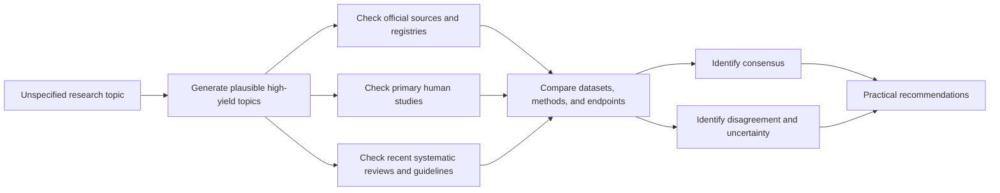
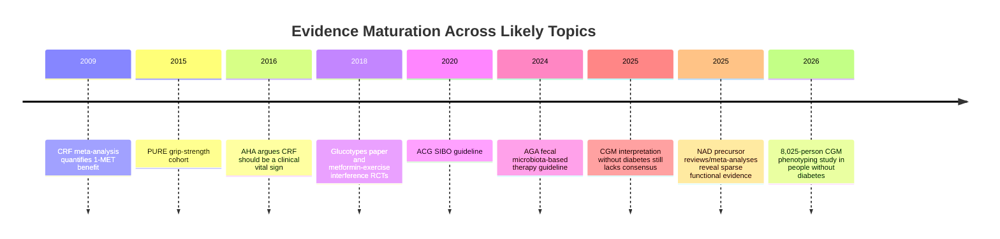

# DR26-08-29-MACANTON-02-0742 — raw report from chatgpt

> Unedited output of one model. Our reconciled synthesis is the page one level up.

---
title: "Deep research"
type: deep-research-original
source: chatgpt

dr_id: DR26-08-29-MACANTON-02-0742
conversation_id: 6a518c57-d680-83eb-9c2e-41306f7e9eaa
url: "https://приватный чат"
research_started_at: 2026-07-11T00:21:56.394581Z
research_stopped_at: 2026-07-11T00:26:40.213253Z
dr_status_in_tool: completed
harvested_by: dr_harvest_chatgpt.py
harvested_at: 2026-08-29T07:42:46
vault_chat_note: ""
---

> Отчёт Deep Research забран из ChatGPT verbatim (widget_state.report_message).
> Заметка диалога в волте обрывается на строке запуска — тела отчёта там нет.

## Запрос

```text
@Deep research
```

## Отчёт
# Deep Research Scoping Report for an Unspecified Topic

## Executive Summary

Because no concrete topic was supplied, the most defensible output is not a fake “deep dive” into a guessed subject, but a **scoping report** that identifies the most plausible intended topics, ranks them by evidence quality and practical value, and lays out a rigorous research program for whichever one you actually want next. On the current human evidence base, the **strongest and most actionable literature** among the likely topics is the cardiorespiratory fitness and grip-strength literature: cardiorespiratory fitness shows a dose-response association with lower mortality, with a 1-MET increase associated with roughly **13% lower all-cause mortality** in a landmark meta-analysis, and higher fitness in a 122,007-person cohort associated with progressively lower mortality without a clear upper ceiling of benefit; grip strength in the 139,691-person PURE cohort was inversely associated with all-cause and cardiovascular mortality, with a **16% higher all-cause mortality risk per 5 kg lower grip strength**. citeturn16view1turn16view0turn9view3turn10view4

The second-most researchable cluster is **metformin for healthy aging**, but the evidence is sharply asymmetric. Metformin has robust long-term evidence for **diabetes prevention** in at-risk adults, including an **18% lower diabetes incidence after about 10 years** in DPPOS versus placebo, but that is not the same as proof of geroprotection in healthy adults. The flagship geroscience proof-of-concept study, **TAME**, is still publicly described by AFAR as a planned multicenter six-year study involving more than 3,000 adults aged 65–79, with the organization still “raising funds to launch,” which means the definitive randomized longevity-style evidence is still not available on the public record. At the same time, randomized exercise studies in older adults suggest metformin can **blunt aerobic and resistance-training adaptations**, including cardiorespiratory fitness, mitochondrial adaptation, and lean-mass gains. citeturn10view2turn12view0turn17search7turn17search1turn17search18

The third cluster is **continuous glucose monitoring in people without diabetes**. This is a good topic if the goal is mechanistic phenotyping or N-of-1 behavior change, but it is not yet backed by strong outcome data. A 2026 Communications Medicine study analyzed CGM data from **8,025 adults without diagnosed diabetes** and found that just three latent features—**mean, variance, and autocorrelation**—explained more than **80%** of interindividual differences in CGM-derived measures, and those features were associated with carotid intima-media thickness and hepatic steatosis and stiffness. That supports CGM as a phenotyping tool. But expert interpretation remains unsettled, and a 2025 expert-interpretation study explicitly reported that clinical interpretation of CGM data in people without diabetes is **not well established**. citeturn8view6turn14search14turn14search0

The fourth cluster is **NAD precursor supplementation**. Human trials consistently show that nicotinamide riboside or nicotinamide mononucleotide can raise circulating NAD-related metabolites, and high-dose NR safety data are improving, including a phase I randomized safety trial reporting up to a **5-fold increase in blood NAD+** and support for testing **3,000 mg/day** in later-phase trials with monitoring. But the translational gap remains large: a major 2025 review concluded that human tissue-level data are sparse and rodent-to-human extrapolation is not straightforward, while a 2025 systematic review/meta-analysis concluded the evidence **does not support** NMN/NR for preserving skeletal muscle mass and function in adults over 60. Some narrower signals remain, including a 2021 four-arm NMN runner trial indicating improved ventilatory-threshold-related aerobic measures without clear VO2max changes. citeturn18search3turn11search7turn18search2turn11search0turn11search16

The fifth cluster is **microbiome interventions for SIBO and broader GI health**. The literature is highly uneven. For SIBO, the ACG guideline supports hydrogen breath testing in selected symptomatic populations and antibiotics for symptomatic SIBO, but most recommendations are based on **very low** or **low** certainty evidence. For rifaximin, the 2020 ACG guideline cites a meta-analysis of **32 clinical trials** involving **1,331 patients** with an intention-to-treat success rate of **70.8%**, but with major heterogeneity and only one placebo-controlled trial. For broader fecal microbiota–based interventions, the 2024 AGA guideline is distinctly narrow: it supports use in **recurrent C. difficile** in selected patients and advises **against** conventional FMT outside clinical trials for ulcerative colitis, Crohn’s disease, pouchitis, and IBS. citeturn15view0turn15view1turn10view0turn10view1

The net recommendation is simple. If the next report should maximize **decision value**, prioritize one of three topics: **cardiorespiratory fitness and grip strength as clinical longevity markers**, **metformin for geroprotection versus exercise adaptation trade-offs**, or **CGM in non-diabetic adults as a precision-phenotyping tool rather than an outcome-proven intervention**. Those topics have the best mix of high-quality primary literature, official guidance, quantitative data, and unresolved but tractable questions. citeturn16view0turn9view3turn12view0turn10view2turn8view6

## Likely Intended Research Topics

The table below proposes five likely topics, each with a rationale and a research plan. Because the topic was unspecified, these are not random guesses; they are the most plausible high-yield subjects given the current evidence landscape and the kinds of official and primary sources available.

| Likely topic | Why this is a plausible intended topic | Core questions and hypotheses | Proposed research plan |
|---|---|---|---|
| **Metformin for healthy aging in non-diabetic adults** | This topic has unusually high strategic value because it sits at the intersection of geroscience hype, a major planned trial program, and conflicting exercise-interaction data. Official public material still frames TAME as a future-launch multicenter effort, while DPPOS provides strong metabolic prevention data but not definitive healthy-aging proof. citeturn12view0turn10view2turn3search6 | Does metformin improve healthspan in non-diabetic adults, or is the evidence largely inferential from diabetes/prevention cohorts? Does it impair exercise-induced mitochondrial and muscular adaptation enough to change risk-benefit in physically active adults? citeturn17search7turn17search1 | Build a review around three strata: official trial programs and registries; primary randomized mechanistic/exercise studies; long-term diabetes prevention and observational aging literature. Separate **disease-prevention evidence** from **healthy-aging claims**, and explicitly model exercise status as an effect modifier. citeturn12view0turn10view2turn17search7 |
| **NAD precursors NR and NMN for human aging and performance** | This is a heavily marketed area with real mechanistic rationale but uneven human evidence. Recent safety and pharmacodynamic studies show blood NAD responses, while reviews emphasize sparse tissue data and inconsistent clinical endpoints. citeturn18search3turn11search7turn18search2 | Do oral NAD precursors generate clinically meaningful improvements in muscle function, cognition, insulin sensitivity, or aerobic performance, or mostly biomarker changes? Which populations show the strongest signal: athletes, older adults, MCI, PAD, or metabolically compromised groups? citeturn11search0turn11search1turn18search2 | Run a PICOS-structured review by population and endpoint. Separate **PK/PD outcomes** from **functional outcomes** and from **disease-modifying endpoints**. Compare NR and NMN head-to-head only where the included studies truly allow it. citeturn11search7turn18search3turn18search2 |
| **CGM-guided nutrition and metabolic phenotyping in people without diabetes** | This is now a mature-enough research topic because large non-diabetic CGM datasets exist, but clinical interpretation is still underdeveloped. That combination makes it both practical and scientifically unresolved. citeturn8view6turn14search13turn14search14 | Is CGM in non-diabetics mainly a behavioral feedback device, an early-risk phenotyping tool, or neither? Which CGM-derived metrics—mean, variability, autocorrelation, time >140 mg/dL, postprandial excursion shape—best track future metabolic risk? citeturn8view6turn14search4turn14search14 | Prioritize large observational datasets, standardized meal studies, and official diabetes-technology guidance to define what is and is not validated. Explicitly distinguish **discovery/phenotyping** from **proven intervention effectiveness**. citeturn8view6turn12view5turn14search2 |
| **VO2max, CRF, and grip strength as clinical longevity markers** | This is the strongest evidence cluster if the aim is pragmatic healthspan measurement rather than molecule-hunting. The literature includes major cohorts, meta-analyses, and an AHA scientific statement arguing CRF should be treated as a clinical vital sign. citeturn16view1turn16view0turn9view3turn10view4 | Which field/lab markers best predict mortality, morbidity, and functional decline? Is CRF superior to simpler markers like grip strength, or are they complementary? Which thresholds and age-specific norms are clinically meaningful? citeturn16view1turn16view0turn9view3 | Review meta-analyses, global prospective cohorts, AHA statements, and recent updates. Separate **prognostic strength** from **interventional modifiability**, because a strong marker is not automatically the best intervention target. citeturn16view1turn10view4turn9view3 |
| **Microbiome intervention strategy for SIBO, IBS, and FMT boundaries** | This is high-yield because clinical practice is noisy and guideline-quality evidence is mixed. Society guidance is clearer than the online discourse: breath testing and antibiotics are conditionally supported for selected symptomatic SIBO scenarios, while FMT has narrow guideline support largely confined to recurrent C. difficile. citeturn15view0turn15view1turn10view0turn10view1 | What is the evidence quality for diagnosing SIBO, eradicating it, preventing recurrence, and using broader microbiome restoration approaches? Where do breath tests help, and where do they mostly add noise? When is FMT actually justified? citeturn15view0turn10view0turn10view1 | Structure the review around society guidelines first, then antibiotic trials and meta-analyses, then broader microbiome interventions. Keep **recurrent C. difficile**, **IBS**, **IBD**, and **SIBO** separate; they are often conflated but guideline support is not interchangeable. citeturn10view0turn10view1turn15view1 |

## Background Context and Research Methodology

Because the actual topic was unspecified, the correct methodological frame is a **scoping review with prioritization**, not a single-topic systematic review pretending to be definitive. The approach used here follows the general logic of PRISMA 2020 for transparent selection and reporting, while borrowing evidence-hierarchy and bias-assessment norms from the Cochrane Handbook and certainty grading principles from GRADE. Trial status and official study descriptors were checked against ClinicalTrials.gov and primary organizational pages where available. citeturn7search0turn7search4turn12view2turn12view3turn7search3

The source hierarchy was intentionally strict. First priority went to **official and primary sources**: professional society guidelines, trial registries, NIH- or society-linked study pages, and original peer-reviewed papers. Second priority went to large cohorts and systematic reviews/meta-analyses that aggregate primary evidence. Lower-priority commentary and marketing-adjacent sources were excluded from synthesis unless they pointed back to a primary source or official document. That matters here because some of the likely topics—especially NAD precursors, CGM in healthy people, and microbiome interventions—are surrounded by a large amount of low-grade promotional material. citeturn12view2turn12view3turn7search3turn12view5turn10view0

Inclusion criteria for this scoping report were English-language sources that met at least one of four tests: they were an official guideline or registry entry; a primary RCT, cohort, or mechanistic human study; a systematic review/meta-analysis with clear methods; or an official program page with concrete trial design information. Exclusion criteria were weakly sourced blog posts, uncited claims, and narrative articles that did not materially improve source quality. Where a topic had a major evidence asymmetry, that asymmetry was preserved rather than normalized away. For example, metformin has stronger disease-prevention than healthspan data; CGM in non-diabetics has stronger phenotyping than outcome data; FMT has stronger evidence for recurrent *C. difficile* than for IBS or IBD. citeturn10view2turn12view0turn8view6turn14search14turn10view0



The most useful way to proceed from here is to treat the next report as a **topic-specific systematic review** built from this scoping memo. In other words: this report is the map, not the final destination. The right next move is to choose one candidate topic and then lock down a precise review question, population, comparator, endpoints, and acceptable study designs before doing a full extraction and synthesis pass. That is consistent with Cochrane and GRADE practice and avoids the common failure mode of letting a wellness-marketed question sprawl across incompatible populations and endpoints. citeturn12view2turn12view3

## Comparative Evidence Snapshot

The timeline below shows why these five topics are the most plausible and researchable choices: they each have a visible sequence from early mechanistic or prognostic work to larger cohorts, guidelines, or modern translational studies, but they differ sharply in how far they have progressed toward clinically decisive human evidence. The CRF/grip-strength literature is the most mature; metformin and CGM sit in the middle; NAD and broad microbiome optimization remain much less settled in humans. citeturn16view1turn9view3turn12view0turn8view6turn11search7turn10view0



| Topic | Major sources, datasets, and methods | Quantitative findings | Main conclusion |
|---|---|---|---|
| **CRF and VO2max** | 2009 JAMA meta-analysis pooling **33 studies**, including **102,980** participants for all-cause mortality and **84,323** for CHD/CVD; 2018 JAMA Network Open retrospective cohort of **122,007** adults with treadmill-estimated METs and median **8.4-year** follow-up; 2024 update to the AHA position. citeturn0search12turn16view1turn10view4 | Each **1-MET** higher fitness was associated with about **13% lower all-cause mortality** and **15% lower CHD/CVD risk** in the meta-analysis. In the Cleveland Clinic cohort, mortality was lowest in the “elite” group; **elite vs low fitness HR 0.20**, and the risk from low fitness was comparable to or greater than major traditional risk factors. citeturn16view1turn16view1 | This is the most mature evidence cluster. The consensus case is not that fitness is merely associated with health, but that objectively assessed CRF is a **powerful, clinically useful prognostic marker** and should likely be treated as a routine clinical measure. citeturn10view4turn16view1 |
| **Grip strength** | 2015 PURE prospective cohort across **17 countries**, **139,691** participants aged 35–70, median **4.0 years** follow-up, Jamar dynamometer measurement. citeturn9view3 | Per **5 kg lower** grip strength: **HR 1.16** for all-cause mortality, **1.17** for cardiovascular mortality, **1.07** for myocardial infarction, and **1.09** for stroke. Grip strength outperformed systolic blood pressure as a mortality predictor in that analysis. citeturn9view3 | Grip strength is a low-cost, scalable, clinically credible longevity marker. It is less mechanistically rich than VO2max, but more deployable. citeturn9view3 |
| **Metformin for healthy aging** | Official AFAR TAME program page; DPPOS long-term follow-up; randomized exercise-interaction studies in older adults. TAME is framed as a planned multicenter, six-year program at **14 sites** with **>3,000** adults aged **65–79**. DPPOS provides long-horizon metabolic prevention evidence. citeturn12view0turn10view2 | DPPOS reports that after about **10 years**, lifestyle intervention reduced diabetes incidence by **34%** and metformin by **18%** versus placebo; metformin delayed diabetes by about **2 years**. However, DPPOS found **no significant overall difference** in the aggregate microvascular outcome among groups in Phase 2. citeturn10view2 | Metformin has real preventive-metabolic evidence, but not decisive evidence that it extends healthspan in healthy adults. Publicly accessible official material still presents TAME as something being raised and prepared, not a completed answer. citeturn12view0turn10view2 |
| **Metformin and exercise adaptation** | 12-week double-blind randomized study in older adults at risk for T2D but free of chronic disease: placebo **n=26**, metformin **n=27** during aerobic exercise training; later trials in resistance training and physical performance in older adults. citeturn17search7turn17search18turn17search1 | The aerobic-training trial reported that metformin inhibited gains in insulin sensitivity, CRF, and skeletal-muscle mitochondrial adaptation. Subsequent resistance-training work reported smaller gains in muscle mass and muscle quality with metformin, and a 2025 Lancet Healthy Longevity result stated that in healthy older people metformin **blunted** both strength and endurance training effects. citeturn17search7turn17search24turn17search1 | The central disagreement is not whether metformin has molecular plausibility; it is whether those theoretical benefits survive contact with real-world exercise adaptation in active older adults. That question is still unresolved and high value. citeturn17search14turn17search1 |
| **CGM in people without diabetes** | 2018 “glucotypes” study in **57** adults, including standardized meal testing in **30**; 2026 Communications Medicine study using CGM data from **8,025** adults without diagnosed diabetes, meal-test validation in **863**, and vascular/liver association analyses in **1,784** non-diabetic adults; newer reference-value work from **>7,000** non-diabetic individuals. citeturn9view0turn8view6turn14search13 | The 2018 study found many individuals classified as non-prediabetic by standard measures still had high postprandial excursions into prediabetic or diabetic ranges. The 2026 study found three latent CGM features explained **>80%** of interindividual variation and outperformed simpler glucose summaries for reconstructing postprandial trajectories. Healthy reference-value work suggests glucose is between **70 and 140 mg/dL** about **96%** of daytime and **99%** of nighttime in healthy people. citeturn9view0turn8view6turn14search4 | Strong for discovery phenotyping; weak for outcome-proven intervention in healthy adults. The field has data, but not yet validated clinical action rules for non-diabetics. citeturn8view6turn14search14 |
| **NAD precursors NR/NMN** | 2025 high-level review of human aging evidence; 2023 phase I NR-SAFE trial; 2021 NMN exercise RCT; 2025 systematic review/meta-analysis of NMN/NR for muscle outcomes; 2024 review of NMN metabolic effects. citeturn11search7turn18search3turn11search0turn18search2turn18search23 | High-dose NR in NR-SAFE increased blood NAD metabolites up to about **5-fold** and supported later-phase testing at **3,000 mg/day** with monitoring. The 2021 NMN runner study found improved ventilatory-threshold-related aerobic capacity measures in medium/high dose groups but **no difference in VO2max**. A 2025 meta-analysis concluded evidence **does not support** preserving muscle mass and function in adults over 60; a 2024 review of **8 RCTs** involving **342** middle-aged/older adults found no significant benefit on fasting glucose, fasting insulin, HbA1c, HOMA-IR, or lipid profile. citeturn18search3turn11search16turn18search2turn18search23 | The field is best described as **safe-ish and biomarker-active but clinically inconsistent**. It is still a valid research topic, but not a finished answer. citeturn11search7turn18search2 |
| **SIBO and microbiome interventions** | 2020 ACG SIBO guideline using GRADE; rifaximin meta-analysis summarized inside the guideline; 2024 AGA guideline on fecal microbiota–based therapies based on **7,383** references screened and **66** included studies. citeturn15view3turn15view1turn10view1 | ACG conditionally recommends glucose or lactulose hydrogen breath testing in selected symptomatic groups and antibiotics for symptomatic SIBO, mostly on **very low** to **low** certainty evidence. The rifaximin summary reported **32 trials**, **1,331** patients, intention-to-treat success **70.8%**, adverse reactions **4.6%**, with major heterogeneity and only **one** placebo comparison. AGA recommends fecal microbiota–based therapies for selected recurrent *C. difficile* settings, but **against** conventional FMT outside clinical trials for UC, Crohn’s, pouchitis, and IBS. citeturn15view0turn15view1turn10view0turn10view1 | This field is clinically relevant but methodologically messy. Strongest support is narrow, not broad: recurrent *C. difficile* yes; generalized microbiome optimization by FMT, no. citeturn10view0turn10view1 |

## Synthesis of Findings, Consensus, Disagreement, and Limitations

A clear **consensus** emerges across the likely topics. First, the most reliable human evidence is still around **measurable physiology**, not around “anti-aging” molecules: CRF and grip strength have stronger human outcome associations, larger cohorts, and more coherent clinical interpretation than metformin-for-aging, NAD precursors, CGM-in-the-healthy, or broad microbiome optimization. Second, where official society guidance exists, it is usually narrower and more conservative than the commercial narrative surrounding a topic. The AHA framing of CRF as a vital sign is stronger than most laboratory geroprotector claims; the AGA stance on fecal microbiota therapy is far narrower than internet enthusiasm for FMT; and ADA guidance strongly supports CGM in diabetes, not a blanket rollout for healthy adults. citeturn10view4turn10view0turn12view5

The main **disagreements** are also consistent across topics. In metformin, the dispute is between mechanistic plausibility and exercise-interference data. In NAD biology, the dispute is between biomarker/pharmacodynamic success and absent or inconsistent functional endpoints. In CGM, the dispute is between the genuine richness of glucose dynamics and the lack of clinically validated interpretation or long-term outcome benefit in people without diabetes. In SIBO and broader microbiome work, the dispute is between real symptomatic syndromes and weak or heterogeneous diagnostics/intervention evidence. None of those disagreements are superficial; they are structural, and they define the research agenda. citeturn17search14turn18search2turn8view6turn14search14turn15view1

The biggest limitation of this report is obvious: **the topic is unspecified**, so this cannot be the final single-topic report the request originally asked for. It is necessarily a **research-prioritization report**. A second limitation is that some high-value papers were accessible mainly through abstracts, snippets, or official summaries rather than full text inside the browsing environment; wherever that happened, the synthesis leaned more heavily on official pages, accessible abstracts, and guidelines than on paywalled full-text detail. A third limitation is that several of these fields are moving targets in 2025–2026, particularly CGM in non-diabetic populations and NAD precursor clinical research. citeturn12view0turn12view5turn8view6turn11search7

The most important **open questions** are therefore specific. For metformin: what population, if any, gets a net healthspan benefit once exercise adaptation is accounted for? For NAD precursors: which tissue-level and functional endpoints, in which populations, move in a clinically meaningful way rather than just changing blood metabolites? For CGM: which non-diabetic CGM features actually predict future disease or meaningfully improve decisions? For CRF and grip: what is the best protocol to turn powerful prognostic markers into everyday clinical monitoring? For SIBO/microbiome care: which diagnosis-treatment algorithms materially improve symptoms and recurrence while avoiding overtesting and overtreatment? citeturn17search1turn18search3turn8view6turn10view4turn15view0

## Practical Implications, Recommendations, and Resources

If the real goal is **practical decision-making**, the immediate recommendation is to choose the next deep report from the matrix below rather than request a generic “anti-aging” review. That keeps the evidence synthesis honest and makes the output operational.

| If the real objective is… | Best next topic | Why this should go first |
|---|---|---|
| **Highest-confidence actions for healthspan** | **CRF, VO2max, and grip strength** | This topic has the strongest human outcome evidence, the cleanest measurement logic, and the lowest intervention ambiguity. It converts directly into training, testing cadence, and risk stratification. citeturn16view1turn16view0turn9view3 |
| **Deciding whether a “geroprotector” is worth using** | **Metformin in active non-diabetic adults** | This is where the evidence gap is most decision-relevant: preventive-metabolic benefits are real, but exercise-interference may materially change the answer for active people. citeturn10view2turn17search7turn17search1 |
| **Running better N-of-1 metabolic experiments** | **CGM in people without diabetes** | This topic can separate useful personal phenotyping from consumer overinterpretation and define what metrics are signal versus noise. citeturn8view6turn14search14 |
| **Assessing supplement claims without marketing contamination** | **NR/NMN and human functional outcomes** | The literature is now large enough to analyze seriously, but still inconsistent enough that a rigorous review can add real value. citeturn11search7turn18search2turn18search3 |
| **Sorting GI evidence from microbiome hype** | **SIBO diagnosis/treatment and FMT boundaries** | Guidelines now provide a strong anchor against the wide mismatch between clinical evidence and online recommendations. citeturn15view0turn10view0turn10view1 |

A concrete next-step workflow is straightforward. First, lock the exact question into a PICOS-style format. Second, constrain endpoints before reading more papers. Third, separate biomarker movement from patient-important outcomes. Fourth, grade certainty explicitly rather than mixing RCT signals, observational studies, and mechanistic plausibility into one pool. That sequence follows the spirit of PRISMA, Cochrane, and GRADE and is the fastest way to get a report that is analytically useful rather than merely comprehensive. citeturn7search0turn12view2turn12view3

Below is a compact URL list of the most authoritative starting resources referenced in this scoping report.

```text
PRISMA 2020
https://www.prisma-statement.org/prisma-2020-statement
https://www.bmj.com/content/372/bmj.n71

Cochrane and GRADE
https://www.cochrane.org/authors/handbooks-and-manuals/handbook
https://gradepro.org/handbook/
https://clinicaltrials.gov/

Cardiorespiratory fitness and grip strength
https://jamanetwork.com/journals/jama/fullarticle/1108396
https://jamanetwork.com/journals/jamanetworkopen/fullarticle/2707428
https://pubmed.ncbi.nlm.nih.gov/25982160/
https://www.sciencedirect.com/science/article/abs/pii/S0033062024000240

Metformin
https://www.afar.org/tame-trial
https://dppos.bsc.gwu.edu/web/dppos/dppos
https://pubmed.ncbi.nlm.nih.gov/30548390/
https://www.thelancet.com/journals/lanhl/article/PIIS2666-7568(25)00014-5/fulltext

CGM in people without diabetes
https://journals.plos.org/plosbiology/article?id=10.1371/journal.pbio.2005143
https://www.nature.com/articles/s43856-026-01523-8
https://www.sciencedirect.com/science/article/pii/S1550413123001298
https://pubmed.ncbi.nlm.nih.gov/39936548/

NAD precursors
https://pubmed.ncbi.nlm.nih.gov/41083806/
https://www.nature.com/articles/s41467-023-43514-6
https://pubmed.ncbi.nlm.nih.gov/34238308/
https://pubmed.ncbi.nlm.nih.gov/40275690/

SIBO and fecal microbiota therapies
https://pubmed.ncbi.nlm.nih.gov/32023228/
https://gastro.org/clinical-guidance/fecal-microbiota-based-therapies-for-select-gastrointestinal-diseases/
https://www.gastrojournal.org/article/S0016-5085(24)00041-6/fulltext
```

The short version is this: the strongest next report is probably not “deep research on longevity” in the abstract. It is a **focused, primary-source review** on one of the five topics above, with **CRF/grip strength**, **metformin-exercise trade-offs**, and **CGM in non-diabetics** standing out as the highest-value starting points on today’s evidence. citeturn16view0turn9view3turn10view2turn17search1turn8view6
