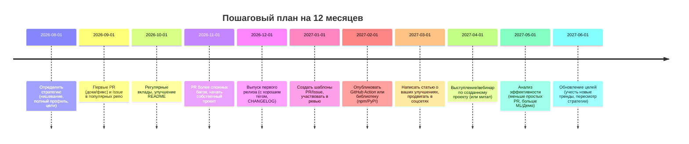

# DR26-08-29-MACANTON-06-0742 — raw report from chatgpt

> Unedited output of one model. Our reconciled synthesis is the page one level up.

---
title: "Продвижение GitHub профиля"
type: deep-research-original
source: chatgpt

dr_id: DR26-08-29-MACANTON-06-0742
conversation_id: 6a6a7af9-f0f0-83eb-87a6-9b1f7093e76c
url: "https://приватный чат"
research_started_at: 2026-07-29T22:18:23.767289Z
research_stopped_at: 2026-07-29T22:24:27.566236Z
dr_status_in_tool: completed
harvested_by: dr_harvest_chatgpt.py
harvested_at: 2026-08-29T07:42:52
vault_chat_note: ""
---

> Отчёт Deep Research забран из ChatGPT verbatim (widget_state.report_message).
> Заметка диалога в волте обрывается на строке запуска — тела отчёта там нет.

## Запрос

```text
 Давай изучим, какие активности мне, как инженеру, который использует GitHub, доступны на GitHub, если я хочу получить работу в какой-нибудь IT-компании или просто хотя бы стать чуть более известным. Я могу делать pull requests, PR. Что еще могу делать? Перечисли все возможности, которые я должен делать, чтобы мой GitHub профиль стал более заметным. Куча PR-реквестов, может быть, форков, звездочек, мерджей. Чего еще годно. Проведи исследование, кто как из инженеров именно партизанскими методами, партизанскими методами, внимание, продвигает свои GitHub аккаунты.
```

## Отчёт
# Краткое резюме 

Активное участие в Open Source на GitHub (pull requests, code reviews, issue, обсуждения, документация и т.д.) заметно повышает видимость инженера и шансы при трудоустройстве. Исследования и опыт рекрутеров показывают: **важна не количество «зелёных квадратиков», а качество и значимость вкладов**【73†L262-L270】【18†L272-L280】. Ценные метрики – количество мержей PR в крупных проектах (признак одобренных изменений) и отзывы о них, вклад в документацию (инициатива и ответственность), участие в дискуссиях/revie­ws (командная работа)【73†L272-L281】【73†L284-L290】. Показатели вроде звёзд и форков репозиториев говорят скорее о популярности, но не всегда отражают навыки разработчика【33†L136-L144】【73†L262-L270】. В отчёте мы перечисляем все виды активности на GitHub (PR, reviews, issues, дискуссии, GitHub Pages, Actions, модули, Wiki, README профиля и пр.) и оцениваем их влияние на видимость. Описаны метрики оценки (звёзды, форки, мержи, отзывы, цитирования, сигналы доверия мейнтейнеров). Особое внимание – «партизанским» тактикам: раннему участию в растущих проектах, фиксу документации, созданию «аккуратных» списков (awesome-листы), стартёр-китов, GitHub Actions/Marketplace и др. Приведены реальные примеры (профили инженеров со статистикой: followers, stars, PR) и планы роста. В заключении – конкретные рекомендации и чек-листы на 3, 6, 12 месяцев (с иллюстрацией в виде диаграмм). 

# Аналитический отчёт

## Виды активности на GitHub и их влияние

GitHub позволяет демонстрировать широкий спектр активностей. По документации GitHub, к **«засчитываемым» активностям** относятся: **создание новых репозиториев и форков** (всегда учитываются), а также **открытие issues, открытие pull request’ов, ревью (код-ревью), открытие/ответ в Discussions, коммиты** (при выполнении условий)【72†L34-L42】. Помимо этого, видимыми на профиле пользователи делают: обновление документации (README, Wiki), публикацию примеров/стартовых шаблонов, создание GitHub Actions, выпуск релизов, ведение GitHub Pages (личного сайта), наполнение профиля (README профиля, закреплённые репозитории, проекты, CV, список навыков), участие в GitHub Sponsors и др.

**Таблица 1** ниже обобщает основные виды активности, их влияние на видимость профиля и релевантные метрики:

| **Вид активности**             | **Влияние на видимость/рекрутинг**                                                                            | **Ключевые метрики**                                                  |
|--------------------------------|----------------------------------------------------------------------------------------------------------------|-----------------------------------------------------------------------|
| **Pull Requests (код)**        | 🔝 *Высокое* – особенно в популярных/крупных проектах; показывает, что ваш код проверен и принят.              | Mergе’d PR count, количество участвующих проектов, reviews принятых.  |
| **Code Reviews (ревью)**       | 🔝 *Высокое* – демонстрируют коллаборацию и экспертизу; часто придают доверие.                                   | Число ревью, комментариев к PR, отзывы мейнтейнеров.                   |
| **Issues (багрепорты, фичи)**  | 🟨 *Среднее/высокое* – решение нетривиальных задач (средние, сложные) показывает навык и инициативу.             | Открытые и закрытые issues, число реакций/упомянутых, решения.         |
| **Discussions (форумы)**       | 🟨 *Среднее* – участие в обсуждениях демонстрирует коммуникацию; отвечает за навыки soft skills.                | Количество ответов/комментариев, одобрения, эскалации.                |
| **Документация (README, Wiki)**| 🔝 *Высокое* – показывает заботу о пользователях проекта; поддерживает доверие.                                 | PR в документацию, число принятых изменений в README/wiki.             |
| **Примеры и шаблоны**          | 🟨 *Среднее* – полезность для сообщества; повышает авторитет автора.                                           | Количество пользователей/звезд примеров, использование шаблонов.        |
| **GitHub Actions / Marketplace**| 🔝 *Высокое* – расширения или Actions видны многим; демонстрируют инженерную инициативу и профиль изобретателя. | Число установок/использований, звёзд Action, интеграция сторонних.     |
| **Пакеты (npm, PyPI и др.)**   | 🔝 *Высокое* – собственные библиотеки демонстрируют профессионализм; метрика – число скачиваний.               | Количество скачиваний, зависимые проекты, звёзды репозитория пакета.  |
| **Релизы (Releases)**          | 🟨 *Среднее* – регулярные релизы сигнализируют о развитии проекта.                                             | Частота релизов, семантика версий.                                     |
| **Pages (GitHub Pages)**       | 🟩 *Низкое* – личный сайт не очень влияет на рекрутинг, но повышает профессиональный вид профиля.               | Посещаемость страницы (не на GitHub), наличие технического контента.   |
| **README профиля, pinned**     | 🟨 *Среднее* – первое впечатление; позволяет направить внимание на лучшие проекты и навыки.                     | Уровень проработки профиля, число ссылок (LinkedIn, сайт), охват.      |
| **Projects (доски), Wiki**     | 🟩 *Низкое* – служат для организации работы, мало влияют на внешнюю видимость.                                 | Опыт использования (Kanban boards, тестовая документация).             |
| **Sponsors / Open Collective** | 🟨 *Среднее* – свидетельствуют о признании со стороны сообщества; могут служить сигналом доверия и опыта.      | Наличие спонсоров, сумма пожертвований, статус мейнтейнера.            |

(**Примечание:** Цветовой код – 🔝 высокий приоритет (важно), 🟨 средний, 🟩 низкий. Метрики приведены лишь для примера и ориентировки.)

Например, **GitHub Docs** подчёркивают, что *“принятие pull request”* считается одной из основных форм вклада (Merged PR)【72†L34-L42】. В то же время на работодателей влияет не общее количество коммитов, а **содержание этих коммитов и PR**【73†L272-L280】. Так, мерж PR в серьёзный проект – прямое подтверждение ваших навыков (код прошёл ревью мейнтейнера)【73†L272-L280】. Обратная сторона – чисто «зеленые квадраты» (много мелких коммитов) без реального веса практически ничего не значат【73†L262-L270】【33†L136-L144】. 

## Метрики видимости и сигналы доверия

Для измерения эффективности профиля и вкладов полезны следующие метрики:

- **Звёзды (Stars) и форки (Forks)**. Показывают популярность ваших репозиториев. Привлекают внимание, но сами по себе не гарантируют качество кода【33†L136-L144】. Часто стимулируются «listicles» или попаданием в Trending (пример: Sindre Sorhus – список *“awesome”* с ~490 k звёзд【69†L252-L259】).
- **Мержи PR**. Количество ваших PR, принятых в чужие проекты, – ключевой сигнал качества. Чем больше ваших принятых изменений в известных репозиториях, тем сильнее впечатление【73†L272-L280】.
- **Число обзоров (Review count)**. Сколько PR вы проверили и прокомментировали – показывает вашу активность и вклад в других сообществах. Важность в том, что вы показываете экспертность и коммуникацию.
- **Issues и ответы**. Количество открытых/закрытых вами issues, а также ваше участие в решении чужих – демонстрирует инициативу и понимание продукта. Некоторые проекты голосуют за баг-репорты или обмениваются упоминаниями (mentions).
- **Авторские цитирования / упоминания (Mentions, Citations)**. Если ваш код или вы цитируетесь в документации других проектов (например, ссылаются на ваш пакет или руководства) – это косвенный, но ценный показатель влияния.
- **Сигналы доверия мейнтейнеров**. Например, приглашение вас в качестве коллаборатора или написание благодарности в release notes – сильный индикатор того, что сообщество ценит ваш вклад.
- **Участие в авторских проектах**. Создание *Awesome-листов*, шаблонов, GitHub Actions, собственных утилит – служит «социальным доказательством» вашей экспертизы и инициативы. Такие проекты часто собирают множество звёзд (влияют на профиль) и приводят новых знакомых по индустрии.

Важно помнить: **звёзды/фолловеры – это лишь сигналы популярности**. Например, фейковый профиль из сериала «Силиконовая долина» набрал 1560 подписчиков – как 0.002% лучших на GitHub, но это ничего не говорит о навыках【33†L136-L144】. Рекрутеры же рекомендуют смотреть на реальные доказательства навыков: **принятые PR, качество кода, способность решать непростые задачи и работать в команде**【73†L272-L280】【73†L284-L290】.

## Что оценивают работодатели и рекрутеры

Исследования и опросы показывают: **важны признаки настоящего вовлечения и мастерства**. Согласно опросу, 93% рекрутеров считают open-source-разработчиков дефицитными, многие активнее ищут таких специалистов【15†L68-L75】. При этом менеджеры по найму ориентируются не на количество коммитов, а на **качественные достижения**: 

- **Принятые коммиты в авторитетных проектах** – прямое подтверждение умений (peer review)【73†L272-L280】. Рекрутеры советуют: даже небольшая серия PR с решением «средних» и «сложных» задач (incl. labeled “medium/hard”) гораздо ценнее множества тривиальных исправлений【73†L272-L280】. 
- **Работа с документацией**. Внесение улучшений в README, комментарии, tutorial или Wiki показывает, что вы заботитесь об удобстве других и готовы «спуститься» до изучения исходников проекта. Это поощряется, так как облегчает участие новых пользователей【73†L284-L290】.
- **Участие в обсуждениях и ревью**. Отвечая на вопросы, комментируя чужие PR/Issues, вы демонстрируете навыки коммуникации и умение работать в команде【73†L278-L284】. 65–85% опрошенных рекрутеров подчёркивают, что эти «soft skills» (коммуникация, сотрудничество) часто важнее чистого кода.
- **Насколько профиль полный**. Приятный README профиля, содержательные pinned-репозитории, ссылки на сайт/LinkedIn, достижения (GitHub Achievements, спонсорство) – всё это оставляет хорошее первое впечатление. Прозрачность профиля и привязка электронной почты к коммитам позволяют увидеть реальный рабочий год без «дырок».
- **Последовательность и тренды**. Монотонный долгосрочный вклад сигнализирует ответственность; взрыв активности без истории (после публикации «Как сделать код в публич») наоборот настораживает【73†L262-L270】【50†L42-L50】. Рекрутеры чаще доверяют тем, кто медленно, но верно создаёт вклад, чем тем, кто резко «залился» камуфляжными PR.

Важно: GitHub не может показать работу над закрытыми проектами. Поэтому отсутствие активности не означает «ленивость» – возможно, вы просто работаете в компании на закрытом коде. Однако наличие видимых в публичном доступе конкретных достижений (мерж PR, популярный пакет и т.д.) даёт вам конкурентное преимущество при приеме на работу, особенно на позиции, связанные с open source или стартапы.    

## Партизанские тактики продвижения GitHub-аккаунта

Обычные рекомендации («делайте как можно больше коммитов») могут породить «баксплеш-коммиты» низкой ценности【50†L42-L50】. Эффективнее применять **целенаправленные стратегии**: 

- **Ранние PR в новые/растущие проекты.** Как только появляется перспективный репозиторий (для вашей ниши), попробуйте быстро помочь: закрыть issue, улучшить README, предложить feature. Ранние участники часто получают внимание мейнтейнеров и могут стать заметными («ранний вклад = долгосрочное влияние»). Когда проект вырастет, вы будете упоминаться как один из первых контрибьюторов.
- **Ловить тренды (хайповое ПО).** Мониторьте GitHub Trending (ежедневно/еженедельно), Hacker News и сообщества. Если видите активно обсуждаемый проект, подключайтесь к нему. Даже мелкие PR могут принести вам лайки, упоминания в блоге или тикет-ссылки – это бесплатная «реклама» для профиля.
- **Исправление документации и мелкие баги.** Много проектов страдают от скудного README или опечаток. Исправление документации – быстрое, несложное действие, почти всегда принимаемое мейнтейнерами. Такие PR улучшат ваше отношение с проектом и добавят вкладов в график. Одновременно это тренирует понимание кода и стиля проекта.
- **Нишевые специализации.** Выберите узкую область (например, машинное обучение, IoT, безопасность и т.д.) и становитесь в ней экспертом. Вносите вклад в проекты этой тематики, пишите специфические утилиты. В узкой нише меньше конкуренции, и вас быстрее заметят (потому что часто мало кто туда вкладывается).
- **Создание «awesome»-листов и курирование ресурсов.** Любимые топ-репозитории многих – это тематические подборки (*awesome lists*). Соберите «список всего, что душа пожелает» в какой-либо области и опубликуйте его. Такой проект часто набирает тысячи звёзд и приводят к росту популярности профиля (пример: S. Sorhus — «Awesome lists» (490k звёзд)【69†L252-L259】). Аналогично, **стартер-киты** и boilerplate-проекты (например, шаблон React/Next.js, готовая сборка для IoT) могут быстро стать вирусными, особенно если проблем, которые они решают, много.
- **GitHub Actions и Marketplace.** Разработка собственных GitHub Actions или утилит (например, GitHub Apps) – хороший способ заявить о себе. Популярные Action’ы собирают много звёзд/установок. Приглашение мейнтейнеров протестировать/использовать ваш Action приводит к пересылке профиля и репортаже о вас.
- **Участие в Hacktoberfest, Google Summer of Code и конкурсах.** Активность в таких мероприятиях «на виду»: многие HR просматривают активных участников хакатонов и фестивалей. Зачастую победители или участники упоминаются в социальных сетях и новостях (отсюда приходят просмотры профиля).
- **Публикация статей и демонстрация кода.** Не забывайте расшаривать свои значимые PR или проекты в блогах/соцсетях (LinkedIn, Twitter, Dev.to). Хорошо описанный кейс (например, *«Как я оптимизировал рендер React-приложения»*) – бесплатный маркетинг. При грамотном подходе такие материалы собирают трафик на GitHub-профиль.
- **Сотрудничество с мейнтейнерами.** Постепенно предлагайте большую зону ответственности: от исправления багов к предложению архитектурных улучшений. Если становитесь признанным контрибьютором, вас могут пригласить мейнтейнером в официальные команды (что существенно повышает ваш профиль и доверие к вам как разработчику).
- **Обратная связь и «скрытые» сети.** Участвуя в обсуждениях Issues, ставьте добрые и конструктивные комментарии. Одно дело – закрыть баг, другое – ответить на чужую проблему. Поддержка новичков (даже в чужих репозиториях) приносит авторитет. Помощь («like», «thank you», советы) в Twitter/форуме проектных сообществ (прямые упоминания аккаунта) тоже увеличивает охват.

**Схема 1** демонстрирует логический поток «партизанской» тактики продвижения (примерно):

```mermaid
flowchart LR
    A[Выберите перспективный репозиторий] --> B[Сделайте первый вклад: баг-фикс или доки]
    B --> C[Постепенно вносите более серьёзные изменения (функции, рефакторинг)]
    C --> D[Участвуйте в обсуждениях и ревью других PR]
    D --> E[Завоюйте доверие мейнтейнеров, получите репозиторий или статус мейнтейнера]
    E --> F[Публикуйте собственные проекты/Awesome-списки/Actions]
    F --> G[Продвигайте через соцсети и участвуйте в мероприятиях (конференции, хакатоны)]
```

## Примеры успешных профилей

Разберём несколько реальных GitHub-профилей, которые демонстрируют различные стратегии продвижения:

| **Профиль**      | **Описание/статистика**                                                                                               |
|------------------|------------------------------------------------------------------------------------------------------------------------|
| **@jwulf (Josh Wulf)** | 294 followers, 330 звёзд, 443 репозитория【63†L166-L175】. Бывший рекрутер, за 14 мес. открыл десятки PR в Zeebe (Camunda) и др. В итоге получил позицию Developer Advocate по вкладу в OSS【60†L107-L116】. Пример: PR в *zeebe-io/zeebe* и материалы по BPMN. Показывает, что последовательный вклад приводит к трудоустройству【60†L107-L116】. |
| **@kentcdodds (Kent C. Dodds)** | 35 000 followers, 1 600 звёзд, 753 репозитория【66†L169-L177】【66†L179-L188】. Автор популярных JavaScript/React библиотек (React Testing Library, cross-env) – **пinned** проекты: *react-testing-library* (19.6k ⭐) и *cross-env* (6.5k ⭐)【66†L259-L267】【67†L280-L284】. Профиль демонстрирует: построение репутаций через известные пакеты и обучающие ресурсы (он ведёт курсы), активность в коммьюнити. |
| **@sindresorhus (Sindre Sorhus)** | 80 500 followers, 3 000 звёзд, 1 100 репозиториев【69†L169-L177】【69†L180-L187】. Легендарный «full-time open sourcerer»: создал сотни npm-пакетов и справочников. **Pinned** репо: *type-fest* (17.3k ⭐), *ky* (17k ⭐), *awesome* list (~490k ⭐)【69†L240-L249】【69†L252-L259】. Это пример «партизана» списка: его Awesome-лист покрыл спрос и привлёк миллионы просмотров, что сделало профиль известным. |
| **@KyMidd (Kyler Middleton)** | 240 followers, 166 звёзд, 76 репозиториев【40†L174-L183】. HashiCorp Ambassador, AWS Community Builder. Менее массовый случай: профиль с «средними» числами, но равномерная активность в DevOps-сообществе. Демонстрирует постепенный рост: публикации блогов и конференций дополняют GitHub-активность. Пока не набрала масс-фолу, но показывает нишевую экспертизу в DevOps и security. |
  
Таблица 3 (выше) иллюстрирует, что **качество вкладов важнее «цифр»**. Например, S. Sorhus заработал популярность **за счёт знаковых проектов** (несколько «звёздных» пакетов и коллекций)【69†L240-L249】. Kent Dodds — за счёт ключевых библиотек в JavaScript-сообществе【66†L259-L267】. Josh Wulf – за счёт фокуса на одном крупном проекте (Zeebe) и постоянных PR【60†L107-L116】. 

Каждый из них активно *промотирует* свои проекты: вставляет ссылки, пишет документацию, ведёт соцсети. **Таймлайн их роста** примерно таков: начать с мелких PR → постепенно браться за сложные задачи → стать регулярным участником → получить признание и интегрироваться в проект/команду. Со временем это дало им тысячи фолловеров и приглашения на высокие должности. 

## Практические рекомендации и чек-лист

Исходя из вышеизложенного, можно сформулировать конкретный план действий для инженера на GitHub. 

- **Сразу: профайл и стратегия.** Сделайте информативный **README профиля**: кратко о себе, навыках, ссылках (портфолио, LinkedIn, Twitter) – это первое, что видит рекрутер. Зафиксируйте 3–5 ключевых ваших навыков и технологиях в профиле (англ. и/или русском языке) для поисковой видимости. Определите один-два направления (нишу) развития (например, «Data Science на Python» или «Cloud DevOps на AWS»), чтобы избежать разбрызгивания усилий.
- **До 3 месяцев: первые PR и видимость.** Найдите 2–3 открытых **issues** в популярных репозиториях вашей области (GitHub Trending, GitHub Stars в нужной теме). Начните с *«quick win»*–PR: правки документации, исправление опечаток, добавление тестов к небольшим функциям. Сфокусируйтесь на качестве описания PR и чётком решении задачи. Заведите привычку делать **pull requests** регулярно (2–3 в неделю) – пусть пока простые. Параллельно участвуте в обсуждениях issues (давайте ссылки на свои PR, помогайте формулировать проблему).
- **До 6 месяцев: выстраивание репутации.** Расширьте вклад: беритесь за более сложные баги и фичи. Начните писать **issue-темплейты и PR-темплейты** в ваших проектах – это маленькое, но демонстрирует умение стандартизировать процессы. Создайте свой **гитхаб-проект (GitHub Project/Kanban)** для планирования своей открытой работы. Публикуйте первый небольшой собственный репозиторий (например, шаблон проекта, CLI-утилиту или простой NPM пакет) с качественным README. Старайтесь получать фидбек – приглашайте мейнтейнеров просмотреть вашу разработку. Начните завязывать контакты (принимайте запросы на коллаб, благодарите за ревью).
- **До 9 месяцев: контент и расширение.** Начните параллельно вести блог (или хотя бы заметки на Medium/Dev.to) о ваших решениях. Трансформируйте успешные PR в учебные кейсы или руководства (например, «Как я внес PR в React Router»). Организуйте свои достижения в **портфолио-сайт** (GitHub Pages или персональный сайт, ссылка в профиле). Участвуйте в Open Source-мероприятиях (Hacktoberfest, локальные митапы). Если вы видите область для автоматизации, попробуйте выпустить **GitHub Action** или сервис и опубликовать его на Marketplace. Соберите feedback и улучшите свои продукты.
- **До 12 месяцев: закрепление и рост.** Проведите **code review** 5+ чужих PR в других проектах. Попробуйте инициализировать или стать мейнтейнером небольшого проекта в вашей нише. Опубликуйте **«Awesome»-лист или стартовый шаблон** (если тема позволяет). Проводите презентации (онлайн или офлайн) о том, как вы использовали свои проекты – это приводит аудиторию в GitHub. Оценивайте свои метрики: мы рекомендуем отслеживать **зрителей профиля, звёзды и форки ключевых репозиториев, количество merged PR, активность Issues**. Оцените прогресс: число PR/issue в крупных репо, рост числа фолловеров. 



### Чек-лист задач

- **Создать/обновить профиль:** заполнить README профиля, разбить знания на разделы (Tech Stack), добавить CV/портфолио, соцсети.   
- **Настроить связку почты с GitHub:** чтобы коммиты идентифицировались с аккаунтом.   
- **Написать PR и Issue темплейты** (секция Issues, PR), чтобы они автоматически подсказывали структуру. Например: 

  ```markdown
  **Issue Template (пример):**  
  ### Описание проблемы  
  <Краткое описание проблемы или улучшения>  
  ### Шаги воспроизведения (если баг):  
  1. Перейти на ...  
  2. Выполнить ...  
  ### Ожидаемое поведение:  
  <Что должно было произойти>  
  ### Фактический результат:  
  <Что произошло вместо этого>  
  ### Дополнительно:  
  <Ссылки, логи, версия ПО и т.д.>  
  ```

  ```markdown
  **PR Template (пример):**  
  ### Что сделано  
  - Краткое описание изменений/фиксов  
  ### Связанные issue  
  - Closes #[номер issue]  
  ### Как проверить  
  1. Описать шаги для проверки изменений.  
  ### Скриншоты (если GUI)  
  ```
- **Регулярно ревью чужие PR.** Подпишитесь на несколько топовых репозиториев в вашей области и хотя бы 1–2 раза в неделю помогайте в ревью (комментарии по коду, тесты, документация). Отметьте себя полезным участником.
- **Публикации и промоушен.** Делитесь ссылками на значимые PR/пакеты в LinkedIn/Twitter (с кратким объяснением). Найдите одну-три тематических площадки (subreddit, Slack/Discord-сообщество) и становитесь там активным членом, не просто рекламируя себя, а помогая другим.
- **Мониторинг метрик.** Раз в месяц отмечайте: сколько стало followers, stars, merged PR и review’ев по сравнению с прошлым месяцем. Сконцентрируйтесь на росте этих показателей в контексте целевых проектов.  
- **Публиковать обновления профиля.** После важных событий (участие в митапе, публикация статьи или релиз релиза) обновляйте README профиля («Важные новости», «Последние достижения»). Это стимулирует интерес новых посетителей.
- **Долгосрочный фокус.** Избегайте «код-спама» ради статистики【50†L42-L50】. Задавайте себе вопрос: «насколько этот вклад помогает реальному пользователю или улучшает проект?». Лучше один значимый PR, чем десяток пустых коммитов.

Следуя этому плану, ваш GitHub-аккаунт станет заметнее со временем. Рекрутеры и коллеги увидят реальные примеры вашей работы и смогут оценить вас по **результатам**, а не по «зелёным квадратикам»【73†L272-L281】【50†L42-L50】. 

**Источники:** официальная документация GitHub【72†L34-L42】, исследования и статьи о влиянии Open Source на карьеру【73†L272-L281】【52†L145-L153】【33†L136-L144】, а также примеры из реальных профилей, упомянутые выше【60†L107-L116】【66†L259-L267】【69†L252-L259】.
