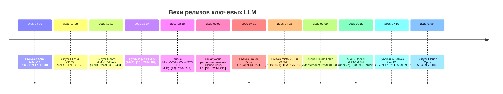

# DR26-08-29-MACANTON-10-0742 — raw report from chatgpt

> Unedited output of one model. Our reconciled synthesis is the page one level up.

---
title: "Обзор ЛЛМ и их сравнений"
type: deep-research-original
source: chatgpt

dr_id: DR26-08-29-MACANTON-10-0742
conversation_id: 6a6dc33e-8b34-83eb-bdc5-1b708d3ae445
url: "https://приватный чат"
research_started_at: 2026-08-01T09:59:42.497250Z
research_stopped_at: 2026-08-01T10:05:50.213493Z
dr_status_in_tool: completed
harvested_by: dr_harvest_chatgpt.py
harvested_at: 2026-08-29T07:42:57
vault_chat_note: ""
---

> Отчёт Deep Research забран из ChatGPT verbatim (widget_state.report_message).
> Заметка диалога в волте обрывается на строке запуска — тела отчёта там нет.

## Запрос

```text
Разьясни и изучи эти новые для меня ЛЛМки @Deep research 
Я про GLM 
Mimo

Fable. Опус был хорош на версии 4.6 где-то до марта, потом его сломали и так и не починили. 
Вообще я в антропиках разочаровался. Sol от OpenAi получше будет для оркестрации, для живых задач лучше имхо GLM а для относительно простых вообще MiMo

Где-то между GLM и Sol ещё болтается Fable, ну и если деньги есть на токены то K3 кроет всех, но по подписьки более нет инференса :(
```

## Отчёт
# Сравнительный анализ LLM 

## Краткое резюме  
Нынешний рынок ИИ наводнён новыми крупными моделями: китайские (ZhipuAI GLM, Xiaomi MiMo, Moonshot Kimi K3) и западные (Anthropic Claude Fable/Opus, OpenAI GPT-5.6 «Sol»). Эти системы различаются по архитектуре, размерам, возможностям и бизнес-моделям. GLM и K3 – открытые модели с весами, ориентированные на «агентные» задачи с длинным контекстом (до 1M токенов)【15†L244-L252】【56†L29-L33】. MiMo – семейство продуктов Xiaomi: есть открытые версии (7B, 310B под MIT-лицензией) и закрытые (1T параметр под проприетарной лицензией)【16†L173-L178】, также с контекстом до 1M. Anthropic предлагает Fable 5 (с «Mythos»-классом модели с ограниченными запросами) и Opus 5 – закрытые коммерческие модели (цена $10/$50 для Fable 5, $5/$25 для Opus 5)【25†L74-L82】【45†L7-L10】. OpenAI анонсировала GPT-5.6 Sol (флагманский вариант серии GPT-5.6) с новыми режимами «max» и «ultra» для усиленного вывода【33†L961-L969】【29†L91-L100】. Kimi K3 (2.8T параметров) – открытая модель Moonshot, с 1M контекста и гибридной архитектурой MoE/KDA【50†L102-L111】【56†L29-L33】. 

Каждая модель имеет сильные стороны: GLM и K3 – ориентированы на автоматизацию и код (agentic AI), MiMo – на математическое рассуждение и код, Anthropic – на высший уровень общей способности (Fable 5 превосходит все предшественники по многим бенчмаркам), OpenAI Sol – на кибербезопасность и геномные задачи. Стоимость и доступность заметно различаются: открытые модели дают наибольшую гибкость (своя инфраструктура), а коммерческие требуют API-доступа с оплатой за токены. Ниже – подробный разбор по ключевым характеристикам и рекомендациям.

## Архитектура и обучающие данные  
- **GLM (ZhipuAI)** – семейство больших моделей-трансформеров с собственной гибридной архитектурой Sparse/MoE (наследие GLM-4, «DeepSeek Sparse Attention») и усиленным обучением («SLiME» RL)【15†L284-L291】【15†L293-L301】. GLM-4.5 и выше – MoE-модели (32–40B активных параметров)【11†L13-L17】【15†L284-L289】. Предобучение велось на общем корпусе (100+ языков, код, наука) объёмом десятки триллионов токенов. GLM-5.2 специализируется на задачах с очень длинным контекстом (до 1M токенов) и поддерживает «мыслящий» режим, балансируя задержку и производительность【15†L244-L252】. Модель открыта, веса опубликованы в BF16/FP8 (Apache-2.0).

- **Xiaomi MiMo** – семейство моделей Xiaomi, оптимизированных под математические рассуждения и кодирование. Имеет как небольшую MiMo-7B (предобучена на ~25T токенов, MIT-лизенция), так и супербольшие «V2» (до 1T параметров с MoE, 42B активных)【20†L38-L47】【16†L173-L178】. Архитектура – MoE с гибридным вниманием (MiMo-V2-Pro использует Attention с соотношением 7:1)【24†L215-L223】. Предобучение велось по 27T токенов с FP8, с дообучением RL на задачах математики/кода【19†L5-L11】【24†L236-L243】. Модель поддерживает multimodal-интеграцию (Omni: текст, изображение, аудио). Некоторые версии (MiMo-V2-Pro, Omni) – закрыты, но MiMo-7B, V2-Flash, V2.5-Pro – выпускаются с MIT-лицензией【16†L173-L178】【24†L236-L243】.  

- **Anthropic Claude (Fable 5, Opus 5)** – коммерческие трансформеры закрытого класса. Каждый выпуск Claude разделяется на «Haiku/Sonnet/Opus» по возрастанию мощности. Fable 5 – это «Mythos-класс» модель с усиленными безопасностями и частичной деградацией производительности ради безопасности【25†L40-L48】. Opus 5 – самый мощный публичный Claude. Точные архитектурные детали не разглашаются, это плотные (не MoE) трансформеры последнего поколения с миллиардными параметрами. Anthropic внедряет сложный стек защит и RLHF (конституция)【26†L225-L231】.  

- **OpenAI GPT-5.6 Sol** – флагман OpenAI (серия GPT-5.6: Sol, Terra, Luna). Точная архитектура не раскрыта, но это плотный трансформер с расширенным режимом «max reasoning» и новым «ultra mode» с субагентами【33†L961-L969】【29†L31-L40】. Поддерживает генерацию с вложенным планированием и большим контекстом (предположительно до сотен тысяч токенов). Совместим с инструментами (API-интеграции ChatGPT, браузерное управление).  

- **Kimi K3 (Moonshot)** – открытая модель с 2.8 трлн параметров (896 экспертов, 16 активных на токен)【50†L102-L111】【56†L29-L33】. Архитектура – гибридное «Kimi Delta Attention (KDA)» и «Attention Residuals» (улучшенный поток информации) с «Stable Latent MoE»【50†L123-L132】. Контекст 1M токенов. Предназначена для долгих инженерных и интеллектуальных задач (код, знания, мультимодальность)【56†L17-L21】【50†L141-L149】. Вес модели открыт, технический отчет ожидается.  

## Размеры моделей и варианты  
| **Модель**        | **Параметров (актив.)**    | **Архитектура**         | **Контекст (токен)** | **API / Хостинг**                   | **Цена (USD 1M in/out)**             |  
|-------------------|---------------------------|-------------------------|----------------------|-------------------------------------|-------------------------------------|  
| **GLM-5.2 / 5.1** | 744B (40B актив.)【15†L284-L289】 | Sparse (MoE + DSA)      | до 1 000 000【15†L244-L252】     | Z.AI API (купируется); открытые веса (HuggingFace, ModelScope) | $1.4/$4.4【49†L128-L136】           |  
| **MiMo-V2-Pro**   | ≈1.02T (42B актив.)【24†L236-L243】 | Mixture-of-Experts     | до 1 000 000【24†L215-L223】     | Xiaomi MiMo API; OpenRouter (раньше «Hunter Alpha»); закрытые вес и API | $1/$3 (до 256K), $2/$6 (1M)【24†L236-L243】 |  
| **Claude Fable 5**| (Mythos-класс, число не раскрыто) | Dense Transformer      | ~200K–? (не раскрыто) | Anthropic Claude API (на Claude.ai)  | $10/$50【25†L74-L82】                |  
| **Claude Opus 5** | (несколько сотен млрд, не раскрыто) | Dense Transformer      | ~200K–?              | Claude API; Amazon Bedrock; Azure AI; Vertex AI | $5/$25【41†L52-L54】【45†L7-L10】      |  
| **GPT-5.6 Sol**   | (несколько сотен млрд, не раскрыто) | Dense Transformer      | ~??                  | OpenAI API (ChatGPT, Azure OpenAI)    | $5/$30【29†L91-L100】                |  
| **Kimi K3**       | 2.8T (16 из 896 эксперт.)【50†L123-L132】 | Hybrid Sparse (KDA+MoE) | 1 048 576【56†L21-L24】 | Moonshot API (kimi.com); OpenRouter | $3/$15【56†L60-L64】                |  

- **Гибкость и режимы:** Все модели поддерживают многошаговый диалог (multi-turn) и генерацию «потоком» (streaming). GLM и K3 имеют режимы «глубокого мышления» (Thinking Mode) и автоматическое кеширование контекста (Context Caching)【15†L244-L252】【50†L102-L111】. K3 и Anthropic-модели предлагают несколько уровней «усилий рассуждения» (обычный, max, ultra)【33†L961-L969】【42†L211-L219】, что позволяет балансировать качество и задержку вывода. GLM и Claude интегрированы с системами вызова инструментов/функций (tooling): GLM-документация упоминает поток инструментов и структуру вывода【48†L121-L128】; Claude Code/Opus поддерживают параллельные агенты («Dynamic workflows»)【42†L190-L199】. MiMo и K3 фокусируются на распознавании изображений, аудио (Omni/TTS) и взаимодействии с кодом. Sol ориентирован на защиту от неправомерного кода (серьёзные слои безопасности)【33†L961-L969】【29†L91-L100】.

## API и хостинг  
- **GLM (Z.AI):** Доступен через облачную платформу Z.AI и API (подписка на ресурсы ZhipuAI). Также можно запустить на собственных серверах: публичные веса GLM-5/5.1/5.2 в BF16/FP8 выложены на HuggingFace и ModelScope【15†L317-L324】.  
- **MiMo:** Официально – через Xiaomi MiMo API (требуется учётная запись Xiaomi). В раннем доступе часть моделей (Hunter Alpha) попадала в OpenRouter. Некоторые весовые и API версии (MiMo-7B, Flash) – открыты, но крупные (V2-Pro, Omni) – вначале закрыты. Компания обещает поддержку разработки внутри экосистемы Xiaomi (см. Mimo.com)【17†L148-L154】【24†L236-L243】.  
- **Anthropic Claude:** Fable 5/Opus 5 доступны только через Claude API и чат-интерфейс Claude.ai. Также можно вызвать Claude через партнерские облачные сервисы: Amazon Bedrock (F5 модели), Google Vertex AI, Microsoft Foundry, а для кода – через Claude Code CLI【41†L52-L54】. Модели нельзя разместить локально.  
- **OpenAI GPT-5.6 Sol:** Доступен через API OpenAI (ChatGPT API, Azure OpenAI), для корпоративного использования – через Azure. OpenAI проводит ограниченный превью (текущая фаза – доступ по приглашениям)【33†L927-L936】. Как и положено OpenAI, нет возможности локального развертывания.  
- **Moonshot Kimi K3:** Пока доступен через API Moonshot (kimi.com) и OpenRouter, платформа Kimi Code и Kimi Work. Вскоре будут опубликованы веса и репозиторий модели (анонсировано к 27 июля 2026)【50†L102-L111】. Компания выпускает SDK (совместимый с OpenAI-API) и предлагает «Kimi Hosted Agent» для предприятий.  

## Модель оплаты и стоимость  
Все перечисленные сервисы используют модель оплаты “pay-as-you-go” по токенам. Ниже приведены цены в долларах за миллион токенов: 

- **GLM (ZhipuAI):** от \$0.6 за 1M входных и \$2.2 за выходных (GLM-4.x/4.7) до \$1.4/\$4.4 (GLM-5/5.2)【49†L128-L136】. Зависит от варианта; есть «Turbo» и «Flash» режимы с другими тарифами.  
- **MiMo:** примерно \$1 за входной и \$3 за выходной токен (MiMo-V2-Flash/Pro до 256K контекста)【24†L236-L243】; расширение до 1M контекста – \$2/\$6. (0.40/2.00$ для модели Omni)【24†L236-L243】.  
- **Claude Fable 5:** \$10 за вход и \$50 за выход (значительно выше стандартных Claude)【25†L74-L82】. По состоянию на запуск — недёшево из-за серьёзных задач безопасности.  
- **Claude Opus 5:** \$5/\$25【41†L52-L54】【45†L7-L10】 (то же, что Opus 4.8). При этом в интерфейсе Claude Max и Team субскрипции увеличивают лимиты использования, но каждый токен всё равно тарифицируется.  
- **GPT-5.6 Sol:** \$5/\$30【29†L91-L100】. (Terra — \$2.5/\$15, Luna — \$1/\$6, но они менее мощные). Также введены более предсказуемые механизмы кеширования подсказок и увеличение пропускной способности до 750 токенов/сек.  
- **Kimi K3:** \$3 за входной (при кэше – \$0.3) и \$15 за выходной токен【56†L60-L64】. Цены фиксированы по всему окну в 1M токенов. С учётом агрессивного кэширования (90% запросов) эффективная стоимость низка, но модель генерирует много промежуточного вывода, что удорожает задачи【56†L100-L109】.  

Помимо «токенов», модели Anthropic и OpenAI предлагают платные планы (Claude Team/Max, ChatGPT Plus) с расширенными лимитами, но базовая тарификация остаётся токеновой. Цены OpenAI и Anthropic фиксированы, по промо-акциям могут давать скидку (например, Sonnet 5 временно \$2/\$10 до конца лета【56†L72-L75】). Все расчёты проводятся в долларах США.

## Лицензия и коммерческое использование  
- **Открытые модели:** GLM-5 и ниже распространяются под открытыми лицензиями (Apache-2.0). Kimi K3 заявлена как open-source (весов пока нет, но обещаны). У MiMo открыты небольшие модели (7B, Flash, V2.5) под MIT【16†L173-L178】. Это позволяет свободно использовать их в любых целях (включая коммерческие) без ограничений.  
- **Закрытые модели:** Claude (Fable/Opus) и GPT-5.6 – проприетарные, коммерческое применение возможно только через платный API с ограничениями пользователей (соглашения об использовании, соответствие политике). MiMo-V2-Pro/Omni/TTS официально проприетарны. Использование «восточных» моделей на территории вне Китая обычно не накладывает географических лицензий, но зависит от политики компании (Xiaomi активно продвигает на мировом рынке).  

## Известные проблемы и хроника обновлений  
- **GLM:** Модели GLM-4.x стабильно улучшались («GLM-4.5» июль 2025 – первая мощная MoE【11†L13-L17】; «GLM-4.6» – ранняя 2026, расширен контекст до 200K【48†L118-L127】). GLM-5 (фин 2025/нач.2026) поднял планку параметров до 744B【15†L284-L289】, а GLM-5.1/5.2 (2026) ввели 1M контекст и улучшенное кодирование【15†L244-L252】. Очевидных регрессий или критических багов со стабильностью у GLM не отмечено – архитектура ZhipuAI тщательно тестируется на «боровых» заданиях и AI-индексах【15†L255-L263】.  

- **MiMo:** Xiaomi последовательно наращивает семейство: MiMo-7B (Апр 2025)【16†L170-L178】, MiMo-V2-Flash (309B, Дек 2025), V2-Pro/Omni/TTS (1T и мультимодальные, Мар 2026)【24†L236-L243】, V2.5 (310B/1.02T, Апр 2026). На релизах не было широко известных катастроф. Единственная условная сложность – ограниченный доступ к крупным моделям; однако, Xiaomi активно публикует технические отчёты (HySparse, ARL-Tangram и др.)【17†L214-L222】, что свидетельствует об устойчивом развитии.  

- **Claude Opus:** В первой половине 2026 года Anthropic выпустил несколько версий Opus. **Opus 4.6 (начало 2026)** подверглась критике сообщества: пользователи зафиксировали «утечку» производительности – модель внезапно «становилась глупее» (выполняла задачи на уровне Sonnet) после тихих настроек default-параметров (из-за чего Anthropic и анонсировал Opus 4.7)【38†L221-L230】【39†L94-L102】. Фактически в марте 2026 было обнаружено ухудшение качества Opus-4.6, что вызвало поток жалоб (открытые issues на GitHub, посты в сообществе)【38†L221-L230】【39†L96-L104】. **Opus 4.7 (16 апр. 2026)** исправил эти проблемы: отмечается явное улучшение самопроверки кода, соблюдения инструкций и производительности【41†L22-L30】【41†L52-L54】. **Opus 4.8 (лето 2026)** добавил динамические рабочие процессы и «effort control», повысил честность модели (она чаще помечает неуверенность)【42†L164-L173】【42†L239-L244】. **Opus 5 (24 июл. 2026)**, по заявлениям Anthropic, близок по возможностям к Fable 5 при половинном ценнике【45†L1-L10】.  

- **Claude Fable:** **Fable 5** был анонсирован 9 июня 2026 с ограничениями безопасности (часть запросов перенаправляется на Opus 4.8)【25†L40-L48】. После кратковременной приостановки доступа (12–30 июня, произошла «redispatch») модель стала доступна с ценой \$10/\$50【25†L74-L82】. Проблем с работоспособностью (кроме строгих фильтров на некоторых темах) не сообщалось; Fable 5 демонстрирует выдающиеся результаты, но остаётся недоступной для локального использования.  

- **OpenAI Sol:** Анонс GPT-5.6 Sol (26 июня 2026) был предварен тщательным редкомментированием и проверкой безопасности【33†L961-L969】【29†L91-L100】. Модель на этапе превью доступна только избранным; глобальных регрессий не зафиксировано. Возможны следующие обновления по мере ввода «ултра»-режимов и Cerebras-инференса (750 ток/с)【29†L97-L100】.  

- **Kimi K3:** Выпущен 16–17 июля 2026 года【55†L67-L73】【56†L17-L21】, пока без известных ошибок (модель новая). Идёт доработка производительности сервиса, есть ограничения (жёсткие настройки семплинга, единственный режим «max reasoning»)【56†L44-L53】. Вскоре после запуска будут открыты веса, что позволит сообществу выявлять проблемы.  

Ни одна из моделей пока не демонстрирует катастрофических «ошибок безопасности», но всегда есть риск скрытых уязвимостей. Например, смешение генеративного кода с инструментами ставит вопросы приведения кода в безопасность; производители внедряют safeguards (конституции, метрики готовности)【33†L961-L969】【42†L211-L219】.  

## Отчёты сообщества и бенчмарки  
- **GLM:** в закрытых и открытых тестах GLM-4.5/5 показал одну из лучших позиций среди свободных моделей【11†L13-L21】【15†L284-L289】. GLM-5 по данным arXiv находится вплотную к лидерству в кодировании и рассуждениях (на Vending Bench 2.0 – $4432 против $5408 у Opus 4.5)【15†L305-L314】. GLM-5.2 претендует на SOTA среди открытых в Terminal-Bench 2.1 (81.0 балла, немного ниже 85.0 у Opus 4.8)【15†L255-L263】.  
- **MiMo:** Независимые оценки ставят MiMo-V2-Pro на 8-е место в мире (комбинированные показатели кодирования, математики, рассуждений)【20†L38-L47】. Поощряется хорошее соотношение производительности и цены (он обходит многие западные модели при 3–6 раз меньшей стоимости). В специфических тестах (ClawEval – «agent benchmark») MiMo-V2-Pro близка к Opus 4.6【24†L236-L243】; в Terminal-Bench 2.0 – 86.7 баллов (превышает многие), уступая лишь самым топовым. Модификации Omni оказались сильнее Gemini 3 Pro и Opus 4.6 в мультимодальных задачах【24†L248-L252】. К моменту подготовки данных рейтингов запасы официальных цифр Мимо ограничены (в основном внутренние сравнения Xiaomi).  
- **Claude Fable 5:** Anthropic заявляет SOTA-показатели «во всех областях» (по их тестам Fable 5 превосходит любые выпущенные модели)【25†L40-L48】. Fable 5 лидирует в многошаговых тестах, в сообществе его сравнивают даже с Mythos (сняты ограничения). Внутренние презентации сообщают, что на специализированных бенчмарках (генетика, инженерия) он лучше GPT-5.5 и Opus 4.8 при меньшем числе токенов【29†L43-L52】【33†L970-L978】. Замечено также исключительное понимание изображений (новый SOTA по задачам визуальных рассуждений)【25†L112-L121】. Самостоятельные обзоры пока ограничены (модель дебютировала недавно).  
- **Claude Opus 5:** Согласно Anthropic, Opus 5 «насколько возможно заскейленные» передовые модели, показывая существенные улучшения по сравнению с Opus 4.8 (примерно на уровне лидеров рынка), при стоимости «среднюю»【45†L7-L10】. В бенчмарках кода и логики Opus 5 опережает Opus 4.8 и Sonnet 5. Он остаётся немного слабее Mythos 5 в киберзадачах (что и было задумано)【44†L378-L386】【44†L394-L403】.  
- **GPT-5.6 Sol:** Ранние оценки (OpenAI) показывают, что Sol задаёт новые рекорды в Terminal-Bench 2.1 (код) и ExploitBench (кибербезопасность)【33†L966-L974】【33†L974-L981】. По отзывам, GPT-5.6 Sol эффективнее Fable 5 по ряду задач при большем уровне безопасности. Независимого MMLU-ранжирования ещё нет (модель только в превью).  
- **Kimi K3:** Независимые проверки в Intelligence Index (Artificial Analysis) дали K3 ~57 баллов, что ставит его на 4-е место из 189 моделей (пропустив лишь Fable 5 и два режима GPT-5.6 Sol)【56†L29-L33】. Также K3 лидирует на Arena.ai (Code WebDev) в сложных задачах веб-кодинга, и показывает очень высокое качество в тестах интеграции код+визуализация【56†L29-L33】. Стоимость вывода в расчёте на задачу сопоставима с Sol и выгоднее Fable 5 с учётом кэша【56†L122-L130】, однако скорость вывода (2 s до первого токена) чуть ниже топовой. Так что K3 считается одним из сильнейших открытых моделей на текущий момент.

## Рекомендуемые сценарии использования  
- **GLM** (GLM-5.1/5.2) подходит для самых сложных инженерных и агентных задач: системная архитектура, автоматизация многозадачных рабочих процессов, долгие расчётные сессии. Благодаря открытости хорош для исследований и адаптации под свои цели (динамические цепочки промптов, fine-tuning)【15†L303-L312】【15†L315-L324】. Особенно эффективен при обработке больших кодовых баз и данных (высокие результаты в терминальных задачах)【15†L303-L312】. Не требует дорогостоящих лицензий.  

- **MiMo** (MiMo-V2-Pro/V2.5) целенаправлен на «агентскую эру»: сложный код и сложные цепочки рассуждений. Благодаря MoE-архитектуре выдаёт производительность уровня лидеров при умеренной стоимости【20†L38-L47】【24†L236-L243】. Хорошо подходит для корпоративных решений с мультимодальным контентом (с учётом MiMo-Omni/TTS) и встраивается в устройства Xiaomi (автомобильные, смартфоны). Для задач с малым количеством данных (например, узкоспециализированные области) имеет сильный китайский NLP-бэкграунд.  

- **Claude Fable 5** – топ для исследований, машинного обучения, науки, здравоохранения (биоинформатика) и творческих задач (обработка изображений, дизайна). Предназначен для ответственного использования (сильные фильтры), поэтому особенно актуален там, где нужна максимальная мощность без риска злоупотреблений (финтех, life sciences). Не рекомендован для полностью «горячих» автоматических целей без слежки (из-за встроенных ограничений).  

- **Claude Opus 5** – оптимален для сложных рабочих нагрузок бизнеса: анализ финансовой и правовой документации, автоматизация клиентских сервисов, сопровождение разработок и CI/CD. Хорош для приложений, где важны качество и надежность (юриспруденция, корпоративные системы). Дешевле Fable при почти сопоставимой функциональности. Также поддерживает «Claude Team/Enterprise» планы с расширенными параметрами использования.  

- **GPT-5.6 Sol** – подходит для широкого круга приложений: разработка софта, кибербезопасность, научные исследования, образование. Новые режимы «max/ultra» эффективно справляются с длинными цепочками рассуждений и спецзадачами (геномика, безопасность). Sol явный выбор, если нужен высокоскоростной вывод (планируется Cerebras-инференс) и интеграция с существующей инфраструктурой OpenAI (ChatGPT-экосистема, Azure).  

- **Kimi K3** – ещё новая, но перспективная платформа для комплексных задач: длинные кодовые проекты, мультизадачные агенты с мультимодальностью, управление большими репозиториями. Благодаря открытости её можно запускать локально (сеть или сервера) и настраивать под себя. Лучший вариант, когда требуется сочетание frontier-производительности и максимальной гибкости (открытые веса, нестандартные датасеты, отсутствие ограничений провайдера).  

## Пробелы и риски  
- **Конфиденциальность:** только GLM, MiMo-7B/Flash, K3 можно развёртывать локально и обрабатывать чувствительные данные «на месте». Все коммерческие модели (Claude, Sol, коммерческие MiMo) – с хранением и обработкой данных на чужих серверах, что требует внимательности к приватности и политике провайдеров.  

- **Ограничения по токенам:** хотя контекст моделей растёт (до 1M у GLM-5.2, MiMo, K3), фактический ввод обычно ограничен менее (учитывая расход на вывод и безопасность). Многие платформы ставят квоты по суммарным токенам/сессиям, особенно в дешёвых планах. Стоит оптимизировать промпты и использовать кэширование, где возможно (GLM и K3 умеют кешировать прошлый контент【49†L128-L136】【56†L60-L64】).  

- **Безопасность и этика:** всесторонние модели потенциально могут генерировать нежелательный контент (хакерские инструкции, дезинформация). Fable/Opus/Sol имеют жёсткие контент-фильтры и корпоративные договоры, но риск утечек есть у любых генераторов. GLM и K3 как открытые модели не имеют встроенных конституций, при необходимости защиту придётся реализовывать самостоятельно.  

- **Качество и стабильность:** случаи регрессии (Claude Opus 4.6) показывают, что пользователи рискуют «молча» получить ухудшенный сервис при апдейтах. Производители обычно исправляют баги в следующих релизах (Opus 4.7, MiMo-V2.5, GLM-5.1 и т.д.), но важно иметь возможность фиксировать версию модели (model pinning). У открытых моделей свои риски: K3 только-только запущена и может требовать оптимизаций в inference, MiMo насчитывает «экспериментальные» выпуски (Omni, TTS), стабильность которых ещё изучается.  

- **Бюджет:** дорогие модели (Fable 5, K3) быстро расходуют токены. Для непрерывных или объемных задач выгоднее выбирать модели с более низкой тарификацией (GLM-4.6, MiMo-Flash, GPT-5.6 Luna). Стоимость разработки агента надо оценивать по «цена/задача» (включая количество токенов вывода, которое у K3 и Fable может быть велико【56†L101-L109】).  

**Вывод:** выбор модели зависит от задачи и бюджета. Для собственных исследований и контроля данных хороши открытые GLM и K3. Для «высокого интеллекта» и безопасных приложений – Anthropic Fable/Opus. Для отечественных/китайских решений – MiMo. Для многозадачных сценариев и интеграций с existing cloud – OpenAI Sol или Anthropic. Все они продолжают активно развиваться, и следует следить за выходами новых версий (см. хронологию выше).



**Источники:** официальная документация и релизы компаний (Anthropic, OpenAI, ZhipuAI, Xiaomi, Moonshot), технические отчёты и пресс-релизы【11†L13-L21】【15†L284-L289】【24†L236-L243】【25†L40-L48】【33†L961-L969】【56†L29-L33】, а также независимые исследования и бенчмарки【41†L52-L54】【56†L60-L64】.
