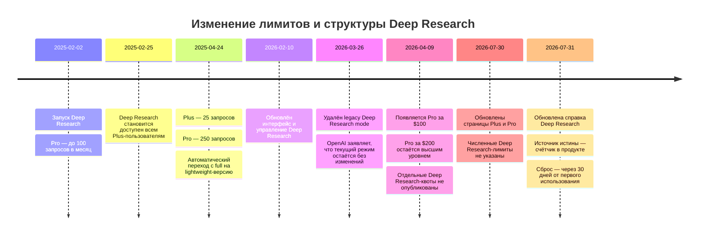

# DR26-08-29-MACANTON-11-0742 — raw report from chatgpt

> Unedited output of one model. Our reconciled synthesis is the page one level up.

---
title: "Запросы Deep Research"
type: deep-research-original
source: chatgpt

dr_id: DR26-08-29-MACANTON-11-0742
conversation_id: 6a71e627-358c-83eb-84a2-1a91b6c8773d
url: "https://приватный чат"
research_started_at: 2026-08-04T13:17:34.178607Z
research_stopped_at: 2026-08-04T13:21:18.361497Z
dr_status_in_tool: completed
harvested_by: dr_harvest_chatgpt.py
harvested_at: 2026-08-29T07:42:58
vault_chat_note: ""
---

> Отчёт Deep Research забран из ChatGPT verbatim (widget_state.report_message).
> Заметка диалога в волте обрывается на строке запуска — тела отчёта там нет.

## Запрос

```text
@Deep research Сколько запросов Deep Research в месяц включено в планы ChatGPT Plus и Pro по состоянию на август 2026, и что происходит после исчерпания лимита — переключается ли аккаунт на облегчённую версию (deep research mini)? Дай точные цифры со ссылками на официальные страницы OpenAI (help.openai.com, openai.com) и укажи дату каждой страницы. Коротко, 5-10 источников.
```

## Отчёт
# Лимиты Deep Research в ChatGPT Plus и Pro на август 2026 года

## Резюме для руководителя

По состоянию на **4 августа 2026 года** официальная документация OpenAI содержит два разных слоя информации:

**Последние точные публично опубликованные количества запросов**:

- **ChatGPT Plus — 25 запросов Deep Research за месячный цикл**.
- **ChatGPT Pro — 250 запросов за месячный цикл**.

Эти цифры были опубликованы OpenAI в обновлении от **24 апреля 2025 года**. Там же OpenAI прямо указала, что после исчерпания лимита **полной версии** последующие запросы автоматически переводятся на **“lightweight version of deep research”**, работавшую на версии o4-mini. Термин **“Deep Research Mini”** на официальных потребительских страницах не используется. citeturn3view0

Однако текущая справочная статья, обновлённая в конце июля 2026 года, больше не показывает фиксированные числа. Она говорит только, что лимиты зависят от тарифа, оставшийся объём отображается во встроенном счётчике, а фиксированный месячный лимит сбрасывается **через 30 дней от первого использования**, а не обязательно первого числа календарного месяца. citeturn3view1

Кроме того, с **9 апреля 2026 года** существует два уровня Pro — **$100 и $200 в месяц**. Новые официальные страницы сообщают, что они дают соответственно **5× и 20× больше “usage” относительно Plus**, но не утверждают, что этот множитель относится именно к количеству Deep Research-запросов. Поэтому официально вывести из него, например, 125 или 500 Deep Research-запросов нельзя. citeturn8view0turn4view0

**Строгое заключение:** 25 для Plus и 250 для исходного Pro — последние точные официальные значения, но OpenAI не опубликовала актуальную на август 2026 года числовую разбивку Deep Research для новых тарифов Pro $100 и Pro $200. Для конкретного аккаунта текущим операционным источником истины является счётчик внутри ChatGPT.

## Сравнение тарифов

| Тариф | Официальная цена | Точное число Deep Research-запросов | Поведение после лимита полной версии | Статус информации на август 2026 |
|---|---:|---:|---|---|
| **ChatGPT Plus** | **$20/месяц** | **25 за 30-дневный цикл** — последнее точное официальное число, опубликованное 24 апреля 2025 года | Автоматический переход на **lightweight version of deep research** после достижения лимита полной версии | Текущая Help Center-страница число 25 больше не повторяет; показывает только счётчик аккаунта и правило сброса через 30 дней citeturn3view0turn4view4turn3view1 |
| **ChatGPT Pro $100** | **$100/месяц** | **Официально не указано** | Отдельное правило именно для этого уровня Pro официально не опубликовано | OpenAI указывает “5× higher usage than Plus”, но не связывает 5× с Deep Research. Вычислять 125 запросов как официальную цифру нельзя. citeturn4view0turn8view0 |
| **ChatGPT Pro $200** | **$200/месяц** | **250 за 30-дневный цикл** — последнее точное число для существовавшего тогда единственного Pro-тарифа | Автоматический переход на lightweight-версию после лимита полной версии | В 2026 году OpenAI заявила, что существующий $200 Pro остаётся самым высоким уровнем, но не повторила число 250 и не подтвердила его отдельно для новой двухуровневой структуры Pro. citeturn3view0turn4view0 |

Под «месяцем» здесь следует понимать не обязательно календарный месяц. Актуальная Help Center-статья говорит, что для планов с фиксированным месячным объёмом лимит сбрасывается **каждые 30 дней, отсчитываемые от даты первого использования Deep Research**. Оставшееся количество заданий показывается непосредственно в интерфейсе. citeturn3view1

### Почему нельзя применить множители пять и двадцать напрямую

Текущая Pro-страница говорит:

- Pro $100 предоставляет в целом **5× больше usage**, чем Plus.
- Pro $200 предоставляет в целом **20× больше usage**, чем Plus. citeturn4view0

Но это описание относится к совокупным квотам тарифов, которые могут различаться для моделей, Codex, изображений, Deep Research и других функций. На той же странице OpenAI предупреждает, что отдельные модели имеют собственные лимиты. citeturn4view0

Если механически умножить опубликованные 25 Deep Research-запросов Plus на 20, получится 500, что не совпадает с официально опубликованными ранее 250 запросами Pro. Это подтверждает, что множитель **не является официальной формулой расчёта Deep Research-квоты**. Следовательно:

- **125 для Pro $100 — неподтверждённая экстраполяция**.
- **500 для Pro $200 — неподтверждённая и конфликтующая с прежней цифрой экстраполяция**.
- Единственное точное число, когда-либо прямо опубликованное для Pro в потребительском тарифе, — **250 запросов**, но оно предшествует разделению Pro на два ценовых уровня. citeturn3view0turn8view0

## Что происходит после исчерпания лимита

Здесь необходимо разделять два разных лимита.

### Лимит полной версии Deep Research

Официальная формулировка OpenAI от 24 апреля 2025 года однозначна: после достижения лимита **full version** запросы **автоматически переключаются** на более экономичную lightweight-версию Deep Research. Она была описана как версия, работающая на варианте o4-mini и сохраняющая высокое качество при меньшей вычислительной стоимости. citeturn3view0

То есть пользователю не требовалось:

- вручную менять модель;
- активировать отдельный тариф;
- создавать новый чат;
- выбирать пункт “Deep Research Mini”.

Переход происходил автоматически.

На официальной Enterprise/Edu-странице механизм был описан ещё конкретнее: после десяти запросов стандартной модели пользователи автоматически получали ещё пятнадцать запросов lightweight-версии до сброса месячного лимита. Эта конкретная разбивка относится к Enterprise/Edu и не может автоматически переноситься на Plus или Pro, но она подтверждает архитектуру «стандартный пул → автоматический lightweight-пул». citeturn9view0

### Общий месячный лимит

Официальные потребительские страницы **не объясняют точно**, что происходит после исчерпания уже всего совокупного месячного объёма, включая lightweight-запросы. Они не заявляют публично, появляется ли:

- полная блокировка Deep Research до сброса;
- возможность докупить запросы;
- переход на обычный Search;
- ещё один более лёгкий режим.

Текущая справка сообщает лишь, что встроенный счётчик показывает оставшиеся задания и что квота обновляется через 30 дней. citeturn3view1

Следовательно, корректная формулировка такова:

> **Автоматическое переключение официально документировано после исчерпания лимита полной версии, а не после исчерпания всего месячного пакета. Что именно происходит после исчерпания и стандартного, и lightweight-пула, на текущих официальных страницах Plus/Pro не указано.**

### Название облегчённой версии

Официальное потребительское название в источнике OpenAI:

> **“lightweight version of deep research”**

Это не отдельный официально именованный продукт **“Deep Research Mini”**. OpenAI связывала облегчённую реализацию с версией o4-mini, но название модели и название пользовательской функции — не одно и то же. citeturn3view0

После обновления интерфейса Deep Research и удаления legacy-режима в марте 2026 года актуальная справочная статья перестала упоминать o4-mini или lightweight-переход. Release Notes при этом утверждали, что удаление legacy-режима не меняет текущий Deep Research experience. citeturn6view3

Поэтому наличие исторически документированного автоматического fallback подтверждено, но название и модель текущего fallback на август 2026 года OpenAI публично не уточняет.

## Хронология изменений

Следующая хронология основана на официальных публикациях OpenAI и показывает, почему цифры 25 и 250 нельзя безоговорочно переносить на новую структуру Pro. citeturn3view0turn8view0turn6view3turn3view1



При первоначальном запуске 2 февраля 2025 года Pro предоставлял до 100 запросов в месяц. 24 апреля квота была увеличена до 250, а Plus получил 25. Это последняя официальная публикация, где OpenAI назвала точные потребительские месячные числа. citeturn3view0

## Официальные источники

| Страница | URL | Дата, показанная на странице | Что подтверждает |
|---|---|---|---|
| **Introducing deep research** citeturn3view0 | https://openai.com/index/introducing-deep-research/ | Основная дата: **February 2, 2025**. Встроенные обновления: **April 24, 2025**, **February 10, 2026** | 25 запросов Plus, 250 запросов Pro, автоматический переход на lightweight-версию, первоначальные 100 запросов Pro |
| **Deep research in ChatGPT** citeturn3view1 | https://help.openai.com/en/articles/10500283-deep-research-in-chatgpt | На момент проверки показано **“Updated: 4 days ago”**; при дате доступа 4 августа 2026 года — приблизительно **31 июля 2026 года** | Текущие лимиты зависят от плана; оставшийся объём показывает счётчик; сброс через 30 дней от первого использования |
| **What is ChatGPT Plus?** citeturn4view4 | https://help.openai.com/en/articles/6950777-what-is-chatgpt-plus | Показано **“Updated: 5 days ago”**; приблизительно **30 июля 2026 года** | Цена Plus $20/месяц и наличие Deep Research |
| **About ChatGPT Pro tiers** citeturn4view0 | https://help.openai.com/en/articles/9793128-about-chatgpt-pro-tiers | Показано **“Updated: 5 days ago”**; приблизительно **30 июля 2026 года** | Два уровня Pro: $100 и $200; 5× и 20× usage относительно Plus; отсутствие численной Deep Research-разбивки |
| **ChatGPT — Release Notes** citeturn8view0turn6view3 | https://help.openai.com/en/articles/6825453-chatgpt-release-notes | Общая дата страницы **не указана**; релевантные записи: **April 9, 2026**, **March 19, 2026**, **February 10, 2026** | Введение Pro $100, сохранение Pro $200, удаление legacy Deep Research и обновление текущего интерфейса |
| **ChatGPT Plans — Pricing** citeturn4view1 | https://openai.com/chatgpt/pricing/ | **Дата не указана** | Plus имеет расширенный Deep Research, Pro — maximum Deep Research; точные количества не показаны |
| **Introducing ChatGPT Pro** citeturn3view3 | https://openai.com/index/introducing-chatgpt-pro/ | **December 5, 2024** | Исходная цена Pro $200/месяц и происхождение существующего $200-тарифа |
| **ChatGPT Enterprise & Edu — Release Notes** citeturn9view0turn8view2 | https://help.openai.com/en/articles/10128477-chatgpt-enterprise-edu-release-notes | На момент проверки: **“Updated: 20 hours ago”**; релевантная запись о lightweight-механизме — **May 1, 2025** | Подтверждает автоматическую схему 10 стандартных + 15 lightweight для Enterprise/Edu; не устанавливает разбивку Plus/Pro |

## Вывод и рекомендуемые цитаты

Наиболее defensible формулировка для документа, статьи или закупочного обоснования:

> По официальному обновлению OpenAI от 24 апреля 2025 года ChatGPT Plus получил 25, а ChatGPT Pro — 250 Deep Research-запросов за месячный цикл. После достижения лимита полной версии запросы автоматически переключались на облегчённую lightweight-версию Deep Research. Однако по состоянию на 4 августа 2026 года актуальная справка OpenAI больше не публикует фиксированные числа и направляет пользователя к встроенному счётчику; кроме того, для введённых в апреле 2026 года уровней Pro за $100 и $200 отдельные численные Deep Research-квоты официально не раскрыты. citeturn3view0turn3view1turn8view0turn4view0

Для краткой ссылки достаточно использовать три источника:

| Назначение цитаты | Рекомендуемый источник |
|---|---|
| Точные числа 25 и 250 и автоматический lightweight-fallback | **Introducing deep research**, обновление от 24 апреля 2025 года citeturn3view0 |
| Текущее правило счётчика и 30-дневного сброса | **Deep research in ChatGPT**, обновлено в конце июля 2026 года citeturn3view1 |
| Текущая структура Pro $100/$200 и отсутствие конкретных Deep Research-чисел | **About ChatGPT Pro tiers** и Release Notes от 9 апреля 2026 года citeturn4view0turn8view0 |

Итоговая степень уверенности:

- **Plus: 25** — высокая уверенность как последнее точное официально опубликованное значение, но не повторённое в текущей справке.
- **Исходный/$200 Pro: 250** — высокая уверенность как официальное значение с апреля 2025 года; средняя уверенность, что оно без изменений применяется в августе 2026 года.
- **Pro $100: точное число неизвестно** — официальная численная Deep Research-квота не опубликована.
- **Автоматический переход на lightweight-версию после full-version cap** — официально подтверждён.
- **Поведение после исчерпания всего стандартного и lightweight-пула** — на официальных потребительских страницах не указано.
