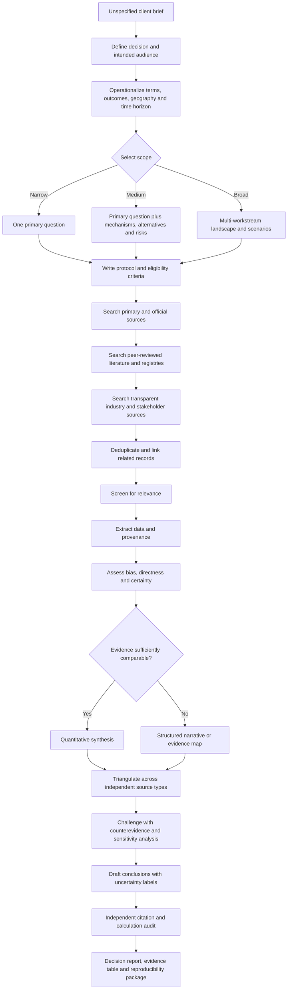
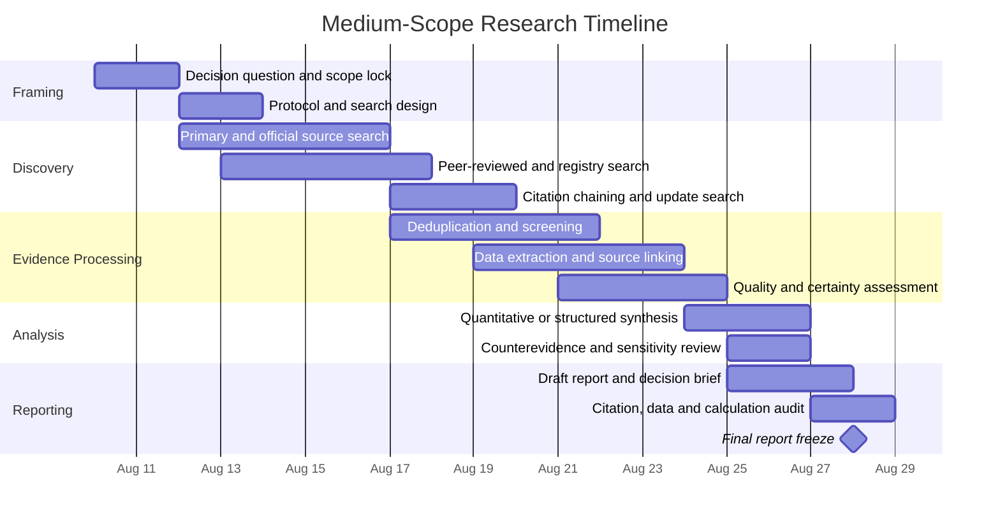

# DR26-08-29-MACANTON-12-0743 — raw report from chatgpt

> Unedited output of one model. Our reconciled synthesis is the page one level up.

---
title: "Deep research"
type: deep-research-original
source: chatgpt

dr_id: DR26-08-29-MACANTON-12-0743
conversation_id: 6a737c82-bdb8-83eb-ba94-fa08f3306aa4
url: "https://приватный чат"
research_started_at: 2026-08-05T18:11:20.496892Z
research_stopped_at: 2026-08-05T18:16:24.921528Z
dr_status_in_tool: completed
harvested_by: dr_harvest_chatgpt.py
harvested_at: 2026-08-29T07:43:00
vault_chat_note: ""
---

> Отчёт Deep Research забран из ChatGPT verbatim (widget_state.report_message).
> Заметка диалога в волте обрывается на строке запуска — тела отчёта там нет.

## Запрос

```text
@Deep research
```

## Отчёт
# Open-Ended Deep Research Framework for an Unspecified Client Topic

## Executive Summary

**Research subject:** unspecified.  
**Decision to be supported:** unspecified.  
**Geography, population, industry, intervention, comparator, time horizon, budget, and intended audience:** unspecified.  
**Report date:** August 5, 2026.

Because no substantive topic has been provided, this report does not attempt to manufacture domain findings. It instead specifies a rigorous, reusable research architecture for turning an open-ended client brief into an auditable evidence product. The framework can be applied to biomedical questions, technology assessment, market and industry analysis, public policy, scientific developments, corporate due diligence, or mixed-domain strategic questions.

The recommended default is the **medium scope**: approximately **55–90 person-hours over three calendar weeks**, producing a structured protocol, reproducible searches, screened evidence inventory, source-quality assessment, quantitative or structured qualitative synthesis, uncertainty analysis, and a decision-oriented report. This scope is usually sufficient to distinguish robust conclusions from marketing claims without incurring the cost of a full systematic review, primary-data study, or extensive expert-interview program.

The research should begin with the decision, not with unrestricted information collection. The brief should be converted into explicit questions, inclusion criteria, outcome definitions, geographic and temporal boundaries, and a source hierarchy. For intervention questions, Cochrane recommends defining the review scope, eligibility criteria, search process, data collection, bias assessment, synthesis, and interpretation in advance. For broader or exploratory questions, JBI’s scoping-review framework is more appropriate because it allows systematic mapping of concepts, evidence types, definitions, and research gaps. citeturn0search21turn5search0

The evidence pipeline should privilege primary and official sources, followed by peer-reviewed research and transparent secondary analysis. PRISMA 2020 provides reporting checklists and flow diagrams for documenting evidence identification and selection; GRADE provides a structured method for judging certainty; EQUATOR provides design-specific reporting standards; and preregistration or timestamped protocol registration can make later deviations visible rather than silently changing the analysis after results are known. citeturn0search6turn0search0turn0search13turn5search1

No defensible substantive conclusion can be stated until the topic is specified. The most likely meta-level outcome, however, is that the initial client question will need to be decomposed into several narrower questions, that apparently precise figures will rely on inconsistent definitions or denominators, and that evidence strength will vary materially across outcomes, populations, and time periods. Those are hypotheses for the research process to test, not predetermined conclusions.

## Research Questions and Scope Architecture

### Core research questions

A topic-agnostic brief should be translated into the following research questions. Not every project needs every question, but each should be explicitly included, excluded, or marked not applicable.

| Research dimension | Core question | Required specification |
|---|---|---|
| Decision context | What decision will the client make differently after receiving the research? | Investment, policy, clinical choice, procurement, product strategy, litigation, research planning, or general understanding |
| Definition | What exactly is the subject, and which adjacent concepts are excluded? | Operational definition, synonyms, classifications, version numbers, regulatory definitions |
| Baseline | What is currently known, practiced, measured, or believed? | Reference period, incumbent approach, status quo comparator |
| Magnitude | How large is the effect, market, risk, burden, opportunity, or association? | Absolute and relative measures, denominator, uncertainty interval |
| Causality | Is the evidence descriptive, correlational, mechanistic, quasi-causal, or experimental? | Study design and causal estimand |
| Heterogeneity | For whom, where, and under what conditions does the result differ? | Population, geography, severity, implementation, time, subgroup |
| Mechanism | What mechanism plausibly explains the observed result? | Biological, technical, behavioral, economic, organizational, or regulatory pathway |
| Alternatives | What competing explanations, interventions, products, or strategies exist? | Comparator set and reasons for inclusion |
| Implementation | What resources, constraints, dependencies, and failure modes affect execution? | Cost, personnel, infrastructure, regulation, adoption, timing |
| Risk | What harms, downsides, externalities, or tail risks are plausible? | Probability, severity, reversibility, affected stakeholders |
| Evidence maturity | How complete and reliable is the evidence base? | Replication, publication status, conflicts, missing data, certainty |
| Forward view | What developments could change the conclusion? | Ongoing trials, regulation, product releases, patents, macroeconomic or scientific changes |

For health interventions, the question can be formalized using a PICO or related structure: population, intervention, comparator, and outcomes. Cochrane treats question definition and inclusion criteria as core review stages. For broader scoping work, a population–concept–context structure is often more suitable because the objective may be to map terminology and evidence rather than estimate one pooled effect. citeturn0search21turn5search0

### Scope options

**Narrow scope** answers one tightly defined decision question. A suitable example would be: “Among adults with condition X, does intervention Y improve outcome Z over 12 months compared with standard care?” In technology or business research, the equivalent might be one product category, one geography, one customer segment, and one decision date. This scope should avoid broad historical narratives, extensive market mapping, and large numbers of secondary questions.

**Medium scope** answers one primary question plus several structured secondary questions. It generally covers mechanisms, alternatives, subgroup differences, implementation constraints, and major risks. It is broad enough to triangulate across literature, official datasets, registries, and industry material, but still bounded enough to maintain a reproducible evidence trail.

**Broad scope** maps an entire field or strategic landscape. It may include historical development, scientific evidence, markets, competitors, patents, regulations, economic consequences, stakeholder positions, scenario analysis, and expert interviews. A broad scope is not merely a longer medium report; it usually requires multiple workstreams and domain specialists.

### Inclusion and exclusion boundaries

The protocol should specify the following before full searching begins:

| Boundary | Default starting rule when unspecified |
|---|---|
| Publication period | Prioritize 2021–2026; retain older landmark evidence where it defines the field or remains authoritative |
| Search update | Final database and web searches rerun within 48 hours of report freeze for fast-moving topics |
| Languages | English by default; add local-language searches for relevant jurisdictions |
| Geography | Global evidence, with separate analysis for the client’s target jurisdiction |
| Study types | Primary research and official data first; systematic reviews for orientation and triangulation |
| Preprints | Include only when the field is fast-moving; label them as non-peer-reviewed |
| Industry reports | Include when methodology, sample, sponsor, and definitions can be evaluated |
| News | Use to identify developments and primary documents, not as the sole basis for technical conclusions |
| Social media | Use only as a lead, stakeholder-sentiment source, or source of directly attributable public statements |
| Outcomes | Predefine primary, secondary, surrogate, safety, implementation, and economic outcomes |
| Duplicate evidence | Link reports from the same study, dataset, trial, or corporate source to avoid double-counting |
| Exclusions | Unsupported opinion, unattributed statistics, inaccessible methodology, content farms, and unverifiable AI-generated summaries |

Scope changes should be logged. A broad question that is narrowed after seeing inconvenient evidence creates a risk of outcome-driven analysis. A timestamped protocol or preregistration provides a visible record of intended methods and later amendments. OSF defines preregistration as posting a time-stamped, read-only study plan before data collection or analysis. citeturn5search1

## Methodology and Research Process

### Protocol and source hierarchy

The first deliverable should be a concise protocol containing the decision question, definitions, scope, search concepts, eligibility criteria, quality framework, extraction fields, planned synthesis, and amendment procedure. For a formal systematic review, PRISMA 2020 should govern reporting; for an exploratory evidence map, the JBI manual and relevant PRISMA extensions are better aligned with the objective. PRISMA 2020 includes a checklist, expanded reporting guidance, an abstract checklist, and flow-diagram templates. citeturn0search6turn0search11turn5search0

Sources should be ranked approximately as follows:

1. Primary legal texts, regulatory databases, official statistics, trial registries, company filings, protocols, datasets, standards, and original technical documentation.
2. Peer-reviewed primary research, with priority given to designs appropriate to the question.
3. High-quality systematic reviews, meta-analyses, guidelines, health-technology assessments, and consensus reports.
4. Reputable industry research with disclosed methods, sample definitions, sponsorship, and data provenance.
5. Credible journalism for chronology, interviews, and identification of primary materials.
6. Expert commentary, conference presentations, preprints, and stakeholder publications.
7. Informal web content only as hypothesis-generating material.

A source’s position in this hierarchy does not guarantee validity. PubMed, for example, indexes and retrieves biomedical literature but does not independently endorse the validity of each indexed article. citeturn1search15

### Search and retrieval

The literature search should combine controlled vocabulary, exact phrases, synonyms, product names, acronyms, spelling variants, and exclusion terms. Search strings and result counts should be saved verbatim. At least two complementary literature indexes should be used for important questions because database coverage and metadata differ.

Searches should include backward citation review, forward citation tracking, related-record searches, author searches, trial-registry checks, and searches for corrections, retractions, protocols, appendices, datasets, and supplementary materials. Crossref can be used for DOI metadata and publication relationships, while OpenAlex can support citation-network and bibliometric mapping across works, authors, institutions, sources, funders, and topics. Crossref explicitly notes that it primarily provides metadata and may link to full-text locations rather than hosting the full text itself. citeturn1search2turn1search17turn3view0

For recent or high-stakes topics, searches should include ongoing and completed-but-unpublished work. ClinicalTrials.gov provides structured clinical-study records and an API, with its data service refreshed on working days according to the platform’s current documentation. Registry records should still be compared with protocols and publications because entries can be incomplete or updated over time. citeturn1search1turn1search9

### Screening and extraction

Screening should occur in two stages: title/abstract or summary screening, followed by full-text or full-record eligibility assessment. For medium and broad scopes, ambiguous inclusions and all high-impact exclusions should receive a second review. A PRISMA-style flow record should document identification, deduplication, screening, exclusions, and final inclusion. citeturn0search6turn0search26

A standard extraction schema should include:

| Field group | Minimum fields |
|---|---|
| Identity | Citation, URL, DOI or record identifier, version, publication date, retrieval date |
| Provenance | Author, institution, sponsor, funder, conflicts, regulatory or journal status |
| Design | Study or data design, sampling method, comparator, duration, setting |
| Population | Eligibility, sample size, demographics, geography, severity or customer segment |
| Intervention or exposure | Exact version, dose, implementation, technical configuration, business model |
| Outcomes | Definition, measurement method, timing, primary versus secondary status |
| Results | Point estimate, denominator, uncertainty interval, raw counts where available |
| Bias and limitations | Missingness, confounding, attrition, selective reporting, model assumptions |
| Relevance | Directness to the client question, implementation fit, jurisdictional fit |
| Researcher notes | Contradictions, unresolved questions, linked records, follow-up actions |

Quantitative values should be stored with units, currencies, reference years, transformations, and denominators. A figure such as “30% growth” is analytically unusable without knowing whether it is nominal or real, annual or cumulative, observed or forecast, revenue or units, and which baseline produced the percentage.

### Quality, bias, and certainty

Quality assessment should match study design rather than apply one generic score. Randomized trials, observational studies, diagnostic studies, prediction models, qualitative studies, market surveys, official statistics, and economic models have different failure modes. EQUATOR maintains a searchable library of design-specific reporting guidelines, while the Cochrane Handbook provides detailed guidance on bias assessment, missing results, meta-analysis, non-randomized evidence, qualitative evidence, equity, and economic evidence. citeturn0search1turn0search21

For health and intervention evidence, certainty can be summarized using GRADE domains such as risk of bias, inconsistency, indirectness, imprecision, and publication bias, with upgrading considerations where appropriate. GRADE distinguishes the certainty of an evidence body from the strength of a recommendation; a recommendation also depends on benefits, harms, values, feasibility, equity, and resource use. citeturn0search0turn0search2turn0search7

For industry and market evidence, an analogous appraisal should examine:

- Whether the market is defined by revenue, shipments, users, contracts, installed base, or another metric.
- Whether historical values are observed and forecasts are modeled.
- Whether the sponsor benefits from a larger or faster-growing estimate.
- Whether the sample excludes private firms, smaller jurisdictions, failed products, or noncustomers.
- Whether currency conversion, inflation, acquisitions, and category reclassification have been handled consistently.
- Whether the report provides enough methodological detail to reproduce or challenge the estimate.

### Synthesis and triangulation

The synthesis method should be selected after inspecting evidence compatibility, not assumed in advance.

A quantitative meta-analysis is appropriate only when studies estimate sufficiently comparable effects. When pooling is inappropriate, the report should use structured tables, effect-direction summaries, ranges, subgroup comparisons, mechanistic synthesis, or narrative synthesis rather than producing a misleading combined figure. Cochrane separately addresses meta-analysis and synthesis using other methods, reflecting the fact that not all evidence bodies should be statistically pooled. citeturn0search21

Every major conclusion should be expressed in a decision-oriented form:

> **Conclusion:** what the evidence supports.  
> **Magnitude:** how large the effect or opportunity appears to be.  
> **Certainty:** high, moderate, low, or very low, with reasons.  
> **Applicability:** where and to whom it is likely to apply.  
> **Counterevidence:** the strongest credible disagreement.  
> **Decision implication:** what action the evidence favors or rules out.  
> **Trigger for revision:** what new evidence would materially change the conclusion.

### Research flowchart

The following process combines protocol development, PRISMA-style evidence tracking, design-specific appraisal, and certainty assessment. citeturn0search6turn0search21turn0search0turn5search0



## Prioritized Literature and Data Sources

The following is a **baseline cross-domain source stack**, not a substitute for topic-specific regulators, repositories, national statistical offices, technical standards bodies, or specialist databases. The final source list cannot be completed until the subject is specified.

| Priority | Source | Primary use | Link and annotation |
|---:|---|---|---|
| 1 | PubMed | Biomedical and life-science literature | **https://pubmed.ncbi.nlm.nih.gov/** — A free NLM search resource covering more than 40 million biomedical citations and abstracts, including MEDLINE and other NLM collections. Strong for clinical, biological, epidemiological, and health-policy questions, but inclusion does not imply validation or endorsement. citeturn1search0turn1search8turn1search15 |
| 2 | OpenAlex | Cross-disciplinary discovery and bibliometrics | **https://openalex.org/** and **https://developers.openalex.org/** — An open scholarly catalog connecting works, authors, institutions, sources, publishers, topics, and funders. Useful for citation mapping, author and institution analysis, related-work discovery, and reproducible API-based retrieval. citeturn3view0 |
| 3 | Crossref Metadata and REST API | DOI verification and publication metadata | **https://www.crossref.org/documentation/retrieve-metadata/rest-api/** — Useful for DOI resolution, publication metadata, funder information, licenses, record relationships, updates, and large-scale bibliographic retrieval. Crossref mainly provides metadata; full-text access depends on linked publishers or repositories. citeturn1search2turn1search17 |
| 4 | ClinicalTrials.gov | Clinical protocols, ongoing studies, and results records | **https://clinicaltrials.gov/** and **https://clinicaltrials.gov/data-api/api** — Essential for identifying ongoing, completed, terminated, and potentially unpublished clinical studies and for comparing registrations with published claims. It also offers structured downloads and API access. citeturn1search1turn1search5turn1search25 |
| 5 | WHO Global Health Observatory | Cross-national health indicators | **https://www.who.int/data/gho** — WHO’s gateway to health-related statistics for its member states, covering mortality, disease burden, risk factors, health systems, communicable and noncommunicable diseases, equity, and other health topics. An OData interface is available for programmatic access. citeturn4search3turn4search10turn4search16 |
| 6 | World Bank Open Data | Development, economic, demographic, and social indicators | **https://data.worldbank.org/** — Provides open access to global development data, World Development Indicators, time series, survey microdata links, and downloadable datasets. Definitions, source agencies, revisions, and country comparability still require examination. citeturn3view1 |
| 7 | OECD Data Explorer | Comparable statistics for OECD and partner economies | **https://data-explorer.oecd.org/** — The OECD’s statistical data warehouse, covering economic, social, education, health, labor, innovation, environmental, tax, and governance indicators. Programmatic retrieval guidance is available through the OECD API documentation. citeturn4search0turn4search8 |
| 8 | Eurostat Database | Detailed European Union statistics | **https://ec.europa.eu/eurostat/web/main/data/database** — Contains Eurostat’s publicly available detailed multidimensional datasets and selected tables across major statistical themes. It is the preferred baseline for harmonized EU-level comparisons, subject to dataset-specific metadata and revisions. citeturn4search1turn4search5 |
| 9 | UNdata and UN Statistics Division | Global official statistics | **https://data.un.org/** and **https://unstats.un.org/** — Aggregates UN statistical databases and provides official demographic, social, economic, environmental, and national-accounts resources. Useful for broad cross-country mapping and for identifying underlying national and international statistical sources. citeturn2search13turn4search2turn4search6turn4search9 |
| 10 | SEC EDGAR | Public-company primary documents | **https://www.sec.gov/edgar/search/** — Provides full-text access to U.S. public-company filings, including annual, quarterly, current, registration, proxy, and other filings. The SEC notes that the submitted HTML or plain-text filing is the official record; derivative PDFs and some structured representations should be checked against it. citeturn7search0turn7search12 |

For a medical topic, additional high-priority sources would typically include the relevant regulator, drug label database, assessment agency, guideline body, disease registry, and specialty society. For technology, likely additions include standards bodies, official documentation, vulnerability databases, patent databases, repositories, benchmark datasets, and regulatory filings. For policy, the relevant jurisdiction’s legislation, court decisions, ministry data, budget documents, audit reports, and national statistical office would move above most secondary sources.

## Expected Synthesis Across Plausible Topic Families

The following are not findings about the unspecified topic. They are anticipated evidence patterns that the research should test.

### Biomedical or health intervention

A biomedical review will often find that evidence is uneven across efficacy, safety, mechanism, surrogate biomarkers, patient-important outcomes, and long-term outcomes. Randomized trials may provide the strongest causal evidence for an intervention under study conditions, while observational evidence may be more informative about rare harms, longer exposure, real-world adherence, or populations excluded from trials. Non-randomized evidence remains vulnerable to confounding and design heterogeneity, which Cochrane specifically identifies as issues that must be addressed in analysis and interpretation. citeturn0search30turn0search21

Likely uncertainties include small samples, short follow-up, outcome switching, selective reporting, poor representation of older or multimorbid patients, variation in dose or implementation, and a mismatch between statistically significant surrogate outcomes and clinically meaningful benefit. Trial-registry searches may identify ongoing studies or discrepancies between registered and published outcomes. citeturn1search5turn1search9

The expected deliverable should therefore separate:

| Evidence layer | Typical synthesis |
|---|---|
| Mechanism | Biological plausibility and pathway evidence |
| Efficacy | Effect under controlled study conditions |
| Effectiveness | Real-world effect and adherence |
| Safety | Common, rare, short-term, and delayed harms |
| Applicability | Fit to the client’s population and setting |
| Net benefit | Benefit–harm–cost balance rather than one isolated biomarker |

### Technology or artificial-intelligence topic

A technology review is likely to encounter version drift, benchmark contamination, noncomparable evaluation settings, proprietary data, selective demonstrations, and rapid obsolescence. Product names may remain constant while models, firmware, APIs, pricing, licensing, security controls, or hardware change. Consequently, every claim should be tied to a version and test date.

Likely findings may differ substantially between laboratory benchmarks, vendor demonstrations, independent evaluations, and production performance. The medium or broad scope should request raw benchmark definitions, sample construction, excluded cases, latency, cost, error distribution, human-review requirements, security assumptions, and failure examples rather than relying on one aggregate accuracy score.

Key gaps are likely to involve external validation, edge cases, data provenance, intellectual-property restrictions, privacy, robustness under distribution shift, and the cost of integration and monitoring. Official documentation and reproducible tests should generally outweigh marketing language.

### Market, product, or industry topic

Market estimates will probably diverge because analysts use different category definitions, geographies, currencies, inclusion rules, and forecasting models. One report may count hardware revenue, another subscriptions, another total contract value, and another the estimated economic value of the same activity. The apparent disagreement may therefore be definitional rather than empirical.

The strongest synthesis should reconstruct the market from several independent layers:

| Layer | Example evidence |
|---|---|
| Top-down | Official production, trade, employment, tax, or industry statistics |
| Bottom-up | Company filings, unit volumes, prices, contracts, capacity, installations |
| Demand-side | Customer surveys, procurement data, user counts, usage or adoption metrics |
| Competitive | Market shares, patents, hiring, partnerships, distribution, capital expenditure |
| Forward indicators | Orders, permits, clinical pipelines, regulations, standards, funding |

Company filings should be treated as primary disclosures but not automatically as neutral analysis. Risk factors, segment definitions, non-GAAP measures, and management estimates must be reconciled with audited statements and filing definitions. For U.S.-listed firms, the official EDGAR filing should be checked rather than relying only on an investor presentation or derived PDF. citeturn7search0turn7search12

### Public policy, economics, or social science

Cross-national policy research is likely to find differences in indicator definitions, collection methods, reporting delays, revisions, institutional capacity, and missingness. Even harmonized databases require examination of metadata and breaks in series. Eurostat provides detailed multidimensional EU datasets, OECD Data Explorer aggregates OECD statistics, and World Bank Open Data links indicators, datasets, and survey resources, but none eliminates the need to verify the original definition and national source. citeturn4search0turn4search1turn3view1

Causal claims will often be less certain than descriptive trends. Policy adoption is rarely random, and outcomes may be influenced by economic cycles, demographic change, concurrent reforms, enforcement intensity, anticipation effects, and differences in baseline conditions. A broad scope may therefore require quasi-experimental evidence, synthetic controls, difference-in-differences, interrupted time series, natural experiments, or comparative case studies.

The report should distinguish:

- A policy’s legal enactment from implementation.
- Eligibility from actual access.
- Budget allocation from expenditure.
- Nominal expenditure from real or purchasing-power-adjusted expenditure.
- National averages from distributional effects.
- Short-term behavioral response from long-term equilibrium effects.

### Environmental, scientific, or emerging-field topic

An emerging-field review may find abundant mechanistic or laboratory evidence but limited validation at operational scale. Early literature is especially vulnerable to unstable terminology, small datasets, positive-result selection, and repeated use of a small number of benchmark samples.

A defensible synthesis should map the maturity chain from theory to laboratory demonstration, replication, field validation, deployment, durability, cost, and externalities. It should also separate measured outcomes from modeled outcomes and forecasts. Where models dominate, the report should document assumptions, calibration data, sensitivity ranges, and whether the model has been externally validated.

### Cross-topic likely conclusions

Across most plausible topics, the research is likely to produce several recurring conclusions:

1. **The answer depends on definition.** Many apparent disagreements disappear after harmonizing populations, endpoints, market boundaries, denominators, and time periods.
2. **Evidence strength is outcome-specific.** A source may strongly support one endpoint and weakly support another.
3. **The average may conceal decision-relevant heterogeneity.** Effects may differ by population, geography, implementation quality, baseline risk, customer segment, or product version.
4. **Primary and secondary sources serve different functions.** Primary records establish what was measured, filed, registered, or legally enacted; high-quality reviews help synthesize patterns and identify bias.
5. **Absence of published evidence is not necessarily evidence of absence.** Registries, protocols, government records, and unpublished datasets may reveal incomplete publication or delayed reporting.
6. **Forecasts should be scenario ranges, not point predictions.** Sensitivity to assumptions should be visible.
7. **The most useful output is usually a conditional recommendation.** The recommendation should state the conditions under which it holds and the evidence that would reverse it.

The confidence assigned to these conclusions must come from the actual evidence body. GRADE’s central contribution is precisely to make certainty judgments explicit rather than equating publication, statistical significance, or study design with a final decision. citeturn0search0turn0search2

## Delivery Plan, Scope Comparison, and Timeline

### Scope comparison

Monetary cost cannot be calculated because the billing currency, hourly rate, team composition, access subscriptions, interview expenses, and travel requirements are unspecified. The cost basis below is therefore expressed as **person-hours × agreed blended rate**, plus external data, licensing, translation, interview, or specialist-review costs.

| Scope | Deliverables | Timeline | Estimated effort and cost basis | Key outputs |
|---|---|---:|---:|---|
| Narrow | Finalized research question; concise protocol; targeted search; approximately 15–35 core sources; evidence table; limited quality assessment; short analytical report; citation audit | 3–5 business days | **18–30 hours**; labor cost = hours × blended rate | 8–15 page decision memo, source inventory, key uncertainty table, direct recommendation |
| Medium | Full protocol; multi-database search; primary-source and official-data review; approximately 40–100 included sources; screening log; structured extraction; quality and certainty assessment; quantitative analysis where feasible; counterevidence review; reproducibility appendix | 3 calendar weeks | **55–90 hours**; labor cost = hours × blended rate; possible minor database or document costs | 25–45 page report, executive brief, evidence matrix, charts, methods appendix, search strings, decision framework |
| Broad | Multiple research questions and workstreams; systematic landscape mapping; extensive primary documents; approximately 100–300+ included sources; dataset construction; regulatory, competitive, patent, or policy analysis; expert interviews where justified; scenarios; independent specialist review | 4–8 calendar weeks | **140–260 hours**; labor cost = hours × blended rate; likely paid data, translation, interview, or specialist costs | 60–120+ page report, executive deck, structured dataset, source library, evidence map, scenarios, risk register, reproducibility package |

### Recommended medium-scope deliverables

The medium package should contain:

| Deliverable | Content |
|---|---|
| Research protocol | Questions, definitions, boundaries, eligibility criteria, search plan, quality tools, planned synthesis |
| Search record | Database, platform, date, complete query, filters, result count, exported file |
| Source inventory | Deduplicated citations and primary-document links with status labels |
| Evidence matrix | Study or source characteristics, findings, limitations, conflicts, relevance |
| Data workbook | Cleaned numerical data, units, transformations, calculations, and source cells |
| Analytical report | Executive conclusions, methods, findings, counterevidence, uncertainties, implications |
| Decision brief | Two- to four-page summary for nontechnical stakeholders |
| Reproducibility appendix | Search strings, inclusion log, formulas, code references, data dictionary |
| Quality-control record | Citation audit, calculation review, unresolved discrepancies, amendment log |

### Medium-scope timeline

The following is an illustrative schedule for a project starting Monday, August 10, 2026. Dates are planning assumptions rather than a commitment; source accessibility, topic complexity, and client-response latency can alter the sequence.



### Estimated effort by activity

| Activity | Narrow | Medium | Broad |
|---|---:|---:|---:|
| Framing and protocol | 2–4 h | 5–8 h | 12–20 h |
| Search design and retrieval | 4–6 h | 10–16 h | 25–45 h |
| Screening and source linking | 3–5 h | 10–15 h | 25–45 h |
| Extraction and data cleaning | 3–5 h | 10–18 h | 30–55 h |
| Quality and bias assessment | 2–3 h | 6–10 h | 15–30 h |
| Synthesis and analysis | 2–4 h | 7–12 h | 18–35 h |
| Writing and visualizations | 2–4 h | 6–10 h | 12–22 h |
| Independent QA | 1–2 h | 3–5 h | 6–12 h |
| **Total** | **18–30 h** | **55–90 h** | **143–264 h** |

The broad estimate is intentionally approximate. A topic involving multilingual legal research, inaccessible paywalled datasets, primary interviews, patient-level data, complex meta-analysis, source-code testing, patent landscaping, or geospatial analysis could exceed the stated range.

### Immediate next steps

The first work product should be a one-page research charter that resolves the most consequential unspecified variables:

| Required input | Why it matters |
|---|---|
| Exact subject | Determines terminology, databases, experts, and primary sources |
| Decision to support | Prevents an encyclopedic but unusable report |
| Primary audience | Controls technical depth, format, and acceptable uncertainty |
| Geography and jurisdiction | Determines laws, regulators, official statistics, and applicability |
| Population or customer segment | Defines directness and subgroup analysis |
| Intervention, product, policy, or exposure | Defines the object being evaluated |
| Comparator | Prevents claims against an undefined baseline |
| Primary outcomes | Prevents selective focus on convenient endpoints |
| Time horizon | Determines historical period, follow-up, and forecast horizon |
| Deadline | Determines feasible scope and update procedure |
| Data-access constraints | Identifies paywalls, privacy, licenses, and proprietary sources |
| Risk tolerance | Determines evidentiary threshold for action |
| Required output format | Report, deck, data workbook, code, evidence database, or decision memo |

After the charter, the medium-scope workflow should proceed without waiting for every minor ambiguity to be resolved. Remaining uncertainties can be converted into explicit assumptions and tested through sensitivity analyses.

## Risks, Assumptions, Ethics, and Governance

### Research risks

| Risk | Consequence | Mitigation |
|---|---|---|
| Topic ambiguity | Irrelevant evidence collection and scope expansion | Lock a decision question and operational definitions before full retrieval |
| Search bias | Missing negative, non-English, unpublished, or differently indexed evidence | Use multiple databases, registries, citation chaining, synonyms, and local-language searches |
| Publication bias | Overestimation of effects or underestimation of harms | Check protocols, registries, conference records, regulatory reviews, and missing-result indicators |
| Source duplication | Double-counting one study or dataset published in multiple forms | Link protocol, abstract, article, update, correction, dataset, and secondary analysis to one evidence family |
| Citation laundering | Repeating a secondary claim whose original source does not support it | Trace important figures and quotations to the earliest accessible primary source |
| Definition drift | False trends and invalid comparisons | Maintain a data dictionary and track classification changes |
| Temporal instability | Conclusions become obsolete during drafting | Record retrieval dates and rerun high-priority searches before report freeze |
| Proprietary opacity | Inability to validate vendor or analyst claims | Downgrade certainty and triangulate using filings, official data, customers, or independent tests |
| Model dependence | Results driven by hidden assumptions | Expose formulas, parameter ranges, and sensitivity analyses |
| Overaggregation | Meaningful subgroup effects disappear | Report stratified results where evidence permits |
| Conflicts of interest | Selective framing, reporting, or interpretation | Extract funding and competing interests and include them in certainty judgments |
| Automation error | Fabricated citations, incorrect extraction, or silent coding errors | Require human verification against source documents and independent calculation checks |

Conflicts can be financial or nonfinancial, including professional and personal relationships. They should be disclosed and analyzed rather than treated as automatic proof that a source is wrong. COPE’s guidance calls for clear definitions and procedures for managing competing interests. citeturn6search2turn6search15turn6search19

### Assumptions

This framework assumes that:

- The client seeks an evidence-based decision product rather than advocacy material.
- English-language research is acceptable as the baseline, with other languages added where relevant.
- Publicly accessible sources will be used unless the client provides licensed or proprietary databases.
- Topic-specific legal, clinical, financial, or engineering specialists will be added when the research exceeds generalist competence.
- Conclusions will be revised when material new evidence appears.
- Uncertainty will be reported explicitly, even when a client prefers a single definitive answer.
- Source quality will be judged independently of whether the result favors the client’s preferred position.
- The report will distinguish documented fact, source interpretation, analytical inference, scenario assumption, and recommendation.

### Privacy and personal data

If the research uses personal data, the lawful basis, purpose limitation, data minimization, retention, access controls, cross-border transfers, and de-identification requirements must be evaluated under the applicable jurisdiction. Within the European Economic Area, Regulation (EU) 2016/679 governs personal-data processing and requires safeguards for scientific and statistical uses, including measures that support data minimization. citeturn6search0turn6search8

Public availability does not automatically eliminate ethical risk. Combining ostensibly anonymous datasets can enable re-identification, and analyzing sensitive attributes can expose individuals or vulnerable groups even when names are absent. The broad scope should therefore include a privacy-impact review whenever individual-level records, location traces, genomic data, health data, employment records, children’s data, or other sensitive information are involved.

### Research integrity

Fabrication, falsification, and plagiarism are recognized forms of research misconduct under the U.S. Office of Research Integrity definition. The project should also guard against subtler integrity failures: selectively omitting inconvenient evidence, changing outcomes without disclosure, copying errors across secondary sources, overstating precision, hiding model assumptions, and representing AI-generated text as source verification. citeturn6search3turn6search7

At minimum, the governance record should preserve:

- Original downloaded source or stable identifier.
- Retrieval date and version.
- Search history and screening decision.
- Extracted quotation or numerical value with page, table, or field location.
- Calculation lineage from source value to reported result.
- Protocol deviations and rationale.
- Researcher and reviewer identities for critical decisions.
- Funding, client interests, and potential conflicts.
- Retractions, corrections, and post-publication notices.
- Final citation and factual-verification status.

### Ethical analysis beyond compliance

A rigorous report should assess not only whether an action is legal, but who receives benefits, who bears harms, whether affected groups have agency, and whether risks are reversible. Relevant questions include:

| Ethical dimension | Review question |
|---|---|
| Distribution | Are benefits and harms concentrated in different populations? |
| Consent and agency | Can affected people meaningfully understand or refuse participation? |
| Vulnerability | Are children, patients, employees, economically constrained groups, or marginalized communities disproportionately exposed? |
| Transparency | Can stakeholders understand the evidence, model, and decision criteria? |
| Accountability | Who is responsible for errors, harms, monitoring, and remediation? |
| Reversibility | Can the intervention or policy be stopped and its effects repaired? |
| Dual use | Could the findings enable surveillance, discrimination, biological harm, cyber abuse, or coercion? |
| Environmental impact | Are energy, material, waste, biodiversity, or lifecycle effects omitted? |
| Opportunity cost | What beneficial activity is displaced by the proposed decision? |
| Epistemic fairness | Are relevant local knowledge, negative results, and underrepresented populations missing from the evidence base? |

### Method and governance URLs

The principal methodological standards underlying this framework are:

- PRISMA 2020: https://www.prisma-statement.org/prisma-2020  
- Cochrane Handbook, current version: https://training.cochrane.org/handbook/current  
- GRADE Book: https://book.gradepro.org/  
- JBI Manual for Evidence Synthesis: https://jbi-global-wiki.refined.site/space/MANUAL  
- EQUATOR reporting-guideline library: https://www.equator-network.org/reporting-guidelines/  
- OSF registrations and preregistrations: https://help.osf.io/article/330-welcome-to-registrations  
- European Union GDPR text: https://eur-lex.europa.eu/eli/reg/2016/679/oj/eng  
- COPE conflicts-of-interest guidance: https://publicationethics.org/cope-focus/conflicts-of-interest  
- U.S. Office of Research Integrity definition: https://ori.hhs.gov/definition-research-misconduct  

The substantive source register, final queries, included literature, datasets, industry reports, legal texts, and primary documents remain unspecified because the actual research topic has not been provided.
