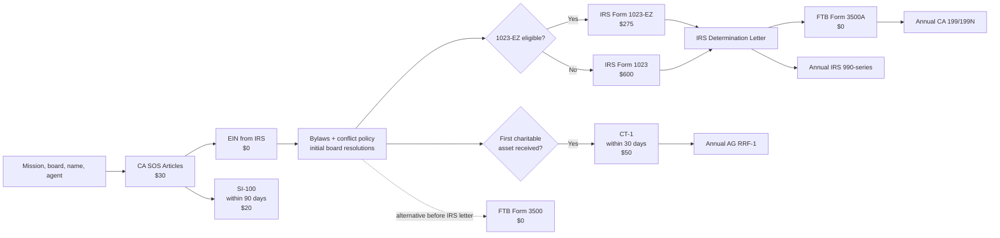

# DR26-08-29-MACANTON-15-0743 — raw report from chatgpt

> Unedited output of one model. Our reconciled synthesis is the page one level up.

---
title: "Регистрация НПО в США"
type: deep-research-original
source: chatgpt

dr_id: DR26-08-29-MACANTON-15-0743
conversation_id: 6a798da6-fb50-83eb-8e9b-a6f35ddb7307
url: "https://приватный чат"
research_started_at: 2026-08-10T08:38:18.924684Z
research_stopped_at: 2026-08-10T08:48:51.758099Z
dr_status_in_tool: completed
harvested_by: dr_harvest_chatgpt.py
harvested_at: 2026-08-29T07:43:05
vault_chat_note: ""
---

> Отчёт Deep Research забран из ChatGPT verbatim (widget_state.report_message).
> Заметка диалога в волте обрывается на строке запуска — тела отчёта там нет.

## Запрос

```text
Раньше, когда я регистрировал себе C Corp и LLC через Stripe Atlas. Подскажи, пожалуйста, есть ли аналогичный Stripe от сервис для регистрации non-profit? И если есть аналогичный, но не Stripe Atlas, но аналогичного уровня какой-нибудь сервис, где можно делаться подключить, и через который делается там сотни non-profit в год. При этом, чтобы были супердемократические цены.
```

## Отчёт
# Регистрация nonprofit 501(c)(3) в Калифорнии: полный практический процесс для русскоязычного учредителя

## Резюме

Для типичной новой благотворительной организации в Калифорнии оптимальная структура — **California Nonprofit Public Benefit Corporation**, после чего отдельно оформляются федеральный статус **IRC §501(c)(3)**, регистрация благотворительной организации у **California Attorney General**, и освобождение от налога штата через **California Franchise Tax Board**. Федеральное 501(c)(3) **не возникает автоматически** из факта регистрации nonprofit-корпорации в Калифорнии, а федеральное освобождение, в свою очередь, **не автоматически освобождает организацию от California franchise/income tax**. citeturn16view3turn16view4turn26search17

Для обычной public charity последовательность выглядит так:

**Secretary of State → EIN → bylaws/board resolutions → CT-1 и SI-100 → IRS Form 1023/1023-EZ → IRS determination letter → FTB 3500A → ежегодные IRS/FTB/AG filings.**

Критически важно не путать три разные вещи:

| Что вы получаете | Орган | Что это означает |
|---|---|---|
| Юридическое лицо nonprofit corporation | California Secretary of State | Организация существует как калифорнийская корпорация |
| Федеральный 501(c)(3) | IRS | Федеральное освобождение + потенциальная deductible-статусность пожертвований |
| California tax exemption | Franchise Tax Board | Освобождение от California franchise/income tax для exempt-деятельности |
| Право находиться в системе надзора за благотворительностью | California Attorney General | Регистрация/annual compliance для charitable assets и fundraising |

Официальные источники прямо подтверждают такое разделение обязанностей. citeturn18search2turn26search13turn16view3turn16view4

**Минимальные государственные startup fees на август 2026 года** для стандартной схемы составляют примерно:

- **$375**, если организация вправе использовать Form 1023-EZ: $30 Articles + $20 SI-100 + $50 CT-1 + $275 IRS;
- **$700**, если требуется full Form 1023: те же California fees + $600 IRS.

EIN бесплатен; Form 3500/3500A в настоящее время не имеет filing fee. Эти цифры не включают registered agent, адвоката, preparer service, certified copies, expedited processing или последующие ежегодные RRF-1 fees. citeturn18search1turn19search4turn17view0turn21search1turn0search22

Главный practical recommendation: **не использовать Form 1023-EZ только потому, что ожидаемый оборот меньше $50,000**. IRS требует пройти Eligibility Worksheet; если хотя бы один запрещающий вопрос получает ответ “Yes”, нужно подавать full Form 1023. Финансовые базовые ограничения EZ — не более $50,000 annual gross receipts в соответствующих прошлых/будущих периодах и assets не более $250,000. citeturn22search10turn21search6

Для пользователя, который хочет отдать практически весь процесс подрядчику, наиболее соответствующий запросу специализированный вариант из исследованных — **Foundation Group SureSTART full-service**, поскольку более полный пакет прямо предусматривает не только incorporation и IRS exemption, но и state tax exemption и state fundraising registration. Их более дешевый **SureSTART Express за $1,499 + government fees**, наоборот, рассчитан на простые 1023-EZ cases и прямо исключает дополнительные compliance filings. citeturn24search1turn13view0

LegalZoom может быть заметно дешевле: nonprofit incorporation начинается с $99 + state fees, а 501(c)(3) service — с $595, но публично описанные стандартные продукты не дают такого же ясного подтверждения того, что **California CT-1 + FTB 3500A + весь downstream compliance** входят в единый пакет. Northwest и Bizee еще дешевле для самого incorporation, но по их собственным материалам они в первую очередь решают state formation, а не весь California + IRS workflow. citeturn23search4turn23search1turn23search24turn24search0

> Ниже — practical compliance map, а не индивидуальное юридическое или налоговое заключение. Для founder-controlled charity, крупных related-party transactions, foreign grants, donor-advised structures, private foundation, religious organization, school, healthcare nonprofit или сложного международного финансирования разумно использовать California nonprofit attorney/CPA, а не только filing service.

## Карта регистрации, формы, официальные ссылки и стоимость

Основная точка входа у California Secretary of State — **bizfile Online**. SOS называет online filing самым быстрым способом и предоставляет отдельную форму **Articles of Incorporation – CA Nonprofit Corporation – Public Benefit**. Для организации, которая планирует 501(c)(3), наиболее безопасно использовать именно вариант **ARTS-PB-501(c)(3)** или online equivalent, поскольку он построен с учетом необходимых charitable/tax-exempt provisions. Filing fee для incorporation — $30. citeturn18search0turn18search2turn18search3

### Основные формы

| Этап | Форма / портал | Срок | Government fee | Официальный источник |
|---|---|---:|---:|---|
| Создание корпорации | **ARTS-PB-501(c)(3)** / bizfile Online | Сначала | **$30** | California SOS forms/bizfile. citeturn18search0turn18search3 |
| Initial Statement of Information | **SI-100** | В течение 90 дней после incorporation | **$20** | California SOS; nonprofit statements thereafter biennially. citeturn19search1turn19search3turn19search4 |
| Federal EIN | IRS EIN application / **Form SS-4** | После юридического образования entity | **$0** | IRS EIN guidance. citeturn21search0turn21search17 |
| CA charitable registration | **Form CT-1** | В течение 30 дней после первого получения charitable assets | **$50** | CA Attorney General. citeturn17view0turn17view1turn26search13 |
| Федеральное exemption | **Form 1023** | Обычно подать в пределах 27 месяцев с formation для retroactive recognition | **$600** | IRS. citeturn16view4turn21search1 |
| Упрощенное exemption | **Form 1023-EZ** | Только если пройдена eligibility worksheet | **$275** | IRS. citeturn21search1turn22search10 |
| California exemption после IRS | **FTB 3500A** | После determination letter | **$0** | FTB. citeturn16view3turn26search11turn0search22 |
| California exemption без IRS letter | **FTB 3500** | При необходимости до федерального решения / в специальных случаях | **$0** | FTB. citeturn16view3turn26search17turn0search22 |
| Federal annual return | **990-N / 990-EZ / 990** | 15-й день 5-го месяца после year-end | $0 IRS filing fee | IRS. citeturn21search3turn21search27 |
| CA annual exempt filing | **199N / Form 199** | Обычно тот же 15-й день 5-го месяца | Сейчас filing fee $0 | FTB. citeturn10search2turn10search11turn0search22 |
| AG annual renewal | **RRF-1**, иногда + **CT-TR-1** | 4 месяца + 15 дней после year-end | От $25 по revenue schedule | CA AG. citeturn16view2turn17view2 |
| CA UBIT | **Form 109** | Если unrelated business income > $1,000 | зависит от tax | FTB. citeturn26search22 |

IRS требует подавать Form 1023-series **электронно через Pay.gov**. EIN следует получать уже после фактического юридического образования организации; IRS отдельно предупреждает не получать EIN “заранее”, поскольку после создания EIN начинает иметь значение для annual-filing/automatic-revocation lifecycle. citeturn16view4turn21search0turn22search18

**Важно для русскоязычного/международного founder:** если стандартный online EIN workflow недоступен ответственному лицу, IRS также предусматривает fax/mail, а для international applicants — отдельный телефонный путь. Не покупайте “EIN service” только потому, что вам говорят, что EIN якобы стоит денег: непосредственно IRS выдает его бесплатно. citeturn16view4turn21search17

California SOS также предлагает expedite options, но они обычно бессмысленны для обычного nonprofit, поскольку основной bottleneck — IRS/FTB, а не несколько дней state incorporation. На август 2026 SOS указывает 24-hour filing за $350, same-day за $750 и специальные варианты preclearance/4-hour processing. citeturn18search12

## Пошаговая процедура от идеи до полного exemption

**Подготовьте структуру до filing.** Определите название, конкретную charitable mission, предполагаемые программы, источники финансирования, fiscal year, initial board и California agent for service of process. Сразу решите, предполагается ли **public charity** или финансирование преимущественно одним founder/family: IRS по умолчанию классифицирует признанную 501(c)(3) как private foundation, если она не соответствует требованиям public-charity classification. citeturn16view4

Для обычной общественной благотворительной организации я бы проектировал board минимум из **трех реально независимых людей**, даже если вы могли бы построить более минимальную корпоративную конструкцию. Это не “магическое IRS-требование трех человек”, а практическая защита от вопросов о founder control, conflicts/private benefit и governance. California public-benefit corporations регулируются отдельной частью Corporations Code, а IRS отдельно рассматривает conflict-of-interest governance при exemption/annual reporting. citeturn1search1turn8search2

**Проверьте имя и сформируйте California Nonprofit Public Benefit Corporation.** Через SOS/bizfile подайте Articles of Incorporation. Для предполагаемой 501(c)(3) используйте nonprofit public-benefit 501(c)(3) form, а не stock corporation и не nonprofit mutual-benefit corporation. State filing fee — $30. Online filing SOS прямо называет fastest service. citeturn18search0turn18search2turn18search3

В Articles должны быть корректно отражены charitable/exempt purpose и disposition of assets. IRS organizational test требует, чтобы purposes были ограничены permissible §501(c)(3) purposes, private inurement был исключен, political campaign intervention не допускался, а assets при dissolution оставались permanently dedicated допустимой exempt/public цели. citeturn7search5turn7search8

**После SOS acceptance получите EIN.** Делайте это непосредственно через IRS. EIN нужен даже nonprofit без employees и требуется для Form 1023-series, банка и большинства последующих государственных filings. citeturn16view4turn21search17

**Проведите organizational board action.** После создания корпорации board должен привести внутреннее управление в рабочее состояние: принять bylaws, назначить officers, принять conflict-of-interest policy, определить fiscal year, открыть bank account, утвердить initial budget/programs, назначить authorized signers и разрешить подачу IRS/California applications. Bylaws не подаются как отдельный formation document в SOS, но California CT-1 требует приложить current bylaws, а full Form 1023 workflow также предполагает предоставление adopted bylaws, если они существуют. citeturn17view1turn22search7

**Подайте SI-100.** Initial Statement of Information для California nonprofit corporation подается в течение 90 дней после первоначальных Articles; filing fee для California nonprofit — $20. После первоначального отчета domestic California nonprofits подают Statement of Information **раз в два года**, в odd/even-year cycle, установленном по первоначальной регистрации. Не полагайтесь на reminder от SOS: обязанность существует независимо от того, пришло ли уведомление. citeturn3search7turn19search3turn19search4

**Не ждите IRS letter для CT-1.** Это одна из наиболее частых ошибок. California Attorney General привязывает Initial Registration не к дате IRS approval, а к **первому получению charitable assets**. Организация должна зарегистрироваться в Registry of Charities and Fundraisers в течение 30 дней после получения cash, property, grants, noncash donations или иной contribution of value. citeturn26search13turn17view1

Current CT-1 имеет fee **$50** и требует, среди прочего, сведения о directors/officers, деятельности, accounting period и charitable assets. Для corporation нужно приложить endorsed/certified Articles со всеми amendments и current bylaws. Форма также предусматривает сведения о Form 1023 и IRS determination letter; если федеральный процесс еще не завершен, не следует искусственно задерживать обязательную state registration. citeturn17view0turn17view1turn16view1

Практически разумный порядок: как только вы получили первую founder contribution, grant или donation, запускайте 30-day CT-1 clock. Еще безопаснее — завершить CT-1 до масштабной публичной fundraising campaign. AG отдельно указывает, что организация, soliciting charitable donations, должна быть registered and in good standing. citeturn26search13turn26search19

На 2026 год Registry находится в переходе на новый **Online Filing Service**. AG сообщает, что initial release уже доступен новым charities, а дальнейшее развертывание системы для existing registrants и остальных filing types идет в течение 2026 года. Поэтому использовать лучше не старую сохраненную ссылку на портал, а текущую страницу **California Attorney General — Charities**, откуда переходить в актуальную систему. citeturn26search4

**Выберите между Form 1023-EZ и full Form 1023.** IRS fee — $275 против $600. EZ возможен только после прохождения Eligibility Worksheet. Помимо финансовых ограничений $50,000 gross receipts / $250,000 assets, существует ряд structural disqualifiers; IRS прямо говорит: если на любой вопрос worksheet ответ “Yes”, подавать EZ нельзя. citeturn21search1turn21search6turn22search10

Для очень простой local charity без сложных relationships, schools, hospitals, foreign structures и нестандартных программ EZ может быть рациональным. Однако full Form 1023 дает IRS существенно больше информации о activities, finances и governance и часто предпочтительнее, если будущие grantmakers хотят видеть хорошо документированную exemption history. Последнее — практическое соображение, а не IRS requirement.

Для full 1023 заранее подготовьте как минимум: endorsed Articles, bylaws, EIN, detailed narrative of activities, historical/projected financial data, сведения о directors/officers/key employees, compensation и related-party relationships, fundraising, grants, public-charity classification и применимые schedules. IRS указывает, что пропущенные bylaws, недостаточные financial data и неполные ответы являются типовыми источниками задержек. citeturn22search7turn22search9

**Подайте IRS application не поздно.** В общем случае обязательная application должна быть подана в пределах **27 месяцев с formation**, чтобы recognition могла распространяться обратно на дату formation. Исключения существуют, но строить startup-план вокруг позднего relief не стоит. citeturn16view4

**Продолжайте annual filings даже пока IRS рассматривает заявление.** IRS прямо предупреждает, что если annual Form 990-series становится due до получения determination letter, организация должна подать требуемый return и обозначить pending exemption status. Ожидание IRS не “останавливает часы”. citeturn21search28

**После IRS determination letter подайте FTB 3500A.** Это рекомендуемый путь для большинства новых California 501(c)(3). California не предоставляет income/franchise-tax exemption автоматически вслед за IRS: организация должна отдельно обратиться в FTB. Если federal determination letter предоставляет exemption с требуемой даты начала, используется streamlined **Form 3500A** с копией IRS letter. citeturn16view3turn26search11turn26search17

Если IRS letter еще нет, либо ситуация не подходит под 3500A, используется более подробный **Form 3500**. FTB прямо говорит, что до предоставления California exemption организация остается taxable для целей штата и state return requirements продолжают действовать. citeturn16view3turn26search17

FTB сейчас позволяет подать 3500/3500A через MyFTB workflow либо отправить подписанную форму по почте. Для 3500A приложением является federal determination letter. citeturn16view3turn26search11

Не путайте это с sales tax. FTB exemption относится к California franchise/income tax; он **не создает общего sales/use-tax exemption**. FTB прямо отвечает, что для потенциального sales/use-tax exemption нужно отдельно смотреть правила California Department of Tax and Fee Administration, причем exempt organizations во многих обычных ситуациях все равно платят California use tax. citeturn26search8turn26search14

## Документы и двуязычные шаблоны

Рабочий corporate record book лучше создать в день incorporation и хранить как минимум Articles, SOS endorsement, EIN confirmation, bylaws, conflict policy, initial consent/minutes, officer/director roster, IRS application/determination, CT-1 confirmation, FTB letter и последующие annual filings. IRS также требует от exempt organizations обеспечивать public inspection определенных exemption applications и последних annual information returns. citeturn16view4turn22search15

Для California filings я рекомендую иметь **юридически рабочую английскую версию** документов. Русскую версию используйте как parallel translation для founders/directors. Не делайте машинный русский текст governing version, если board реально не способен проверить юридический смысл английского оригинала.

**Articles — specific purpose clause.** У официальной California ARTS-PB-501(c)(3) уже есть необходимая структурная language, поэтому пример ниже лучше использовать для specific-purpose section, а не вместо preprinted statutory language. IRS требует charitable purpose и compliant dissolution restriction. citeturn18search3turn7search5turn7search8

**English sample**

> The corporation is organized exclusively to conduct charitable and educational activities qualifying under Section 501(c)(3) of the Internal Revenue Code, including [describe your actual mission in one or two precise sentences].

**Русский перевод**

> Корпорация создана исключительно для осуществления благотворительной и образовательной деятельности, соответствующей требованиям раздела 501(c)(3) Налогового кодекса США, включая [точно описать фактическую миссию организации одним-двумя предложениями].

Не пишите просто “to help people” или “for any lawful purpose”. Purpose в Articles, narrative в Form 1023, website и фактическая деятельность должны быть логически совместимы; overly broad organizational purposes могут потребовать amendment перед IRS approval. citeturn7search8

**Dissolution clause — supplemental example**

**English**

> After satisfaction of all liabilities, the corporation's remaining assets shall be transferred only to one or more organizations then recognized as exempt under Internal Revenue Code Section 501(c)(3), or to a federal, state, or local government for a public purpose.

**Русский**

> После погашения всех обязательств оставшиеся активы корпорации передаются исключительно одной или нескольким организациям, которые на тот момент признаны освобожденными от налогообложения в соответствии с разделом 501(c)(3) Налогового кодекса США, либо федеральному, штатному или местному государственному органу для общественно полезной цели.

Именно **Articles**, а не только bylaws, должны удовлетворять organizational test по disposition of assets; IRS приводит acceptable dissolution language в своих Form 1023 materials. citeturn7search8

**Private benefit / politics clause — sample**

**English**

> No net earnings or corporate assets may improperly benefit a director, officer, founder, or other private person. The corporation will not participate or intervene in a campaign for or against a candidate for public office, and lobbying will not constitute a substantial part of its activities.

**Русский**

> Чистый доход и активы корпорации не могут неправомерно использоваться в интересах директора, должностного лица, учредителя или иного частного лица. Корпорация не участвует и не вмешивается в избирательные кампании за или против кандидатов на государственные должности, а лоббистская деятельность не составляет существенную часть ее деятельности.

IRS действительно запрещает §501(c)(3) campaign intervention и ограничивает lobbying/private inurement; это substantive operating requirement, а не просто ceremonial wording. citeturn7search5

**Bylaws — минимальный skeleton.** В реальном документе я бы использовал примерно такую архитектуру:

| Article | English subject | Содержание по-русски |
|---|---|---|
| I | Name and Offices | Название, principal office, registered/agent matters |
| II | Purposes and Limitations | §501(c)(3) purpose, private benefit, politics |
| III | Members | Обычно “no voting members”, если member structure действительно не нужна |
| IV | Board of Directors | Число директоров, terms, election/removal, vacancies |
| V | Board Meetings | Notice, quorum, voting, written consent, remote meetings |
| VI | Officers | President/Chair, Secretary, Treasurer/CFO, powers |
| VII | Committees | Board committees и delegated authority |
| VIII | Conflicts and Compensation | Disclosure, recusal, disinterested approval |
| IX | Records and Fiscal Year | Minutes, accounting records, fiscal year |
| X | Indemnification | В пределах California law |
| XI | Amendments | Кто и как меняет bylaws |
| XII | Dissolution | Ссылка на Articles и §501(c)(3) restrictions |

California CT-1 прямо требует current bylaws в initial registration package, а IRS советует включать adopted bylaws в full exemption application. citeturn17view1turn22search7

Для небольшого founder-led nonprofit я обычно выбирал бы **no statutory voting members**, если нет реальной причины давать отдельной категории members юридическое право голосовать за board или менять governance. Это упрощает corporate governance, но конкретный выбор зависит от модели организации.

**Conflict-of-interest policy — рабочая core clause**

**English**

> Any director or officer with a financial, family, business, or other material interest in a proposed transaction must disclose the relevant facts before deliberation. The interested person will not vote on the transaction and, when appropriate, will leave the meeting during discussion. The disinterested directors will determine whether the transaction is fair, reasonable, and in the corporation's best interests, and the minutes will document the disclosure, recusal, information considered, and vote.

**Русский**

> Любой директор или должностное лицо, имеющее финансовую, семейную, деловую или иную существенную заинтересованность в предполагаемой сделке, обязано раскрыть соответствующие обстоятельства до ее обсуждения. Заинтересованное лицо не участвует в голосовании и, когда это уместно, покидает заседание на время обсуждения. Независимые директора определяют, является ли сделка справедливой, разумной и соответствующей интересам корпорации; протокол фиксирует раскрытие конфликта, самоотвод, рассмотренные данные и результат голосования.

IRS публикует model conflict-of-interest guidance в материалах Form 1023; policy является важной governance control, хотя сам факт наличия красивой policy не исправляет фактический private benefit или self-dealing. citeturn8search2

**Initial Action of Board / Written Consent — skeleton**

```text
UNANIMOUS WRITTEN CONSENT
OF THE INITIAL BOARD OF DIRECTORS
OF [NONPROFIT NAME]

The undersigned directors hereby adopt the following resolutions:

1. RESOLVED, that the Bylaws presented to the Board are adopted.
2. RESOLVED, that the Conflict of Interest Policy is adopted.
3. RESOLVED, that the following officers are elected:
   President/Chair: [Name]
   Secretary: [Name]
   Treasurer/CFO: [Name]
4. RESOLVED, that the fiscal year shall end on December 31.
5. RESOLVED, that [Name/Title] is authorized to obtain the EIN.
6. RESOLVED, that [Name/Title] is authorized to prepare, sign, and submit
   Form 1023 or Form 1023-EZ and related IRS filings.
7. RESOLVED, that the officers are authorized to submit Form CT-1,
   Form SI-100, and California FTB exemption filings.
8. RESOLVED, that a bank account may be opened in the corporation's name.
9. RESOLVED, that reasonable documented pre-incorporation expenses
   may be reimbursed subject to applicable law and conflict procedures.
10. RESOLVED, that the initial programs and operating budget are approved.

Date:
Director signatures:
```

**Русский смысл:** совет единогласно принимает bylaws и conflict policy, назначает officers, fiscal year, уполномочивает конкретных людей на EIN/IRS/California filings, открытие банка и утверждает первые программы/budget.

Для Form 1023 особенно важно, чтобы board resolutions не были “бумагой задним числом”: фактическая compensation, contracts with founders, grants и activities должны соответствовать тому, что организация заявила IRS.

**Activity narrative — пример структуры для full Form 1023**

```text
Program: Community Education Program

What:
The organization provides free educational workshops and online materials
on [subject].

Who benefits:
Members of the general public, with a focus on [population].

How:
Programs are delivered by volunteers and paid independent instructors
selected by the Board.

Where:
California and online.

Funding:
Individual donations, foundation grants, and program grants.

Fees:
Programs are free. No director or founder receives a share of program revenue.

Estimated share of total time and expenses:
Approximately 60%.
```

Не ограничивайтесь маркетинговой фразой. IRS full Form 1023 анализирует то, **что именно**, **кто**, **кому**, **как оплачивается**, **где**, **как финансируется**, **какие related parties участвуют** и какую долю ресурсов занимает каждая activity. Неполные activities/financial data являются известным источником IRS follow-up. citeturn22search7turn22search13

## Сроки, порядок подачи и типовые ошибки

На опубликованной IRS странице processing status в 2026 году IRS сообщал, что около **80% Form 1023-EZ determinations выдавались в пределах 22 дней**, а cases, требующие дополнительного review, — в пределах примерно 120 дней. Для full Form 1023 опубликованный benchmark составлял **80% determinations в пределах 191 дня** для указанной IRS группы поступивших заявлений. Это не SLA и не обещание для заявления, поданного сегодня; IRS status page отражает текущую очередь и ее нужно проверять перед filing. citeturn22search0

FTB публиковал ориентиры порядка **четырех месяцев для Form 3500A** и около **шести месяцев для Form 3500**, причем incomplete applications могут потребовать дополнительной переписки. При mailed applications FTB сообщает receipt confirmation примерно через 4–5 недель; MyFTB дает immediate submission confirmation. citeturn10search10turn16view3

California AG в своих forms/resources указывает processing порядка 30–90 дней для многих Registry filings; юридически важнее не ждать approval, а вовремя выполнить applicable registration deadline. citeturn0search5turn26search13

**Реалистичный EZ-сценарий:**

| Период | Действие |
|---|---|
| День 0 | Mission, board, name, agent, draft Articles |
| День 1–7 | SOS Articles, $30 |
| После acceptance | EIN |
| Та же неделя | Bylaws, conflict policy, board consent, bank setup |
| До дня 90 | SI-100, $20 |
| ≤30 дней с первого charitable asset | CT-1, $50 |
| Неделя 1–2 | Form 1023-EZ, $275, если eligibility worksheet пройдена |
| Примерно неделя 4+ | Возможен IRS determination, но срок не гарантирован |
| Сразу после IRS letter | FTB 3500A |
| Следующие месяцы | FTB acknowledgment |
| После каждого fiscal year | IRS + FTB + AG annual compliance |

Сроки IRS/FTB выше основаны на текущих опубликованных agency benchmarks и могут изменяться. citeturn22search0turn10search10

**Full-1023 сценарий** нередко растягивает federal part примерно до полугода или дольше; если ждать IRS letter и только затем запускать 3500A, полный федерально-штатный exemption workflow может уйти примерно к 8–12 месяцам. Это расчетная оценка из последовательного сложения текущих agency processing windows, а не официальный гарантированный срок. citeturn22search0turn10search10

В отдельных случаях можно подать California **Form 3500** раньше и вести state review параллельно с IRS, однако это существенно более тяжелая application, поэтому для простой новой charity обычно эффективнее получить IRS determination и использовать 3500A. FTB именно для наличия federal determination letter предусматривает streamlined 3500A. citeturn16view3turn26search11



**Наиболее опасные ошибки:**

| Ошибка | Почему это проблема | Что делать |
|---|---|---|
| Создать просто “nonprofit” и считать, что это 501(c)(3) | State corporation ≠ federal exemption | Отдельно подать Form 1023-series. citeturn16view4 |
| Использовать неправильный California corporation type | Mutual-benefit и public-benefit имеют разные цели/режим | Для обычной charity используйте Public Benefit. citeturn18search0 |
| Articles без правильных exempt/dissolution provisions | IRS organizational test может быть не пройден | Использовать ARTS-PB-501(c)(3) и проверять Articles до filing. citeturn18search3turn7search8 |
| Ждать IRS letter перед CT-1 | 30-day clock идет от charitable assets | Подавать CT-1 по California deadline независимо от IRS backlog. citeturn26search13turn17view1 |
| Забыть SI-100 | Возможны delinquency/suspension issues | Initial ≤90 дней, затем biennially. citeturn19search3turn19search4 |
| Решить, что IRS automatically exempts CA tax | Это прямо неверно | Подать 3500A/3500 в FTB. citeturn26search17 |
| Выбрать 1023-EZ только по revenue | Worksheet содержит дополнительные disqualifiers | Пройти все вопросы Eligibility Worksheet. citeturn22search10 |
| Получить EIN задолго до реального formation | IRS считает, что filing lifecycle уже начался | EIN после юридического образования. citeturn21search0 |
| Не подавать 990, пока Form 1023 pending | Pending application не отменяет annual return | Подать required 990-series с pending status. citeturn21search28 |
| Три года не подавать required IRS returns/notices | Возникает automatic revocation | Calendar/compliance system с первого дня. citeturn21search0turn6search3 |
| Founder контролирует деньги без recusal/documentation | Private benefit/conflict risk | Independent board review, minutes, conflict policy. citeturn8search2turn7search5 |
| Платить посреднику за “mandatory SOS annual report” по рекламному письму | SOS отдельно предупреждает о misleading Statement-of-Information solicitations | Проверять все notices непосредственно через SOS/bizfile. citeturn19search4 |
| Начать публичный fundraising в delinquent AG status | California требует registration/good standing для solicitation | Проверять Registry status до кампаний. citeturn26search19 |

Отдельно проверьте **public charity versus private foundation** до заполнения 1023. Если organization фактически финансирует один wealthy founder/family и не предполагается broad public support или operating-charity model, попытка механически назвать себя public charity не меняет IRS classification rules. IRS прямо устанавливает private-foundation default, если public-charity requirements не выполнены. citeturn16view4

## Онлайн-сервисы: кто реально делает весь California + IRS процесс

Рынок сильно фрагментирован. Большинство массовых formation services отлично умеют отправить Articles, но фраза “start your nonprofit” **не означает**, что они также сделают CT-1, FTB 3500A, Form 1023, annual RRF-1 и 990. Поэтому сравнивать их только по цене incorporation бессмысленно.

### Сравнение

| Провайдер | Публичная цена | Что реально подтверждено | California-specific completeness | Аналитическая оценка |
|---|---:|---|---|---|
| **Foundation Group** | SureSTART Express **$1,499 + gov. fees**; более полный SureSTART — quote | Incorporation, EIN, bylaws support, IRS 1023-EZ; более полный пакет включает state tax exemption, state fundraising registration и дополнительные compliance services | **Наиболее полный из исследованных** | Лучший match для “сделайте почти всё за меня”. citeturn24search1turn13view0 |
| **Harbor/Labyrinth + Foundation Group** | От **$1,499 + fees** через партнерский workflow | Harbor/Labyrinth направляет startup work Foundation Group; специализация Harbor/Labyrinth — compliance/registrations | **Сильный**, особенно если затем нужен multi-state charitable compliance | Логичный вариант для масштабного fundraising. citeturn23search3 |
| **LegalZoom** | Nonprofit formation от **$99 + state fee**; 501(c)(3) service от **$595** | State incorporation и отдельная 501(c)(3) preparation/filing service | **Частичный**: не считать CT-1/3500A включенными без письменного scope | Хорошая массовая платформа, но нужно докупать/контролировать CA-specific steps. citeturn23search4turn23search1 |
| **Northwest Registered Agent** | CA nonprofit formation **$39 + state fees** | Articles filing, registered-agent service, bylaws/resources и formation support | **State formation преимущественно**; их 501(c)(3) page описывает IRS процесс как отдельный процесс | Хороший inexpensive incorporation/agent, не full nonprofit compliance shop. citeturn23search24turn23search19 |
| **Bizee** | Basic formation **$0 + state fee**; общие packages $199/$299 | State formation; собственный guide прямо объясняет, что formation service не заменяет lawyer/accountant для IRS application | **Недостаточный для “всё под ключ”** | Дешево сформировать entity, но 501(c)(3)/CA charity stack придется собирать отдельно. citeturn24search0turn24search4 |

**Foundation Group.** Это наиболее профильный оператор из найденных: компания работает именно с nonprofit formation, 501(c)(3), Form 990 и charitable-solicitation compliance. SureSTART Express за $1,499 + filing fees включает EIN, state incorporation и Form 1023-EZ, но сама страница прямо говорит, что пакет рассчитан на small/simple nonprofits и **не включает add-on compliance filings**. Поэтому для California пользователя, который действительно хочет “всё”, Express недостаточен — нужен более полный SureSTART scope, где нужно письменно подтвердить 3500A и CT-1. citeturn24search1turn13view0

По trustworthiness Foundation Group выглядит сильнее типичного неизвестного “501c3 consultant”: BBB указывает начало бизнеса в 1995 году, около 30 лет истории и рейтинг **A+**. При этом текущая BBB profile на момент исследования обозначает компанию как **not BBB accredited**, что расходится с некоторыми собственными маркетинговыми материалами Foundation Group; ориентироваться здесь лучше на текущую BBB record, а не logo на сайте поставщика. citeturn25search3turn25search23

**LegalZoom.** Публичный pricing достаточно прозрачен: nonprofit incorporation Economy начинается с $99 + state fees, а отдельный 501(c)(3) product — с $595; на 501(c)(3) странице эта базовая цена связана с preparation of 1023-EZ. Таким образом, verified floor по service fees за state formation + EZ assistance примерно **$694**, до government fees и add-ons. citeturn23search4turn23search1

Плюс LegalZoom — огромная операционная инфраструктура и объем customer feedback. На исследованной Trustpilot profile было более **32,000 reviews**, причем 85% отображались как 5-star; однако эти reviews относятся ко всему LegalZoom, а не specifically к California nonprofit/501(c)(3). Это следует считать сигналом масштабности/customer service, а не доказательством качества сложного nonprofit tax work. citeturn25search1

Главный минус для вашего use case: “LegalZoom formed my nonprofit and filed 1023-EZ” все еще не гарантирует, что выполнены **CT-1, SI-100, FTB 3500A и annual AG filings**. До оплаты требуйте written scope по каждой форме.

**Northwest Registered Agent.** California nonprofit product рекламируется как $39 + state fees и включает formation support, первый год registered-agent service и bylaws/resources. Это хорошая value proposition для state entity formation и privacy/address handling. citeturn23search24

Но собственная 501(c)(3) guide Northwest описывает Form 1023 как отдельный сложный процесс, а не подтверждает, что базовый $39 formation package подает его за клиента. Поэтому сравнивать $39 Northwest с $1,499 Foundation Group как одинаковые услуги неправильно. citeturn23search19

Independent Trustpilot feedback, найденный при исследовании, в основном позитивно характеризует человеческую поддержку Northwest, но review volume значительно меньше массовых LegalZoom/Bizee и также не является nonprofit-specific. citeturn25search2

**Bizee.** Для incorporation цена привлекательна: базовый formation заявлен как $0 service fee + state fee. Но собственный nonprofit guide Bizee практически прямо формулирует ограничение: formation platform занимается state paperwork, а IRS 501(c)(3) application — отдельная задача и formation service не заменяет specialist/legal/accounting work. citeturn24search0

Bizee имеет очень большой общий customer-review footprint: Trustpilot search показывал около 25,861 reviews, но множество видимых reviews касаются LLC/business formation. Поэтому высокая general-business rating не доказывает expertise в Form 1023 или California charitable registration. citeturn25search10turn25search14

### Что спросить у любого сервиса до оплаты

Не спрашивайте: “Вы делаете nonprofit?” Отправьте им такой scope:

```text
Please confirm in writing whether your quoted price includes:

1. California Nonprofit Public Benefit Articles of Incorporation
   suitable for IRC 501(c)(3)
2. California SI-100 initial Statement of Information
3. Federal EIN
4. Customized bylaws
5. Conflict-of-interest policy
6. Initial board resolutions / organizational consent
7. IRS Form 1023 or 1023-EZ preparation and filing
8. Responses to routine IRS follow-up questions
9. California Attorney General Form CT-1 initial registration
10. California FTB Form 3500A or Form 3500
11. Monitoring until CA AG registration is accepted
12. Monitoring until FTB exemption acknowledgment is issued
13. First-year IRS Form 990/990-EZ/990-N
14. First-year CA Form 199/199N
15. First-year CA Attorney General Form RRF-1 / CT-TR-1
16. Registered agent fees and renewal price
17. All government filing fees
18. Any auto-renewing subscriptions
```

Для русскоязычного founder также спросите, есть ли возможность работать с English documents через bilingual representative. Ни Foundation Group, ни LegalZoom, ни Northwest, ни Bizee не следует автоматически считать Russian-language professional service без прямого письменного подтверждения.

Мой ranking именно для **“California 501(c)(3), максимально под ключ”**:

**Foundation Group full SureSTART → Harbor/Labyrinth + Foundation Group для более тяжелого compliance → LegalZoom с отдельным CA-compliance контролем → Northwest/Bizee только если вы готовы сами/через другого специалиста делать IRS и California charity/tax filings.** Эта оценка основана на подтвержденном scope, а не на общих star ratings. citeturn13view0turn23search3turn23search1turn23search19turn24search0

## Постоянный compliance, fundraising и итоговый checklist

Получение determination letter — не конец процесса. Для California charity существует минимум **три параллельных annual/biennial compliance tracks: IRS, FTB и Attorney General**, плюс Secretary of State Statement of Information. FTB прямо рекомендует поддерживать records/status одновременно с AG, IRS и SOS. citeturn26search20

**IRS annual filing** зависит от размера организации:

| Финансовый уровень | Обычно форма |
|---|---|
| Gross receipts normally ≤ $50,000 | **Form 990-N** |
| Gross receipts < $200,000 **и** assets < $500,000 | **Form 990-EZ или 990** |
| Gross receipts ≥ $200,000 **или** assets ≥ $500,000 | **Form 990** |

Эти thresholds опубликованы IRS и действуют на текущей странице 2026 года. citeturn21search3

990-series обычно due на **15-й день пятого месяца после fiscal year end**: для December 31 year-end это May 15. Для applicable exempt-organization returns Form 8868 предоставляет automatic six-month extension; 990-N имеет отдельный e-postcard regime. citeturn21search27turn21search25

Три последовательных года неподачи требуемого return/notice приводят к **automatic revocation** federal exempt status. Именно поэтому calendar/compliance software следует настроить сразу после EIN, а не после первого большого grant. citeturn21search0turn6search3

**California FTB:** exempt organizations обычно должны отдельно выполнять California annual filing requirements. Smaller organizations могут использовать **199N**, более крупные — **Form 199**; private foundations имеют отдельные требования. Form 199 обычно также due на 15-й день пятого месяца после year-end. Если unrelated trade/business дает более $1,000 unrelated business income, обычно требуется California **Form 109**. citeturn10search2turn10search11turn26search22

**California Attorney General:** все registrants, на которых распространяется Registry regime, подают **RRF-1** не позднее чем через четыре месяца и 15 дней после accounting-period end. Для calendar year это May 15. citeturn16view2turn17view2

Для организаций ниже IRS 990-EZ revenue threshold Registry требует RRF-1 вместе с **CT-TR-1**; для организаций, которые подают 990/990-EZ/990-PF, Registry получает соответствующую копию return вместе с RRF-1. Schedule B в Registry package не требуется. citeturn16view2

Текущий annual RRF-1 fee schedule:

| Total revenue предыдущего периода | RRF-1 fee |
|---:|---:|
| < $50,000 | $25 |
| $50,000–$100,000 | $50 |
| $100,001–$250,000 | $75 |
| $250,001–$1 million | $100 |
| $1,000,001–$5 million | $200 |
| $5,000,001–$20 million | $400 |
| $20,000,001–$100 million | $800 |
| $100,000,001–$500 million | $1,000 |
| > $500 million | $1,200 |

Это текущий schedule из RRF-1 instructions. citeturn16view2turn17view2

California также требует **annual independent audit** от charitable organizations, которые достигают $2 million или более relevant total revenue, с некоторыми statutory adjustments для определенных government grants/contracts. При приближении к этой границе нужно заранее подключить California nonprofit CPA, поскольку это уже не уровень DIY bookkeeping. citeturn26search0turn26search15

**SOS SI-100** после initial filing подается California nonprofit corporations biennially. Текущий fee — $20. При изменениях addresses/agent information не ждите очередного reminder cycle, если требуется update. citeturn19search3turn19search4

**Fundraising.** На California charity нельзя смотреть только через IRS. AG Registry требует charitable registration, а организация, soliciting donations, должна оставаться registered and in good standing. Это особенно важно перед grant applications, crowdfunding и public donation campaigns. citeturn26search19

Если вы используете GoFundMe, Meta, PayPal или другие online charitable fundraising platforms, California с 2024 года имеет отдельный regulatory framework для platform operators и partnership arrangements; закон требует good-standing checks и устанавливает обязанности платформ. Обычная charity должна как минимум убедиться, что ее Registry/FTB status не создает препятствий для disbursements через такие системы. citeturn26search1turn26search7

Если nonprofit нанимает **commercial fundraiser** или **fundraising counsel**, у California есть отдельные registration/reporting regimes для таких профессиональных посредников. CT-1 прямо просит раскрывать сведения о таких providers. citeturn17view1turn26search16

Raffles также не являются просто обычным donation campaign: California AG использует отдельный nonprofit raffle registration/reporting process. Поэтому raffle не следует запускать через Stripe/website как “обычную fundraising activity” без проверки специальных правил. citeturn9search18turn9search3

На дату этого исследования — **10 августа 2026 года** — California Attorney General также публикует временный deadline relief, связанный с переходом Registry на новую Online Filing Service. AG сообщает о специальном продлении части renewal filings до **31 августа 2026 года**. Это временная мера, а не новый постоянный annual deadline, поэтому после августа нужно руководствоваться обычным rule “4 months + 15 days” и текущей Registry page. citeturn9search0turn26search4

### Финальный checklist

| Статус | Документ / действие | Кто хранит / куда подается |
|---|---|---|
| ☐ | Final mission + program description | Corporate records |
| ☐ | Проверка nonprofit name | CA SOS |
| ☐ | California agent for service of process | Articles/SOS |
| ☐ | Initial directors identified | Corporate records / later filings |
| ☐ | **ARTS-PB-501(c)(3)** filed | CA SOS |
| ☐ | Endorsed Articles saved | Permanent corporate file |
| ☐ | **EIN** received from IRS | Permanent corporate file |
| ☐ | Bylaws adopted | Corporate records + CT-1/IRS where applicable |
| ☐ | Conflict-of-interest policy adopted | Corporate records |
| ☐ | Initial board consent/minutes signed | Corporate records |
| ☐ | Officers appointed | Corporate records/SI-100 |
| ☐ | Fiscal year selected | Board records / tax filings |
| ☐ | Bank account authorized/opened | Bank + records |
| ☐ | **SI-100** filed within 90 days | CA SOS |
| ☐ | Date of first charitable asset documented | Accounting records |
| ☐ | **CT-1** filed within 30 days of first charitable assets | CA Attorney General |
| ☐ | CT-1 Articles/bylaws attachments included | CA Attorney General |
| ☐ | 1023-EZ Eligibility Worksheet completed | Corporate tax file |
| ☐ | **1023-EZ or Form 1023** filed via Pay.gov | IRS |
| ☐ | Complete copy of IRS application retained | Permanent/public-inspection file |
| ☐ | IRS determination letter received/saved | Permanent file |
| ☐ | Public charity/private foundation classification verified | IRS letter |
| ☐ | **FTB 3500A** filed with IRS letter, or 3500 where appropriate | California FTB |
| ☐ | FTB exemption acknowledgment received | Permanent file |
| ☐ | IRS 990-series recurring deadline calendared | IRS |
| ☐ | FTB 199/199N recurring deadline calendared | FTB |
| ☐ | AG RRF-1 + CT-TR-1/990 recurring deadline calendared | Attorney General |
| ☐ | Biennial SI-100 calendared | SOS |
| ☐ | Registered-agent renewal/address monitoring calendared | SOS/agent |
| ☐ | Fundraising platform/professional-fundraiser rules reviewed | AG |
| ☐ | $2m California audit threshold monitored | Finance/CPA |
| ☐ | Unrelated business income monitored for Form 109 | FTB/CPA |
| ☐ | Board annually reviews conflicts/compensation/related-party transactions | Corporate records |

### Базовый комплект файлов, который должен существовать после завершения

```text
/01_Corporate
    Articles_of_Incorporation_Endorsed.pdf
    SI-100.pdf
    Bylaws.pdf
    Conflict_of_Interest_Policy.pdf
    Initial_Board_Consent.pdf
    Directors_Officers_Roster.xlsx

/02_IRS
    EIN_CP575_or_confirmation.pdf
    Form_1023_or_1023EZ_complete_copy.pdf
    Attachments.pdf
    IRS_Determination_Letter.pdf

/03_California_AG
    CT-1.pdf
    CT-1_Attachments.pdf
    Registration_Confirmation.pdf
    RRF-1_YYYY.pdf
    CT-TR-1_or_990_YYYY.pdf

/04_California_FTB
    FTB_3500A_or_3500.pdf
    FTB_Exemption_Acknowledgment.pdf
    Form_199_or_199N_YYYY.pdf
    Form_109_YYYY_if_applicable.pdf

/05_Governance
    Board_Minutes_YYYY.pdf
    Annual_Conflict_Disclosures.pdf
    Budgets.xlsx
    Compensation_Approvals.pdf

/06_Fundraising
    Fundraising_Contracts.pdf
    Platform_Agreements.pdf
    Grant_Agreements.pdf
```

Такой record structure соответствует фактическому разделению California SOS, AG, FTB и IRS obligations и существенно снижает риск, что founder ошибочно воспримет “IRS approval” как завершение всей регистрации. citeturn26search20turn16view4turn16view3turn26search13
