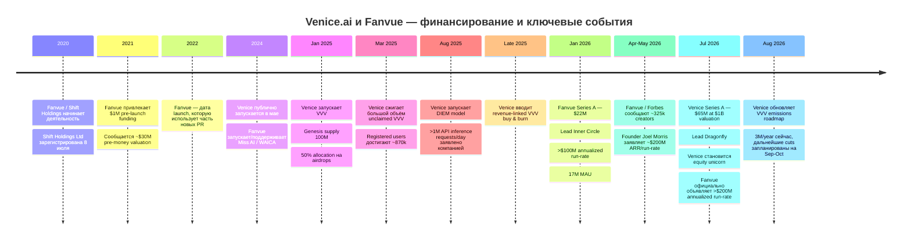
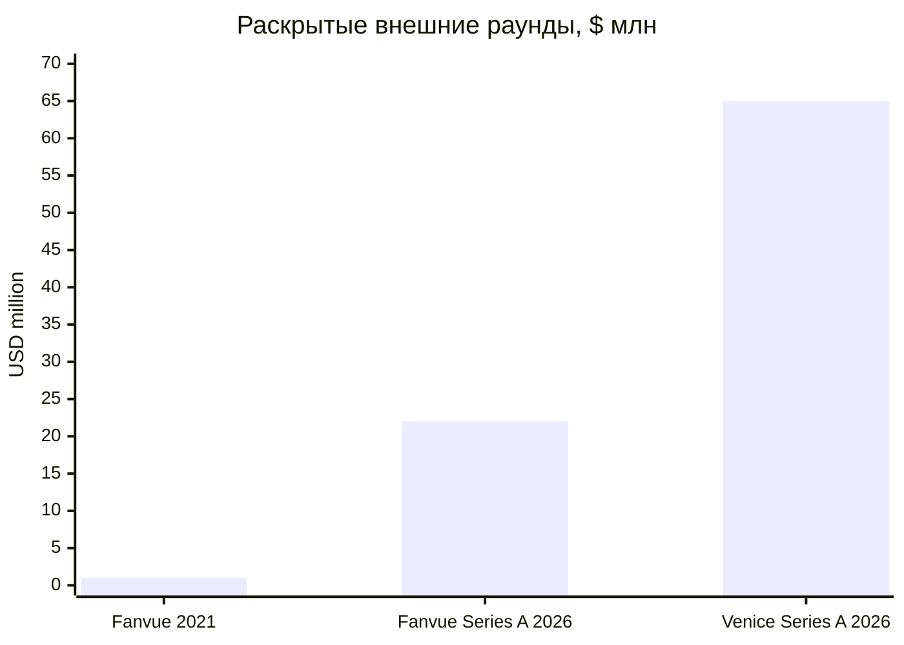

# DR26-08-29-MACANTON-18-0743 — raw report from chatgpt

> Unedited output of one model. Our reconciled synthesis is the page one level up.

---
title: "Подробнее о стартапах"
type: deep-research-original
source: chatgpt

dr_id: DR26-08-29-MACANTON-18-0743
conversation_id: 6a8c3c83-288c-83eb-bad5-051cd2409375
url: "https://приватный чат"
research_started_at: 2026-08-24T12:45:13.108468Z
research_stopped_at: 2026-08-24T12:55:17.675338Z
dr_status_in_tool: completed
harvested_by: dr_harvest_chatgpt.py
harvested_at: 2026-08-29T07:43:09
vault_chat_note: ""
---

> Отчёт Deep Research забран из ChatGPT verbatim (widget_state.report_message).
> Заметка диалога в волте обрывается на строке запуска — тела отчёта там нет.

## Запрос

```text
@Deep research Расскажи подробнее про эти стартапы

Venice — единорог, но на крипто-деньгах; Fanvue $22M — от exited-founders.
```

## Отчёт
# Venice.ai и Fanvue: глубокий аналитический разбор

## Executive summary

**Venice.ai и Fanvue — быстрорастущие компании, но инвестиционно это две принципиально разные конструкции.** Venice — privacy-first AI-платформа на стыке consumer AI, API-инфраструктуры и crypto-economic layer вокруг токена VVV. Fanvue — двухсторонний creator marketplace/monetization platform, где базовая экономика существенно проще: платящие фанаты → выручка создателей → стандартная комиссия Fanvue в 20%, поверх которой компания строит AI-инструменты для автоматизации контента и общения. citeturn17search17turn21search1

**Venice уже обоснованно можно называть unicorn по классическому венчурному определению.** 1 июля 2026 года компания объявила свой первый внешний раунд — **$65 млн Series A при оценке equity $1 млрд**, led by Dragonfly, с участием Coinbase Ventures, North Island Ventures и других фондов. Это не путать с рыночной капитализацией или FDV токена VVV: речь именно об оценке акционерного капитала компании в институциональном раунде. TechCrunch также прямо назвал Venice unicorn. citeturn22search16turn22search12turn22search31

У Venice весьма необычная для AI-стартапа картина: до Series A компания была практически полностью bootstrapped Эриком Ворхисом, а к раунду, по словам CEO, уже была прибыльной и имела **свыше $70 млн annualized revenue run-rate**. На момент раунда Venice сообщала о примерно **3,5 млн зарегистрированных пользователей и 1,3 трлн обрабатываемых токенов в месяц**. Команда при этом оставалась очень компактной — около 45 сотрудников в июле 2026 года — и работала удалённо без полноценного физического офиса. citeturn15search30turn17search1turn2search9

Но **VVV делает cap table и value accrual Venice гораздо сложнее**, чем у обычного AI SaaS. Токен был выпущен 27 января 2025 года со стартовым supply 100 млн VVV, без presale. Он используется для staking/access к inference; компания постепенно сокращает эмиссию, сжигает VVV за счёт части subscription/API revenue и создала дополнительный актив DIEM, получаемый посредством блокировки staked VVV. Более того, Series A имела crypto-компонент: согласно The Block, инвесторы получили не только equity, но и vesting-grant на **1,5 млн VVV плюс warrants на приобретение ещё 5 млн VVV**, потенциально приносящие Venice ещё около $66,5 млн при полном исполнении. Следовательно, **equity investors и token holders участвуют в разных, но связанных слоях одной экономики**, что является одновременно сильным moat и существенным governance/regulatory risk. citeturn2search7turn2search4turn14search1

**Fanvue не имеет подтверждённого публичного unicorn valuation.** Компания получила приблизительно **$1 млн pre-launch financing в апреле 2021 года**, тогда сообщалась pre-money valuation около **$30 млн**, а в январе 2026 года привлекла **$22 млн Series A** led by Inner Circle. То есть публично идентифицируемое финансирование составляет примерно **$23 млн**. Оценка Series A не раскрывалась; выводить её из revenue или ARR нельзя. citeturn8search23turn4search7turn18search3turn22search35

При этом операционные заявления Fanvue очень агрессивны: январский Series A announcement указывал **>$100 млн annualized revenue run-rate, 17 млн MAU и около 250 тыс. creators**, а 10 июля 2026 года компания объявила, что run-rate удвоился до **>$200 млн всего за пять месяцев**. Текущие официальные страницы одновременно называют **325 тыс.+ creators**, то есть данные компании между релизами не полностью синхронизированы. Поэтому $200 млн следует читать именно как **management-reported annualized run-rate**, а не как $200 млн аудированной выручки за завершённый финансовый год. citeturn18search3turn16search0turn18search1

Ключевая проверка заявления, что **«основатели Fanvue — exited founders»**, даёт отрицательный результат. Надёжных свидетельств того, что Joel Morris, William Monange или Harry Fitzgerald до Fanvue продали собственный стартап, я не обнаружил. Источник путаницы легко идентифицируется: в Series A announcement говорится, что **lead investor Inner Circle backed by 50+ exited founders**, а René Rechtman действительно связан с многомиллиардным exit Moonbug. Эта характеристика относится к **инвесторам Fanvue, а не к основателям Fanvue**. citeturn18search3turn18search2

Напротив, среди основателей Venice exits подтверждаются гораздо лучше. **Erik Voorhees** продал SatoshiDice в 2013 году примерно за $11,5–12,4 млн в BTC и затем основал ShapeShift; **Jesse Proudman** участвовал как минимум в Blue Box, приобретённой IBM, Makara, приобретённой Betterment, и Strix Leviathan, приобретённой Parataxis. По proven founder/exits profile Venice заметно сильнее Fanvue. citeturn23search4turn17search5

Мой итоговый взгляд: **Venice выглядит технологически и экономически более необычным и потенциально более defensible активом, но с повышенным crypto/regulatory/governance tail risk. Fanvue выглядит более понятным marketplace/SaaS-like бизнесом с выдающейся заявленной коммерческой динамикой, но более слабой прозрачностью метрик, сильной зависимостью от creator/content regulation, card/payment rails и пока неподтверждённой публичной оценкой.** У обеих компаний цифры роста в основном являются company-reported, а не audited disclosures, поэтому headline ARR/run-rate следует дисконтировать до получения финансовой отчётности или investor materials.

## Сводное сравнение

| Параметр | Venice.ai | Fanvue |
|---|---|---|
| **Начало деятельности** | 2024; публичный запуск в мае 2024. citeturn17search20turn17search2 | Корни бизнеса — март/июль 2020; Shift Holdings Ltd зарегистрирована 8 июля 2020. Некоторые свежие PR компании называют launch/founding 2022 — имеется реальное расхождение в публичной истории. citeturn21search0turn18search2turn16search0 |
| **Штаб-квартира** | Юридический адрес Venice.ai, Inc. — Sheridan, Wyoming; фактически компания remote-first и в июле 2026 не имела офиса. citeturn17search25turn17search1 | London, UK; оператор платформы — активная британская Shift Holdings Ltd. citeturn16search0turn21search0 |
| **Основатели / founding team** | Erik Voorhees; Jesse Proudman официально называется co-founder; ранний founding team также включал Teana Baker-Taylor, которая теперь основала BasedAI. citeturn17search5turn13search2turn17search20 | Joel Morris, William Monange, Harry Fitzgerald. citeturn18search1turn18search2 |
| **Команда** | ≈45 человек в июле 2026, против ≈15 годом ранее; LinkedIn уже относит компанию к bucket 51–200. citeturn17search1turn17search2 | Официальная страница руководства говорит о масштабировании до **130+** сотрудников; Forbes в апреле сообщал 117. citeturn18search1turn18search9 |
| **Основной продукт** | Private/unrestricted multi-model generative AI: text, code, image, video, audio + API/agents. citeturn17search17turn2search9 | Creator monetization/subscription platform + AI creation, messaging, voice, analytics и engagement automation. citeturn18search1turn16search0 |
| **Бизнес-модель** | Consumer subscriptions + metered API credits + VVV/DIEM access economy; часть revenue направляется на VVV buy-and-burn. citeturn1search9turn2search1turn22search26 | Стандартно creator получает 80% gross paid-services revenue, Fanvue оставляет 20%; подписки, tips, PPV, bundles, custom content. citeturn21search1 |
| **Публично раскрытое внешнее финансирование** | **$65 млн**, один Series A, первый внешний капитал. citeturn22search16 | ≈**$23 млн**: $1 млн pre-launch + $22 млн Series A. citeturn8search23turn18search3 |
| **Последний раунд** | $65 млн Series A, 1 июля 2026, lead Dragonfly. citeturn22search16 | $22 млн Series A, январь 2026, lead Inner Circle. citeturn18search3turn22search32 |
| **Valuation** | **$1 млрд equity valuation**, подтверждённая Series A → unicorn. citeturn22search31turn22search16 | Series A valuation **не раскрыта**. В 2021 сообщалось о **$30 млн pre-money**. Unicorn status не подтверждён. citeturn4search7turn22search35 |
| **Последний revenue metric** | >$70 млн annualized run-rate; компания, по словам Voorhees, прибыльна. citeturn15search30 | >$200 млн annualized revenue run-rate на 10 июля 2026, company-reported. citeturn16search0 |
| **User traction** | ≈3,5 млн зарегистрированных пользователей; 1,3 трлн AI tokens/month к Series A. citeturn2search9 | >17 млн MAU; official creator count варьируется между >250 тыс. и >325 тыс. citeturn16search0turn18search1 |
| **Криптотокен** | Да — **VVV**, Base/ERC-20 ecosystem; staking, inference access, emissions, buy/burn; плюс DIEM. citeturn2search7turn2search4 | Нет собственного токена |
| **Главные риски** | Crypto classification/value accrual, token/equity alignment, founder regulatory history, privacy dependent partly on ZDR contractual counterparties, abuse risk вокруг «uncensored AI». citeturn20search1turn23search9turn1search5 | Adult/explicit-content regulation, age assurance, AI deepfakes/consent/IP, payment/chargeback dependence, measurement transparency, founder's historical XCAD controversy. citeturn21search2turn21search1turn19search0 |
| **Уверенность в основных фактах** | Высокая по Series A/valuation/tokenomics; средняя по revenue, поскольку это management-reported run-rate | Высокая по funding/legal entity/take-rate; средняя по revenue/user metrics из-за self-reporting и внутренних расхождений |

## Venice.ai: компания, финансирование, токеномика и traction

**Происхождение и структура.** Venice появилась в 2024 году как следующий крупный проект Erik Voorhees после ShapeShift; The Block сообщал о запуске уже 10 мая 2024 года. В ранней команде Voorhees был CEO, а бывшая Circle executive Teana Baker-Taylor — COO. Сегодня официальные и независимые источники также однозначно называют Jesse Proudman co-founder, President и CTO. Teana в 2026 году уже является сооснователем BasedAI, чей официальный профиль прямо называет её co-founder Venice AI; поэтому её разумнее считать членом founding team, но не текущего executive team. citeturn17search20turn17search5turn13search2

Юридический адрес Venice.ai, Inc. находится в **Sheridan, Wyoming**, но фактически компания распределённая: GeekWire в июле 2026 писал, что офис отсутствует и около 45 сотрудников работают remote. Это важно, поскольку сторонние базы, указывающие Sheridan как «HQ», описывают прежде всего юридическую регистрацию, а не реальный operating headquarters. citeturn17search25turn17search1

**Продукт.** Venice позиционируется как private и comparatively unrestricted interface к большому набору text/image/video/audio/code models, а также как API-инфраструктура для разработчиков и AI agents. К Series A компания заявляла доступ более чем к 200 моделям; в текущих каналах Venice уже рекламирует сотни моделей и single API для агентов. citeturn2search9turn17search2

Privacy architecture заслуживает более точного описания, чем маркетинговое «prompts never leave your device». История беседы действительно может храниться локально, а Venice декларирует zero-data-retention inference. Но сама Venice объясняет, что default private inference может выполняться либо на подконтрольных ей GPU, либо у партнёров под **zero-data-retention contractual agreements**; компания прямо характеризует такой вариант как доверительный — пользователь полагается на соблюдение договоров Venice и её провайдерами. Более сильные режимы TEE/E2EE существуют отдельно. Следовательно, Venice существенно privacy-oriented, но **обычный режим не эквивалентен fully local inference**. citeturn1search2turn1search5turn1search9

**Бизнес-модель** уже не чисто crypto. Основной денежный поток состоит из consumer subscriptions и платного API: API calls расходуют credits согласно стоимости конкретной модели и не становятся «безлимитными» просто из-за подписки. VVV/DIEM добавляют альтернативный способ покупать/обеспечивать inference capacity и связывают экономику бизнеса с токеном. citeturn1search9turn2search4

### Финансирование и unicorn status

В мае 2024 года Voorhees говорил The Block, что является единственным инвестором Venice и внешнее финансирование компании не требуется; тогда в команде было всего шесть человек. Таким образом, до середины 2026 Venice была по существу founder-financed/bootstrapped. citeturn17search20

**1 июля 2026 — $65 млн Series A при $1 млрд valuation.** Lead — Dragonfly. Среди участников официально/публично назывались Coinbase Ventures, North Island Ventures, F-Prime, Archetype, Morgan Creek, Liquid2 Ventures, Founders' Co-op и другие. Venice называет этот раунд первым внешним капиталом. citeturn22search16turn17search1

В результате статус unicorn здесь **хорошо подтверждён**: и сама компания/Voorhees обозначили **$1 млрд equity valuation**, и TechCrunch сообщил те же условия раунда. Это существенно надёжнее неформального употребления «unicorn», основанного на crypto FDV. citeturn22search31turn22search16

Имеется интересная особенность структуры сделки. The Block сообщил, что Series A investors также получили **1,5 млн VVV в виде vesting grant** и warrants на приобретение ещё **5 млн VVV в течение восьми лет**; полное исполнение warrants стоило бы около **$66,5 млн**, то есть потенциальный совокупный приток капитала по equity round + будущему token exercise способен достичь примерно $131,5 млн. По данным издания, token grant и warrants имеют lock-up/vesting. citeturn14search1

Это важнее, чем выглядит: $65 млн — **реально объявленный Series A**, тогда как потенциальные $66,5 млн по warrants **не следует прибавлять к уже привлечённому funding**. Это условная будущая сумма, зависящая от исполнения warrants.

### VVV: tokenomics

VVV был запущен на Base **27 января 2025 года**. Genesis supply составлял **100 млн VVV**, а presale, по заявлению Venice, не проводился. Изначально предусматривалась годовая эмиссия 14 млн VVV. citeturn2search7turn22search7

Genesis distribution выглядит следующим образом:

| Allocation | Доля от genesis supply | Комментарий |
|---|---:|---|
| User/ecosystem airdrops | **50% / 50 млн** | 25 млн пользователям Venice и 25 млн crypto×AI ecosystem |
| Venice.ai allocation | **35% / 35 млн** | Внутри этого allocation 10 млн, то есть 10% total supply, предназначались team |
| Venice Incentive Fund | **10% / 10 млн** | Ecosystem incentives |
| Liquidity | **5% / 5 млн** | Initial liquidity |
| **Итого** | **100%** | Team allocation нельзя ещё раз прибавлять сверху: он указан внутри 35% Venice allocation |

Для team allocation первоначальная документация указывала 25% unlock upfront и streaming оставшейся части на 24 месяца. citeturn2search7

VVV **не является equity Venice и не даёт governance rights** в компании. Его функция — экономический access layer: пользователь или приложение stake'ит VVV, получает inference capacity и одновременно может получать emissions/yield. Это принципиально отличает VVV от акций, которые были проданы Series A investors. citeturn2search7turn14search0

Tokenomics быстро менялась. После первоначальных 14 млн annual emissions Venice последовательно снижала выпуск; осенью 2025 компания сообщала о переходе с 10 млн к 8 млн VVV в год. К июльскому обновлению 2026 rate уже был **3 млн/год**, с запланированным дальнейшим снижением до 2,5 млн с 1 сентября и 2 млн с 1 октября 2026 года. Поэтому **на дату этого отчёта, 24 августа 2026 года, применимая опубликованная ставка — 3 млн/год; 2 млн — ещё будущая ставка**, а не сегодняшняя. citeturn2search3turn2search1

С другой стороны supply уменьшается через burns. После airdrop примерно 17,4 млн VVV были востребованы более чем 40 тыс. адресов/участников, а большая часть невостребованного остатка была сожжена. К 15 апреля 2026 Venice сообщала о **более 33,7 млн VVV cumulative burns** с учётом первоначального unclaimed-airdrop burn и последующих операций. При этом эмиссии снова увеличивают total supply, поэтому cumulative burns нельзя просто вычесть из 100 млн и принять результат за текущий supply. citeturn2search10turn2search0

В конце 2025–2026 компания стала напрямую привязывать коммерческую деятельность к VVV: новые consumer subscriptions запускают программный buy-and-burn, а с июльского обновления **$5 из каждых $100 API credit purchases** направляются на покупку и сжигание VVV. Компания открыто описывает механизм как способ связать рост retail/API бизнеса со scarcity токена. citeturn2search0turn2search1turn22search26

**DIEM** добавляет ещё один слой. DIEM — ERC-20 asset на Base, который mint'ится посредством блокировки staked VVV. Один staked DIEM предоставляет **$1 API credit в день**, при этом locked sVVV продолжает получать значительную часть staking yield; чтобы разблокировать sVVV, соответствующий DIEM должен быть сожжён. То есть Venice фактически tokenizes recurring inference capacity. citeturn2search4

С экономической точки зрения это интересная конструкция: VVV превращается не столько в простой «utility token», сколько в **capital-like capacity asset**, где спрос поддерживается AI inference, а supply контролируется emissions + burns. При этом token holders всё равно не владеют Venice.ai, Inc. Именно этот разрыв между **economic value accrual** и **legal ownership** является главным структурным вопросом VVV. citeturn22search7turn14search0

### Traction

При запуске VVV в январе 2025 Venice сообщала примерно о **450 тыс. зарегистрированных пользователей, >50 тыс. daily active users и >15 тыс. inference requests в час**. На тот момент основным денежным источником назывались Pro subscriptions. citeturn2search7

Уже к марту 2025 года компания сообщала о **870 тыс. зарегистрированных пользователей**, то есть почти удвоении за полтора месяца; daily app prompts выросли примерно с 464 тыс. до 1,142 млн, а API prompts — с ~34 тыс. до ~124,5 тыс. в сутки. Поскольку эти цифры опубликованы самой Venice вокруг token burn event, их разумно рассматривать как management telemetry, а не независимо верифицированную аудиторию. citeturn2search10

В августе 2025 Venice утверждала, что API уже обрабатывает более **1 млн inference requests в день**, в том числе через OpenRouter, Warden, Brave Leo и Fleek, а среди developer environments упоминались Cursor, VSCode и VOID. Здесь корректнее говорить об **интеграциях / distribution endpoints**, а не считать каждое название стратегическим партнёрством. citeturn2search4

К Series A летом 2026 компания сообщала **3,5 млн registered users и 1,3 трлн processed AI tokens/month**. CEO также заявил TechCrunch, что Venice прибыльна и превышает **$70 млн annualized run-rate revenue**. При ~45 сотрудниках это, если данные точны, чрезвычайно высокий уровень revenue per employee — порядка >$1,5 млн annualized run-rate на человека. Последняя величина — мой расчёт на основе опубликованных company metrics, а не раскрытый Venice KPI. citeturn2search9turn15search30turn17search1

### Основатели и предыдущие exits

**Erik Voorhees** — один из самых опытных ранних crypto entrepreneurs. Он создал Bitcoin gambling platform SatoshiDice и продал её в 2013 году за 126 315 BTC, что на момент сделки составляло примерно **$11,5–12,4 млн**; позднее основал ShapeShift. Это настоящий, документируемый founder exit, хотя ShapeShift впоследствии был не продан традиционному покупателю, а трансформирован в DAO. citeturn23search4turn23search7

У Voorhees есть и существенный regulatory history. В 2014 году SEC обвинила его в незарегистрированном публичном предложении shares FeedZeBirds и SatoshiDICE. Он урегулировал дело без признания или отрицания выводов SEC, выплатив $15 843,98 disgorgement и $35 тыс. penalty; также действовал пятилетний запрет на участие в определённых незарегистрированных securities offerings за virtual currency. Это **историческое дело против Voorhees, а не enforcement action против Venice или VVV**, но для оценки founder/regulatory risk оно релевантно. citeturn23search9

**Jesse Proudman** имеет ещё более традиционный startup/exits profile. GeekWire перечисляет три его компании, дошедшие до acquisitions: **Blue Box → IBM, Makara → Betterment, Strix Leviathan → Parataxis**. Betterment также подтверждает его как founder/CEO Makara. citeturn17search5turn23search1

**Teana Baker-Taylor** пришла с executive/policy background в Circle, Binance и Crypto.com и была ранним COO/founding-team member Venice; в 2026 году официальный BasedAI bio описывает её как co-founder Venice и теперь co-founder собственного нового проекта BasedAI. Подтверждённого предыдущего acquisition exit уровня Proudman/SatoshiDice у неё я не обнаружил. citeturn13search2

## Fanvue: бизнес, funding, founders и коммерческая динамика

**Дата основания Fanvue требует оговорки.** Первичный PR 2021 года говорил, что William Monange и Joel Morris основали бизнес во время первого lockdown, в **марте 2020 года**. Это хорошо согласуется с Companies House: нынешний оператор платформы, **Shift Holdings Ltd**, зарегистрирован 8 июля 2020 года и остаётся active. Forbes также относит запуск Fanvue к 2020 году. citeturn8search23turn21search0turn18search2

Однако свежий июльский PR 2026 года говорит «founded in London in 2022» уже тремя co-founders — Joel Morris, Will Monange и Harry Fitzgerald. Вероятнее всего, 2020 обозначает начало компании/legal build, 2021 — pre-launch funding, а 2022 — коммерческую итерацию/масштабирование нынешней версии продукта. Поскольку сама компания использует обе хронологии, **я считаю 2020 наиболее документально обоснованной датой основания, но отмечаю 2022 как официальный альтернативный narrative.** citeturn16search0turn21search0

Отдельная британская компания **Fanvue Ltd** действительно существовала и была впоследствии dissolved, однако это не означает закрытия Fanvue: текущие условия платформы заключаются с **Shift Holdings Ltd**, которая активна и прямо именует себя Fanvue. Это полезная юридическая оговорка, поскольку автоматические company databases легко создают ложное впечатление, что стартап ликвидирован. citeturn21search3turn21search1

**Продукт и business model.** Fanvue — direct-to-fan subscription/paid-content platform: creators продают subscriptions, tips, pay-per-view messages, bundles и custom content. Сегодня компания всё сильнее позиционирует себя не как «ещё один OnlyFans», а как AI infrastructure для creator businesses, включая AI-assisted messaging, content generation, analytics, voice и automation. citeturn21search1turn16search0

Экономика прозрачнее, чем у Venice: **стандартный Creator Earning Rate = 80% gross revenue, Platform Fee Fanvue = 20%**. Компания может временно давать promotional earning rates; текущая consumer-facing страница, например, рекламирует более высокий creator share в первый месяц, однако юридическая политика фиксирует 80/20 как стандартный режим. citeturn21search1turn22search6

На уровне rough economics интересен следующий sanity check. Если сообщаемые Fanvue **$200 млн annualized revenue run-rate** действительно представляют net platform revenue, а средняя economics близка к стандартному 20% take-rate, это арифметически соответствует примерно **$1 млрд annualized gross paid-services volume**:

\[
\$200m / 20\% \approx \$1.0bn
\]

Однако Fanvue не публиковала audited reconciliation между revenue, creator GMV, payment fees, refunds и promotional take rates. Поэтому $1 млрд — **аналитическая оценка порядка величины, а не раскрытый GMV**. База для расчёта — официальный $200 млн run-rate и официальный стандартный 20% platform fee. citeturn16search0turn21search1

### Funding history и valuation

**Апрель 2021 — $1 млн pre-launch financing.** Компания объявила о $1 млн финансирования перед полноценным запуском. Современная публикация UK Tech News указывала приблизительно **$30 млн pre-money valuation** и описывала инвесторов как группу prominent angels без полного публичного раскрытия имён. Формальное название раунда не везде одинаково, поэтому корректнее считать его **pre-launch/early financing**, а не уверенно маркировать Seed. citeturn8search23turn4search7

**Январь 2026 — $22 млн Series A.** Lead investor — **Inner Circle**. Среди названных backers — René Rechtman, основатель Moonbug, founders британского unicorn Marshmallow и GPs ряда европейских venture firms. Средства предназначались для international expansion, hiring и дальнейшей AI-разработки. citeturn18search3turn22search32

Таким образом, **публично подтверждаемая сумма внешнего funding ≈ $23 млн**. Companies House показывает промежуточные share allotments в 2023–2025 годах, однако без достаточной публичной информации я не приписываю им дополнительные раунды и не увеличиваю $23 млн: это создало бы ложную точность.

**Series A valuation не раскрывалась.** Независимая база Sacra также отмечает отсутствие disclosure. Следовательно, на 24 августа 2026 года у меня нет достаточной первичной или качественной вторичной базы, чтобы утверждать, что Fanvue — unicorn. Даже $200 млн run-rate сам по себе не доказывает $1 млрд valuation: соответствующий multiple зависит от margins, net-vs-gross revenue recognition, retention, concentration, risk discount и условий конкретного preferred round. citeturn22search35turn16search0

### Traction и growth

На момент Series A Fanvue сообщала о:

**>$100 млн annualized revenue run-rate, 17 млн monthly active users, ~250 тыс. creators, 450% YoY revenue growth, 20 тыс. новых creators за предыдущий месяц**, а команда, по данным того же релиза, увеличилась примерно с 42 до 115 человек за двенадцать месяцев. Компания также заявляла, что 93% creators использовали как минимум один proprietary AI tool. citeturn18search3

В апреле–мае Forbes и официальные материалы уже говорили о **17 млн users и 325 тыс. creators**, а founder profile Fanvue фиксировал 117 сотрудников. citeturn18search9turn18search6

10 июля 2026 компания объявила, что annualized revenue run-rate достиг **>$200 млн**, то есть удвоился примерно за пять месяцев. Она также сообщила, что **72% earning creators используют AI tools**, причём creators, использующие AI, якобы зарабатывают в 3–6 раз больше остальных. Это интересная корреляция, но её нельзя трактовать как причинный эффект AI без cohort adjustment: более профессиональные/high-volume creators, скорее всего, одновременно и чаще используют AI, и больше зарабатывают. citeturn16search0

Есть заметная **data-quality inconsistency**: июльский PR снова говорит о «over 250,000 creators», тогда как более ранние Forbes/company pages уже приводили **325,000**. Поскольку creator base не должен естественным образом внезапно уменьшиться на ~75 тыс. без объяснения, вероятнее всего, разные страницы используют stale или по-разному определённые metrics. Для due diligence я бы потребовал определения *registered creators*, *verified creators*, *earning creators* и *monthly active creators* по каждому reporting period. citeturn16search0turn18search6

Текущая Fanvue также заявляет уже **>$500 млн cumulative creator payouts**. Как и ARR/run-rate, это пока company-reported metric без опубликованного independent audit. citeturn9search9

С точки зрения brand traction Fanvue удалось выйти далеко за пределы нишевых AI models: официально упоминаются **Cardi B** и швейцарская футболистка **Alisha Lehmann**, а ещё в 2024 году Fanvue приобрела заметную мировую прессу благодаря **Miss AI / World AI Creator Awards**. Конкурс освещали Forbes, Euronews и другие массовые издания, одновременно обеспечив компании publicity и вызвав критику вокруг synthetic beauty standards. citeturn18search1turn22search33turn22news40

### Основатели и проверка «exited founders»

**Joel Morris** начал как YouTube creator JMX и накопил около 2 млн+ подписчиков до переключения на Fanvue. Его creator background хорошо соответствует product thesis — creator monetization без зависимости исключительно от advertising/brand deals. citeturn18search2turn19search11

**William “Will” Monange** в официальном Fanvue bio описывается как бывший сотрудник BBC и product leader; сегодня он co-founder/co-CEO и отвечает прежде всего за product, engineering direction и financial infrastructure. Companies House показывает его директором Shift Holdings с августа 2020 года. citeturn18search1turn21search3

**Harry Fitzgerald** — бывший COO Cage Warriors Europe; Fanvue говорит, что он отвечает за operations/hiring/culture и масштабировал команду с пяти человек до 130+. citeturn18search1

Теперь к конкретной проверке:

> **Утверждение: “Fanvue founders are exited founders.”**

**Вердикт: не подтверждается; скорее всего это неправильное прочтение пресс-релиза Series A.**

В официальном Series A announcement формулировка относится к **Inner Circle**, который «backed by 50+ exited founders», а не к Joel, Will и Harry. Там же отдельно упоминается René Rechtman, действительно стоявший за крупным exit Moonbug, и founders Marshmallow. citeturn18search3

По Joel Morris Companies House/публичные biographies не показывают подтверждённого acquisition/liquidity exit до Fanvue; его предыдущая известная entrepreneurial activity связана прежде всего с YouTube/Xcademy/XCAD. У Will Monange также не обнаруживается подтверждённый предшествующий проданный стартап; Companies House показывает только Fanvue-related appointments. Harry Fitzgerald был executive в Cage Warriors, а не exited founder этой компании. Поэтому **троица Fanvue не должна описываться как serial exited founders на основании доступных доказательств.** citeturn21search3turn18search1

У Joel есть отдельный reputational footnote. В 2021 году вокруг XCAD Network и Save the Kids token возник crypto controversy. В собственном заявлении Morris признал, что торговал XCAD, назвал торговлю собственным token ошибкой и объявил об уходе из роли в XCAD; при этом он отрицал намеренный обман и отрицал осознанное участие в схеме Save the Kids. Независимое Esports News UK тогда подробно описывало обвинения и его ответ. Это **не доказанный уголовный fraud finding**, поэтому корректно говорить о репутационном эпизоде/обвинениях, а не приписывать Morris юридически установленное мошенничество. citeturn19search0turn19search2

## Рыночное позиционирование, конкуренты и ключевые риски

**Venice занимает редкую комбинацию трёх рынков:** consumer generative AI, multi-model/API infrastructure и crypto-native AI capacity. На consumer layer её функциональными конкурентами являются крупные assistants вроде ChatGPT, Claude и Gemini; на aggregation/API layer — такие сервисы, как OpenRouter; на privacy axis — local/self-hosted inference и privacy-oriented assistants. Но наиболее дифференцирующим элементом Venice является не сам доступ к моделям, а сочетание **multi-model access + reduced censorship + zero-retention/privacy architecture + VVV-based capacity economics**. Именно это сочетание и объясняет интерес crypto-focused инвесторов. citeturn17search17turn22search16

Проблема в том, что модели во многом не принадлежат Venice. Terms компании допускают third-party model providers и их собственные ограничения, поэтому «uncensored» следует трактовать как **less restricted orchestration/product policy**, а не абсолютную гарантию отсутствия downstream restrictions. citeturn1search4

**Первый риск Venice — token/equity alignment.** Equity investors юридически владеют частью компании; VVV holders — нет. При этом Venice целенаправленно направляет часть retail/API economics в VVV buy-and-burn. Series A investors дополнительно получили VVV-related grant/warrants. Это создаёт сложную систему стимулов: рост компании может повышать demand/scarcity VVV, но board/cap-table governance принадлежит equity owners, а не token holders. Критика условий сделки среди VVV holders после Series A как раз концентрировалась вокруг этого потенциального конфликта. citeturn14search0turn14search1turn14search2

**Второй — regulatory classification.** SEC в марте 2026 года выпустила обновлённое толкование, подчёркивающее, что crypto asset может сам по себе не быть security, но его предложение/продажа при определённых обстоятельствах может формировать investment contract; отдельно регулятор рассмотрел airdrops и staking. При этом SEC стала заметно благоприятнее относиться к некоторым видам protocol staking, но VVV — не просто PoS validator staking: это issuer-associated access asset с emissions, commercial buy-and-burn и активной ролью самой Venice. Поэтому статус должен анализироваться по конкретной структуре и representations, а не переносить выводы SEC о protocol staking автоматически на VVV. citeturn20search1turn20search7

Особенно чувствительно то, что сама Venice публично описывает feedback loop вида **рост revenue → больше buy/burn → меньший token supply**. Это экономически мощная narrative для VVV holder, но одновременно повышает важность юридического анализа issuer promises. Я не обнаружил публичного SEC enforcement action непосредственно против Venice или VVV к 24 августа 2026 года; это именно **potential regulatory risk, а не утверждение о нарушении закона**. citeturn22search26turn20search1

**Третий — founder regulatory baggage.** Старое дело SEC против Voorhees завершено много лет назад и не относится к Venice, однако institutional compliance teams почти наверняка будут учитывать его при due diligence crypto-linked product. citeturn23search9

**Четвёртый — privacy implementation risk.** Venice намного лучше многих облачных AI products артикулирует data-minimization, но обычная privacy architecture всё ещё частично полагается на ZDR contracts с infrastructure/model providers; сама Venice предупреждает о trust-based nature такой схемы. TEE/E2EE уменьшают этот trust surface, но не все запросы автоматически являются fully local/private computation. citeturn1search5turn1search2

Для **Fanvue** competitive reference set проще: **OnlyFans** — наиболее очевидный direct-to-fan paid-content incumbent; **Patreon** конкурирует за subscription/membership creator businesses; плюс растёт число creator commerce/community products. Forbes прямо ставил перед Fanvue вопрос, смогут ли AI tools помочь ей обойти incumbents вроде Patreon и OnlyFans. citeturn24search5turn24search11

Fanvue берёт те же стандартные **20%**, которые Reuters в 2026 году указывал для OnlyFans. Следовательно, ценовое преимущество Fanvue относительно крупнейшего adult/paid-content incumbent минимально; дифференциация должна происходить через AI tooling, creator acquisition, product experience и payouts/distribution. citeturn21search1turn24news32

В сравнении с Patreon Fanvue сильнее ориентирована на transactional paid content, direct messaging и synthetic/AI personalities, тогда как Patreon остаётся community/membership-oriented platform. Patreon официально описывает продукт вокруг эксклюзивного контента и direct community, а Forbes выделяет AI influencers как ключевую особенность Fanvue. citeturn24search13turn24search5

**Главный Fanvue regulatory risk — explicit content + age assurance.** Платформа разрешает intimate/adult content при соблюдении правил, но запрещает несовершеннолетних, non-consensual sexual media и ряд категорий экстремального контента. В Великобритании требования Online Safety regime заметно усилили ответственность платформ, распространяющих pornographic content, за эффективную age assurance. Даже при добросовестной compliance infrastructure операционная цена ошибки здесь высока. citeturn21search2turn10search2

**Второй — synthetic media/deepfakes.** Fanvue разрешает AI-generated creators и даже face-swapped/deepfake-like content при условии disclosure, documented consent и identity verification реального человека. Community Guidelines требуют маркировки AI media, запрещают resemblance to minors и запрещают deepfake реальных людей без consent/verification. citeturn21search2turn21search5

Политика разумная; проблема — enforcement at scale. Чем больше synthetic adult creators и generative content проходит через платформу, тем выше вероятность IP disputes, unauthorized likeness, consent failures и edge cases вокруг возраста визуально синтетического персонажа. Это не только теоретическая проблема: пресса уже документировала более широкий рынок AI influencers как источник споров об украденных изображениях, deepfakes и прозрачности перед пользователями. citeturn10search14turn21search2

**Третий — payments/chargebacks/KYC.** У creators средства проходят pending period, payouts зависят от anti-fraud/compliance/payment-provider checks, а refunds и chargebacks могут вычитаться из creator balances. Adult-adjacent marketplaces особенно чувствительны к изменениям политики card networks и payment processors, хотя конкретного текущего запрета/кризиса у Fanvue в найденных источниках нет. citeturn21search1

**Четвёртый — качество reporting metrics.** У Fanvue высокий заявленный рост, но 250 тыс. vs 325 тыс. creators и одновременное присутствие на текущих страницах $100m+ и более свежего $200m run-rate демонстрируют, что marketing pages обновляются несинхронно. Это не признак фальсификации, но для институционального due diligence я бы считал MAU, paying users, creator count и revenue лишь provisional до data-room verification. citeturn16search0turn18search1

В сумме риск-профили выглядят так:

| Риск | Venice | Fanvue |
|---|---|---|
| Product/technology | **Средний** — зависит от внешних models/GPU economics | **Средний** — marketplace tech менее deep-tech, AI features копируемы |
| Regulatory | **Высокий/средний** из-за VVV и crypto structure | **Высокий/средний** из-за adult content, age assurance, synthetic media |
| Founder reputation | **Средний** — старое SEC settlement Voorhees | **Низкий–средний** — XCAD episode Morris |
| Platform/payment dependence | **Средний** | **Высокий** |
| Token volatility | **Высокий**, специфично VVV | Отсутствует |
| Privacy/data | Центральная competitive advantage, но ZDR counterparty risk | Обычный platform privacy + sensitive creator/KYC data |
| Metric transparency | Средняя: многие данные self-reported | Средняя/ниже средней: заметны несогласованные creator/revenue snapshots |
| Competitive moat | Потенциально высокий за счёт privacy + crypto/API flywheel | Пока средний: strongest wedge — AI creator tooling + growth/distribution |

## Хронология, funding chart и последние события



Хронология собрана из Companies House, ранних Fanvue funding announcements, официальных Venice token updates и июльских Series A/releases. Особенно важно разделять Fanvue 2020/2022 как две публичные версии истории основания и Venice $1 млрд equity valuation от crypto-token metrics. citeturn21search0turn8search23turn2search7turn18search3turn22search16turn16search0turn2search1

Объём **реально объявленных внешних cash funding rounds**, без VVV airdrop и без потенциальных будущих token-warrant proceeds:



Здесь deliberately не учитывается выпуск VVV: Venice не проводила token presale при genesis, поэтому airdrop не является cash financing. Также не включены потенциальные ~$66,5 млн от исполнения Series A token warrants, поскольку это **возможный будущий**, а не уже полученный капитал. citeturn2search7turn14search1turn8search23turn18search3turn22search16

Последние наиболее существенные события на дату **24 августа 2026 года** следующие. Для Venice главным событием остаётся 1 июля — unicorn Series A; затем 17 июля/5 августа компания обновила VVV buy/burn и emission policy, причём сокращение годовой эмиссии с 3 млн к 2,5 млн и затем 2 млн ещё только должно вступить в силу 1 сентября и 1 октября соответственно. citeturn22search16turn2search1

Для Fanvue последним крупным количественным disclosure остаётся **10 июля 2026 года**, когда компания объявила >$200 млн annualized revenue run-rate. Это вдвое выше $100 млн, заявленных вокруг Series A примерно пять месяцев ранее, хотя creator-count в этом же релизе выглядит менее свежим, чем на апрельских/майских страницах. citeturn16search0turn18search9

Российскоязычное освещение заметно сильнее у Venice, что неудивительно из-за crypto-аудитории: **ForkLog** сообщал о $65 млн Series A и $1 млрд оценке, перечисляя Dragonfly, Coinbase Ventures, F-Prime, North Island Ventures и Morgan Creek. Для Fanvue качественного русскоязычного coverage раунда сопоставимого уровня в доступном поиске существенно меньше; международные Forbes/Business Wire остаются более надёжной базой. citeturn22search12

## Первичные источники, проверка утверждений и итоговая оценка

Для **Venice** наиболее значимые primary/near-primary источники — официальный сайт и product/legal pages Venice, официальный launch/token documentation, VVV tokenomics/burn updates и объявление Series A. Для независимой проверки ключевых утверждений особенно полезны TechCrunch по valuation и profitability/revenue, GeekWire по team/founder structure, SEC по прошлому делу Voorhees и The Block по crypto-компоненту Series A. citeturn17search17turn2search7turn2search0turn22search16turn17search1turn23search9turn14search1

Для **Fanvue** strongest primary evidence — британский Companies House, юридическая политика Creator Earnings & Payouts, Community Guidelines и company Series A / July growth releases. Forbes даёт полезную независимую проверку founders, fundraising и competitive position. citeturn21search0turn21search1turn21search2turn18search3turn16search0turn18search2

**Что я считаю подтверждённым с высокой уверенностью:** Venice существует с 2024 года, её Series A составила $65 млн при заявленной $1 млрд equity valuation; VVV стартовал с 100 млн genesis supply и имеет реальную tokenized inference economy; Fanvue восходит к 2020 году и действующей Shift Holdings Ltd; Fanvue привлекла примерно $1 млн early funding и $22 млн Series A; стандартный Fanvue take rate равен 20%; утверждение о том, что сами основатели Fanvue являются «exited founders», не подтверждается доступными источниками. citeturn22search16turn2search7turn21search0turn8search23turn18search3turn21search1turn18search3

**Что подтверждено только как management claim:** Venice >$70 млн revenue run-rate/profitability; Fanvue >$200 млн annualized revenue run-rate; 17 млн MAU Fanvue; 3,5 млн registered users Venice; $500 млн+ creator payouts Fanvue; многочисленные performance claims вроде «AI creators earn 3–6× more». Никакой найденный мной источник не предоставляет аудированные financial statements, достаточные для независимого подтверждения этих цифр. citeturn15search30turn16search0turn2search9turn9search9

**Что остаётся неустановленным:** текущая valuation Fanvue после Series A; точный fully diluted ownership Series A investors Venice после учёта всех equity instruments; полный cap table обеих компаний; net revenue retention/churn и CAC/LTV; доля Fanvue revenue от adult versus mainstream creators; доля Venice revenue от subscriptions против API; действительный MAU/paid-user conversion Venice; audited gross margin обоих бизнесов. Публичные материалы этих показателей в пригодной для проверки форме не раскрывают.

С точки зрения **venture quality**, Venice выглядит более доказанным founder-led technology bet: serial-exit founders, bootstrapped profitability claim, крайне компактная команда, серьёзный институциональный Series A и уникальная privacy/token architecture. Но именно последняя добавляет crypto volatility, securities-law uncertainty и возможный конфликт token/equity value capture. citeturn17search5turn15search30turn17search1turn14search1turn20search1

Fanvue, напротив, имеет более conventional monetization engine. При подтверждении $200 млн run-rate после всего ~$23 млн раскрытого venture funding это была бы **исключительно capital-efficient growth story**. Однако до data-room verification я бы применял существенный haircut к этой картине: headline metrics self-reported, определение ARR/run-rate непоследовательно, creator counts расходятся между официальными материалами, а содержание платформы создаёт непропорционально высокий compliance/payment risk. citeturn16search0turn18search3turn21search2

**Относительный инвестиционный вывод:** Venice имеет более сильный technical/founder moat и подтверждённый unicorn price discovery, но сложнее для оценки из-за двух параллельных активов — equity и VVV. Fanvue потенциально уже имеет более крупный revenue scale, чем Venice, но его valuation неизвестна и качество публичной financial evidence ниже. Поэтому для equity investor я бы считал **Venice более верифицированной по valuation/founder quality, Fanvue — более интересной по claimed growth/revenue multiple**, а для token investor VVV следует анализировать отдельно от Venice equity: владение VVV — **не владение unicorn Venice**, даже несмотря на всё более явную связь token scarcity с коммерческой выручкой платформы. citeturn22search16turn16search0turn14search0turn22search26
