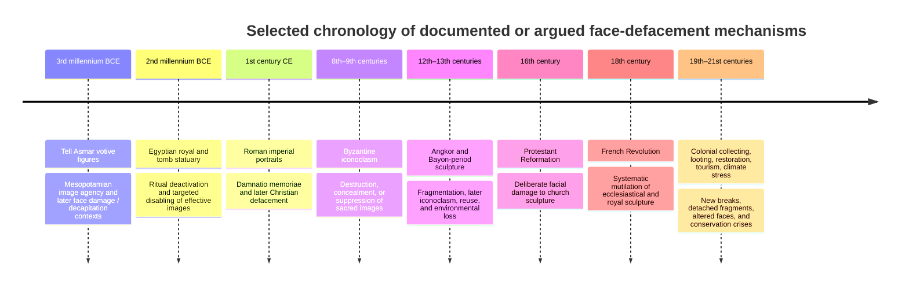

# DR26-08-29-MACANTON-20-0743 — raw report from chatgpt

> Unedited output of one model. Our reconciled synthesis is the page one level up.

---
title: "Исследование сломанных носов"
type: deep-research-original
source: chatgpt

dr_id: DR26-08-29-MACANTON-20-0743
conversation_id: 6a5782f1-2604-83ed-95a3-738392c93395
url: "https://приватный чат"
research_started_at: 2026-07-15T13:29:41.204154Z
research_stopped_at: 2026-07-15T13:39:04.329039Z
dr_status_in_tool: completed
harvested_by: dr_harvest_chatgpt.py
harvested_at: 2026-08-29T07:43:12
vault_chat_note: ""
---

> Отчёт Deep Research забран из ChatGPT verbatim (widget_state.report_message).
> Заметка диалога в волте обрывается на строке запуска — тела отчёта там нет.

## Запрос

```text
@Deep research Я в процессе. Исследование получилось довольно объёмным: здесь нельзя просто перечислить «у всех отбиты носы» — нужно отделить:

* реальный археологический паттерн (какие культуры действительно имеют высокий процент повреждений лица);
* избирательность повреждения (почему именно нос, уши, глаза, руки);
* доказанные случаи намеренного разрушения;
* случайную эрозию и хрупкость выступающих частей;
* альтернативные версии (ритуальное «обезвреживание», политическая борьба, «стирание памяти», палеоконтакт и т.д.).

Сейчас собираю структуру:

1. КРАТКОЕ ДОСЬЕ
    * Египет: статуи фараонов, сфинксы, ушебти, изображения богов.
    * Месопотамия: шумерские/аккадские статуи (Гудеа, молитвенные фигуры).
    * Греция: архаическая и классическая скульптура.
    * Рим: императорские портреты, позднеантичные повреждения.
    * Византия и Средневековье: иконоборчество.
    * Мезоамерика: ольмеки, майя, ацтеки.
    * Южная Америка: инки и доколумбовые культуры.
    * Индия и Юго-Восточная Азия.
    * Африка и Океания.
2. Главные аномалии
    * Почему часто повреждается именно центральная часть лица?
    * Почему носы чаще отсутствуют, чем другие элементы?
    * Есть ли статистика или это визуальная иллюзия из-за формы скульптуры?
    * Почему иногда вместе с носом выбиты глаза и рот?
3. Все версии объяснения

Будут разобраны:

Академические

* [ФАКТ/ИСТОЧНИК] естественная хрупкость выступающих элементов;
* [ФАКТ/ИСТОЧНИК] намеренное повреждение во время войн и религиозных конфликтов;
* [ГИПОТЕЗА] «ритуальное убийство изображения» (египетская концепция уничтожения силы статуи);
* [ГИПОТЕЗА] политическое уничтожение памяти (damnatio memoriae).

Альтернативные

* [ГИПОТЕЗА] древние люди сознательно «выключали» статуи, уничтожая канал связи с божеством;
* [ГИПОТЕЗА] борьба между религиями;
* [СПЕКУЛЯЦИЯ] скрытие следов другой цивилизации;
* [СПЕКУЛЯЦИЯ] палеоконтакт: уничтожение изображений «неправильных существ»;
* [СПЕКУЛЯЦИЯ] «переписывание истории победителями».

4. Отдельно разберу самые известные кейсы:

* Великий Сфинкс Гизы — отсутствующий нос и легенды о пушечном выстреле Наполеона (разберу, почему это почти наверняка миф).
* Египетские статуи храмов Карнака и Луксора.
* Статуи Ахенатона и Нефертити.
* Шумерские молитвенные статуи из Телль-Асмара.
* Римские портреты после смерти императоров.
* Византийское иконоборчество.
* Ольмекские головы.
* Ангкор-Ват и кхмерские статуи.
* Индийские храмовые скульптуры.

5. Финальная матрица:

Теория	Доказательства	Слабость	Оценка
Случайное повреждение	высокая	не объясняет массовость некоторых случаев	высокая
Ритуальное уничтожение	высокая	зависит от культуры	высокая
Политическое уничтожение	высокая	не все случаи объясняет	высокая
Тайное сокрытие истории	низкая	нет прямых доказательств	низкая
Палеоконтакт	спекуляция	нет проверяемых следов	очень низкая
«Удаление энергии статуи»	культурная интерпретация	невозможно измерить	неизвестно

Также отдельно отмечу, где альтернативные исследователи действительно задают хорошие вопросы, а где происходит подмена «неизвестно» → «значит скрывают».

Продолжаю сбор материала. Следующее сообщение будет уже полный отчёт в формате расследования.
```

## Отчёт
# Broken and Missing Noses in World Sculpture

## Executive Summary

Across ancient and medieval sculpture, broken noses are real, widespread, and visually striking—but there is no single universal cause. The strongest explanation is a **mixed-causation model**: noses are mechanically vulnerable because they protrude, but in many historically documented cases they were also **deliberately targeted** in acts of ritual “deactivation,” political iconoclasm, conquest, damnatio memoriae, religious hostility, looting, or later vandalism. The evidence for intentionality is strongest where the damage pattern is selective or tool-marked, where flat relief noses are also smashed, where inscriptions or emblems are removed together with the face, or where written or archaeological context points to iconoclasm. citeturn11search17turn9search13turn41view0turn28search0turn26search21

Egypt provides the clearest documented framework. Museum and scholarly sources emphasize that Egyptian statues were understood as potentially effective images: a spirit or life-force could inhabit them, and damaging the nose could symbolically stop the image from “breathing.” The broader damage pattern—eyes, ears, arms, royal emblems, and offering hands also being attacked—supports a functional logic rather than random breakage. Recent work on Hatshepsut complicates older “revenge” narratives by showing that some statues were broken in patterned ways consistent with ritual deactivation or reuse rather than indiscriminate hatred; among 18 freestanding Hatshepsut statues preserving at least part of the head, only 9 showed significant facial damage. citeturn11search1turn11search2turn13search14turn10search1turn10search24

Outside Egypt, similar mechanisms recur but with different weights. In Mesopotamia, both texts and archaeology support the idea that divine or human presence could inhabit statues; British Museum evidence for a Gudea statue records “clear wilful damage” to the face before deliberate decapitation. In Rome, nose damage intersects with **damnatio memoriae** and later Christian defacement of pagan portraits; the British Museum’s Germanicus bust explicitly records a mutilated nose and a Christian cross cut into the forehead. Medieval Europe supplies abundant evidence for iconoclasm, including Reformation-period mutilation of faces and the French Revolution’s systematic decapitation and defacement of church sculpture. citeturn42search0turn41view0turn28search0turn28search1turn26search21turn26search2

Conservation science matters because not every missing nose is ideological. Modern conservation literature notes that **protruding, unsupported, and exposed parts** such as noses, fingers, and hands are the most likely to fail through impact, weathering, shear, tension fractures, salt crystallization, moisture cycling, and granular disintegration. Khmer, Rapa Nui, and many outdoor stone traditions especially show strong evidence for general facial erosion rather than selective anti-nose action. The right conclusion is therefore not “all noses were broken for one reason,” but rather that the same vulnerable feature was repeatedly lost through **different mechanisms that often overlapped**. citeturn10search11turn23search10turn17view1turn40search12

Pseudo-explanations—ancient aliens, a global secret society erasing humanity’s past, a universal racial “whitewashing” campaign, or a single coordinated “memory-erasure” program—have **no credible archaeological support**. They fail because the damage is historically uneven, context-dependent, and often directly documented by excavation, tool marks, recarving, religious conflict, or conservation analysis. The famous claim that Napoleon’s troops shot off the Sphinx’s nose is also false: eighteenth-century depictions already show the nose missing before Napoleon reached Egypt. citeturn43search0turn43search2turn38search2turn37search2

## Scope and Method

This report prioritizes museum object pages, official site records, conservation guidance, peer-reviewed or scholarly publications, and reputable archaeological synthesis. Because the underlying question spans many regions and time periods, the evidence is not evenly distributed. Egypt, Rome, and medieval Christian contexts are comparatively well documented; Mesoamerican, Andean, Cambodian, African, and Oceanian cases are often better documented at the level of **site damage, looting, or erosion** than as formal “missing nose” studies. Wherever the object-level cause is not securely published, it is marked as **unspecified** rather than guessed. citeturn11search2turn10search1turn41view0turn28search0turn23search10turn17view1

The key analytical distinction used throughout is this: **damage pattern recognition**. If the nose is lost together with other projecting elements on a freestanding outdoor sculpture, accident and weathering remain plausible. If the nose on a flat relief is chiseled away, or if the eyes/ears/royal insignia/offering hand are also selectively damaged, intentional iconoclasm becomes more likely. This logic appears explicitly in museum interpretation of Egyptian and Roman pieces, and it aligns with conservation descriptions of how unsupported parts fail naturally. citeturn11search17turn24search16turn10search26turn28search0turn10search11

## Catalog of Secure and Probable Cases

### Object-level catalog

| Sculpture | Culture | Approx. date | Current location | Condition notes | Image / official object page | Main published interpretation |
|---|---|---:|---|---|---|---|
| Great Sphinx | Egyptian | 4th Dynasty, c. 2613–2494 BCE | Giza Plateau, Egypt | Nose missing; chisel/lever damage on face discussed; exact perpetrator uncertain | Official monument page: citeturn37search4turn43search0 | Deliberate removal is more plausible than accident; Napoleon story is false because pre-1798 depictions already show the nose missing. citeturn43search0turn43search2turn37search2 |
| Scribe Statue of Amunhotep, Son of Nebiry | Egyptian | c. 1426–1400 BCE | Brooklyn Museum, New York | Nose missing; eye damage; ancillary ancient damage to shoulder/arm area noted | Museum page: citeturn11search1turn11search14 | Frequently used by curators as a case of likely intentional disabling of a statue-image. citeturn11search1turn11search16 |
| Sphinx of Hatshepsut | Egyptian | c. 1479–1458 BCE | The Met, New York | Excavated in pieces near temple quarry; face damage varies by piece | Museum page: citeturn11search8 | Older interpretation: destruction ordered by Thutmose III; newer scholarship: many pieces fit ritual deactivation/reuse rather than simple vengeance. citeturn11search8turn11search13turn10search24 |
| Seated Statue of Hatshepsut | Egyptian | 18th Dynasty | The Met, New York | Broken and cracked; not complete | Museum page: citeturn11search6 | Important for comparison because some Hatshepsut pieces retain much of the face while others do not, arguing against one-size-fits-all facial attack. citeturn11search13 |
| Standing male worshiper from Tell Asmar | Sumerian / Mesopotamian | c. 2900–2600 BCE | The Met, New York | One of a group buried in a temple; condition varies across the hoard | Museum page: citeturn42search0 | The Met emphasizes that gods and humans were believed physically present in statues; related Tell Asmar publication notes examples with separately inserted noses broken off. citeturn42search0turn42search7 |
| Statue of Gudea | Mesopotamian, Lagash II | c. 2130 BCE | British Museum, London | “Clear wilful damage” to face and back of head before deliberate decapitation | Museum page: citeturn41view0 | Strong object-level evidence for ancient cancellation of a statue’s power/status. citeturn41view0 |
| Marble head from a statue | Greek | Classical/Hellenistic tradition; BM object described as Greek | date unspecified on search snippet | British Museum, London | Nose and neck damaged; surface worn | Museum page: citeturn29search1 | Likely mixed mechanical/wear history; no secure iconoclastic context published on object page. |
| Bust of Germanicus Caesar | Roman | c. 14–20 CE | British Museum, London | Nose mutilated; cross cut into forehead; further facial/chest damage | Museum page: citeturn28search0 | Classic case of later Christian defacement of a pagan imperial portrait. citeturn28search0 |
| Portrait head of Vespasian, probably re-carved from Nero | Roman Imperial | 70–80 CE, from earlier Nero type | British Museum, London | Nose missing | Museum page: citeturn28search2 | Strong example of memory sanctions/recarving culture rather than simple breakage. citeturn28search2turn28search1 |
| Head of an Apostle | Medieval German | c. 1280–1300 | The Met, New York | Missing nose; detached from architectural context | Museum page: citeturn27search1 | The Met links comparable works to later ecclesiastical/political destruction, especially Reformation and revolutionary iconoclasm. citeturn26search21turn26search2 |
| Crucifix | Medieval European | 11th century | British Museum, London | Nose restored by BM laboratory in 1960 | Museum page: citeturn27search23 | Demonstrates that museums have historically replaced lost noses; not all missing noses are ancient or intentional. citeturn27search23turn27search22 |
| Standing Buddha | Indian, Sarnath school | Gupta-period, date on BM page not restated in snippet | British Museum, London | “The nose and some finger of the left hand broken” | Museum page: citeturn20search1 | Object-level damage secure; specific cause unspecified on BM page. |
| Standing Buddha | Indian / Gandharan-Buddhist | date unspecified in snippet | British Museum, London | “The nose has been lost” | Museum page: citeturn20search6 | Object-level damage secure; cause unspecified. |
| Standing male figure | Republic of Congo | date unspecified in snippet | British Museum, London | “Nose, mouth and beard broken away” | Museum page: citeturn25search7 | Useful African comparator showing that facial breakage is not confined to Mediterranean antiquity. |

### Site-level or corpus-level cases with incomplete object-specific nose records

| Site / corpus | Region | Published damage pattern | Current custodial context | Notes |
|---|---|---|---|---|
| Olmec colossal heads, especially San Lorenzo corpus | Mesoamerica | Several heads show severe weathering, deliberate pits, mutilation, or “deliberate damage”; full-figure sculptures at San Lorenzo were often decapitated | Museo de Antropología de Xalapa, Museo Nacional de Antropología, site museums, others | Object-level official nose-by-nose documentation is patchy, but the corpus is central to discussions of defacement and ritual/political burial. citeturn31search3turn31search2turn31search1 |
| Chavín tenon heads | Andean Peru | Wear/alteration/fragmentation studies document stress sectors, fracture patterns, and loss of carving traces; exposed heads are especially vulnerable | Chavín de Huántar / Museo Larco / regional holdings | Better documented as an erosion-fragmentation problem than as selective anti-nose iconoclasm. citeturn14search6turn14search2turn32search0 |
| Ta Prohm / Angkor Buddha fragments | Khmer, Cambodia | Excavations recovered many broken Buddha statues and fragments; storm, war, roots, bat urine, moisture, and possible iconoclasm all appear in the record | APSARA Authority / National Museum of Cambodia | Important Southeast Asian comparator, but published records emphasize overall fragmentation more than noses specifically. citeturn16search4turn16search11turn16news14 |
| Rapa Nui moai | Oceanian / Polynesian | UNESCO diagnosis emphasizes erosion, vegetation, flaking, and loss of stylistic features from climate and water factors; many statues were also toppled historically | Rapa Nui National Park; some examples in museums | In Oceania, the strongest published pattern is generalized facial erosion/toppling, not a specific nose-breaking tradition. citeturn23search10turn23search2turn22search7 |

## Archaeological, Forensic, and Conservation Evidence

The clearest conservation principle is simple: **noses are structurally bad survivors**. Stone conservation guidance explicitly identifies “protruding and particularly exposed parts” such as **nose, fingers, hands** as typical features that go missing. The same guidance links these losses to vandalism, mechanical damage, and weathering, and explains how unsupported elements develop tension fractures, shear failures, and moisture-assisted breakage. It also notes that rounding and granular disintegration preferentially erase **extremities and protruding parts**. citeturn33view0

That said, vulnerability alone does not explain everything. Curators working on Egyptian sculpture repeatedly emphasize that the real clue is **patterned selectivity**. A nose that breaks from a freestanding statue could be accidental, but noses smashed from **flat reliefs** are much harder to explain by toppling. In Egyptian material, the nose often appears alongside attacks on ears, eyes, royal emblems, and arms—the very parts that would metaphorically allow a statue to breathe, hear prayers, see offerings, or perform ritual acts. That pattern strongly favors intentional disabling in at least a substantial subset of cases. citeturn11search17turn13search14turn10search26turn24search16

Quantitative studies are limited. There is no good global database of “missing noses” by culture, material, and date. The best numerical data in the current literature are **case-specific** rather than global. In the new Hatshepsut study, for example, 18 freestanding statues with preserved head portions were reviewed, and only 9 had facial damage considered significant. That is important because it shows that even in a highly politicized destruction event, facial mutilation was **not** automatic or universal; some breaking related to transport, reuse, or deactivation may have mattered more than symbolic facial attack in every case. citeturn10search1turn10search24

Mesopotamian evidence supports a similar interpretive framework. The Met explains that Mesopotamian deities literally inhabited cult statues after proper rituals, and that humans too were thought physically present in their statues. Against that background, later damage to face or head is not just “breakage”; it can be read as an assault on agency or presence. The British Museum’s Gudea statue is especially important because the museum explicitly records **wilful facial damage** preceding deliberate decapitation. citeturn42search0turn41view0

Conservation reports from Cambodia, Rapa Nui, and Angkor complicate any monocausal theory by showing how strongly **environmental deterioration** affects facial features. APSARA reports attribute deterioration to age, climate, war damage, neglect, tree roots, moisture, salts, and even bat urine in some Angkor contexts. UNESCO’s 2023 diagnosis for Rapa Nui similarly concluded that erosion driven by climate and water factors is the most recurrent and damaging alteration because it affects the shape and stylistic features of the moai. When whole faces soften, flake, or blur, missing nasal definition may be only one symptom of broader weathering. citeturn17view1turn16search11turn23search10


The point of the diagram is not that every case uses all branches. It is that a broken nose is usually the endpoint of **multiple interacting risk pathways**, and the historian’s job is to decide which branch best fits the context of each object. citeturn11search17turn33view0turn23search10

## Documented Intentional Defacement and Historical Contexts

The best-documented intentional cases come from Egypt. Brooklyn Museum interpretation makes the argument plainly: if statues were understood as effective dwellings for the soul, smashing the nose could symbolically “kill” the image by stopping breath. The same interpretive framework also explains broken ears, hands, and emblems. The Great Sphinx is a special sub-case: its nose removal is widely considered deliberate, but the exact historical agent remains uncertain. Al-Maqrizi’s account blaming a fourteenth-century iconoclast is repeated by later sources, while pre-Napoleonic depictions eliminate the famous artillery myth. citeturn11search1turn13search14turn43search2turn43search0

In Mesopotamia, deliberate facial mutilation and decapitation are also clearly attested. The British Museum’s Gudea statue is one of the most explicit object-level records: the museum notes ancient “cancelling” damage to the face before decapitation. Scholarly work on ancient Near Eastern statuary mutilation treats facial attack and beheading as a recognizable phenomenon rather than isolated accident. citeturn41view0turn35search2

In Rome, intentional defacement takes two different forms. One is **damnatio memoriae**, in which disgraced rulers’ names and likenesses were mutilated, erased, or reworked; the Vespasian head probably re-carved from Nero belongs to that world. The second is **later Christian iconoclasm** directed at pagan images, for which the Germanicus bust is a textbook case: broken nose plus Christian cross on the forehead. citeturn28search1turn28search2turn28search0

In medieval and early modern Europe, religious iconoclasm is ubiquitous. The Met’s medieval essays stress that faces were attacked because sculpture was treated as the embodiment of religious or political power. They specifically connect surviving fragments to Protestant reformers, and also to the “guillotine of history” during the French Revolution, when sculpted heads were mutilated in parallel with human political violence. citeturn26search21turn26search2

For Mesoamerica, the evidence is suggestive rather than uniform. Smarthistory notes that many San Lorenzo full-figure sculptures were decapitated, and broader literature on the colossal heads points to deliberate vandalism, purposeful burial, and possibly rulership-related ritual distancing or neutralization of predecessors’ power. This is not as tightly documented nose-by-nose as in Egypt or Rome, but it is strong evidence against treating all damage as natural erosion. citeturn31search3turn31search2turn31search1

In Cambodia and parts of South Asia, intentional damage comes in two large waves: older iconoclasms and modern looting. Recent archaeological reporting from Ta Prohm mentions the discovery of large groups of broken Buddha statues and fragments, while art-recovery documentation for Khmer statuary records sculptures broken off pedestals at the ankles during illicit removal. More broadly, current scholarship on Khmer sculpture stresses iconoclasm, reuse, and ritual disposal as part of the objects’ long afterlives. For medieval India, current economic-historical work argues that temple desecration often tracked military victory and political strategy rather than simple blanket religious hatred, which matters because it cautions against oversimplified narratives. citeturn16search4turn40search3turn40search1turn40search13

## Theories and Explanations

### Comparative inventory of proposed explanations

| Theory | What it claims | Supporting evidence | Counterarguments / limits | Plausibility |
|---|---|---|---|---|
| Mechanical fragility | Noses break because they protrude and are often first to hit the ground | Conservation literature identifies noses and other protrusions as typical missing parts; impact/toppling and unsupported-element failure are common. citeturn33view0turn10search11 | Does not explain smashed noses on flat reliefs, tool-marked removals, crosses cut into foreheads, or associated damage to ears/emblems/hands. citeturn11search17turn28search0 | **High**, but insufficient alone |
| Long-term weathering and erosion | Rain, wind, salts, moisture cycling, granular disintegration, burial chemistry erase features over time | Strong for outdoor stone in Angkor and Rapa Nui; conservation sources show moisture, salts, cracking, rounding, and flaking remove features. citeturn23search10turn17view1turn33view0 | Explains generalized facial softening better than selective nose-only damage in protected or indoor contexts. | **High** for outdoor monuments; **medium/low** for select indoor iconoclasm cases |
| Ritual deactivation of “living” images | The statue was treated as animate; breaking the nose stopped the image from breathing/acting | Strongest in Egypt; object interpretation by Brooklyn and Met, plus Mesopotamian ideas of inhabited statues. citeturn11search1turn13search14turn42search0 | Best documented in some traditions, not all; must not be exported mechanically to every culture without local evidence. | **High** in Egypt; **medium** in Mesopotamia; **low** where no animate-image doctrine is evidenced |
| Political iconoclasm / damnatio memoriae | Faces were mutilated to neutralize or erase rulers and rivals | Roman memory sanctions; re-carved Nero/Vespasian head; Hatshepsut destruction/reuse; Olmec predecessor-neutralization theories. citeturn28search1turn28search2turn11search13turn31search2 | Not every damaged ruler portrait reflects formal state memory sanctions; sometimes damage is later or incidental. | **High** in Roman cases; **medium/high** in Egyptian royal cases; **medium** in some Mesoamerican interpretations |
| Religious iconoclasm | Images were damaged because they were seen as idols or theologically dangerous | Germanicus bust with Christian cross; Byzantine and Reformation iconoclasm; alleged Sphinx defacement by anti-idolatry zeal. citeturn28search0turn26search0turn26search21turn43search2 | Often difficult to separate from political conflict; some sources are later and polemical. | **High** where inscriptional or archaeological indicators survive |
| Reuse / recarving / pragmatic monument recycling | Older sculptures were altered for reuse, transport, or architectural adaptation | Vespasian/Nero head; Hatshepsut study stresses reuse/removal patterns; Olmec heads sometimes reworked from thrones. citeturn28search2turn10search1turn31search1 | Reuse explains some breakage but not fine, selective nose attacks in situ. | **High** in some royal/monumental corpora |
| Looting and transport damage | Faces break during illicit removal, handling, market circulation, or rough excavation | Khmer sculptures broken from pedestals; modern antiquities trade documented in Cambodia; excavation/exposure can worsen already weakened projections. citeturn40search3turn40news25turn10search11 | Cannot explain ancient in-situ missing noses documented long before modern looting. citeturn38search2 | **Medium** overall; **high** for some modern losses |
| Colonial / modern vandalism and bad restoration | Later damage, collecting histories, or restoration choices created or amplified missing noses | Museums historically added and removed replacement noses; some Khmer restorations were mishandled; modern protest or vandalism also occurs. citeturn27search22turn40search6 | Important, but secondary to antiquity for many canonical cases. | **Medium** |
| Ritual burial / disposal after decommissioning | Statues were intentionally buried, cached, or removed after use, sometimes after damage | Tell Asmar hoard burial; Olmec heads and sculptures often purposefully buried; Hatshepsut pieces dumped in quarry areas. citeturn42search0turn31search2turn11search8 | Burial alone does not explain why the nose is missing unless damage preceded the burial. | **Medium** |
| “Whitewashing” or racial-coverup conspiracy | Noses were removed to hide African or other ethnic facial features | This idea circulates online, but museum and archaeological evidence shows similar defacement across Egyptian, Nubian, Greco-Roman, Mesopotamian, medieval, African, and non-African sculpture; many pieces were damaged in antiquity in situ. citeturn38search2turn18search3turn24search16 | Fails cross-culturally and chronologically; no credible documentary or archaeological support as a general explanation. | **Very low** |
| Ancient aliens | A non-human intervention targeted statues or encoded a message through broken noses | No archaeological evidence whatsoever; natural and historical mechanisms already explain the pattern. citeturn38search2turn33view0turn28search0 | Non-falsifiable and unnecessary. | **Near zero** |
| Global conspiracy / unified memory-erasure program | A coordinated transhistorical network deliberately removed noses worldwide to erase ancient knowledge | No evidence of coordination; actual damage histories differ radically by place, material, cult, climate, and era. citeturn11search13turn28search0turn23search10 | Contradicted by the diversity of mechanisms and by securely dated local events. | **Near zero** |

## Famous Case Studies

### Great Sphinx of Giza

The Sphinx is the most famous missing-nose monument because it has attracted a myth larger than the damage itself. The Napoleon story is wrong: eighteenth-century depictions already show the nose missing. Modern discussion from official and scholarly channels instead points toward deliberate removal, with marks on the face consistent with chiseling and levering. The most cited medieval explanation comes from al-Maqrizi’s report of anti-idolatry defacement, but that attribution is not archaeologically certain; what is secure is that the damage predates Napoleon by decades. citeturn43search0turn43search2turn37search2turn37search4

### Hatshepsut’s statues

Hatshepsut’s statuary is crucial because it shows why simplistic explanations fail. The standard older story held that Thutmose III mutilated her images out of hatred after her death. The new Antiquity study complicates that sharply: many statues were broken at predictable body points associated with deactivation and removal, and many faces survived much better than older narratives assumed. Facial destruction occurred, but not universally. This is one of the strongest arguments for moving from “they hated her face” to “they managed a royal image corpus through ritual, politics, and reuse.” citeturn11search8turn10search1turn10search24

### Tell Asmar and Mesopotamian image agency

The Tell Asmar worshipers matter not because every example has a broken nose, but because they make the mental world behind image damage legible. The Met stresses that gods and humans were thought physically present in statues. In related Tell Asmar publication evidence, inserted noses on some heads are already broken away. In the nearby Mesopotamian tradition, the British Museum’s Gudea statue shows explicit facial cancellation prior to decapitation. Together, these cases make it hard to dismiss Near Eastern facial mutilation as random wear. citeturn42search0turn42search7turn41view0

### Roman imperial portraits

The Germanicus bust is one of the cleanest cross-cultural comparators to Egypt: a face attacked not because noses are fragile in the abstract, but because the image had ideological charge. The British Museum’s description explicitly links the mutilated nose to later Christian defacement and notes the cross on the forehead. The Vespasian/Nero head adds another Roman mechanism: not just destruction, but **conversion** of one ruler’s image into another’s through recarving. citeturn28search0turn28search2turn28search1

### Olmec colossal heads

The Olmec heads are often recruited into broad “global mystery” arguments, but the actual evidence points in more terrestrial directions: some heads show weathering, some show deliberate pits or mutilation, and major San Lorenzo sculptures also show decapitation and purposeful burial. The most responsible reading is that the Olmec corpus records a combination of monument reuse, ritual distancing from predecessors, political transition, and taphonomic damage—not a single worldwide code. citeturn31search1turn31search2turn31search3

### Khmer and Indian sculptures

Khmer and Indian evidence is more heterogeneous. At Angkor, current records emphasize fragmentation from climate, salts, roots, war, neglect, and looting; iconoclasm is part of the literature, but object-by-object “nose studies” are rare. In India, museum catalogues securely record broken noses on Buddhist sculptures, while broader scholarship on temple desecration increasingly argues that political conquest and statecraft often mattered as much as theology. This region therefore supports the big comparative conclusion: **same visual outcome, different local causes**. citeturn16search11turn16search4turn40search1turn20search1turn20search6turn40search13



## Comparative Assessment

The table below rates the main explanations by **case family**, not by a fantasy of global uniformity.

| Region / case family | Mechanical fragility | Weathering / erosion | Ritual or political deactivation | Religious iconoclasm | Looting / modern damage | Overall best-fit explanation |
|---|---|---|---|---|---|---|
| Egyptian tomb and temple statuary | Medium | Medium | **High** | Medium | Low | Mixed, with **intentional deactivation** especially strong in many cases. citeturn11search1turn11search17turn13search14 |
| Great Sphinx | Low/medium | Medium | Low | **Medium/high** | Low | Deliberate historical defacement, exact agent uncertain; not Napoleon. citeturn43search0turn43search2turn37search2 |
| Hatshepsut corpus | Medium | Low/medium | **High** | Low | Low | Ritual/pragmatic deactivation and reuse better than simple revenge. citeturn10search1turn10search24 |
| Mesopotamian royal / votive sculpture | Medium | Low/medium | **High** | Low/medium | Low | Strong evidence for intentional “cancelling” in some cases. citeturn41view0turn42search0 |
| Roman imperial portraits | Low/medium | Low | **High** | **High** | Low | Political memory sanctions plus later Christian iconoclasm. citeturn28search0turn28search1turn28search2 |
| Medieval / Byzantine church sculpture | Low/medium | Medium | Medium | **High** | Low/medium | Religious iconoclasm dominates the best-documented cases. citeturn26search0turn26search21turn26search2 |
| Olmec monumental sculpture | Medium | Medium | **Medium/high** | Low | Low | Deliberate vandalism and burial are plausible in many cases, but not uniformly demonstrable object by object. citeturn31search2turn31search3turn31search1 |
| Chavín and other Andean exposed stone sculpture | Medium | **High** | Low/medium | Low | Low | Wear, fragmentation, stress, and surface loss are especially important. citeturn14search6turn14search2 |
| Khmer / Angkor sculpture | Medium | **High** | Medium | Medium | **High** | Environmental deterioration plus looting and some iconoclasm/reuse. citeturn17view1turn16search11turn40search3turn40search1 |
| Indian temple / Buddhist sculpture | Medium | Medium | Medium | Medium | Medium | Case-by-case; political conquest and temple desecration sometimes matter, but many museum examples remain causally unspecified. citeturn20search1turn20search6turn40search13 |
| African sculptural comparators | Medium | Medium | Medium | Low/medium | Medium | Too diverse for one rule; useful mainly as evidence that facial breakage is globally common without a single ideology. citeturn25search7turn21search2 |
| Oceanian moai | Low/medium | **High** | Low/medium | Low | Medium | In the published record, generalized erosion and toppling matter more than targeted anti-nose behavior. citeturn23search10turn23search2turn22search7 |

The bottom line is blunt. There is no “mystery of the broken noses” in the singular. There is a **family of recurrent outcomes** produced by recurring structural weakness and recurring human hostility toward images thought to be alive, dangerous, sacred, politically charged, or commercially valuable. The same anatomical feature kept disappearing because it was both **easy to break** and, in many cultures, **meaningful to break**. citeturn33view0turn11search17turn28search0turn26search21

Where evidence is strongest, the hierarchy of explanation is clear. For Egyptian, Roman, and much medieval material, **intentional defacement is often the best explanation**. For exposed stone in Angkor, Rapa Nui, and many Andean contexts, **erosion and structural deterioration** are at least as important and often dominant. For Mesoamerican and some South Asian corpora, the best answer is mixed and more local than global. The only theories that do not survive contact with the evidence are the universal conspiracies. citeturn10search11turn23search10turn31search2turn40search13turn38search2
