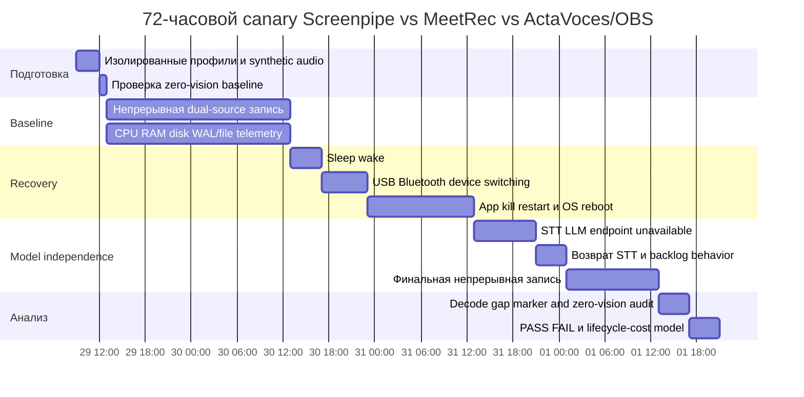

# DR26-10-28-HUB-01 — raw report from alternative

> Unedited output of one model. Our reconciled synthesis is the page one level up.

# DR26-10-16-HUB-08-2027 — Screenpipe alternatives: аудит непрерывной аудиозаписи, исходников и ремонтопригодности ПО

## Исполнительное резюме

**Срез состояния: 28 октября 2026.** Бюджет, масштаб развертывания, корпоративный/личный режим использования и конкретные версии macOS/Windows не заданы; ниже они считаются неопределёнными.

**Главный вывод — [Установлено]: полного готового OSI-open-source аналога Screenpipe, для которого публичными данными доказана одновременно вся требуемая комбинация — macOS Intel + Apple Silicon + Windows, 24/7 unattended-запись, микрофон + system loopback, строго audio-only без vision/OCR, долговечные локальные исходные аудиофайлы, отсутствие зависимости захвата от STT/LLM, сохранение non-speech/тишины, ротация и восстановление после sleep/reboot/device switch — я не нашёл.** У нескольких проектов есть почти все базовые capture-примитивы, но именно эксплуатационная часть «72 часа без человека» остаётся недоказанной.

Наиболее интересные результаты:

| Место для дальнейшей проверки | Кандидат | Почему |
|---|---|---|
| **Первый canary** | **MeetRec / `mmaximov97/meeting-recorder`** | MIT; готовые сборки Windows, macOS Intel и Apple Silicon; отдельные `mic.wav` и `system.wav`; запись локальна и прямо заявлена как работоспособная вообще без настроенного transcription server; VAD относится к опциональной транскрипции, а не к созданию WAV. Главный пробел — продукт ориентирован на сессии/звонки, а не доказанный unattended 24/7. citeturn23search0 |
| **Второй canary** | **ActaVoces** | AGPL-3.0-or-later; опубликованы Windows x64, macOS Intel/Apple Silicon; микрофон + system audio; WAV и остальные артефакты остаются обычными файлами; capture локален, summaries отключены по умолчанию, локальная STT не нужна для самого capture. Но проект прямо маркирует себя pre-1.0 и признаёт неполное multi-platform QA; непрерывный unattended-режим не документирован. citeturn23search2 |
| **Контроль зрелости capture-стека** | **OBS Studio** | Очень зрелый open-source capture stack и официальные Intel/Apple Silicon macOS + Windows builds. Полезен как контроль того, способен ли хост стабильно писать mic+desktop audio без STT/LLM. Но OBS — прежде всего video/streaming application; штатный, проверенный нами по первичным источникам сценарий долговременного audio-only с ротацией и recovery не доказан. citeturn22search0turn22search8 |

**Screenpipe остаётся функционально ближе всех к формулировке «always-on», но сейчас это уже не OSI-open-source.** На pinned release commit `d8589e6` от Screenpipe App **v2.7.125, 26 октября 2026**, root `LICENSE.md` — **Screenpipe Commercial License**; README на том же коммите прямо называет продукт **source-available**. Лицензия разрешает, среди прочего, personal non-commercial use, research/education/nonprofit и семидневную evaluation для организации, но коммерческая работа с repository builds/source требует коммерческой лицензии; старые версии, которые действительно были выпущены под MIT, согласно самому тексту лицензии, остаются MIT. Это описание текста лицензии, не юридическая консультация. citeturn13search0turn14view0turn14view1

**Точную границу MIT → Commercial License я не смог доказать.** Я перепроверил как минимум release-commits `aa1696a` (v2.7.79, 29 сентября 2026), `6a3dd0c` (v2.7.97), `e67aec7` и `acc1e7b` (октябрь 2026): Commercial License уже присутствует. Поэтому утверждать, какой именно tag был «последним MIT», без дополнительной истории Git нельзя. citeturn16view0turn16view1turn16view2turn16view3

По надёжности Screenpipe картина неоднозначна и не сводится к «Screenpipe сломан». В 2026 году есть качественно документированные Windows/macOS reports о WAL/SQLite pressure, mouse/UI lag, long startup `quick_check`, silent capture failure, retained processes/ports и Windows WASAPI handle growth. Некоторые старые проблемы уже закрыты, а текущая v2.7.125 включает, например, исправление recovery микрофона native AEC; следовательно, закрытый исторический issue нельзя автоматически переносить на актуальный build. citeturn19view2turn20view0turn20view1turn21view0turn21view1turn13search0

**Моя рекомендация — [Установлено, уверенность: средне-высокая]: не объявлять ни один найденный проект production replacement сейчас. Сохранить Screenpipe только как incumbent/reference и провести 72-часовой A/B canary первым делом с MeetRec, вторым — ActaVoces.** Основное допущение: допустимо рассматривать кандидата с manual/session-oriented UI, если одна запущенная запись технически может оставаться активной длительно. Если требование означает **обязательный автоматический старт/возобновление без человека после reboot/crash**, ни MeetRec, ни ActaVoces пока не имеют достаточного публичного доказательства соответствия.

Метки далее:

- **[Установлено]** — подтверждается первичным источником/кодом/release/воспроизводимым issue.
- **[Формируется]** — есть конкретное техническое свидетельство, но мало независимых воспроизведений либо отсутствует acceptance test.
- **[Спекулятивно]** — гипотеза или непроверенная причинность.
- **[Маргинально]** — слишком слабый/ранний проект или источник для production-вывода.

## Жёсткие требования и ландшафт кандидатов

В матрицах: **PASS** — требование подтверждено; **FAIL** — источник прямо противоречит требованию; **PARTIAL** — реализовано условно/не полностью; **UNKNOWN** — публичного доказательства недостаточно. `24/7` означает именно длительную unattended-запись, а не возможность нажать Record на длинной встрече.

### Базовые capture-требования

| Проект | macOS Intel | macOS Apple Silicon | Windows | Mic + system audio | Без vision/OCR | Локальный audio независимо от LLM/STT | Источник, состояние |
|---|---:|---:|---:|---:|---:|---:|---|
| **Screenpipe v2.7.125** | PASS | PASS | PASS | PASS | **PARTIAL** | **PARTIAL/PASS** | README документирует обе архитектуры Mac, Windows, system audio + microphone, local Whisper и localhost API. Vision можно отключать, но само наличие setting не доказывает отсутствие любых vision-artifacts в длительном run; это нужно проверять canary. [Pinned README, 26 Oct 2026](https://raw.githubusercontent.com/screenpipe/screenpipe/d8589e6/README.md). citeturn14view1 |
| **MeetRec** | PASS | PASS | PASS | PASS, отдельные WAV | PASS | **PASS** | Releases предусматривают `aarch64.dmg`, `x64.dmg`, Windows installer/portable; запись целиком local и без transcription settings остаётся «plain local recorder». [GitHub, accessed 28 Oct 2026](https://github.com/mmaximov97/meeting-recorder). citeturn23search0 |
| **ActaVoces** | PASS | PASS | PASS | PASS | PASS | **PASS** | Опубликованы DMG для Intel/Apple Silicon и EXE/MSI; capture — Rust/`cpal`, WAV на диске; summaries optional, local processing independent of remote provider. [GitHub, accessed 28 Oct 2026](https://github.com/EzyGang/actavoces). citeturn23search2 |
| **OBS Studio** | PASS | PASS | PASS | PASS на поддерживаемых ОС | **PARTIAL** | PASS | Официальный сайт предлагает Intel и Apple Silicon macOS builds и Windows; OBS — open-source recorder/streamer. Modern macOS desktop audio поддерживается capture stack, но штатный audio-only production workflow необходимо валидировать отдельно. [OBS, accessed 28 Oct 2026](https://obsproject.com/). citeturn22search0turn22search8 |
| **Audacity** | PASS* | PASS* | PASS | Win PASS; Mac **PARTIAL** | PASS | PASS | Windows WASAPI loopback официально рекомендован. На macOS системный loopback исторически требует отдельного audio-routing path/device; это ухудшает «ready-made» соответствие. Audacity — GPL/open-source desktop recorder. [Audacity FAQ](https://www.audacityteam.org/faq/), [Windows loopback manual, 2 Sep 2026](https://manual.audacityteam.org/man/tutorial_recording_computer_playback_on_windows.html). citeturn22search5turn22search28 |
| **Meetily** | **UNKNOWN** | PASS | PASS | PASS | PASS | PARTIAL | README/release документируют Mac/Windows, но найденный current installation path показывает macOS `aarch64` build, без доказанного Intel installer; capture смешивает mic+system. [GitHub](https://github.com/Zackriya-Solutions/meetily). citeturn6view0turn6view1 |
| **Sanka Recorder** | UNKNOWN | UNKNOWN | PASS | **PARTIAL/UNKNOWN** | PASS | PASS для сохранения записи | Официально Mac/Windows, Apache-2.0, отдельный `audio.m4a`, без screen-recording permission; recording начинается только после `Record`. Архитектура dual-source требует отдельной source-level проверки. [Sanka Recorder](https://sanka.com/flow/recorder/). citeturn6view2 |
| **Vexa Desktop** | source-build | source-build | source-build | PASS | PASS | **UNKNOWN/PARTIAL** | Tauri + `cpal`, macOS ScreenCaptureKit, Windows WASAPI; WAV+SQLite реализованы, но README требует transcription endpoint/token и сам проект маркирован MVP, всего несколько commits и без доказанного release-install path. [GitHub](https://github.com/Vexa-ai/vexa-desktop). citeturn23search1 |
| **Amanu** | заявлен Mac | заявлен Mac | заявлен Win | PARTIAL | PASS | UNKNOWN | MIT automatic meeting recorder, но автоматизация привязана к meeting lifecycle, а не к continuous ambient capture. [GitHub, 2026](https://github.com/gsamat/amanu). citeturn10search14 |
| **Hark** | PASS | PASS | PASS | PASS | PARTIAL | PARTIAL/PASS | MIT, имеются Windows CPU/CUDA и macOS Apple Silicon/Intel installers, но UX рассчитан на звонок и сознательное `Record`; продукт не заявляет unattended 24/7. [GitHub, accessed 28 Oct 2026](https://github.com/Dallenlol/hark). citeturn10search17 |

\* Для Audacity проблема не столько CPU architecture, сколько отсутствие столь же прямого native system-loopback workflow на macOS, как WASAPI loopback на Windows.

### Устойчивость и сохранение ambient audio

| Проект | 24/7 доказан | Chunking / rotation / retention | Restart / sleep / device-switch recovery | Non-speech/тишина | STT RU/EN offline | API / экспорт | Ресурсные данные |
|---|---:|---|---|---|---|---|---|
| **Screenpipe** | **Заявлен always-on**, но durability спорна | 30-секундные audio chunks наблюдаются в актуальных reports; retention существует | **PARTIAL**: есть новые recovery work, но также актуальные failures | **PARTIAL**: VAD существует; meeting-only paths могут отбрасывать chunks | Local Whisper заявлен | REST `localhost:3030`, MCP/pipes | Vendor: примерно 5–20% CPU, 0.5–3 GB RAM; это не независимый benchmark. citeturn14view1turn12search4turn20view0turn13search0 |
| **MeetRec** | **UNKNOWN** | Месячные каталоги, отдельные WAV; автоматическая ротация длинного run не доказана | UNKNOWN | **Лучший профиль**: raw mic/system WAV; Silero VAD описан для опционального whisper.cpp STT, а не для capture | Whisper.cpp `auto`, поэтому архитектурно пригоден для multilingual; RU acceptance отдельно не показан | Файлы; remote/self-hosted STT optional | Нет достоверных CPU/RAM/disk benchmarks. citeturn23search0 |
| **ActaVoces** | UNKNOWN | Recording folders + WAV/JSON/Markdown; pipeline jobs recoverable | Pipeline retry есть; hardware capture recovery UNKNOWN | Вероятно сохраняет raw audio, но destructive-silence test отсутствует | faster-whisper local; конкретный RU acceptance не приведён | Files/SQLite | Нет опубликованного benchmark; README прямо предупреждает о pre-1.0 QA. citeturn23search2 |
| **OBS** | Long-running use возможен, но 72h acceptance не найден | Configurable files; требуемая автоматическая rotation/retention не доказана здесь | UNKNOWN | **PASS по архитектуре**: capture не требует VAD/STT | Нет встроенного требования к STT | Standard recordings | Нельзя переносить чужие OBS benchmarks на данный сценарий; данных не использовал. citeturn22search0 |
| **Audacity** | UNKNOWN | Один проект/recording, production rotation не является заявленной функцией | UNKNOWN | PASS, если effects/VAD не применяются | Нет встроенной обязательной STT | Audio export | Нет релевантного 72h benchmark. citeturn22search28turn22search5 |
| **Meetily** | **FAIL как доказательство**: meeting-oriented | Session-oriented | Bluetooth resampling и WASAPI improvements заявлялись, но unattended recovery не доказан | **FAIL/PARTIAL для строгого требования**: release notes упоминают advanced noise removal, RMS mixing и VAD; это означает, что сохранность ambient должна проверяться, а не предполагаться | Local Whisper/Parakeet | Meeting artifacts | Release заявляет снижение памяти, но без пригодных абсолютных cross-platform benchmark цифр. citeturn6view0turn6view1 |
| **Sanka** | FAIL | Один folder/call, `audio.m4a` | UNKNOWN | UNKNOWN | Документированы Japanese/English; **RU не подтверждён** | Local files | Нет benchmark. citeturn6view2 |
| **Vexa Desktop** | UNKNOWN/FAIL для production | **Chunk-on-pauses** | UNKNOWN | **PARTIAL/FAIL для строгого ambient**: pause-based segmentation является частью опубликованной pipeline | Зависит от endpoint | SQLite + WAV | MVP, ресурсов нет. citeturn23search1 |
| **Amanu** | FAIL как 24/7 proof | Meeting-triggered | UNKNOWN | UNKNOWN | UNKNOWN | Meeting files | Нет релевантных данных. citeturn10search14 |
| **Hark** | FAIL как 24/7 proof | Call/session | UNKNOWN | UNKNOWN | Локальная обработка есть, RU acceptance не доказан | Session artifacts | Нет доказательного 72h resource profile. citeturn10search17 |

Критически важно различать **«может писать часами»** и **«спроектирован для 24/7 эксплуатации»**. Последнее требует как минимум bounded files/rotation, restart semantics, device rediscovery, обнаружения stale capture и доказанного поведения при sleep/wake. У большинства meeting recorders публичная документация заканчивается намного раньше.

### Явные исключения и слабые leads

**OpenRecall** — не тот класс ПО: это visual-recall/screenshot-oriented проект, поэтому противоречит `zero video/screenshots/OCR`. [GitHub](https://github.com/Eng-Elias/Open_Recall). citeturn3search10

**Hearsay** умеет system audio и/или microphone с local Whisper, но найденный desktop app — Windows-only; следовательно, cross-platform hard requirement провален. [GitHub](https://github.com/parkscloud/Hearsay). citeturn8search1

**akou** — интересный open-source Granola-style direction, но опубликованный design использует macOS capture helper; Windows parity не доказана. [GitHub/design, 17 Oct 2026](https://github.com/GeiserX/akou). citeturn8search6turn8search9

**sonus-auris Audio Dashcam** действительно ближе к идее непрерывного rolling audio: короткие overlapping WAV segments и capture, независимый от sidecar processing. Но исследованный проект — Flutter Android/iOS, microphone stream, а не macOS/Windows + system loopback. [GitHub](https://github.com/sonus-auris/sonus-auris-ui.dart). citeturn7search1

**`mmaximov97/meeting-recorder` / MeetRec**, напротив, оказался сильнее исходных leads: это именно two-track Windows/macOS recorder, а не библиотека или пустые platform folders. citeturn23search0

Для названия **“Amure”** я не установил однозначно соответствующий публичный desktop recorder. Я не подменяю его другим проектом; **Amanu** рассмотрен отдельно как самостоятельный candidate. Это остаётся coverage gap, а не основанием считать Amure FAIL.

## Три ближайших варианта и почему остальные не проходят

**Первое место — MeetRec, [Формируется], confidence medium.** Это наиболее чистое совпадение с архитектурным ядром требования: OSI MIT, три требуемых desktop architecture targets, mic/system разделены на самостоятельные WAV, запись остаётся локальной, а отсутствие transcription gateway прямо превращает программу в обычный recorder. Для macOS указан native Core Audio process tap с требованием macOS 14.2+, для Windows — WASAPI loopback. Также имеется ring buffer первых секунд и documented build `cargo test --workspace` + `npx tauri build`; CI, по README, строит macOS и Windows на pushes/tags. citeturn23search0

Но MeetRec **нельзя пока назвать full match**. UI и detection ориентированы на Zoom/Teams/Slack/Discord; README не обещает 24/7 session, bounded chunk rotation, auto-resume после reboot или day-scale device-switch validation. То, что hotkey может начать запись, не доказывает, что процесс благополучно проживёт 72 часа. citeturn23search0

**Второе место — ActaVoces, [Формируется], confidence medium.** Плюсы: AGPL-3.0-or-later; normal files вместо vendor workspace; `recording.wav`, `microphone.wav`, transcript/JSON/job logs; Tauri/Rust capture, local faster-whisper, локальный Sortformer, summary provider полностью optional. README прямо говорит, что recording/local processing после model setup могут работать без сети. Release workflow публикует Windows x64 и обе Mac architectures. citeturn23search2

Минус существенный: maintainer сам пишет, что это **open-source pre-1.0 без comprehensive multi-platform QA**, с большим Windows usage и меньшим macOS usage. Поэтому наличие хорошей архитектуры не равно операционной надёжности. citeturn23search2

**Третье место — OBS Studio как инженерный control, [Установлено для capture maturity, не для полного match].** Это не лучший UX-кандидат, зато самый полезный независимый контроль: если OBS на том же Mac/Windows стабильно пишет mic + desktop audio при отключённых ML/vision workloads, а Screenpipe нет, это сильно сужает область диагностики в сторону Screenpipe DB/UI/processing pipeline. Официально доступны Windows, macOS Intel и Apple Silicon. citeturn22search0

Для production replacement OBS слабее MeetRec: он video-centric, не предоставляет доказанного в этом аудите lifecycle «always-on audio daemon + rotation + retention + self-heal». На старых/macOS-specific capture paths встречалась необходимость virtual audio routing, хотя современный OBS использует native macOS capture capabilities; конкретный target OS всё равно надо проверять. citeturn22search8

**Почему не Meetily.** Cross-platform meeting recorder хороший по функциональности, но current install evidence для Mac Intel хуже, чем у MeetRec/ActaVoces. Главное для данного use case — release notes прямо указывают VAD, advanced noise removal и RMS-based mixing. Для meeting transcript это может быть достоинством; для forensic-like ambient recorder, где нужна сохранность музыки, шумов и тишины, это требует отдельного доказательства. citeturn6view0turn6view1

**Почему не Sanka.** Это аккуратный Apache-2.0 audio-only recorder с локальным файлом и без screen recording; однако он сознательно не записывает до нажатия Record, описан как per-call workflow и документирует только Japanese/English transcription. citeturn6view2

**Почему не Vexa Desktop.** Исходники выглядят технически релевантно — `cpal` + ScreenCaptureKit/WASAPI, WAV+SQLite, dual-source mix — но README сам маркирует продукт MVP, recording pipeline режет поток «on pauses» и направляет chunks в transcription endpoint. До проверки поведения при недоступном endpoint считать capture независимым от STT нельзя. citeturn23search1

**Audacity** — отличный редактор/recorder, но плохой unattended service: Windows loopback прост, Mac требует дополнительного routing solution, а day-scale recovery/rotation не является его основной product contract. citeturn22search5turn22search28

## Screenpipe: аудит жалоб и контрдоказательств

Ниже проблема считается **текущим дефектом только тогда**, когда это поддерживается состоянием issue и версией. Количество GitHub issues **не используется как оценка prevalence**.

| Issue | Дата / ОС / версия | Что реально установлено | Статус на 28 Oct 2026 | Оценка доказательства |
|---|---|---|---|---|
| [#7569](https://github.com/screenpipe/screenpipe/issues/7569) | 9 Oct 2026, Windows, 2.7.98 diagnostics | Пользователь сообщал mouse lag даже с screenshots off/power-save; diagnostics содержали accessibility overflow warnings, audio-persistence OS error 665 и WAL checkpoint deferrals. Но upload предшествовал части screenshots-off test, поэтому причинность screenshot-independent regression не доказана. | Closed as **not planned**, labels включали performance/Windows/needs-reproduction. | **[Формируется] user report + diagnostic corroboration; не controlled reproduction.** citeturn2view2 |
| [#6305](https://github.com/screenpipe/screenpipe/issues/6305) | 16 Aug 2026, Windows vs macOS | Telemetry report приводил Windows CPU p50 1.46%, p90 9.93%, p98 25.70% против macOS 0.80/2.44/9.69%; автор подозревал accessibility/UIA по исключению, но прямо отмечал, что elimination ≠ proof. | Closed. | **[Формируется] агрегированная telemetry, root cause speculative.** citeturn0search1 |
| [#7059](https://github.com/screenpipe/screenpipe/issues/7059) | 17 Sep 2026; Windows 11 Pro; app 2.7.42 / engine 0.4.50 | Автор лично воспроизвёл sluggish cursor/desktop при recording; audio был отключён. Логи: ~40,368 pending WAL pages, slow DB operations до ~16.8 s, ~1.6 GB process memory и >300 threads; stop recording улучшал responsiveness. | Closed completed 28 Sep. Прямого fix PR в issue нет. | **[Установлено для конкретного host/build]; не доказывает current 2.7.125 regression.** citeturn19view2 |
| [#2482](https://github.com/screenpipe/screenpipe/issues/2482) | 13 Mar 2026, various OS/recent CLI | Auto-generated Sentry report: `PoolTimedOut`, SQLite `database is locked`, unable-to-open DB, включая insert audio chunks; 8 events/3+ users по issue. | Closed 20 Mar с комментарием «Resolved», но без linked PR/branch. | **[Формируется]; historical, закрыт, fix provenance слабая.** citeturn19view1 |
| [#7704](https://github.com/screenpipe/screenpipe/issues/7704) | 19 Oct 2026; macOS 26.3; Screenpipe 2.7.109; 77 GB DB | На одном Mac `PRAGMA quick_check(1)` после startup занимал 24–60 min, читал ~100–190 MB/s, удерживал snapshot, WAL рос; `audio_chunks.file_path` lookup оказался full scan. Приведены измерения и query plan. | **Open**. 26 Oct issue получил referenced commit `3f77658` для skip unconditional quick_check/indexing; включение и field-fix в production независимо не подтверждены. | **[Установлено на данном host], сильный single-machine report.** citeturn20view0 |
| [#7700](https://github.com/screenpipe/screenpipe/issues/7700) | 18 Oct 2026; Windows 11 build 26200; app 2.7.84 / engine 0.4.52 | Измерен рост handles в `audiodg.exe`; source inspection указывает на periodic device inventory через CPAL WASAPI supported-format sweep. Отдельный пользователь 20 Oct сообщил аналогичный degradation и ~1.5M handles, но универсальный leak-rate не установлен. | **Open**, fix на installed build не принят. | **[Формируется → сильное], механизм имеет source/probe evidence + одно независимое подтверждение.** citeturn20view1 |
| [#1626](https://github.com/screenpipe/screenpipe/issues/1626) | 17 Mar 2025; macOS | Historical report: mic/display audio мог останавливаться после десятков часов, часто после ночи/sleep; maintainer позже подтверждал, что проблема ещё случалась. | Closed completed 28 Feb 2026; issue references `ecdcf96` «fix: audio bug (#1626)». | **[Установлено исторически], но нельзя считать defect текущей v2.7.125.** citeturn2view3 |
| [#7626](https://github.com/screenpipe/screenpipe/issues/7626) | 14 Oct 2026; macOS 26.6.2 arm64; 2.7.108 | После relaunch старые desktop/CLI процессы удерживали DB/ports 3030/11435, новая запись не запускалась; SIGTERM/SIGKILL не очистили observed state. Возникновение состояния на clean machine не воспроизведено. | **Open, high priority/macOS.** | **[Установлено persistent failure на одном affected host]; исходная причина неизвестна.** citeturn21view1 |
| [#7679](https://github.com/screenpipe/screenpipe/issues/7679) | 17 Oct 2026; customer OS/version не установлены | Customer report: capture может остановиться, а `/health` остаётся OK. Physical disk-full/stall не воспроизведён, но maintainer затем детерминированно воспроизвёл узкий classification gap в production predicate. | **Open**; draft health PR существовал, full desktop validation не доказана. | **[Формируется]: health bug подтверждён, customer root cause — нет.** citeturn21view0 |
| [#7693](https://github.com/screenpipe/screenpipe/issues/7693) | 17 Oct 2026; macOS, CLI 0.4.52 | Pipe executions получали local API HTTP 403, тогда как shell requests — 200; 26 Oct contributor описал concrete auth-key/token-registry root cause в `screenpipe-engine`/`screenpipe-core` и proposed tests/fix. | **Open** в полученном readback; release fix не установлен. | **[Формируется → сильное] для pipe/MCP-adjacent auth; recorder продолжал работать.** citeturn21view2 |

Эти reports позволяют разделить несколько совершенно разных источников нагрузки.

Во-первых, **system-recorder load не равен local-LLM load**. В #7059 audio был вообще отключён, а bottleneck evidence указывал на WAL/database/accessibility/input-hook workloads; следовательно, относить этот lag к Whisper/Ollama было бы ошибкой. citeturn19view2

Во-вторых, #7700 относится к Windows audio-device enumeration/WASAPI и наблюдался даже при анализе device inventory; это тоже не доказательство нагрузки STT. citeturn20view1

В-третьих, current README официально поддерживает **local Whisper** для transcription и local AI provider вроде **Ollama** для AI processing. Сам факт поддержки backend не означает, что все integration paths бездефектны, но и отдельные STT reports не позволяют утверждать, что «Ollama несовместим со Screenpipe» как общее свойство. [Pinned README, 26 Oct 2026](https://raw.githubusercontent.com/screenpipe/screenpipe/d8589e6/README.md). citeturn14view1

Есть старые/среднесрочные STT leads, которые важно не переинтерпретировать: issue [#4623](https://github.com/screenpipe/screenpipe/issues/4623) сообщал о загрузке local Whisper/VRAM при выбранном Deepgram backend; [#2632](https://github.com/screenpipe/screenpipe/issues/2632) касался MLX/metallib crash на macOS; [#3498](https://github.com/screenpipe/screenpipe/issues/3498) — прекращения transcription reconciliation; [#4837](https://github.com/screenpipe/screenpipe/issues/4837) обсуждал Windows Whisper GPU path. Я рассматриваю их как **single-source leads**, а не доказательство текущего v2.7.125 defect, поскольку в этом pass не установил для каждого связанный fix/release и current reproduction. citeturn12search20turn12search18turn12search12turn12search23

Есть и **контрдоказательство активного ремонта**. Latest release, который удалось закрепить, — **Screenpipe App v2.7.125 от 26 октября 2026, commit `d8589e6`**; release notes включают, среди прочего, исправление native AEC microphone recovery с supervised capture workers и DB/retention work. Поэтому старые bugs вроде #1626 нельзя использовать как доказательство состояния 28 октября без нового reproduction. citeturn13search0

Именно поэтому правильная формулировка не «у Screenpipe много issues», а: **есть несколько свежих конкретных failure modes, достаточно серьёзных, чтобы требовать длительного acceptance test, но публичные данные не дают denominator и не позволяют оценить prevalence среди пользователей.**

## Screenpipe: исходники, лицензия, сборка и программная ремонтопригодность

Pinned baseline аудита — **`d8589e6`, Screenpipe App v2.7.125, 26 Oct 2026**. Это важно, потому что `main` быстро меняется; сам README рекомендует для стабильной разработки ориентироваться на release commit. citeturn13search0turn14view1

### Карта компонентов

| Компонент | Pinned/current repo path | Что удалось установить | Ремонтный риск |
|---|---|---|---|
| **Audio capture / device discovery** | [`crates/screenpipe-audio/`](https://github.com/screenpipe/screenpipe/tree/d8589e6/crates/screenpipe-audio), в частности `src/core/device.rs`, `src/core/process_tap.rs`; Windows process path встречается в `process_tap/windows.rs` | Один общий Rust audio subsystem; macOS process-tap и Windows capture paths явно обсуждаются в code-linked issues. CPAL fork используется в Windows device work. citeturn12search7turn12search17turn20view1 | **Средний:** native OS API + device/driver edge cases. |
| **Audio manager / chunk lifecycle** | `crates/screenpipe-audio/src/audio_manager/manager.rs` | Issue #5611 прямо ссылается на manager и различает ongoing capture от downstream meeting-only dropping. citeturn12search4 | **Средний:** полезная модульность, но behavior modes влияют на persistence. |
| **VAD / resampling / STT** | `crates/screenpipe-audio/src/vad/webrtc.rs`, `.../stt.rs`, `.../transcription/whisper/model.rs`, speaker preparation code | WebRTC VAD path и resampling к 16 kHz documented in issue/code discussion; Whisper implementation находится внутри audio crate. citeturn12search19turn12search23 | **Средне-высокий:** capture, VAD, STT и speaker processing расположены близко; ошибочно считать raw capture автоматически изолированным от processing. |
| **Persistence** | [`crates/screenpipe-db/`](https://github.com/screenpipe/screenpipe/tree/d8589e6/crates/screenpipe-db) | README описывает SQLite FTS5/media storage; current issues показывают WAL/checkpoint/audio_chunks behavior на реальных базах. citeturn14view1turn20view0turn19view1 | **Высокий operational risk при большой истории:** DB не просто metadata adjunct, она участвует в lifecycle. |
| **REST/local service** | server/service crates under `crates/`; API документирован на `localhost:3030` | REST API является штатной частью architecture; current auth issue демонстрирует взаимодействие engine/core/pipes с local API. Точный route-handler файл каждого endpoint в этом web pass не закреплён. citeturn14view1turn21view2 | **Средний:** API открыт исходниками, но auth/version drift требует integration tests. |
| **Pipes/MCP integration** | `crates/screenpipe-engine/src/cli/pipe.rs`, `crates/screenpipe-core/src/pipes/mod.rs`; `packages/` содержит SDK/CLI/MCP layers по repo guide | #7693 даёт конкретные code paths и token-registry failure mechanism. citeturn21view2turn14view1 | **Средний/высокий:** отдельный integration surface, не нужен базовому recorder. |
| **Desktop UI** | [`apps/screenpipe-app-tauri/`](https://github.com/screenpipe/screenpipe/tree/d8589e6/apps/screenpipe-app-tauri) | Tauri desktop layer отделён от Rust capture/storage crates. citeturn14view1 | **Средний:** можно теоретически обслуживать engine отдельно от UI, но официальный deployment связывает их lifecycle. |
| **Build/release** | Root Cargo workspace, CONTRIBUTING, Tauri/app packaging | README предлагает build from source и прямо предупреждает, что `main` быстро движется; release builds существуют для Windows и Mac Intel/Apple Silicon. Root Cargo использует `LICENSE.md` и такие deps, как SQLite/sqlx, samplerate и pinned audio dependencies. citeturn11view3turn14view1 | **Средне-высокий:** source present ≠ reproducible successful build. В этом исследовании ничего не компилировалось. |
| **Models / native runtimes** | Whisper/VAD/speaker runtime assets, не единый proprietary blob | Health output/current docs показывают Silero VAD/speaker runtime concepts; local Whisper поддерживается. Model weights имеют собственную supply/licensing surface, которую нельзя автоматически приравнять к root repo license. citeturn21view2turn14view1 | **Средний:** необходимо отдельно pin/hash/version model assets. |
| **Cloud backends** | Deepgram, Screenpipe Cloud и AI providers | Cloud не является обязательным для documented local-first mode; README заявляет local capture/search offline after initial setup и local Whisper/Ollama option. citeturn14view1 | **Низкий для базового recorder**, если cloud path полностью отключён и это подтверждено тестом. |

### Лицензионная ремонтопригодность

Текущий [`LICENSE.md`](https://raw.githubusercontent.com/screenpipe/screenpipe/d8589e6/LICENSE.md) на pinned commit — **Screenpipe Commercial License**. Он применяется к repository code, разрешает определённые бесплатные категории использования и отдельно говорит, что ранее выпущенные MIT versions сохраняют MIT. Current README использует термин **source-available**, не «open source». citeturn14view0turn14view1

Проверенные release commits показывают Commercial License как минимум уже на `aa1696a` / v2.7.79 от 29 сентября 2026 и далее через начало/середину октября. **Точную последнюю MIT revision установить не удалось**, поэтому я не рекомендую строить procurement decision на предположении вроде «v2.7.x до N был MIT». citeturn16view0turn16view1turn16view2turn16view3

Практическое следствие: **исходники есть, но право коммерчески поддерживать собственный fork уже нельзя автоматически выводить из привычных OSI freedoms.** Для personal/noncommercial использования текст лицензии выглядит существенно менее ограничительным; для корпоративной эксплуатации нужен отдельный license review. Это не правовое заключение. citeturn14view0

### Можно ли независимо починить audio + API?

**Технически — вероятно да; юридически/операционно — условно. [Формируется]**

Положительная сторона: capture, audio manager, VAD/STT, DB, desktop и API layers присутствуют в доступном repository; platform capture не выглядит как закрытый vendor-only binary interface. README документирует local-only mode и build flow. citeturn14view1turn11view3

Отрицательная сторона: Screenpipe уже имеет значительную coupling surface — Rust/Tauri, native macOS/Windows capture APIs, SQLite lifecycle, ML runtimes, process ownership, local API/auth, optional cloud/model stacks. Current issues демонстрируют, что «исправить recorder» может означать не только заменить одну audio function, но и проверить device enumeration, DB persistence, health semantics, updater/relaunch, permissions и background workers. citeturn20view0turn20view1turn21view0turn21view1

Кроме того, **source presence — не build proof**. Я не выполнял checkout, dependency download, code signing, compilation или installer production. Отсутствие обязательного vendor cloud в README не доказывает reproducible offline build из чистой среды. citeturn14view1

### Сравнительная «ремонтопригодность ПО»

Это **моя аналитическая шкала**, не внешний iFixit-style score. Вес: license/fork freedom 20%, build transparency 15%, capture/storage modularity 20%, cross-platform code clarity 15%, test/release machinery 10%, operational recovery/observability 10%, dependency complexity 10%.

| Ранг | Проект | Аналитический score | Обоснование |
|---|---|---:|---|
| **A-** | **MeetRec** | **8.2/10** | MIT, небольшая понятная capture-задача, separate WAV, source build и CI recipe, нет обязательной STT. Снижает оценку молодость и отсутствие proven 24/7 recovery. citeturn23search0 |
| **B+** | **ActaVoces** | **7.7/10** | AGPL, обычные файлы, хорошо разделены Rust capture и Python ML, retryable jobs, cross-platform releases. Минусы: pre-1.0 и более сложный dependency stack. citeturn23search2 |
| **B+** | **OBS Studio** | **7.5/10** | Очень зрелый open-source codebase/release ecosystem; минус — большой сложный проект и не специально спроектированный 24/7 audio daemon. citeturn22search0 |
| **B** | **Sanka Recorder** | **7.0/10** | Apache-2.0, modular crates и inspectable files; но meeting workflow, ограниченная language story и недоказанная dual-platform unattended robustness. citeturn6view2 |
| **B-** | **Meetily** | **6.4/10** | MIT/source доступен, но ML/audio processing сложнее, destructive filtering надо исключать, Intel Mac distribution не доказана. citeturn6view0turn6view1 |
| **C+** | **Vexa Desktop** | **5.9/10** | MIT/Apache dual license и понятный Tauri code, но MVP, 7 commits в полученном snapshot и unclear recorder/STT failure coupling. citeturn23search1 |
| **C** | **Screenpipe current** | **5.4/10 для независимого commercial maintenance** | Source доступен и архитектура относительно модульна, но Commercial License, быстрый version drift, сложная DB/ML/UI/service surface и свежие lifecycle bugs снижают независимую repairability. Для разрешённого noncommercial use score был бы выше. citeturn14view0turn14view1turn20view0turn21view1 |

## Repair-vs-replace: procurement и lifecycle решение

Строгий decision tree получается следующим.

**Если главный критерий — именно unattended 24/7 сегодня**, Screenpipe остаётся единственным из исследованных кандидатов с явным always-on product contract; однако текущие complaints делают неприемлемым доверять только UI/status. Требуется проверять **fresh playable persisted audio**, а не `/health`, tray icon или факт существования process. README заявляет always-on capture, но #7679 показывает, почему control plane не должен быть единственным acceptance signal. citeturn14view1turn21view0

**Если главный критерий — OSI/open-source repair autonomy**, current Screenpipe проигрывает MeetRec, ActaVoces и OBS уже на уровне лицензии. Для организации особенно важно, что current Commercial License не предоставляет обычный MIT/Apache/GPL набор commercial modification/distribution freedoms. citeturn14view0

**Если главный критерий — минимальный ML/DB attack surface**, MeetRec выглядит значительно чище: два WAV-потока можно получить без transcription server вообще. Это снижает число компонентов, способных сделать запись зависимой от inference layer. citeturn23search0

**Если нужны local transcript + normal files**, ActaVoces выглядит сильнее: capture/storage остаются локальными, summary provider optional, pipeline stages разнесены и могут retry. citeturn23search2

Из этого следует procurement policy:

| Решение | Когда оправдано | Что запрещено считать доказательством |
|---|---|---|
| **Оставить Screenpipe временно** | Уже развернут и нужен true always-on сейчас | UI “recording”, `/health=OK`, закрытый старый issue, одиночный 5-минутный test |
| **Canary MeetRec** | Нужна максимальная простота raw audio + OSI | Сам факт наличия WAV после одной встречи ≠ 72h reliability |
| **Canary ActaVoces** | Нужны raw files + local STT + patchability | Наличие Intel/ARM installers ≠ capture parity |
| **OBS control** | Нужно отделить OS/audio-driver проблему от Screenpipe pipeline | Успешная OBS запись ≠ готовый lifecycle replacement |
| **Не закупать/не стандартизировать Vexa сейчас** | Пока только R&D | Source code/build recipe ≠ finished installer/product |
| **Не выбирать Meetily для forensic ambient requirement без теста** | Его denoise/VAD/mixing могут быть полезны meetings | Высокое speech quality ≠ сохранение non-speech |

Для lifecycle cost главным измеряемым параметром должен быть не purchase price, а:

**lost-audio minutes / endpoint-month + GB/day + operator interventions/month + failed recoveries/reboots + CPU-hours/day + engineering hours per upgrade.**

Именно эти величины различат «бесплатный open-source recorder» и реально дешёвую систему. Сейчас публичных данных для честного TCO rank нет.

## Canary на 24–72 часа, action timeline, пробелы и источники

Ни один installation/change не выполнялся в рамках этого исследования. Следующий план предназначен для **изолированного тестового Mac и Windows host** с синтетическим/публичным тестовым аудио, без private recordings и без платных API.

### Acceptance dataset

Создать один **известный 72-часовой stimulus schedule**, одинаковый для всех кандидатов:

| Стимул | Частота | Для чего |
|---|---:|---|
| Короткая EN phrase с timestamp/id | каждые 15 min в system channel | обнаружение пропусков и intelligibility |
| Короткая RU phrase с другим id | каждые 15 min, offset 5 min | RU сохранность; STT secondary |
| Tone/chirp sequence | каждые 5 min | точное автоматическое gap detection без зависимости от STT |
| Музыка/ambient public-domain sample | несколько интервалов/день | проверка, что VAD/denoise не уничтожает non-speech |
| Настоящая тишина | ≥30 min/day | проверка, создаётся ли запись тишины или она фильтруется |
| Mic-side clap/tone/synthetic speech | фиксированный schedule | отдельная оценка microphone path |

**Главная метрика — не transcript completeness, а decoded audio completeness.** STT может использоваться только как дополнительный индекс.

Предлагаемые acceptance thresholds, которые являются **политикой теста, а не свойствами продуктов**:

- `vision_artifacts = 0`: ни screenshots, ни video files, ни OCR records/content.
- **100%** ожидаемых files остаются декодируемыми после clean stop.
- После forced kill уже закрытые chunks должны оставаться декодируемыми; потеря bounded только текущим незавершённым chunk.
- ≥**99.9%** scheduled tone markers обнаруживаются в каждом требуемом audio source.
- Ни одного необъяснённого audio gap >5 s.
- Ambient/music остаются слышимыми и измеряемыми; silence не удаляется, если политика требует real-time continuity.
- При отключённой STT/LLM инфраструктуре **audio marker completeness не меняется**.
- Для true 24/7 claim: после reboot/crash recorder возобновляет capture автоматически; если продукт требует ручного `Record`, это фиксируется как **hard FAIL**, а не workaround.

### Fault sequence

**Первые 24 часа — baseline.** Запись system + mic, vision disabled by design/config, STT локально доступна там, где есть. Каждые 60 секунд собирать process CPU, RSS/working set, disk bytes, file count/size и latest playable-audio timestamp. Screenpipe дополнительно: DB/WAL sizes и timestamp последнего persisted audio chunk. Его vendor resource figures 5–20% CPU/0.5–3 GB RAM следует использовать только как reference envelope, не как acceptance truth. citeturn14view1

**24–48 часов — recorder fault tests.** Выполнить sleep/wake, lid sleep на Mac, Windows sleep, logout/login при необходимости, USB headset unplug/replug, Bluetooth connect/disconnect, default-output switch, microphone switch, output sample-rate change, затем clean application restart и OS reboot. Особенно важны device switch и sleep после исторического #1626 и свежего Windows device-inventory #7700. citeturn2view3turn20view1

**48–72 часа — model/network failure.** Остановить local STT process/Ollama/self-hosted transcription endpoint, либо firewall-block его на test host. Не останавливать recorder. Через 4–6 часов вернуть model service и проверить, продолжалась ли запись всё это время. Это непосредственно отличает «audio recorder with optional STT» от «recording pipeline coupled to STT».

Для Screenpipe дополнительно создать контролируемый, безопасный large-history/storage-pressure сценарий — **не заполнять реальный пользовательский диск**, а использовать test volume — и сравнивать `/health` с реальным latest persisted playable audio timestamp, поскольку #7679 показывает, что health semantics могут расходиться с actual persistence. citeturn21view0

Для Screenpipe на Windows отдельно фиксировать `audiodg.exe` handle count во времени и device inventory activity, поскольку #7700 содержит measurable lead именно на этот subsystem. citeturn20view1

Для Meetily обязательно сравнить input WAV/fixture с сохранённым выходом на участках music/ambient/silence, поскольку VAD/noise-removal/RMS mixing входят в documented feature set. citeturn6view1

Для MeetRec VAD следует оставить **только downstream STT concern**: документация ставит Silero VAD в пример запуска `whisper-server`, тогда как сами mic/system WAV существуют независимо. Это важное архитектурное преимущество, которое canary должен подтвердить на длинной записи. citeturn23search0

### Что измерять

Минимальный result record для каждого host/candidate:

| Метрика | Как интерпретировать |
|---|---|
| `wall_clock_recordable_seconds / expected_seconds` | Главная completeness metric |
| marker recovery по mic и system отдельно | Обнаруживает loss одного source при «живом» recorder |
| longest unexplained gap | Быстро выявляет sleep/device failures |
| decoded-file failure count | Durable-storage integrity |
| current open chunk loss после kill | Journal/chunk crash tolerance |
| CPU p50/p95/p99 | Не среднее за день, а хвосты |
| RSS p50/p95/max | Поиск leaks |
| disk write GB/day | TCO/storage |
| DB/WAL max size и checkpoint latency | Screenpipe-specific |
| `audiodg` handles over time | Windows Screenpipe-specific |
| post-sleep recovery seconds | Self-healing |
| post-device-switch recovery seconds | Audio-device resilience |
| post-reboot human actions | **0 требуется для строгого 24/7** |
| artifacts PNG/JPEG/WebP/MP4/OCR count | Должно быть 0 |
| non-speech retention | Tone/music/ambient должны присутствовать |
| capture during STT outage | Должен быть неизменным |

На macOS достаточно использовать системные process/disk instrumentation и file timestamps; на Windows — PerfMon/PowerShell/process counters. Не нужно загружать audio в облако или покупать API для acceptance.

### Ключевые пробелы

**Первый и главный:** публично не доказана 72-часовая unattended устойчивость ни MeetRec, ни ActaVoces. Их архитектура подходит, но architecture ≠ endurance test. citeturn23search0turn23search2

**Второй:** не установлена точная последняя OSI/MIT revision Screenpipe. Установлено лишь, что v2.7.79 от 29 сентября 2026 уже несла нынешнюю Commercial License, а current license заявляет сохранение MIT-прав для ранее MIT-релизов. citeturn16view3turn14view0

**Третий:** Screenpipe source/build audit был read-only. Я не доказал clean-room build на Windows/macOS, не проверял notarization/signing, hashes downloaded model assets или reproducibility official binary vs source commit.

**Четвёртый:** для большинства альтернатив нет честных cross-platform CPU/RAM/disk benchmarks. Я намеренно не экстраполировал случайные marketing numbers и не рассчитывал «типичный GB/day» без закреплённых codec/sample-rate/channel settings.

**Пятый:** Sanka, Hark, Amanu и несколько молодых meeting recorders имеют меньше evidence именно для fault recovery, чем для feature presence. Отсутствие опубликованного теста обозначено `UNKNOWN`, а не `FAIL`. citeturn6view2turn10search17turn10search14

**Шестой:** `Amure` не был однозначно идентифицирован как релевантный публичный проект; название не было автоматически исправлено или смешано с Amanu.

**Седьмой:** issue reports Screenpipe не дают prevalence. Хорошо документированный failure на одном host доказывает возможность failure mode, но не его частоту у общей user population.

### Основные первичные источники

Screenpipe: [repository](https://github.com/screenpipe/screenpipe), [pinned README `d8589e6`](https://raw.githubusercontent.com/screenpipe/screenpipe/d8589e6/README.md), [pinned LICENSE](https://raw.githubusercontent.com/screenpipe/screenpipe/d8589e6/LICENSE.md), [releases](https://github.com/screenpipe/screenpipe/releases), issues [#7569](https://github.com/screenpipe/screenpipe/issues/7569), [#6305](https://github.com/screenpipe/screenpipe/issues/6305), [#1626](https://github.com/screenpipe/screenpipe/issues/1626), [#7059](https://github.com/screenpipe/screenpipe/issues/7059), [#2482](https://github.com/screenpipe/screenpipe/issues/2482), [#7704](https://github.com/screenpipe/screenpipe/issues/7704), [#7700](https://github.com/screenpipe/screenpipe/issues/7700), [#7679](https://github.com/screenpipe/screenpipe/issues/7679), [#7626](https://github.com/screenpipe/screenpipe/issues/7626), [#7693](https://github.com/screenpipe/screenpipe/issues/7693). Эти страницы были проверены по публичному web состоянию 28 октября 2026. citeturn13search0turn14view0turn14view1turn19view2turn20view0turn20view1turn21view0turn21view1turn21view2

Основные alternatives: [MeetRec](https://github.com/mmaximov97/meeting-recorder), [ActaVoces](https://github.com/EzyGang/actavoces), [Vexa Desktop](https://github.com/Vexa-ai/vexa-desktop), [Meetily](https://github.com/Zackriya-Solutions/meetily), [Sanka Recorder](https://sanka.com/flow/recorder/), [OBS Studio](https://obsproject.com/), [Audacity](https://www.audacityteam.org/), [Hearsay](https://github.com/parkscloud/Hearsay), [OpenRecall](https://github.com/Eng-Elias/Open_Recall), [Audio Dashcam](https://github.com/sonus-auris/sonus-auris-ui.dart). citeturn23search0turn23search2turn23search1turn6view0turn6view2turn22search0turn22search28turn8search1turn3search10turn7search1

**Итоговая рекомендация — [Установлено, confidence medium-high]: пока не делать production replace. Первым кандидатом на 72-часовой canary выбрать MeetRec; ActaVoces использовать вторым независимым OSI candidate, OBS — control capture stack. Screenpipe считать приемлемым incumbent только после проверки фактически воспроизводимых persisted audio chunks, а не UI/API health. Главная предпосылка этой рекомендации — strict 24/7 self-recovery действительно является hard requirement; при её ослаблении до «одна вручную запущенная длинная запись» MeetRec становится наиболее сильным найденным open-source replacement.**