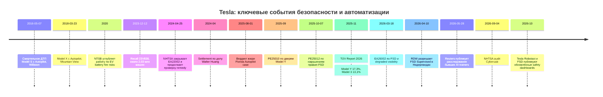

# DR26-10-30-HUB-02 — raw report from сис

> Unedited output of one model. Our reconciled synthesis is the page one level up.

# Насколько безопасны автомобили Tesla и их системы автоматизации вождения

## Исполнительное резюме и метод расследования

**Краткий вывод:** вопрос «безопасны ли Tesla?» нельзя корректно свести к одному вердикту. Независимые краш-тесты показывают, что современные Model 3 и Model Y имеют сильную пассивную безопасность; немецкие данные периодических техосмотров показывают заметно худшую эксплуатационную надёжность некоторых Model 3/Y того же возраста, чем у многих сопоставимых машин; риски аккумуляторных пожаров выглядят реже, чем у среднего американского автопарка, но прямое причинное сравнение затруднено разницей возраста парка и определений событий; электронные двери и аварийный выход представляют реальную, но плохо количефицированную проблему; исторический Autopilot имел установленные недостатки контроля внимания водителя; текущий FSD (Supervised) остаётся SAE Level 2 и требует постоянного надзора; Tesla Robotaxi нужно анализировать отдельно как driverless-сервис, где пока накоплено существенно меньше публично сопоставимого беспилотного пробега, чем у Waymo. citeturn632087search0turn632087search1turn918712search0turn748997view1turn602491search3

В этом отчёте термины используются строго. **Established / установлено** означает официальный вывод регулятора, подтверждённый отзыв, опубликованное решение суда или воспроизводимый независимый тест. **Emerging / формирующееся свидетельство** означает согласующиеся данные из нескольких источников, но без полного причинного доказательства. **Speculative / предположение** — правдоподобная, но не установленная гипотеза. **Fringe / unsupported** — утверждение, для которого проверяемая база отсутствует. Открытие расследования NHTSA само по себе не означает установленного дефекта; отзыв — не доказательство того, что каждая машина фактически проявила неисправность; settlement — не судебное признание ответственности; анонимный пост на форуме — не показатель распространённости.

Исследование ограничено публичным вебом по состоянию на **30 октября 2026 года**. Основной приоритет отдан NHTSA, NTSB, IIHS, Euro NCAP, TÜV, RDW, California DMV, Waymo и Tesla; вторичный — Reuters, AP, WIRED, Handelsblatt и профсоюзным первичным материалам. Форумы используются только как источники сценариев и свидетельств, не как частотные данные. После начала веб-поиска все интернет-проверяемые утверждения ниже снабжены источниками. PDF-документы NHTSA и Euro NCAP проверялись по их полным страницам, включая визуальное представление соответствующих страниц. citeturn767337view0turn767337view2turn767337view3turn767337view4turn767337view5

iturn126859image0turn126859image2turn126859image3turn126859image5

Главная картина выглядит так:

| Область | Наиболее защищённый вывод | Статус | Уверенность |
|---|---|---:|---:|
| Пассивная защита современных Model 3/Y | Очень сильная по IIHS/Euro NCAP | Established | Высокая |
| Надёжность Model 3/Y в немецкой когорте 2–3 лет | Хуже многих одногодков | Established | Высокая для Германии/этой когорты |
| Пожары | Публичные данные совместимы с более низкой частотой, чем у среднего автопарка США | Emerging | Средняя |
| Двери/эвакуация | Есть реальный failure mode при потере низковольтного питания и конструкционная неоднородность аварийных выходов | Established как сценарий | Высокая для наличия, низкая для частоты |
| Исторический Autopilot | Недостаточный контроль над неправильным использованием установлен регулятором и NTSB | Established | Высокая |
| FSD (Supervised) 2025–2026 | Мощная L2-система, но причинное преимущество в безопасности не доказано публичными данными | Emerging | Средняя |
| Tesla Robotaxi | Реально работает без человека в салоне в части ODD | Established | Высокая |
| Tesla Robotaxi против Waymo | Waymo имеет намного более зрелую публичную статистику L4 | Established по объёму данных | Высокая |

## Пассивная безопасность, качество, аккумуляторы и аварийный выход

Современные Tesla действительно показывают сильные результаты в стандартизированных краш-тестах. **2025 Model Y** имеет IIHS Top Safety Pick+ и оценки Good за малое фронтальное перекрытие, обновлённый moderate-overlap и обновлённый боковой тест; фары и предотвращение столкновений также получили Good. **2025 Model 3** получила Top Safety Pick: Good за small overlap и side, но лишь Acceptable за updated moderate overlap и фары, а напоминание о ремне — Marginal. **2025 Cybertruck** получил Top Safety Pick+, но награда распространяется только на машины, произведённые после апреля 2025 года. citeturn632087search0turn632087search1turn632087search2

Euro NCAP в 2025 году оценил Model 3 в пять звёзд: 90% защита взрослых, 93% детей, 89% vulnerable road users и 87% Safety Assist; рейтинг относится к конкретной сертифицированной конфигурации и методике 2025 года. citeturn748997view5turn632087search5 Это **не** доказательство низкой частоты ДТП в реальном движении: crashworthiness отвечает главным образом на вопрос «что происходит при стандартизированном столкновении», а не «насколько часто машина попадает в ДТП».

Совсем другая картина возникает при рассмотрении эксплуатационной надёжности в Германии. В TÜV Report 2026 среди автомобилей возрастом 2–3 года средняя доля существенных дефектов составляла 6,5%; у Model 3 — **13,1%**, у Model Y — **17,3%**, последняя оказалась худшей в этой возрастной группе. TÜV SÜD отдельно указывает на тормозные диски и элементы подвески; одновременно обе Tesla имели пробег более 50 000 км, что выше, чем у многих ровесников. citeturn918712search0turn918712search1

Это сильное доказательство **проблем эксплуатационного качества в данной немецкой выборке**, но не доказательство большей аварийности. Результат нельзя автоматически переносить на новые рестайлинговые Model Y 2025–2026 годов, автомобили из США или на все заводы производства: возраст, пробег, климат, техобслуживание и конструктивные изменения различаются. citeturn918712search1

По пожарам Tesla сообщает, что в глобальном парке 2012–2024 годов известное событие возгорания приходилось примерно на **140 млн миль**, тогда как сопоставляемый компанией американский общий автопарк — примерно одно событие на 17 млн миль. Tesla учитывает и пожары, не возникшие в самой машине, включая поджоги, лесные и структурные пожары. citeturn918712search2 Арифметически это выглядит примерно как восьмикратная разница, но **не является причинной оценкой**: парк Tesla значительно моложе среднего американского автопарка, глобальная Tesla-выборка сравнивается с американским смешанным парком, а исходные individual-level данные Tesla не опубликованы для независимого аудита. Независимый Plug In America прямо отмечает эту методологическую проблему. citeturn918712search3

Следовательно, сильнейшая формулировка в пользу Tesla — «публичные агрегаты совместимы с тем, что Tesla реже вовлекаются в пожары, чем средний автомобиль». Более сильная формулировка «Tesla в восемь раз пожаробезопаснее сопоставимого автомобиля того же возраста» не доказана.

Отдельный риск — поведение повреждённой литий-ионной батареи после тяжёлой аварии. В расследовании Mountain View 2018 года высоковольтная батарея Model X была пробита и после удара возник пожар; NTSB в более широких исследованиях EV также обращал внимание на thermal runaway и повторные возгорания как риск для спасателей. citeturn632087search4 Это проблема класса литий-ионных EV, а не уникальная особенность Tesla.

**Двери и эвакуация** требуют особенно точного разделения. NHTSA в PE25010 расследует Model Y 2021 модельного года из-за сообщений о потере работы наружных электронных ручек при низком напряжении 12 В. К 27 октября 2025 года агентство получило 16 таких сообщений; в четырёх родители утверждали, что были вынуждены разбить стекло для доступа к ребёнку. Это именно **allegation under investigation**, а не установленная частота отказов во всём парке. citeturn748997view4turn767337view4

В этом вопросе часто смешивают три разные проблемы: отказ наружной ручки при потере питания, невозможность пассажира найти/использовать механический аварийный выход изнутри и физическое заклинивание двери после деформации кузова. Эти механизмы нельзя считать одним дефектом. Модель, модельный год и конкретная конструкция двери критичны; если год выпуска не указан, его следует считать **неуказанным**.

## Autopilot и FSD: что установлено, а что пока нельзя доказать

Tesla сама и регуляторы классифицируют обычный Autopilot и FSD (Supervised) как **SAE Level 2**: автомобиль может одновременно управлять рулём и скоростью, но водитель остаётся ответственным за динамическую задачу движения, обязан наблюдать дорогу и быть готовым немедленно вмешаться. Tesla прямо говорит, что FSD (Supervised) не делает машину автономной; доступные функции зависят от аппаратной платформы, ПО, региона, модели, комплектации и модельного года. citeturn304141search3turn918712search6

В Нидерландах RDW 10 апреля 2026 года одобрил европейскую версию FSD Supervised только как **driver-controlled assistance system**, после более чем полутора лет испытаний. Водитель обязан следить за дорогой и оставаться готовым взять управление; RDW также подчёркивает, что американская и европейская версии программного обеспечения не сопоставимы один к одному. citeturn602491search0 В июне 2026 года RDW раскрыл более подробную методику: более 3 000 часов испытаний, свыше 1 000 тестовых прогонов и 1,8 млн км европейских данных, включая разные типы дорог и погодные условия. citeturn602491search4 Это сильное контрдоказательство тезису, что FSD вообще не подвергалась независимой регуляторной проверке; но типовое одобрение не является доказательством того, что FSD безопаснее среднего внимательного человека во всех условиях.

Исторический Autopilot имеет более жёсткую доказательную базу. В ДТП 7 мая 2016 года во Флориде NTSB установил сочетание непредоставления преимущества грузовиком, невнимательности водителя Tesla из-за чрезмерной уверенности в автоматизации и конструкции, допускавшей длительное disengagement водителя от задачи вождения. citeturn632087search3 В аварии Model X 23 марта 2018 года в Mountain View NTSB указал, что Autopilot направил машину в gore area из-за системных ограничений, водитель не вмешался из-за отвлечения и overreliance, а неработающий crash attenuator увеличил тяжесть последствий. citeturn632087search4

В декабре 2023 года Tesla подала отзыв 23V-838 на **2 031 220** автомобилей; в документе Tesla признала, что «prominence and scope» системных контролей в некоторых обстоятельствах могут быть недостаточными для предотвращения неправильного использования. citeturn748997view0turn767337view0 NHTSA в апреле 2024 года, закрывая EA22002 и открывая последующую Recall Query, пришло к выводу, что недостаточные controls могут способствовать предсказуемому disengagement водителя и предотвращаемым авариям. citeturn748997view1turn767337view1 При этом это вывод о историческом Autopilot и его driver-engagement architecture; его нельзя без проверки переносить на каждую FSD-сборку 2026 года.

NHTSA затем выявило 20 ДТП в автомобилях с уже установленным remedy 23V838 и открыло RQ24009 для проверки эффективности исправления. Это **не означает**, что remedy вызвал эти аварии; означает только, что агентство не считало вопрос закрытым. citeturn632087search8turn632087search9

Для непосредственно FSD действуют два особенно важных современных расследования. **PE25012**, открытое 7 октября 2025 года, охватывает все Tesla с FSD (Beta) или FSD (Supervised) и оценивает сообщения о проезде красного и движении против направления потока. Исходный файл перечисляет 58 инцидентов, 14 ДТП, 10 injury incidents и 23 заявленные травмы; оценочная популяция — 2 882 566 автомобилей. citeturn748997view3turn767337view3 Это знаменатель автомобилей, а не пробега; делить 14 на 2,88 млн и называть результат «аварийностью FSD» методологически неправильно.

**EA26002**, открытое 18 марта 2026 года, изучает способность FSD распознавать деградацию видимости — блики, туман, пыль и сходные условия. В исходном файле девять ДТП, два injury incidents и один смертельный исход; NHTSA оценивает исследуемую популяцию в 3 203 754 машины. Агентство также пишет, что ограничения внутренних данных Tesla могли привести к недоучёту части событий, а обновление системы degradation detection потенциально могло повлиять на три из девяти известных событий. citeturn748997view2turn918712search5turn767337view2 Статус: **emerging concern under active engineering analysis**, не окончательный дефектный вердикт.

### Аудит статистики Tesla

В 2026 году Tesla публикует FSD Vehicle Safety Report, в котором заявляет кратно меньшую частоту «major», «minor» и off-highway collisions при включённом FSD по сравнению с оценочным американским средним. Компания раскрывает, что использует телеметрию, trip-level mileage, road classifications и collision-triggered VIN-associated packets; одновременно признаёт, что потеря связи или повреждение коммуникационных систем могут привести к отсутствию события в данных. citeturn304141search2

Проблема заключается не в арифметике, а в **causal inference**. Чтобы доказать, что FSD *причинно* снижает риск, нужно сравнивать одинаковые дороги, время суток, погоду, возраст автомобиля, водителей, интенсивность движения, hardware generation, скорость, тип поездки и propensity to activate FSD. Публичный отчёт Tesla не предоставляет достаточной информации для полного контроля этих факторов. citeturn304141search2turn602491news5

Reuters 28 мая 2026 года опросил девять бывших data labelers и одного бывшего инженера автономного вождения и привлёк внешних исследователей для анализа статистики. Материал указывает на несопоставимость некоторых Tesla endpoints с федеральными базами, разницу возраста парка и отсутствие независимой публикации исходных данных; Reuters сообщает, что 10 из 11 опрошенных исследователей сочли ключевые сравнения проблемными. Это независимое журналистское расследование, а не peer-reviewed meta-analysis, поэтому его нельзя считать окончательным статистическим приговором. citeturn602491news5

Сильнейший аргумент Tesla в ответ состоит в том, что внутри собственного connected fleet она имеет единообразный телеметрический сбор данных и может регистрировать события, которые другие производители вообще не видят. Tesla справедливо отмечает, что абсолютное число SGO-отчётов нельзя сравнивать между брендами без знаменателя пробега и размера парка. citeturn304141search2 Это хороший аргумент против грубого сравнения raw crash counts, но не устраняет selection bias между режимом FSD и manual driving.

Минимальный набор отсутствующих переменных для строгой оценки таков:

| Переменная | Публично достаточна? | Почему важна |
|---|---:|---|
| Дорога / functional class | Частично | Риск freeway ≠ urban arterial |
| Погода | Нет в требуемой детализации | Камеры и человеческое зрение зависят от условий |
| Возраст автомобиля | Нет | Новый парк Tesla не эквивалентен среднему парку США |
| HW3/HW4 | Недостаточно | Разные compute/sensor pipelines |
| FSD software branch | Недостаточно | v12/v13/v14 могут существенно различаться |
| Driver selection | Нет | Пользователи FSD не случайная выборка |
| Disengagements / interventions | Нет в crash dashboard | Предотвращённая водителем авария не становится crash |
| Пяти-/30-секундные attribution windows | Частично | Определение exposure влияет на числитель |
| Injury severity | Ограниченно | Airbag deployment ≠ injury ≠ tow-away |
| Независимая VIN-level валидация | Нет | Нельзя провести внешний audit |

Поэтому фраза «FSD в X раз безопаснее человека» должна маркироваться как **не установленный причинный вывод**, даже если арифметическое отношение на корпоративной странице существует.

## Настоящие беспилотные сервисы и корректное сравнение с Waymo

Tesla Robotaxi нельзя смешивать с потребительским FSD. В Robotaxi Tesla публикует отдельный отчёт по поездкам без safety monitor в автомобиле, включая случаи, когда remote operator помогает или берёт управление; период отчёта начинается 22 января 2026 года. На странице, просмотренной 30 октября 2026 года, live counter показывал 3,95 млн автономных миль, тогда как методологический блок фиксировал **3,1 млн миль по состоянию на 18 октября** и распределение по городам Техаса и Флориды. citeturn304141search0

Tesla сообщает ноль случаев в трёх выбранных категориях за опубликованный период: injuries в столкновениях, где Robotaxi совершил first contact, собственных airbag deployments и first-contact pedestrian/cyclist collisions. Но это **не означает ноль столкновений**: сама методика говорит о SGO-reportable collisions, а public NHTSA data включает и события с safety monitor, исключённые из нового «чистого автономного» знаменателя. citeturn304141search0

WIRED в мае 2026 года сообщил о 17 тогда раскрытых SGO-событиях Tesla Robotaxi за июль 2025 — март 2026 года; минимум в двух remote operators непосредственно управляли машинами при низкоскоростном столкновении с ограждением или строительным барьером. В этих двух случаях safety monitor находился внутри, поэтому они не принадлежат к позднему driverless-only знаменателю Tesla. citeturn304141search4 Это важное различие: утверждение «Tesla Robotaxi никогда не сталкивался» ложно, но утверждение «в driverless-only периоде Tesla не зарегистрировала injury-first-contact events по своей методике» соответствует отчёту компании. citeturn304141search0turn304141search4

Waymo по состоянию на июнь 2026 года публиковала **271,3 млн rider-only miles**, то есть без человека-водителя в автомобиле. Компания заявляет по сопоставленным городским benchmark’ам 0,67 injury-reported crash на миллион миль против 3,77 у человеческого benchmark, 0,01 serious-injury-or-worse против 0,21 и 0,29 airbag-deployment-in-any-vehicle против 1,61. citeturn602491search3 Эти данные также корпоративные и наблюдательные, а не randomized trial, но Waymo раскрывает географию, endpoints, интервалы и соответствующие benchmark rates значительно подробнее.

Прямое сравнение Tesla Robotaxi и Waymo должно делаться только в сходной ODD. Нельзя сравнивать потребительский FSD на любой доступной дороге США с geofenced Waymo L4. Нельзя также сравнивать все driverless miles Tesla с одной конкретной городской выборкой Waymo без учета города, скорости, дождя, ночи и road class. citeturn602491search3turn304141search0

California DMV на 21–22 октября 2026 года показывает Tesla Robotaxi LLC только в списке **testing with a driver**; Tesla не фигурирует среди держателей California driverless testing или deployment permit. Waymo находится среди driverless/deployment holders. citeturn304141search5 Поэтому наличие driverless Tesla в Техасе нельзя переносить на Калифорнию.

NHTSA 4 сентября 2026 года отдельно открыло Audit Query по самосертификации Cybercab, поскольку автомобиль не имеет традиционных человеческих органов управления. Это **audit of compliance**, а не вывод о нарушении. citeturn632087search6

## Сотрудники, сервис, информаторы, профсоюзы и форумы

Здесь особенно важно отделять **проверенную личность**, **проверенную занятость** и **проверку технического утверждения**. Ни одно из перечисленного ниже не является интервью, проведённым в рамках данного исследования.

| Источник | Страна / роль | Что утверждается | Проверка личности/занятости | Корроборация | Статус |
|---|---|---|---|---|---|
| 9 бывших Tesla data labelers, Reuters 28.05.2026 | США | Сообщали о проблемах в edge cases, включая school buses, emergency vehicles, pedestrians, animals; часть критиковала safety claims | Имена в публикации не раскрыты; Reuters заявляет о проверке трудового статуса | Совпадает с рядом официальных edge-case расследований, но не доказывает частоту | **Anonymous, multi-source, emerging** citeturn602491news5 |
| Бывший инженер self-driving, Reuters | США | Критика внутренних/публичных метрик | Анонимный, редакционно проверенный Reuters | Методологические претензии частично подтверждаются публичной структурой Tesla report | **Anonymous, single-source identity, emerging** citeturn602491news5turn304141search2 |
| Lukasz Krupski | Норвегия / бывший сервис-техник Tesla | Сообщал о внутренних safety/data-protection проблемах и передал Handelsblatt Tesla Files | Имя, стаж и судебные споры публично документированы | Норвежский суд подтвердил незаконность части обращения с ним; суд не устанавливал общую дефектность FSD | **Verified identity; allegations partly corroborated, scope limited** citeturn601717search7turn601717search8 |
| IG Metall / работники Grünheide | Германия | Перегрузка, understaffing, давление на профсоюзную деятельность | Профсоюз и завод публичны; отдельные сотрудники частично названы | Tesla сообщала о ~80% удовлетворённости в собственной survey, что является контрдоказательством | **Established labor dispute; safety causality unproven** citeturn601717search2turn601717search0 |
| IG Metall election challenge | Германия | Утверждение о вмешательстве компании в выборы works council | Официальная жалоба профсоюза | Это allegation pending legal resolution; Tesla отвергала ряд обвинений | **Allegation, not judgment** citeturn601717search4turn601717search5 |
| IF Metall | Швеция / сервис Tesla | Трёхлетний конфликт по collective agreement завершён после выкупа договоров бастовавших членов | Официальный профсоюз, подтверждено Reuters | Tesla утверждала, что её условия не хуже требуемых профсоюзом | **Established labor event; not vehicle-safety evidence** citeturn601717search6 |
| Reddit Model Y 2026, FSD 14.3.5 | Австралия | Автор утверждает, что затормозил, чтобы избежать удара в остановившуюся машину | Анонимный; VIN и телеметрия не проверены | Сходный сценарий встречается у других пользователей, но prevalence неизвестна | **Anonymous lead only** citeturn798573reddit45 |
| Reddit Model Y, FSD 14.3.7 | Неуказанная страна | Автор утверждает, что FSD уклонился от перестраивающейся машины | Анонимный; видео может показать движение, но не контрфактический исход | Несколько положительных video anecdotes | **Anonymous lead only** citeturn798573reddit46turn798573reddit48 |
| Reddit Model Y 2026, FSD 14.3.9 | Австралия | Автор утверждает, что предотвратил столкновение с парковочной колонной | Анонимный | Никакой независимой телеметрии | **Anonymous single-source** citeturn798573reddit51 |
| Blind | Международно | Публично доступны Tesla/FSD-дискуссии, но найденные материалы не дают одновременно надёжно проверяемой Tesla-занятости и технического доказательства | Blind сам объясняет employer re-verification для private channels, но публичные страницы не дают достаточной проверки каждого автора | Недостаточно | **Lead only / not used quantitatively** citeturn798573search3turn798573search4 |
| Tesla Motors Club | Международно | Активная pro-Tesla owner community с критикой и поддержкой FSD | Публичные авторы, employment generally unspecified | Полезно для discovery, не prevalence | **Forum lead only** citeturn798573search1turn798573search18 |

Reuters’овское расследование сотрудников важно, но имеет естественный selection problem: data labelers могут по должности видеть непропорционально много неудачных и редких сцен. Это сильнейший контраргумент против прямого переноса их впечатлений на среднюю поездку. citeturn602491news5 Обратная ошибка — считать многотысячемильный безаварийный опыт владельца доказательством отсутствия tail risk. Редкие опасные события могут сосуществовать с очень высокой средней успешностью.

Профсоюзные свидетельства из Германии и Швеции полезны для оценки организационной культуры и условий труда, но **не являются доказательством дефектности автомобилей**, пока не показана причинная связь между конкретной производственной практикой и измеримым safety outcome. Reuters в Германии приводит и позицию Tesla: руководство оспаривает профсоюзную трактовку и указывает на внутренний опрос удовлетворённости. citeturn601717search2turn601717search0

## Хронология и матрица «утверждение — доказательства — контрдоказательства»

Хронологические точки подтверждаются NTSB, NHTSA, TÜV, RDW, Reuters и корпоративными отчётами; диаграмма не показывает causal relationships. citeturn632087search3turn632087search4turn748997view0turn748997view3turn748997view2turn918712search0turn602491search0turn602491news5turn632087search6turn304141search0

| Утверждение | Доказательства | Контрдоказательства / ограничения | Оценка |
|---|---|---|---|
| «Современные Tesla хорошо защищают людей при ударе» | IIHS и Euro NCAP дают сильные оценки Model 3/Y; Cybertruck TSP+ после апреля 2025 | Не все годы и комплектации одинаковы; краш-тест ≠ частота аварий | **Established** citeturn632087search0turn632087search1turn632087search2turn748997view5 |
| «Tesla имеют плохую надёжность» | TÜV 2026: 13,1% Model 3 и 17,3% Model Y против 6,5% среднего | Выборка — Германия, возраст 2–3 года; высокий пробег; не новые поколения | **Established для когорты, не универсально** citeturn918712search0turn918712search1 |
| «Tesla почти не горят» | Корпоративно: 1 fire event / 140 млн миль | Нет like-for-like контроля возраста и географии; raw events не опубликованы | **Emerging** citeturn918712search2turn918712search3 |
| «Двери опасны после потери питания» | NHTSA PE25010, 16 reports по MY2021 Model Y | Расследование, не окончательный дефектный finding; речь в основном о наружном доступе | **Established failure scenario, frequency unknown** citeturn748997view4 |
| «Autopilot исторически плохо предотвращал misuse» | NTSB 2016/2018, recall 23V838, EA22002 | Системы позже изменялись | **Established historically** citeturn632087search3turn632087search4turn748997view1 |
| «Нынешний FSD опасен» | Активны PE25012 и EA26002; документированы crash cases | Нет корректного denominator для универсального вывода | **Не установлено универсально** citeturn748997view2turn748997view3 |
| «Нынешний FSD безопаснее человека» | Tesla telemetry показывает существенно более низкие rates | Self-selection, road mix, vehicle age, endpoint mismatch, нет независимого raw audit | **Association established; causal magnitude unproven** citeturn304141search2turn602491news5 |
| «FSD — self-driving» | Название может создавать такое впечатление | Tesla, NHTSA и RDW прямо называют систему supervised L2/driver assistance | **False для потребительского FSD** citeturn304141search3turn918712search6turn602491search0 |
| «Robotaxi Tesla уже driverless» | Tesla публикует no-safety-monitor miles; сервис работает в ряде городов | ODD ограничена; remote assistance учитывается | **Established в конкретной ODD** citeturn304141search0 |
| «Tesla Robotaxi безопаснее Waymo» | Недостаточно данных для такого вывода | Waymo имеет гораздо больший driverless denominator и более зрелую методику | **Speculative** citeturn304141search0turn602491search3 |
| «Суды признали Autopilot дефектным» | Florida jury 2025 возложило часть ответственности на Tesla; judge upheld verdict in Feb 2026 | Tesla выигрывала другие Autopilot trials; settlement ≠ judgment | **False как универсальное утверждение** citeturn181467news47turn181467search2turn181467search15 |

Судебная практика особенно хорошо показывает опасность бинарного вывода. Tesla выиграла калифорнийские дела 2023 года, где присяжные не нашли, что Autopilot был причиной или defect в конкретных обстоятельствах. citeturn181467search2turn181467search9 Семья Walter Huang достигла settlement в 2024 году — это **не judgment** об ответственности. citeturn181467search15 В августе 2025 года федеральные присяжные во Флориде присудили \$243 млн в деле о смертельном ДТП 2019 года, возложив на Tesla часть compensatory liability и punitive damages; 20 февраля 2026 года судья отказалась отменить вердикт. Tesla продолжала утверждать, что основной причиной было reckless driver behavior, и оспаривала punitive component. citeturn181467search1turn181467news47

Это означает не «суды доказали опасность Autopilot», а то, что **исход зависит от конкретной версии системы, фактов ДТП, предупреждений, поведения водителя и применимого права**.

## Источники, пробелы данных, NotebookLM и итоговый рейтинг уверенности

Ниже — **32 ключевых источника**. Корпоративные Tesla/Waymo материалы являются первичными, но не независимыми; официальные регуляторы и независимые испытательные организации отделены от журналистских и заинтересованных сторон.

**Основной реестр источников**

| Источник | Дата / статус | Тип | URL |
|---|---|---|---|
| IIHS — Tesla Model Y 2025 | актуально на 30.10.2026 | независимый тест | https://www.iihs.org/ratings/vehicle/tesla/model-y/2025 |
| IIHS — Tesla Model 3 2025 | актуально | независимый тест | https://www.iihs.org/ratings/vehicle/tesla/model-3/2025 |
| IIHS — Cybertruck 2025 | актуально | независимый тест | https://www.iihs.org/ratings/vehicle/tesla/cybertruck-crew-cab-pickup/2025 |
| Euro NCAP Model 3 2025 | 21.05.2025 | независимый тест | https://cdn.euroncap.com/media/87591/euroncap-2025-tesla-model-3-datasheet.pdf |
| TÜV Report 2026 | 2025 | независимые техосмотры | https://www.tuev-verband.de/presse/publikationen/reporte/tuev-report-autobild |
| TÜV SÜD EV analysis | 11.2025 | независимый технадзор | https://www.tuvsud.com/en/newsroom/press-releases/2025/november/used-e-vehicles-are-keeping-up-where-safety-is-concerned |
| NTSB Williston | расследование ДТП 2016 | регулятор | https://www.ntsb.gov/investigations/Pages/HWY16FH018.aspx |
| NTSB Mountain View | расследование ДТП 2018 | регулятор | https://www.ntsb.gov/investigations/Pages/HWY18FH011.aspx |
| NHTSA Recall 23V838 | 12.12.2023 | регулятор / recall | https://static.nhtsa.gov/odi/rcl/2023/RCLRPT-23V838-8276.PDF |
| NHTSA EA22002 closure material | 25.04.2024 | регулятор | https://static.nhtsa.gov/odi/inv/2022/INCR-EA22002-14496.pdf |
| NHTSA RQ24009 info request | 06.05.2024 | регулятор | https://static.nhtsa.gov/odi/inv/2024/INIM-RQ24009-12199.pdf |
| NHTSA PE25012 | 07.10.2025 | регулятор | https://static.nhtsa.gov/odi/inv/2025/INOA-PE25012-19171.pdf |
| NHTSA EA26002 | 18.03.2026 | регулятор | https://static.nhtsa.gov/odi/inv/2026/INOA-EA26002-10023.pdf |
| NHTSA PE25010 | 27.10.2025 letter | регулятор | https://static.nhtsa.gov/odi/inv/2025/INIM-PE25010-23199.pdf |
| NHTSA Cybercab audit | 04.09.2026 | регулятор | https://www.nhtsa.gov/press-releases/investigation-tesla-cybercab-self-certification |
| California DMV AV permits | 21–22.10.2026 | регулятор | https://www.dmv.ca.gov/portal/vehicle-industry-services/autonomous-vehicles/autonomous-vehicle-testing-permit-holders/ |
| RDW FSD approval | 10.04.2026 | регулятор | https://www.rdw.nl/en/news/2026/rdw-explanation-of-european-type-approval-tesla-with-provisional-validity-in-the-netherlands |
| RDW methodology | 17.06.2026 | регулятор | https://www.rdw.nl/en/news/2026/explanation-of-the-type-approval-of-fsd-supervised |
| Tesla FSD Safety Report | актуально 30.10.2026 | корпоративный primary | https://www.tesla.com/fsd/safety |
| Tesla FSD Support | актуально | corporate primary | https://www.tesla.com/support/fsd |
| Tesla Vehicle Fire Data | данные до 2024 | corporate primary | https://www.tesla.com/en_gb/VehicleFireSafetyReport |
| Tesla Robotaxi Safety Report | данные до 18.10.2026 | corporate primary | https://www.tesla.com/robotaxi/safety |
| Waymo Safety Impact | данные до 06.2026 | corporate primary | https://waymo.com/safety/impact/ |
| Reuters — former AI trainers | 28.05.2026 | журналистское расследование | https://www.reuters.com/investigations/why-teslas-ai-trainers-dont-trust-its-self-driving-tech-or-its-safety-stats-2026-05-28/ |
| Reuters — EU/RDW pressure | 07.10.2026 | журналистское расследование | оригинал Reuters, зеркала доступны через агрегаторы |
| WIRED — Tesla Robotaxi crashes | 15.05.2026 | журналистское расследование | https://www.wired.com/story/tesla-reveals-new-details-about-robotaxi-crashes-and-the-humans-involved/ |
| Handelsblatt — Krupski judgment | 11.12.2024 | журналистика / суд | https://www.handelsblatt.com/unternehmen/industrie/autobauer-tesla-muss-whistleblower-lukasz-krupski-entschaedigung-zahlen/100094225.html |
| Handelsblatt — Krupski Supreme Court | 08.04.2026 | журналистика / суд | https://www.handelsblatt.com/unternehmen/energie/tesla-files-whistleblower-gewinnt-vor-dem-obersten-gerichtshof-norwegens-gegen-tesla-01/100214601.html |
| IG Metall — election challenge | 25–26.03.2026 | профсоюзный primary | https://www.igmetall.de/en/presse/pressemitteilungen/ig-metall-ficht-betriebsratswahl-bei-tesla-an |
| Reuters — Grünheide works council | 04.03.2026 | журналистика | доступен через Reuters-синдикацию |
| Reuters — IF Metall ends strike | 13.08.2026 | журналистика | доступен через Reuters-синдикацию |
| Reddit FSD near miss | 09.09.2026 | анонимный форум, lead only | https://www.reddit.com/r/TeslaFSD/comments/1wbi7lw/tesla_fsd_near_miss/ |

Из этих материалов **NHTSA/NTSB/IIHS/Euro NCAP/TÜV/RDW/California DMV** являются наиболее важными независимыми или государственными источниками. Tesla и Waymo нужны для собственных метрик компаний, но не должны считаться независимым подтверждением этих метрик. Reuters, Handelsblatt и WIRED дают ценное расследовательское дополнение и свидетельства сотрудников, но не заменяют первичные crash databases.

**Рекомендуемый набор из 18 первичных документов для NotebookLM**

1. https://static.nhtsa.gov/odi/rcl/2023/RCLRPT-23V838-8276.PDF  
2. https://static.nhtsa.gov/odi/inv/2022/INCR-EA22002-14496.pdf  
3. https://static.nhtsa.gov/odi/inv/2024/INIM-RQ24009-12199.pdf  
4. https://static.nhtsa.gov/odi/inv/2025/INOA-PE25012-19171.pdf  
5. https://static.nhtsa.gov/odi/inv/2026/INOA-EA26002-10023.pdf  
6. https://static.nhtsa.gov/odi/inv/2025/INIM-PE25010-23199.pdf  
7. https://www.ntsb.gov/investigations/Pages/HWY16FH018.aspx  
8. https://www.ntsb.gov/investigations/Pages/HWY18FH011.aspx  
9. https://www.iihs.org/ratings/vehicle/tesla/model-y/2025  
10. https://www.iihs.org/ratings/vehicle/tesla/model-3/2025  
11. https://cdn.euroncap.com/media/87591/euroncap-2025-tesla-model-3-datasheet.pdf  
12. https://www.tuev-verband.de/presse/publikationen/reporte/tuev-report-autobild  
13. https://www.rdw.nl/en/news/2026/explanation-of-the-type-approval-of-fsd-supervised  
14. https://www.dmv.ca.gov/portal/vehicle-industry-services/autonomous-vehicles/autonomous-vehicle-testing-permit-holders/  
15. https://www.tesla.com/fsd/safety  
16. https://www.tesla.com/robotaxi/safety  
17. https://www.tesla.com/en_gb/VehicleFireSafetyReport  
18. https://waymo.com/safety/impact/  

**Ключевые пробелы данных:** нет публичного VIN-level независимого аудита Tesla collision telemetry; недостаточно данных по FSD crash rates отдельно для HW3/HW4 и конкретных software branches; нет полноценного matched-route dataset FSD vs manual; disengagement/intervention exposure не раскрыт на уровне, позволяющем корректировать collision rate; пожары не опубликованы с достаточной стратификацией по возрасту, модели и причине; по дверям отсутствует адекватный denominator аварийных эвакуаций; TÜV ещё не даёт зрелой многолетней картины для самых новых поколений Model 3/Y; Robotaxi Tesla пока имеет гораздо меньшую driverless exposure, чем Waymo. citeturn304141search2turn918712search2turn918712search0turn304141search0turn602491search3

**Итоговый уровень уверенности:** высокая уверенность в сильной пассивной безопасности новых Model 3/Y; высокая — в плохих TÜV-результатах некоторых 2–3-летних Model 3/Y в Германии; высокая — в исторических проблемах Autopilot driver monitoring; средняя — в том, что Tesla в среднем реже вовлекаются в пожары, чем смешанный американский автопарк; средняя — в том, что FSD реально снижает некоторые риски в части поездок; низкая — в любой точной формуле вида «FSD в N раз безопаснее человека»; средне-высокая — в том, что Waymo в своей ограниченной ODD уже показывает существенно более зрелую safety evidence base, чем Tesla Robotaxi. citeturn632087search0turn918712search0turn748997view1turn918712search2turn304141search2turn602491search3

## Нейтральный план подкаста на 40–43 минуты

**00:00–04:00 — «У Tesla нет одной безопасности».** Начать с парадокса: Model Y может одновременно иметь Top Safety Pick+ и быть последней в немецком TÜV по своей возрастной группе, потому что краш-защита и эксплуатационная надёжность измеряют разные вещи. Зафиксировать пять отдельных вопросов: crashworthiness, reliability, fire/egress, supervised automation и driverless services. citeturn632087search0turn918712search0

**04:00–09:00 — «Что происходит при ударе».** Разобрать IIHS и Euro NCAP для Model 3/Y; отдельно оговорить Cybertruck после апреля 2025 года. Steelman Tesla: инженерия кузова и restraint systems действительно конкурентоспособна. Steelman критиков: стандартизированный crash test не показывает реальную вероятность ДТП и не оценивает каждую аварийную геометрию. citeturn632087search0turn632087search1turn632087search2turn748997view5

**09:00–14:00 — «Когда новая машина стареет».** TÜV: 13,1% Model 3 и 17,3% Model Y; тормозные диски, подвеска, высокий пробег. Объяснить, почему эту статистику нельзя превращать в «Tesla в три раза чаще аварийны». citeturn918712search0turn918712search1

**14:00–18:00 — «Огонь и двери».** Tesla fire metric 140 млн миль; объяснить mismatch с американским fleet benchmark. Затем двери Model Y MY2021 и PE25010; чётко развести внешний доступ и внутреннюю эвакуацию. citeturn918712search2turn748997view4

**18:00–25:00 — «Autopilot: уроки 2016 и 2018 годов».** Williston и Mountain View; overreliance, driver monitoring, system limitations, road infrastructure. Затем recall 23V838 и RQ24009. Отдельно сказать, что исторические выводы нельзя автоматически переносить на FSD v14. citeturn632087search3turn632087search4turn748997view0turn632087search9

**25:00–31:00 — «FSD: что значит 9× безопаснее».** Объяснить observational vs causal claim, selection bias, road-type confounding, vehicle age, weather, intervention bias и endpoint mismatch. Сопоставить позицию Tesla с расследованием Reuters и документами PE25012/EA26002. citeturn304141search2turn602491news5turn748997view2turn748997view3

**31:00–36:00 — «Люди внутри системы».** Бывшие labelers Reuters, Krupski, IG Metall, IF Metall; объяснить, почему анонимность ограничивает доказательную силу, а трудовой конфликт не является safety finding. Добавить два противоположных Reddit-видео как примеры хвостовых сценариев — «FSD спас» и «водитель спас FSD» — с явной маркировкой anecdote. citeturn602491news5turn601717search7turn601717search4turn601717search6turn798573reddit45turn798573reddit46

**36:00–41:00 — «Robotaxi: Tesla против Waymo без подмены знаменателя».** Tesla no-safety-monitor mileage и remote operators; Waymo 271,3 млн rider-only miles; California permits. Главная идея: сравнивать только сходные ODD и endpoints. citeturn304141search0turn304141search4turn602491search3turn304141search5

**41:00–43:00 — «Что мы можем сказать без маркетинга и без алармизма».** Финальная формулировка: новые Tesla — сильные по пассивной безопасности; некоторые поколения Model 3/Y проблемны по эксплуатационной надёжности; исторический Autopilot имел установленные human-factors deficiencies; FSD остаётся supervised L2; Tesla Robotaxi уже является реальным driverless deployment в ограниченной ODD, но его доказательная база пока намного менее зрелая, чем у Waymo. citeturn632087search0turn918712search0turn748997view1turn304141search3turn304141search0turn602491search3